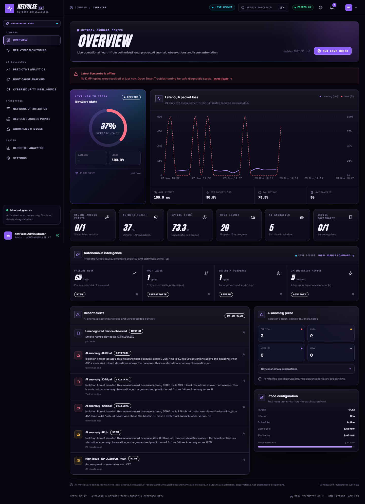
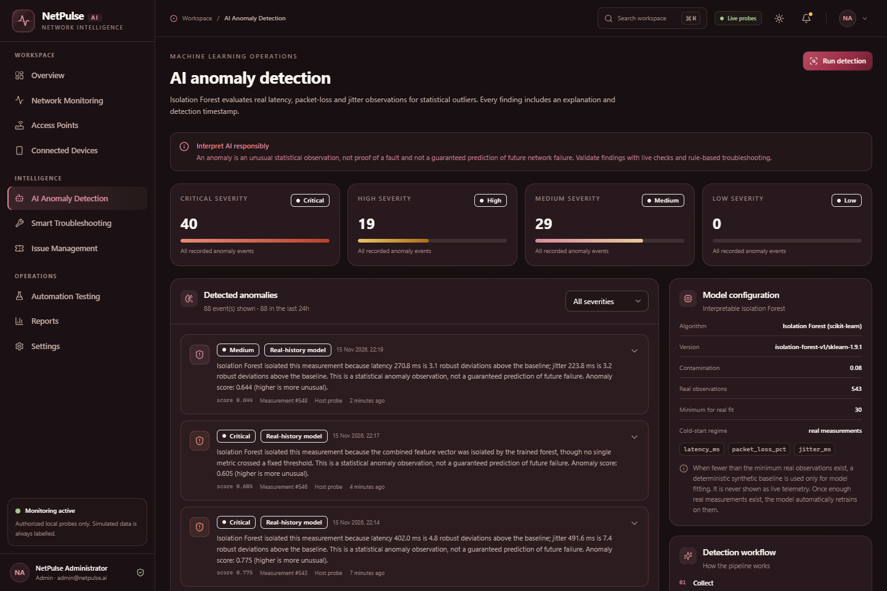
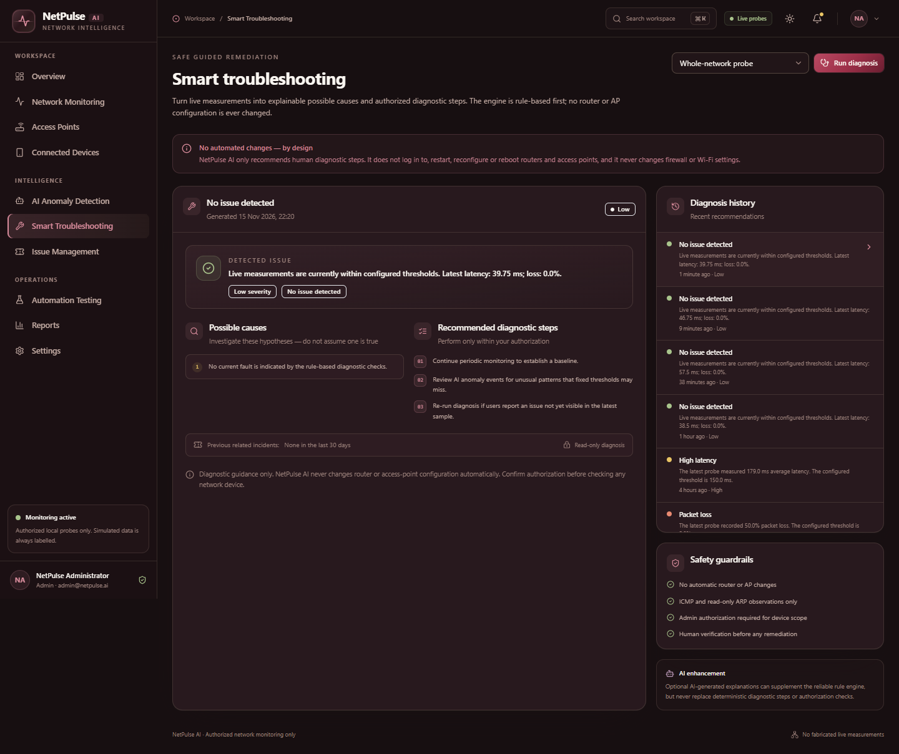
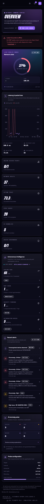

# NetPulse AI

**Autonomous Network Intelligence & Cybersecurity Platform**

A complete B.Sc. final-year project that combines real local network probing,
machine-learning anomaly detection, explainable failure-risk prediction,
root-cause analysis, defensive security intelligence, optimisation advisory,
device governance, automated incident ticketing, PDF/CSV reporting, live
WebSocket updates and a full automated test suite in one responsive web
application.

> **Live-data integrity:** NetPulse AI never invents live measurements or
> findings. Every probe result is a real operating-system network observation.
> Records created for demonstrations are explicitly labelled `simulation` and
> excluded from the live health index. Intelligence engines return an explicit
> `insufficient_data` state instead of fabricating a prediction, threat or
> optimisation gain.

---

## Overview

NetPulse AI monitors a Wi-Fi or hybrid network from an authorized Windows
machine and turns raw observations into actionable insight:

1. **Observe** — ICMP latency, packet loss and jitter are measured against a
   configurable target; the local ARP cache supplies read-only device visibility
   and the host interface supplies traffic counters.
2. **Detect** — an Isolation Forest model scores observations and explains each
   outlier using robust z-scores.
3. **Predict** — a transparent weighted model estimates 24-hour failure risk per
   scope and reports an explicit `insufficient_data` state when the window is too
   small.
4. **Investigate** — persisted evidence is converted into a probable cause,
   ranked hypotheses, confidence and safe next steps.
5. **Secure** — a defensive scanner reviews unapproved devices, failed sign-ins
   and access-point inventory, without port scans or offensive actions.
6. **Optimise** — measured loss, latency, jitter and availability are compared
   with thresholds to produce advisory recommendations with no invented gains.
7. **Act** — incidents become deduplicated tickets, notifications and audit
   entries with priorities, statuses and comments.
8. **Prove** — Pytest and Playwright suites verify the platform; JUnit results,
   PDF reports and CSV exports are available inside the application.

The application is built for a college lab or home network, requires no cloud
account for its core AI, and runs locally on Windows 11.

| Item | Value |
|---|---|
| Frontend | React 18, Vite 6, Tailwind CSS, Recharts, Axios, React Router |
| Backend | FastAPI, SQLAlchemy 2, Pydantic 2, JWT, Argon2 |
| AI | scikit-learn Isolation Forest, robust-z explanations and a transparent local risk model |
| Live transport | WebSocket push with automatic REST polling fallback |
| Database | SQLite (verified local default) · MySQL 8 (deployment schema included) · Prisma Postgres (production) |
| Testing | 103 Pytest tests · 21 Playwright E2E tests |
| Reports | 9 PDF report types and 4 intelligence CSV exports |
| Modules | 10 sidebar modules, legacy deep links, command palette and responsive shell |

---

## Screenshots

### Overview dashboard



### AI anomaly detection



### Smart troubleshooting



### Mobile layout



The full 17-image gallery (login, core modules, dialogs, light theme, command
palette, mobile navigation) is in
[`documentation/screenshots/`](documentation/screenshots/) and is referenced
throughout the project report. The newer intelligence modules are documented in
[chapter 09](documentation/09-autonomous-intelligence.md).

---

## Modules

| Module | What it provides |
|---|---|
| **Authentication** | JWT login, Argon2 password hashing, session restore, login throttling and attempt auditing, role-based access (admin / analyst / viewer). |
| **Overview** | Live health index, latency and packet-loss trends, AP state, device summary, intelligence roll-up, live-transport status, recent AI findings and alerts. |
| **Real-Time Monitoring** | Real OS probes with latency, jitter, loss and online state; scheduler status; live WebSocket updates with polling fallback; recent history and network identity information. |
| **Predictive Analytics** | Transparent 24-hour failure-risk estimates per scope, weighted feature breakdown, confidence, telemetry availability and explicit insufficient-data states. |
| **Root Cause Analysis** | Investigation queue built from measured evidence: probable cause, ranked hypotheses, confidence, safe diagnostic actions and acknowledge/resolve/reopen workflow. |
| **Cybersecurity Intelligence** | Defensive findings for unapproved devices, failed sign-in bursts and AP inventory; posture score, evidence, recommended response and analyst workflow. No offensive scanning. |
| **Network Optimization** | Advisory recommendations from measured loss, latency, jitter and availability thresholds, with evidence, confidence and no fabricated expected gains. |
| **Devices & Access Points** | Read-only ARP-cache discovery with SHA-256 hashed identity and approval workflow, plus authorized AP CRUD, availability checks and configuration history from the legacy inventory link. |
| **Anomalies & Issues** | Isolation Forest anomaly register with robust-z explanations and the issue register with tickets, priorities, comments and workflow. |
| **Reports & Analytics** | Nine PDF report types plus four intelligence CSV exports, generated from real stored data, with a report library and authenticated download. |
| **Settings** | Runtime latency/loss thresholds, automation toggles, theme and organisation settings, team administration and system diagnostics. |

The sidebar contains exactly these ten labels: **Overview**, **Real-Time
Monitoring**, **Predictive Analytics**, **Root Cause Analysis**, **Cybersecurity
Intelligence**, **Network Optimization**, **Devices & Access Points**,
**Anomalies & Issues**, **Reports & Analytics** and **Settings**. The legacy
routes `/access-points`, `/troubleshooting`, `/issues` and `/testing` remain
reachable through the command palette and direct links.

The shell also includes a command palette (`Ctrl+K`), notification centre,
theme switch, live-transport pill, user menu and a responsive mobile drawer.

---

## Architecture

```text
┌──────────────────────────────────────────────────────────────────────────┐
│ Browser (React 18 + Vite + Tailwind + Recharts)                          │
│  Login · Overview · Monitoring · Predictive · RCA · Security             │
│  Optimisation · Devices & APs · Anomalies & Issues · Reports · Settings   │
│  WebSocket live feed with REST polling fallback                          │
└───────────────────────────────┬──────────────────────────────────────────┘
                                │ HTTPS/JSON · JWT Bearer · WSS
┌───────────────────────────────▼──────────────────────────────────────────┐
│ FastAPI backend                                                          │
│  Routers → Services → SQLAlchemy models → SQLite / MySQL / Postgres       │
│                                                                          │
│  Monitoring scheduler ──► OS ICMP probe ──► network_measurements         │
│  Isolation Forest ──────► anomaly_events ──► ticket automation           │
│  Risk model ────────────► prediction_results ──► notifications           │
│  RCA rules ─────────────► root_cause_investigations ──► notifications    │
│  Defensive scanner ─────► security_events ──► notifications              │
│  Optimisation engine ───► optimization_recommendations ──► notifications │
│  Live hub ──────────────► WebSocket broadcast / REST snapshot            │
│  Rule engine ───────────► troubleshooting_recommendations                │
│  ARP adapter ───────────► devices + device_activity                      │
│  ReportLab ─────────────► PDF reports · CSV export                       │
│  Pytest runner ─────────► JUnit XML ──► automated_test_results           │
└───────────────────────────────┬──────────────────────────────────────────┘
                                │
┌───────────────────────────────▼──────────────────────────────────────────┐
│ SQLite (local) · MySQL 8 (deployment) · Prisma Postgres (production)     │
│ 20 domain tables + schema_migrations                                     │
└──────────────────────────────────────────────────────────────────────────┘
```

Detailed architecture, sequence diagrams, DFDs and deployment views are in
[`documentation/02-system-architecture.md`](documentation/02-system-architecture.md)
and [`documentation/04-uml-and-process-models.md`](documentation/04-uml-and-process-models.md).

---

## Quick start (Windows 11)

### Prerequisites

- **Python 3.11+** — <https://www.python.org/downloads/> (enable *Add python.exe to PATH*)
- **Node.js 18 LTS+** — <https://nodejs.org/>
- **Google Chrome** — required by the Playwright suite on this machine because
  the bundled headless shell is blocked by an Application Control policy
- Optional: **MySQL 8** and **Docker Desktop** for the MySQL deployment path

### One-command setup

From the `NetPulse-AI` folder:

```powershell
powershell -ExecutionPolicy Bypass -File .\scripts\setup.ps1
```

The script:

- verifies Python and Node versions;
- creates `backend\.venv` and installs `backend\requirements.txt`;
- creates `backend\.env` from the example with a random JWT secret and a random
  administrator password (it never overwrites an existing `.env`);
- installs frontend dependencies;
- prints the administrator credentials once.

### Run the application

```powershell
powershell -ExecutionPolicy Bypass -File .\scripts\run-all.ps1
```

This opens two PowerShell windows:

| Service | URL |
|---|---|
| Frontend | <http://127.0.0.1:5173> |
| Backend API | <http://127.0.0.1:8000> |
| Swagger UI | <http://127.0.0.1:8000/docs> |
| ReDoc | <http://127.0.0.1:8000/redoc> |

Sign in with `ADMIN_EMAIL` and `ADMIN_PASSWORD` from `backend\.env`. If the
setup script generated them, they were printed at the end of setup.

### Manual start

```powershell
# Terminal 1 - backend
cd backend
.\.venv\Scripts\python.exe -m uvicorn app.main:app --host 127.0.0.1 --port 8000 --reload

# Terminal 2 - frontend
cd frontend
npm.cmd run dev -- --port 5173 --strictPort
```

On Windows PowerShell, use `npm.cmd` rather than `npm` when script execution is
disabled by policy.

### Production-style build

```powershell
powershell -ExecutionPolicy Bypass -File .\scripts\build.ps1
```

The built frontend is written to `frontend\dist`. FastAPI automatically serves it
from <http://127.0.0.1:8000> on the next backend start, so the whole application
runs from one port.

### Vercel deployment

The public production deployment is <https://netpulse-ai-two.vercel.app>. It runs
as one Vercel project (`warrior-074c/netpulse-ai`): `server.py` exposes the
FastAPI application, the Vite frontend is built into `frontend/dist`, and FastAPI
serves both `/api` and the SPA from the same origin.

The deployment is configured by:

- `vercel.json` - FastAPI framework preset, frontend build command, function
  duration and bundled files;
- `server.py` - adds `backend` to `sys.path` and exports the FastAPI `app`;
- `requirements.txt`, `pyproject.toml`, `uv.lock` and `.python-version` - runtime
  dependencies and Python 3.12;
- `.vercelignore` - excludes secrets, local virtual environments, databases,
  tests, reports and Node modules from the upload.

Deploy from the `NetPulse-AI` directory after `vercel login`:

```powershell
npx.cmd --yes vercel@latest deploy --prod --yes
```

Production environment values are stored in the Vercel project. The current
demo deployment uses:

| Variable | Value |
|---|---|
| `ENVIRONMENT` | `production` |
| `DATABASE_URL` | Prisma Postgres connection URL (stored as a production secret in Vercel) |
| `REPORTS_DIR` | `/tmp/reports` |
| `MONITORING_ENABLED` | `false` |
| `MONITOR_ON_STARTUP` | `false` |
| `DEVICE_DISCOVERY_ENABLED` | `false` |
| `TEST_RUNNER_ENABLED` | `false` |

`JWT_SECRET_KEY`, `ADMIN_EMAIL`, `ADMIN_PASSWORD` and the database URL are
stored as production secrets in Vercel; they are not committed to the
repository. Use the **pooled** connection string for application traffic and
the direct string only for migrations or administration. The application
normalises both `postgres://` and `postgresql://` URLs to the bundled
`psycopg2` driver.

> **Serverless deployment notes:** the database is a managed Prisma Postgres
> instance, so accounts, access points, measurements, anomalies, tickets and
> settings are shared by every function instance and survive cold starts.
> Startup table creation and first-run seeding run under a PostgreSQL advisory
> lock, which prevents duplicate administrators when several instances boot at
> once. PDF reports are still written under `/tmp` and are therefore
> instance-local; generate and download a report in the same session. Background
> monitoring, ARP discovery and the Pytest runner are disabled because they need
> a long-running local host. The **Use current Wi-Fi** action is also local-only:
> the function has no wireless association and cannot reach a private gateway.
> It returns an explicit unavailable explanation instead of probing anything.

> **Production database:** the production database is a managed Prisma
> Postgres instance in the Prisma workspace. Its connection URL is stored as a
> Vercel production secret; replace `DATABASE_URL` in Vercel and redeploy if the
> database is ever recreated. Application accounts, access points, measurements,
> anomalies, tickets and settings are stored there, so they survive deployments
> and cold starts.

---

## Configuration

Backend configuration lives in `backend\.env` (ignored by Git). Start from
`backend\.env.example`.

| Variable | Purpose | Default |
|---|---|---|
| `ENVIRONMENT` | `development`, `testing` or `production` | `development` |
| `DATABASE_URL` | SQLAlchemy connection string | `sqlite:///./data/netpulse.db` |
| `JWT_SECRET_KEY` | Token signing key; must be strong in production | generated locally |
| `ACCESS_TOKEN_EXPIRE_MINUTES` | Session lifetime | `480` |
| `CORS_ORIGINS` | Allowed browser origins | localhost Vite ports |
| `ADMIN_EMAIL` / `ADMIN_PASSWORD` | First-run administrator bootstrap | set locally |
| `MONITOR_TARGET` | Real probe target | `1.1.1.1` |
| `MONITOR_PACKET_COUNT` / `MONITOR_TIMEOUT_MS` | Probe shape and timeout | `4` / `1500` |
| `MONITORING_INTERVAL_SECONDS` | Scheduler interval | `60` |
| `MONITORING_ENABLED` / `MONITOR_ON_STARTUP` | Scheduler switches | `true` |
| `DEVICE_DISCOVERY_ENABLED` | ARP-cache discovery switch | `true` |
| `LATENCY_THRESHOLD_MS` / `PACKET_LOSS_THRESHOLD_PCT` | Alert thresholds | `150` / `5` |
| `AUTO_TICKETS_ENABLED` | Create tickets from incidents | `true` |
| `AUTO_ANOMALY_DETECTION` | Run detection after probes | `true` |
| `ANOMALY_MIN_SAMPLES` / `ANOMALY_CONTAMINATION` | Model training policy | `30` / `0.08` |
| `TEST_RUNNER_ENABLED` | Allow the built-in test runner | `true` |
| `REPORTS_DIR` | PDF output folder | `../reports` |

Thresholds and automation toggles can also be changed at runtime from
**Settings** (stored in `app_settings`).

---

## Testing

### Backend — Pytest

```powershell
cd backend
.\.venv\Scripts\python.exe -m pytest
```

- **103 tests passed** in the final verification run.
- Tests use a throw-away SQLite database, disable the scheduler, block live
  probes and prevent recursive test-runner execution.
- JUnit output: `reports\test-runs\backend-junit.xml`.

Coverage includes authentication and RBAC, dashboard aggregation, monitoring,
AP CRUD/history, Wi-Fi association parsing, Isolation Forest behaviour, failure
risk prediction, root-cause investigations, defensive security scans,
optimisation advice, CSV exports, notifications, live-feed contracts, tickets
and deduplication, PDF reports, ARP parsing and device governance,
troubleshooting rules, settings, security headers and JUnit parsing.

### Frontend — Playwright

```powershell
cd frontend
npm.cmd run test:e2e
```

- **21 tests passed** in the final verification run.
- Uses the installed Chrome channel (`PLAYWRIGHT_CHANNEL=chrome`) and starts or
  reuses both servers.
- Covers login/redirect/logout, incorrect-password handling, all ten sidebar
  modules, deep links, legacy command-palette routes, console errors, AP
  detail/check/CRUD, current Wi-Fi prefill and unavailable-cloud messaging,
  device discovery, AI detection, troubleshooting, ticket lifecycle, PDF
  generation/download, settings save, theme persistence, command palette,
  notifications, mobile navigation and horizontal overflow.

### Everything at once

```powershell
powershell -ExecutionPolicy Bypass -File .\scripts\test-all.ps1
```

Outputs:

| Artifact | Location |
|---|---|
| Backend JUnit | `reports/test-runs/backend-junit.xml` |
| Backend coverage XML | `reports/test-runs/coverage.xml` |
| Frontend JUnit | `reports/test-runs/frontend-junit.xml` |
| Playwright HTML report | `reports/playwright-report/index.html` |
| Generated PDF reports | `reports/*.pdf` |
| Documentation screenshots | `documentation/screenshots/` |

The **Automation Testing** module also runs the backend suite through a fixed,
allow-listed command, imports JUnit results and displays pass/fail statistics.

---

## MySQL 8 deployment

SQLite is the verified local database. MySQL 8 support is provided as a complete
deployment path:

- [`database/schema.sql`](database/schema.sql) — full initial schema;
- [`database/migrations/001_initial_schema.sql`](database/migrations/001_initial_schema.sql)
  — versioned migration with `schema_migrations` tracking;
- [`docker-compose.yml`](docker-compose.yml) — MySQL 8.4 + phpMyAdmin with a
  host port of `3307` and automatic schema import;
- [`database/README.md`](database/README.md) — setup, verification, backup and
  restore instructions.

```powershell
Copy-Item .env.docker.example .env.docker
# edit the passwords in .env.docker
docker compose --env-file .env.docker up -d
```

Then set `DATABASE_URL` in `backend\.env` to the MySQL connection string shown in
the database guide and restart the backend.

> MySQL and Docker are **not installed on the development machine**, so the
> MySQL runtime import could not be executed here. The SQL mirrors the verified
> SQLAlchemy model and is marked as deployment-only, not runtime-verified.

---

## Project structure

```text
NetPulse-AI/
├── backend/
│   ├── app/
│   │   ├── ai/              Isolation Forest and synthetic cold-start baseline
│   │   ├── intelligence/    Prediction, RCA, security, optimisation and roll-up
│   │   ├── api/             FastAPI routers (auth, monitoring, APs, devices, AI,
│   │   │                    intelligence, notifications, live, troubleshooting,
│   │   │                    tickets, tests, reports, settings)
│   │   ├── core/            Configuration, database, JWT/Argon2, logging
│   │   ├── models/          SQLAlchemy domain model (20 tables)
│   │   ├── monitoring/      OS probes, scheduler, ARP/Wi-Fi adapters, diagnostics
│   │   ├── schemas/         Pydantic request/response schemas
│   │   ├── services/        Monitoring, intelligence notifications, reports, seeding
│   │   ├── troubleshooting/ Deterministic rule engine
│   │   └── main.py          Application entrypoint and static frontend serving
│   ├── tests/               103 Pytest tests with isolated fixtures
│   ├── .env.example
│   └── requirements.txt
├── frontend/
│   ├── src/
│   │   ├── components/      Shared UI, charts, intelligence widgets, notifications
│   │   ├── context/         Auth, live feed, theme and toast providers
│   │   ├── hooks/           API polling hook
│   │   ├── layouts/         Responsive shell, 10-module sidebar and command palette
│   │   ├── pages/           Ten sidebar modules, legacy deep links, login and 404
│   │   └── services/        Axios client, token handling, PDF/CSV download
│   ├── e2e/                 21 Playwright tests and credential helper
│   ├── scripts/             Documentation screenshot capture
│   ├── playwright.config.js
│   └── package.json
├── database/                MySQL schema, migration and database guide
├── documentation/           Full final-year report, intelligence chapter and screenshots
├── reports/                 PDF reports, JUnit XML, Playwright HTML report
├── scripts/                 Setup, run, test and build PowerShell scripts
├── server.py                Vercel FastAPI entrypoint
├── vercel.json              Vercel build and function configuration
├── .vercelignore            Deployment upload exclusions
├── requirements.txt         Runtime dependencies for the Vercel function
├── docker-compose.yml
├── .env.docker.example
└── README.md
```

---

## Data integrity, privacy and safety

- **No fabricated telemetry.** Live metrics come from real OS ICMP probes. If a
  probe fails, the row is marked offline with the real error; values are not
  filled in.
- **Simulation labels.** Demo APs use RFC 5737 documentation addresses and
  `data_origin = "simulation"`. The UI shows a simulation notice and the backend
  excludes them from live health calculations.
- **Read-only device discovery.** Only the operating system ARP cache is read.
  There is no packet capture, port scanning or Nmap-style active scan.
- **Read-only Wi-Fi association.** The Access Points page can read the backend
  host's *current* SSID, BSSID, signal, band, channel and default gateway through
  read-only OS commands. It never scans neighbouring networks, retrieves Wi-Fi
  passwords or stores credentials. The gateway is probed only after an
  administrator registers it as an authorized AP.
- **MAC privacy.** Device identity is a SHA-256 hash; only a masked MAC fragment
  is displayed.
- **Advisory troubleshooting.** The rule engine never modifies router or
  access-point configuration and always displays a safety note.
- **Security.** Argon2 password hashes, JWT expiry, role checks, login throttling,
  strict CORS, security headers and a fixed allow-listed test command.
- **Cold-start transparency.** When there are too few real observations, the
  Isolation Forest may use a clearly flagged synthetic baseline for the initial
  model only. The UI discloses this via `used_sample_baseline`; synthetic values
  are never stored or shown as live measurements.
- **No fabricated intelligence.** Prediction, root-cause, security and
  optimisation engines read persisted live measurements only. With too few
  observations they return `status = insufficient_data` with the available and
  required counts, instead of inventing a risk score, threat or saving.
- **Defensive only.** The security scanner reads approved-device state, the
  application's own sign-in audit and AP inventory. It performs no port scanning,
  exploitation, packet capture, automatic blocking or offensive action.
- **Advisory optimisation.** Recommendations describe measured threshold
  breaches and safe investigative actions. No device configuration is changed and
  no expected improvement percentage is invented.
- **Explainability.** Every intelligence item exposes its method, evidence,
  confidence and a disclaimer. The core scoring runs locally; no external LLM is
  required.

---

## Documentation

| Document | Contents |
|---|---|
| [Documentation index](documentation/README.md) | Reading guide and screenshot index |
| [01 — Abstract & introduction](documentation/01-abstract-and-introduction.md) | Problem statement, objectives, scope, novelty |
| [02 — System architecture](documentation/02-system-architecture.md) | Layered architecture, components, data flow, deployment |
| [03 — Database design](documentation/03-database-design.md) | ER diagram, data dictionary, normalization, indexes |
| [04 — UML & process models](documentation/04-uml-and-process-models.md) | Use case, class, sequence, activity, DFD, state models |
| [05 — Testing & results](documentation/05-testing-and-results.md) | Strategy, 103+21 test evidence, sample test cases, screenshots |
| [06 — User manual](documentation/06-user-manual.md) | Installation, module walkthrough, troubleshooting |
| [07 — Conclusion & future work](documentation/07-conclusion-and-future-work.md) | Achievements, limitations, roadmap |
| [08 — References](documentation/08-references.md) | Standards, libraries and research references |
| [09 — Autonomous intelligence](documentation/09-autonomous-intelligence.md) | Prediction, RCA, security, optimisation, notifications, live updates |
| [Data dictionary](documentation/data-dictionary.generated.md) | Generated column-level dictionary from the SQLAlchemy model |
| [Test inventory](documentation/test-inventory.generated.md) | Generated list of all backend and browser tests |
| [Final-year report](documentation/Final-Year-Project-Report.md) | Consolidated submission-ready report with appendices A-E |

All diagrams use Mermaid or ASCII so they render directly on GitHub and in
Markdown editors without external tooling.

---

## Known limitations

1. **MySQL runtime not verified on this machine** — SQLite is the tested runtime.
   The MySQL schema should be imported once on a host with MySQL 8 before a live
   demonstration.
2. **ICMP permissions** — some Windows configurations block raw ICMP. The monitor
   then reports the real failure; a labelled TCP fallback is used where the OS
   permits it.
3. **ARP visibility is local only** — devices on other VLANs or subnets may not
   appear in the cache.
4. **Single-node architecture** — the scheduler runs inside the API process; a
   multi-worker deployment would need a distributed lock or task queue.
5. **Cold-start model** — anomaly quality improves as real observations
   accumulate; the initial model uses a disclosed synthetic baseline.
6. **Playwright portability** — the suite defaults to installed Chrome because
   the bundled headless shell is blocked by this machine's Application Control
   policy. Set `PLAYWRIGHT_CHANNEL=msedge` or install Chromium on other machines.
7. **Vercel PDF reports are instance-local** — the public deployment uses
   Prisma Postgres for durable application data, but generated PDFs still live
   under `/tmp`. Download a report immediately after generating it. Object
   storage would be required to keep report files indefinitely.
8. **Current Wi-Fi is backend-local** — the public Vercel function has no Wi-Fi
   association and cannot reach private gateways such as `10.239.39.128`. The
   **Use current Wi-Fi** flow therefore explains that it is unavailable in the
   cloud; run the backend on the Wi-Fi-connected computer to register and check
   that gateway. The separate top-level live probe (`1.1.1.1`) still works in the
   cloud through the real TCP fallback.
9. **Serverless has no persistent WebSocket or scheduler** — Vercel functions
   are short-lived, so the live UI automatically falls back to REST polling and
   the 15-minute intelligence cycle only runs while a persistent uvicorn process
   is alive. Run the backend locally or on a long-running host for push updates
   and background analysis. Manual intelligence runs and `/api/monitoring/run`
   remain available in the cloud.
10. **Intelligence requires telemetry** — the risk model needs at least 8 live
    network measurements in the 72-hour window (6 per AP) and optimisation
    needs 8 live points in its window. A fresh production database therefore
    shows explicit insufficient-data states until probes accumulate. This is
    intended behaviour, not an error.
11. **Predictions are estimates** — failure risk is a transparent weighted
    statistical estimate, not a guarantee. Confidence reflects data volume and
    dispersion; it never certifies that a failure will or will not occur.

Future work is discussed in
[`documentation/07-conclusion-and-future-work.md`](documentation/07-conclusion-and-future-work.md).

---

## Academic use

This repository was developed as a B.Sc. final-year project. It may be used for
learning, demonstration and further academic work. Third-party libraries retain
their respective licenses. Network monitoring must only be performed on networks
you own or are explicitly authorized to observe.
