# 2. System Architecture

## 2.1 Architectural requirements

The architecture was shaped by six requirements derived from the problem
statement:

| ID | Requirement | Architectural response |
|---|---|---|
| AR1 | Real measurements only | OS probe adapter, `data_origin` column, simulation exclusion in every aggregation |
| AR2 | Secure multi-user access | JWT authentication, Argon2 hashes, role dependencies on every mutating endpoint |
| AR3 | Explainable analytics | Isolation Forest plus robust-z explanation stored with each event |
| AR4 | Complete operational workflow | Monitoring → anomaly → troubleshooting → ticket → report in one backend |
| AR5 | Local deployability | SQLite default, single-port production serving, no cloud dependency |
| AR6 | Verifiability | Isolated test configuration, JUnit import, reproducible seed data |

Additional non-functional drivers were responsiveness (mobile and desktop),
maintainability (layered modules), privacy (no raw MAC storage) and portability
(SQLite for development, MySQL for deployment).

---

## 2.2 High-level architecture

NetPulse AI uses a three-tier architecture with a background monitoring worker
inside the API process.

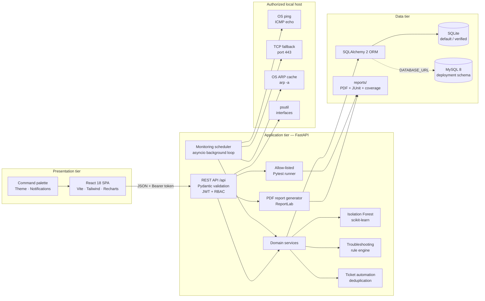

The diagram separates three concerns that are often blurred in student projects:

1. **Observation** — real OS measurements, never synthetic live values.
2. **Interpretation** — statistical and rule-based reasoning over stored data.
3. **Action** — tickets, reports and advisory guidance, with human authorization.

---

## 2.3 Layer responsibilities

| Layer | Components | Responsibilities | Must not do |
|---|---|---|---|
| Presentation | `frontend/src` | Render state, collect input, call API, show loading/error/empty states, theme and responsive layout | Contain business rules or trust client-side authorization |
| Application | `backend/app/api` | Validate requests, enforce roles, serialize responses, map errors | Run long blocking probes inside request handlers where avoidable |
| Domain services | `backend/app/services` | Monitoring orchestration, ticketing, reports, settings, seeding, test execution | Depend on HTTP request objects |
| Intelligence | `backend/app/ai`, `backend/app/troubleshooting` | Train/score Isolation Forest, explain events, apply diagnostic rules | Modify infrastructure or claim future failure |
| Monitoring adapters | `backend/app/monitoring` | Execute OS probes, parse ARP, expose interface information, schedule cycles | Invent values when a probe fails |
| Persistence | `backend/app/models`, `app/core/database.py` | Define tables, relationships, constraints and sessions | Contain presentation logic |
| Verification | `backend/tests`, `frontend/e2e` | Verify API, business rules, ML behaviour and user journeys | Use production data or live probes |

---

## 2.4 Component catalogue

### 2.4.1 Backend modules

| Module | File(s) | Purpose |
|---|---|---|
| Entrypoint | `app/main.py` | FastAPI app, lifespan, middleware, routers, static frontend, health |
| Configuration | `app/core/config.py` | Environment settings, validation, SQLite path resolution, reports path |
| Database | `app/core/database.py` | Engine, session factory, `Base`, `init_db` |
| Security | `app/core/security.py` | Argon2 hashing, JWT creation/decoding, role hierarchy |
| Logging | `app/core/logging_config.py` | Consistent console/file logging |
| Models | `app/models/models.py` | Twelve SQLAlchemy domain tables |
| Schemas | `app/schemas/schemas.py` | Pydantic request/response contracts |
| Auth API | `app/api/auth.py` | Login, session, logout, user listing/creation, throttling |
| Dashboard API | `app/api/dashboard.py` | Health index, series, alerts and summaries |
| Monitoring API | `app/api/monitoring.py` | Network info, current Wi-Fi association, history, latest, manual run, scheduler state |
| Access point API | `app/api/access_points.py` | CRUD, checks, performance, history |
| Device API | `app/api/devices.py` | Discovery, approval, metadata, activity |
| Anomaly API | `app/api/anomalies.py` | Detection, event list, model info |
| Troubleshooting API | `app/api/troubleshooting.py` | Run diagnosis, latest recommendations |
| Ticket API | `app/api/tickets.py` | List, stats, detail, create, update, comments |
| Testing API | `app/api/tests.py` | Start run, list runs, run detail |
| Reports API | `app/api/reports.py` | List, types, generate, download |
| Settings API | `app/api/settings.py` | Read/update settings, system status |
| Monitoring service | `app/services/monitoring.py` | Record probes, run checks, AP availability |
| Ticketing service | `app/services/ticketing.py` | Fingerprint dedup, threshold and anomaly tickets |
| Report service | `app/services/reports.py` | Eight PDF report builders |
| Test runner | `app/services/test_runner.py` | Fixed pytest command, JUnit parse, persisted results |
| Seed service | `app/services/seed.py` | Bootstrap admin, default settings, labelled demo APs |
| Diagnostics | `app/monitoring/diagnostics.py` | ICMP parsing, real TCP fallback, interface info |
| Wi-Fi detector | `app/monitoring/wifi.py` | Read-only current SSID/BSSID/signal/band/gateway detection |
| Device discovery | `app/monitoring/devices.py` | ARP parse, subnet filtering, hashing, masking |
| Scheduler | `app/monitoring/scheduler.py` | Startup and periodic cycles, device/AP refresh |
| Anomaly service | `app/ai/anomaly.py` | Training, scoring, severity, robust-z explanation |
| Baseline | `app/ai/sample_baseline.py` | Deterministic synthetic cold-start baseline |
| Rule engine | `app/troubleshooting/engine.py` | Diagnostic scenarios and safety note |

### 2.4.2 Frontend modules

| Area | File(s) | Purpose |
|---|---|---|
| App shell | `App.jsx`, `layouts/DashboardLayout.jsx` | Routing, sidebar, header, palette, notifications, mobile drawer |
| Auth context | `context/AuthContext.jsx` | Token persistence, user session, role helpers |
| Theme context | `context/ThemeContext.jsx` | Dark/light preference and `html.dark` class |
| Toast context | `context/ToastContext.jsx` | Accessible transient notifications |
| API client | `services/api.js` | Axios instance, bearer injection, 401 handling, PDF download |
| Data hook | `hooks/useApi.js` | Loading/error state and polling |
| UI primitives | `components/ui.jsx` | Buttons, badges, cards, fields, selects, modals, skeletons, alerts |
| Charts | Recharts in pages | Latency, loss, jitter and performance visualisations |
| Pages | `pages/*.jsx` | Ten workspace modules, login and not-found |
| Utilities | `lib/utils.js` | Date/time, bytes, numbers, relative time, title case |

---

## 2.5 Frontend architecture

The single-page application uses React Router with lazy-loaded pages. A protected
route wrapper redirects unauthenticated visitors to `/login`. The dashboard
layout renders the sidebar and header around an `Outlet`, so navigation does not
reload the page.

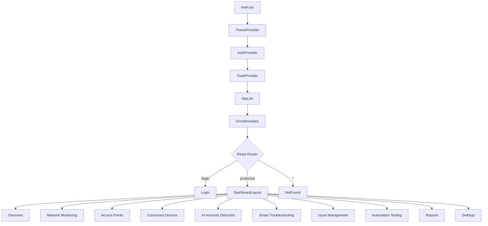

### 2.5.1 State management

The application deliberately avoids a heavy global state library:

- **Authentication** is shared through `AuthContext` and persisted in
  `localStorage` under `netpulse_token` and `netpulse_user`.
- **Theme** is shared through `ThemeContext` and persisted as `netpulse_theme`.
- **Server state** is fetched by `useApi`, which exposes `data`, `loading`,
  `error` and `reload`. Pages that need live updates pass a `pollMs` interval.
- **Local UI state** (filters, dialogs, form fields) remains inside each page.

This keeps the dependency surface small and makes the data flow easy to explain
during a viva.

### 2.5.2 Design system

The UI uses a dark-first professional theme with optional light mode. Shared
primitives ensure consistency:

- `PageHeader`, `SectionHeader`, `StatCard`, `Badge`, `Button`, `Field`, `Select`;
- `Modal` with focus-visible dialog semantics, Escape handling and backdrop close;
- `PageSkeleton`, `ErrorPanel`, `EmptyState`, `Alert`, `InfoNote` for all data
  states;
- Recharts wrappers with responsive containers and explicit axis widths to avoid
  label clipping.

### 2.5.3 Accessibility and responsiveness

- Semantic headings and table structure.
- `aria-label` on icon-only controls (navigation, theme, notifications, dialogs).
- Keyboard command palette (`Ctrl+K`) and Escape-to-close dialogs.
- Mobile drawer below the `lg` breakpoint; E2E tests assert no horizontal
  overflow at 390 × 844.
- Colour is not the only indicator: badges include text and status dots.

---

## 2.6 Backend architecture

FastAPI provides dependency injection, request validation, OpenAPI generation
and exception handling. The backend is organized by feature rather than by
technical layer alone: each API module owns its routes, while shared services
hold cross-cutting business logic.

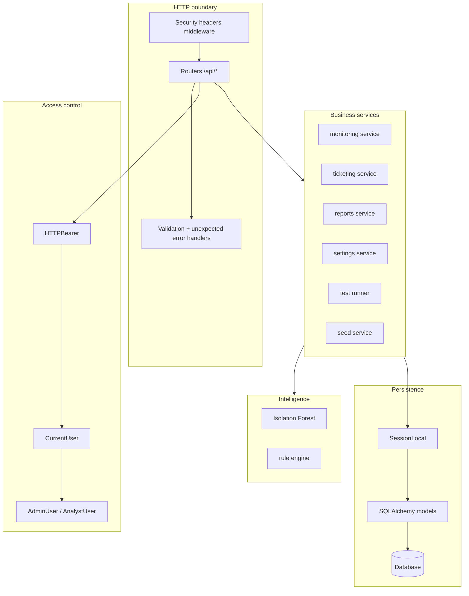

### 2.6.1 Request lifecycle

1. Security middleware adds `X-Content-Type-Options`, `X-Frame-Options`,
   `Referrer-Policy`, `Permissions-Policy` and `Cache-Control`.
2. CORS validates the browser origin.
3. The router validates the body/query through Pydantic.
4. `CurrentUser` decodes the JWT, loads the user and checks `is_active`.
5. `AdminUser`/`AnalystUser` enforce the role hierarchy.
6. The service executes business logic in a SQLAlchemy session.
7. The response model serializes the result.
8. Validation errors return a simplified `{detail, errors}` payload; unexpected
   errors are logged and return a generic message without leaking internals.

### 2.6.2 Role hierarchy

`role_at_least` defines a simple ordered hierarchy:

```text
viewer < analyst < admin
```

| Capability | Viewer | Analyst | Admin |
|---|---:|---:|---:|
| View dashboard, monitoring, APs, devices, AI, tickets, reports | ✓ | ✓ | ✓ |
| Run live check, detect anomalies, run troubleshooting | — | ✓ | ✓ |
| Check access point, create/update tickets, comment | — | ✓ | ✓ |
| Create/edit/delete access points | — | — | ✓ |
| Approve devices, edit device metadata | — | — | ✓ |
| Generate PDF reports | — | ✓ | ✓ |
| Change settings, create users | — | — | ✓ |
| Run the built-in backend test suite | — | ✓ | ✓ |

The frontend hides actions based on `hasRole`, but the backend is authoritative;
every mutating route declares the required dependency.

### 2.6.3 Database session management

`get_db()` yields a session and closes it in a `finally` block. Services commit
explicitly after a unit of work. SQLite uses `check_same_thread=False` so the
scheduler thread can use a separate session. `init_db()` creates missing tables
at startup and the seed service inserts defaults only when they are absent.

---

## 2.7 Monitoring pipeline

The scheduler is the only component that writes live measurements on a timer.
Manual checks use the same service functions.

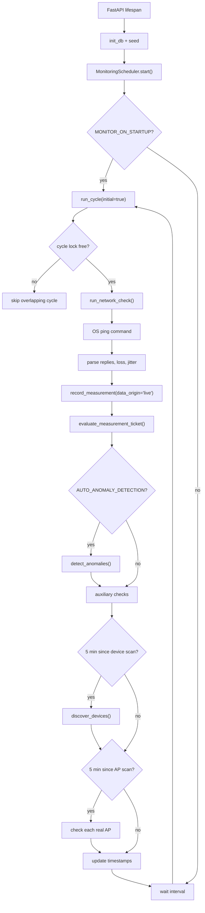

### 2.7.1 Probe behavior

| Situation | Result stored |
|---|---|
| Replies received | `is_online=true`, average latency, parsed loss, population standard deviation as jitter |
| No replies | `is_online=false`, `latency_ms=null`, `packet_loss_pct=100`, error message |
| Timeout | Offline measurement with `Network probe timed out` |
| Ping utility missing | Genuine TCP handshake fallback to port 443, target labelled `(TCP fallback)` |
| Unexpected exception | Offline measurement with a safe error type, exception logged |

The probe target for AP checks is the AP's registered IP address. The global
probe target defaults to `1.1.1.1` and is configurable. Values are never
generated when the probe fails.

### 2.7.2 Simulation isolation

Simulation is confined to one path: `check_access_point()` when
`access_point.is_simulated` is true. It writes `data_origin="simulation"` and a
`SIMULATED:` probe target. Every health query filters to `data_origin="live"`,
and the ticket service rejects non-live measurements. The UI displays a
simulation notice in the AP list and detail dialog.

### 2.7.3 Device discovery

Device discovery is intentionally read-only:

1. Enumerate active IPv4 subnets with `psutil`.
2. Run `arp -a` (timeout 10 s, no shell).
3. Parse IP/MAC pairs with a strict regular expression.
4. Exclude own addresses, loopback, link-local, network/broadcast addresses and
   any IP outside an active local subnet.
5. Hash the normalized MAC with SHA-256 for identity.
6. Store a masked form only (`**:**:**:xx:xx:xx`).
7. Insert a `device_activity` observation and update `last_seen_at`.

There is no port scan, packet capture or active subnet sweep.

---

## 2.8 AI anomaly detection pipeline

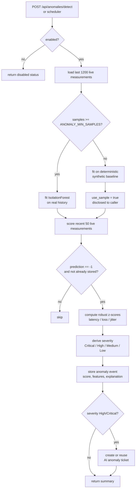

### 2.8.1 Model configuration

| Parameter | Value |
|---|---|
| Algorithm | `sklearn.ensemble.IsolationForest` |
| Estimators | 200 |
| Contamination | 0.08 (configurable from settings) |
| Random state | 42 (reproducible) |
| Features | `latency_ms`, `packet_loss_pct`, `jitter_ms` |
| Training window | Most recent 1,200 live measurements |
| Scoring window | Most recent 50 live measurements per run |
| Minimum real samples | 30 by default |
| Model version | `isolation-forest-v1/sklearn-<version>` |

### 2.8.2 Explanation contract

Each event stores:

- `anomaly_score`: negated decision-function score, higher = more unusual;
- `severity`: Critical, High, Medium or Low;
- `explanation`: human-readable sentence listing the contributing metrics;
- `features`: observed values, baseline medians, robust z-scores and raw score;
- `model_version` and `used_sample_baseline` for provenance.

The explanation explicitly states that the result is a statistical observation,
not a guaranteed prediction of future failure.

### 2.8.3 Cold-start disclosure

When fewer than `ANOMALY_MIN_SAMPLES` real observations exist, the model is fit
on a deterministic synthetic baseline (Gamma/Exponential distributions, seed
2026, 120 rows). Those rows are **not written to `network_measurements`** and are
never displayed as telemetry. The API returns `sample_baseline_used=true`, the UI
shows a warning and each event stores `used_sample_baseline`.

---

## 2.9 Ticketing and troubleshooting pipeline

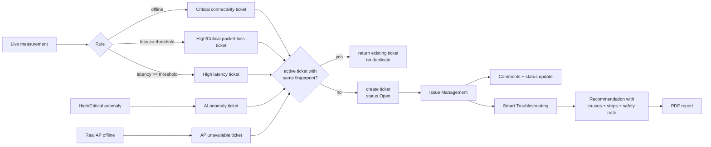

### 2.9.1 Fingerprint strategy

| Incident | Fingerprint | Suppression window |
|---|---|---|
| Connectivity down | `connectivity_down[:ap_id]` | While Open or In Progress |
| Packet loss | `packet_loss[:ap_id]` | While Open or In Progress |
| High latency | `high_latency[:ap_id]` | While Open or In Progress |
| AP unavailable | `ap_offline:<ap_id>` | While Open or In Progress |
| AI anomaly | `ai_anomaly:active` | While Open or In Progress |
| Manual ticket | Random 16-hex fingerprint | No suppression (manual intent) |

Once a ticket is Resolved, the same condition can create a new ticket
for a new incident.

### 2.9.2 Safety model

The troubleshooting engine returns advisory content only. A constant safety note
is attached to every recommendation:

> Diagnostic guidance only. NetPulse AI never changes router or access-point
> configuration automatically. Confirm authorization before checking any network
> device.

The UI repeats this in a dedicated guardrail panel. There is no code path that
writes device configuration, executes remediation or stores router credentials.

---

## 2.10 Request lifecycle sequence

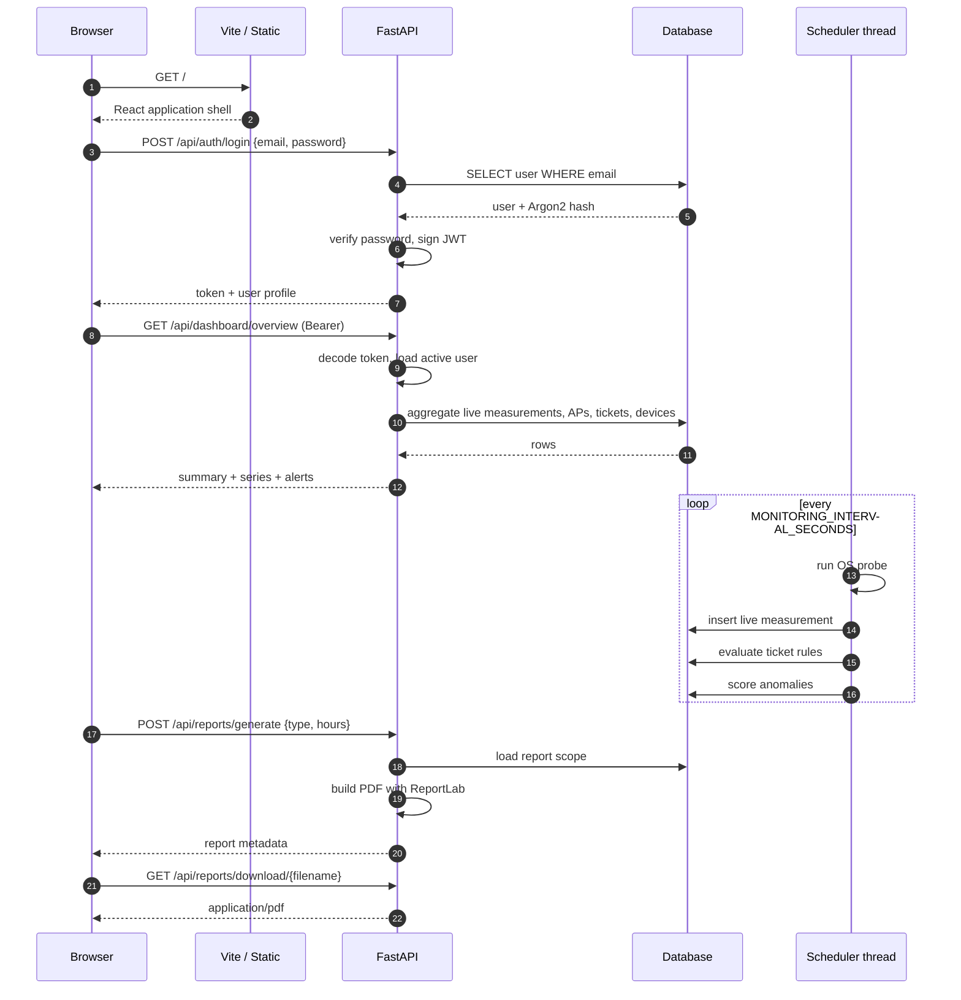

---

## 2.11 Deployment architecture

### 2.11.1 Development deployment

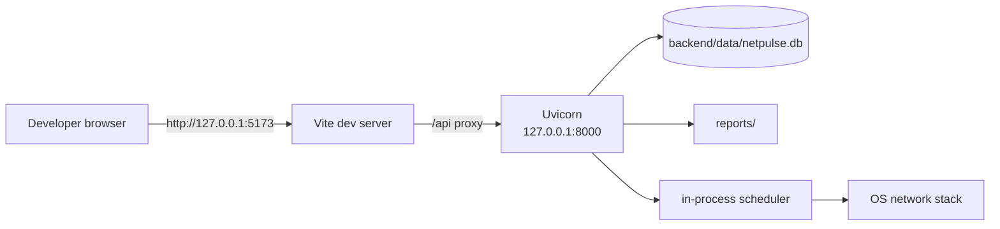

- Vite serves the SPA with hot module replacement and proxies `/api` to port
  8000.
- Uvicorn runs the FastAPI app with optional `--reload`.
- SQLite stores data in `backend/data/netpulse.db`.
- Reports are written to `reports/` at the project root.

### 2.11.2 Single-port production-style deployment

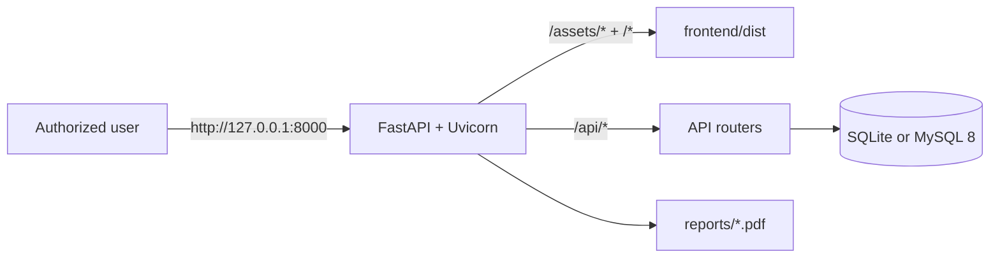

After `npm run build`, FastAPI mounts `frontend/dist/assets` and serves
`index.html` for client-side routes. Unknown `/api` paths return a JSON 404
rather than the SPA shell.

### 2.11.3 MySQL deployment

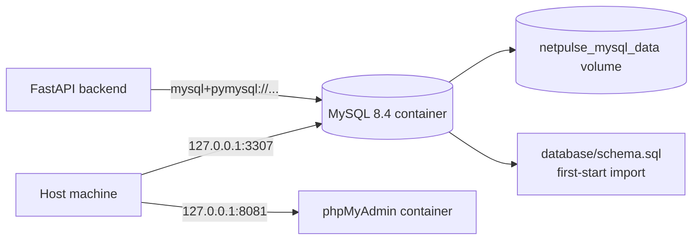

The host port 3307 avoids a collision with an existing MySQL on 3306. The
schema is imported only when the data volume is empty. phpMyAdmin is optional
and should not be exposed beyond localhost.

### 2.11.4 Ports and processes

| Process | Default address | Notes |
|---|---|---|
| FastAPI / Uvicorn | `127.0.0.1:8000` | API, Swagger, optional static frontend |
| Vite dev server | `127.0.0.1:5173` | Proxies `/api` to 8000 |
| Vite preview | `127.0.0.1:4173` | Preview of the production build |
| MySQL container | `127.0.0.1:3307` | Host mapping of container 3306 |
| phpMyAdmin | `127.0.0.1:8081` | Optional database UI |

---

## 2.12 Security architecture

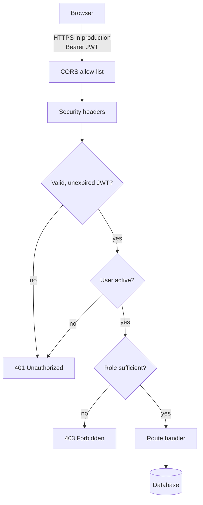

### 2.12.1 Authentication

- Passwords are hashed with Argon2 through `pwdlib`.
- Login uses a dummy hash verification when the email is unknown, reducing
  timing-based user enumeration.
- Failed attempts are tracked per client/email for five minutes; eight failures
  trigger HTTP 429.
- JWT contains `sub`, `role`, `email`, `name`, `exp` and `iat`.
- Tokens expire after 480 minutes by default.
- Logout is stateless: the client discards the token. Revocation would require a
  denylist or short-lived refresh tokens.

### 2.12.2 Authorization

- `viewer`: read-only operational access.
- `analyst`: read plus monitoring, detection, troubleshooting, tickets and
  reports.
- `admin`: full access including APs, devices, settings and users.

The frontend hides unavailable actions, but every protected backend route has an
explicit dependency.

### 2.12.3 Transport and headers

- Development uses HTTP on loopback only.
- Production should terminate TLS at a reverse proxy.
- `X-Content-Type-Options: nosniff`, `X-Frame-Options: DENY`,
  `Referrer-Policy: no-referrer` and a restrictive `Permissions-Policy`.
- API responses use `Cache-Control: no-store`.
- CORS is restricted to configured origins, not `*`.

### 2.12.4 Input validation

Pydantic validates IP addresses, MAC addresses, emails, password length, role
values, thresholds, report types and query bounds. SQLAlchemy uses bound
parameters. The test runner accepts no user-supplied command: it runs a fixed
`python -m pytest` invocation with a generated JUnit path.

### 2.12.5 Secret management

- `backend/.env` is ignored by Git.
- The setup script generates a random JWT secret and administrator password.
- Production mode rejects placeholder secrets and weak configuration.
- No password, token or raw MAC is written to reports or logs.

---

## 2.13 Reliability and error handling

| Failure | Handling |
|---|---|
| Probe timeout | Offline measurement with real error; scheduler continues |
| Ping utility missing | TCP fallback; result labelled |
| Scheduler cycle overlap | Lock skips the overlapping cycle |
| Scheduler exception | `last_error` recorded, exposed in dashboard, logged |
| Database unavailable | `/api/health` reports `degraded`; request returns controlled error |
| Invalid request | 422 with field-level errors |
| Unauthorized | 401 with `WWW-Authenticate` |
| Forbidden | 403 with required role message |
| Not found | 404 with resource-specific message |
| Duplicate AP name/IP | 409 with validation message |
| Test runner busy | 409; only one run at a time |
| PDF missing or invalid name | 404/400 without path traversal |
| Frontend API failure | `ErrorPanel` with retry; toasts for mutations |
| React render error | Error boundary with reset action |

### 2.13.1 Data integrity safeguards

- APS and measurements use `data_origin` to separate live from simulation.
- Anomaly events are unique per measurement (`measurement_id` unique index).
- Ticket numbers are unique; fingerprints suppress duplicates only while active.
- AP name/IP pairs are unique.
- Foreign keys use `CASCADE` for owned history and `SET NULL` for optional actor
  references, preserving audit rows when a user is removed.
- Reports are resolved by filename through a safe path check.

---

## 2.14 Key design decisions and trade-offs

| Decision | Rationale | Trade-off |
|---|---|---|
| SQLite default | Zero-setup demo, reliable tests, no external service | Single-writer limits; not suited to high concurrency |
| MySQL schema provided | Demonstrates deployment-ready relational design | Runtime import not verified on this machine |
| Scheduler inside API | Simple deployment, shared service code | Multiple workers would duplicate cycles |
| ICMP as primary probe | Ubiquitous, accurate round-trip signal | May be blocked by policy; fallback is labelled |
| ARP cache only | Privacy-preserving, no active scanning | Local subnet visibility only |
| Isolation Forest | Unsupervised, works without labelled failures | Statistical outlier ≠ root cause |
| Synthetic cold start | Allows demonstration before history accumulates | Must be disclosed; not live data |
| Rule-based troubleshooting | Deterministic, explainable, auditable | Limited to known scenarios |
| JSON columns | Flexible feature/recommendation payloads | Less queryable than normalized rows |
| Fixed test command | Prevents remote code execution | Only the backend suite can be run from the UI |
| System Chrome for Playwright | Bundled headless shell blocked by policy | Requires Chrome or Edge on the test host |

### 2.14.1 Why not SNMP?

SNMP would provide richer AP and switch metrics, but it requires credentials,
device support and careful authorization. It also expands the security and legal
scope. The project deliberately focuses on end-to-end observations that any
authorized host can collect without infrastructure credentials.

### 2.14.2 Why not active Wi-Fi scanning?

Active scanning and packet capture can reveal other users' traffic and may
violate privacy or institutional policy. The ARP cache provides a defensible,
read-only inventory of devices the host has already communicated with.

The **Use current Wi-Fi** flow does not weaken this boundary. It reads only the
operating system's existing association for the backend host (SSID, BSSID,
signal, band, channel and default gateway) through read-only commands. It does
not enumerate nearby networks, capture frames or read Wi-Fi credentials. The
detected gateway is not probed until an administrator registers it as an
authorized access point, and the endpoint is authenticated. Because the address
is usually private (for example `10.239.39.128`), the flow is useful only when
the backend runs on the connected computer; the serverless deployment returns an
explicit unavailable reason.

### 2.14.3 Why keep the synthetic baseline?

An Isolation Forest needs training data. Without a baseline, the first live
sample cannot be scored meaningfully. The synthetic baseline enables a
demonstration and is clearly marked. As real history accumulates, the model
automatically switches to real observations.

---

## 2.15 Non-functional requirements mapping

| NFR | Implementation | Evidence |
|---|---|---|
| Performance | Indexed queries, 2,000-row dashboard cap, lazy pages, polling intervals | Dashboard test, E2E timings |
| Security | Argon2, JWT, RBAC, throttle, headers, validation | 7 security tests, 12 auth tests |
| Reliability | Error handling, offline records, scheduler lock | Monitoring tests, smoke tests |
| Usability | Dark/light theme, responsive layout, skeletons, toasts, palette | 20 E2E tests, 17 screenshots |
| Maintainability | Layered modules, shared UI, typed schemas, env config | Code structure, 82% coverage |
| Portability | SQLite/MySQL, OS-specific ping commands, env paths | Tested Windows; Linux/macOS commands included |
| Privacy | ARP only, SHA-256 identity, masked MAC, no raw capture | Device tests, UI privacy notice |
| Integrity | `data_origin`, simulation exclusion, disclaimers | AP/device/monitoring tests |
| Testability | Isolated fixtures, no live probes in tests, JUnit import | 88 + 20 passing tests |

---

## 2.16 Project folder structure

```text
NetPulse-AI/
├── backend/
│   ├── app/
│   │   ├── ai/                 anomaly.py, sample_baseline.py
│   │   ├── api/                11 routers + dependencies
│   │   ├── core/               config, database, security, logging
│   │   ├── models/             SQLAlchemy domain model
│   │   ├── monitoring/         diagnostics, devices, scheduler
│   │   ├── schemas/            Pydantic contracts
│   │   ├── services/           monitoring, ticketing, reports, seed,
│   │   │                        settings, test_runner
│   │   ├── troubleshooting/    rule engine
│   │   └── main.py
│   ├── tests/                  88 Pytest tests + isolated conftest
│   ├── .env.example
│   └── requirements.txt
├── frontend/
│   ├── src/
│   │   ├── components/         UI primitives, brand, chart tooltip, boundary
│   │   ├── context/            auth, theme, toast
│   │   ├── hooks/              useApi
│   │   ├── layouts/            dashboard shell
│   │   ├── lib/                formatting utilities
│   │   ├── pages/              10 modules + login + 404
│   │   └── services/           API client
│   ├── e2e/                    4 Playwright specs
│   ├── scripts/                screenshot capture
│   ├── playwright.config.js
│   └── package.json
├── database/                   schema.sql, migration, guide
├── documentation/              report chapters, diagrams, screenshots
├── reports/                    PDFs, JUnit, coverage, Playwright report
├── scripts/                    setup, run, test, build
├── docker-compose.yml
└── README.md
```

---

## 2.17 Chapter summary

NetPulse AI uses a conventional three-tier web architecture with a small,
well-defined intelligence layer. The important architectural choices are not
exotic: they are about **separation of measurement from interpretation**, **explicit
provenance for every record**, **human authority over network changes** and
**repeatable verification**. These choices make the system understandable in a
viva and defensible in operation.

The next chapter describes the relational model that supports these flows.
