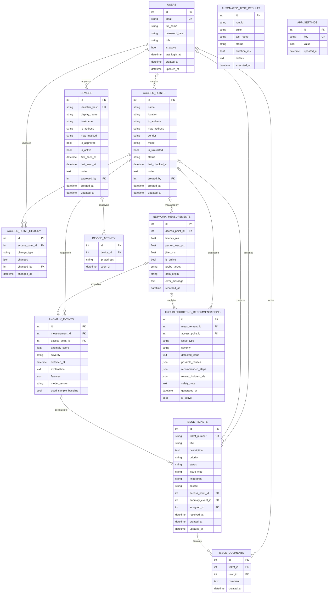

# 3. Database Design

## 3.1 Design goals

The database must preserve **what was observed**, **how it was interpreted** and
**what action was taken**, without ever mixing real measurements with
demonstration data. The design therefore pursues six goals:

| ID | Goal | Design response |
|---|---|---|
| DG1 | Preserve measurement provenance | `data_origin`, `probe_target`, `recorded_at`, model provenance |
| DG2 | Support the operational workflow | Users, APs, measurements, anomalies, recommendations, tickets, comments |
| DG3 | Protect referential integrity | Foreign keys, unique constraints, explicit delete behaviour |
| DG4 | Keep dashboard queries fast | Composite indexes on time, status and approval fields |
| DG5 | Support both SQLite and MySQL | Portable SQLAlchemy types and matching DDL |
| DG6 | Avoid storing sensitive raw identities | SHA-256 device identity, masked MAC display, Argon2 passwords |

---

## 3.2 Entity-relationship model



The `AUTOMATED_TEST_RESULTS` and `APP_SETTINGS` tables are operational support
tables with no foreign keys. `schema_migrations` is a thirteenth table used only
by the deployment migration.

### 3.2.1 Relationship summary

| Parent | Child | Cardinality | Delete behaviour |
|---|---|---|---|
| `users` | `access_points.created_by` | 1 : 0..N | `SET NULL` |
| `users` | `access_point_history.changed_by` | 1 : 0..N | `SET NULL` |
| `users` | `devices.approved_by` | 1 : 0..N | `SET NULL` |
| `users` | `issue_tickets.assigned_to` | 1 : 0..N | `SET NULL` |
| `users` | `issue_comments.user_id` | 1 : 0..N | `SET NULL` |
| `access_points` | `access_point_history` | 1 : 0..N | `CASCADE` |
| `access_points` | `network_measurements` | 1 : 0..N | `CASCADE` |
| `access_points` | `anomaly_events` | 1 : 0..N | `CASCADE` |
| `access_points` | `troubleshooting_recommendations` | 1 : 0..N | `SET NULL` |
| `access_points` | `issue_tickets` | 1 : 0..N | `SET NULL` |
| `devices` | `device_activity` | 1 : 0..N | `CASCADE` |
| `network_measurements` | `anomaly_events` | 1 : 0..1 | `CASCADE` |
| `network_measurements` | `troubleshooting_recommendations` | 1 : 0..N | `SET NULL` |
| `anomaly_events` | `issue_tickets` | 1 : 0..N | `SET NULL` |
| `issue_tickets` | `issue_comments` | 1 : 0..N | `CASCADE` |

The asymmetry is intentional: history and observations are owned by their parent
and disappear with it, while tickets and recommendations preserve their text even
if the referenced AP or measurement is removed. This keeps incident records
auditable.

---

## 3.3 Table overview

| # | Table | Purpose | Typical growth |
|---|---|---|---|
| 1 | `users` | Accounts and roles | Very low |
| 2 | `access_points` | Authorized AP inventory | Low |
| 3 | `access_point_history` | AP configuration audit trail | Low |
| 4 | `devices` | Locally observed devices | Low to medium |
| 5 | `device_activity` | Every ARP observation | Medium (one row per scan per device) |
| 6 | `network_measurements` | Real probe observations and labelled simulations | High (scheduler interval) |
| 7 | `anomaly_events` | Isolation Forest findings | Low to medium |
| 8 | `troubleshooting_recommendations` | Rule-engine output | Low |
| 9 | `issue_tickets` | Incidents and workflow state | Low |
| 10 | `issue_comments` | Ticket audit trail | Low |
| 11 | `automated_test_results` | One row per imported test case | Medium (per test run) |
| 12 | `app_settings` | Runtime settings as JSON | Very low |
| 13 | `schema_migrations` | Applied schema versions | Very low |

At the default one-minute interval, `network_measurements` grows by 1,440 rows
per day for the global probe, plus one row per AP check every five minutes. This
is modest for SQLite and trivial for MySQL, but long-running deployments should
add a retention policy (Section 3.10).

---

## 3.4 Complete data dictionary

The following dictionary was generated directly from the SQLAlchemy metadata to
avoid transcription errors. Types are shown for the MySQL dialect; SQLite maps
them to its dynamic type system.

### `app_settings`

| Column | Type | Nullable | Key / Notes |
|---|---|---|---|
| `id` | INTEGER | no | PK |
| `key` | VARCHAR(80) | no | unique |
| `value` | JSON | no |  |
| `updated_at` | DATETIME | no |  |

Indexes: `ix_app_settings_key` (key) UNIQUE

### `automated_test_results`

| Column | Type | Nullable | Key / Notes |
|---|---|---|---|
| `id` | INTEGER | no | PK |
| `run_id` | VARCHAR(50) | no |  |
| `suite` | VARCHAR(60) | no |  |
| `test_name` | VARCHAR(255) | no |  |
| `status` | VARCHAR(20) | no |  |
| `duration_ms` | FLOAT | no |  |
| `details` | TEXT | yes |  |
| `executed_at` | DATETIME | no |  |

Indexes: `ix_automated_test_results_status` (status); `ix_test_results_executed` (executed_at); `ix_automated_test_results_run_id` (run_id); `ix_automated_test_results_suite` (suite); `ix_test_results_run` (run_id)

### `users`

| Column | Type | Nullable | Key / Notes |
|---|---|---|---|
| `id` | INTEGER | no | PK |
| `email` | VARCHAR(255) | no | unique |
| `full_name` | VARCHAR(120) | no |  |
| `password_hash` | VARCHAR(255) | no |  |
| `role` | VARCHAR(20) | no |  |
| `is_active` | BOOL | no |  |
| `last_login_at` | DATETIME | yes |  |
| `created_at` | DATETIME | no |  |
| `updated_at` | DATETIME | no |  |

Indexes: `ix_users_email` (email) UNIQUE; `ix_users_role` (role)

### `access_points`

| Column | Type | Nullable | Key / Notes |
|---|---|---|---|
| `id` | INTEGER | no | PK |
| `name` | VARCHAR(120) | no |  |
| `location` | VARCHAR(160) | no |  |
| `ip_address` | VARCHAR(45) | no |  |
| `mac_address` | VARCHAR(32) | yes |  |
| `vendor` | VARCHAR(100) | yes |  |
| `model` | VARCHAR(100) | yes |  |
| `is_simulated` | BOOL | no |  |
| `status` | VARCHAR(20) | no |  |
| `last_checked_at` | DATETIME | yes |  |
| `notes` | TEXT | yes |  |
| `created_by` | INTEGER | yes | FK -> users.id (SET NULL) |
| `created_at` | DATETIME | no |  |
| `updated_at` | DATETIME | no |  |

Indexes: `ix_access_points_is_simulated` (is_simulated); `ix_access_points_status` (status)

### `devices`

| Column | Type | Nullable | Key / Notes |
|---|---|---|---|
| `id` | INTEGER | no | PK |
| `identifier_hash` | VARCHAR(64) | no | unique |
| `display_name` | VARCHAR(120) | yes |  |
| `hostname` | VARCHAR(255) | yes |  |
| `ip_address` | VARCHAR(45) | no |  |
| `mac_masked` | VARCHAR(24) | yes |  |
| `is_approved` | BOOL | no |  |
| `is_active` | BOOL | no |  |
| `first_seen_at` | DATETIME | no |  |
| `last_seen_at` | DATETIME | no |  |
| `notes` | TEXT | yes |  |
| `approved_by` | INTEGER | yes | FK -> users.id (SET NULL) |
| `created_at` | DATETIME | no |  |
| `updated_at` | DATETIME | no |  |

Indexes: `ix_devices_approval_seen` (is_approved, last_seen_at)

### `access_point_history`

| Column | Type | Nullable | Key / Notes |
|---|---|---|---|
| `id` | INTEGER | no | PK |
| `access_point_id` | INTEGER | no | FK -> access_points.id (CASCADE) |
| `change_type` | VARCHAR(30) | no |  |
| `changes` | JSON | no |  |
| `changed_by` | INTEGER | yes | FK -> users.id (SET NULL) |
| `changed_at` | DATETIME | no |  |

Indexes: `ix_access_point_history_access_point_id` (access_point_id)

### `device_activity`

| Column | Type | Nullable | Key / Notes |
|---|---|---|---|
| `id` | INTEGER | no | PK |
| `device_id` | INTEGER | no | FK -> devices.id (CASCADE) |
| `ip_address` | VARCHAR(45) | no |  |
| `seen_at` | DATETIME | no |  |

Indexes: `ix_device_activity_seen` (seen_at); `ix_device_activity_device_id` (device_id)

### `network_measurements`

| Column | Type | Nullable | Key / Notes |
|---|---|---|---|
| `id` | INTEGER | no | PK |
| `access_point_id` | INTEGER | yes | FK -> access_points.id (CASCADE) |
| `latency_ms` | FLOAT | yes |  |
| `packet_loss_pct` | FLOAT | no |  |
| `jitter_ms` | FLOAT | yes |  |
| `is_online` | BOOL | no |  |
| `probe_target` | VARCHAR(255) | no |  |
| `data_origin` | VARCHAR(20) | no |  |
| `error_message` | TEXT | yes |  |
| `recorded_at` | DATETIME | no |  |

Indexes: `ix_measurements_online_time` (is_online, recorded_at); `ix_measurements_recorded_at` (recorded_at); `ix_network_measurements_data_origin` (data_origin); `ix_network_measurements_access_point_id` (access_point_id)

### `anomaly_events`

| Column | Type | Nullable | Key / Notes |
|---|---|---|---|
| `id` | INTEGER | no | PK |
| `measurement_id` | INTEGER | yes | unique, FK -> network_measurements.id (CASCADE) |
| `access_point_id` | INTEGER | yes | FK -> access_points.id (CASCADE) |
| `anomaly_score` | FLOAT | no |  |
| `severity` | VARCHAR(20) | no |  |
| `detected_at` | DATETIME | no |  |
| `explanation` | TEXT | no |  |
| `features` | JSON | no |  |
| `model_version` | VARCHAR(80) | no |  |
| `used_sample_baseline` | BOOL | no |  |

Indexes: `ix_anomaly_events_access_point_id` (access_point_id); `ix_anomalies_detected` (detected_at); `ix_anomaly_events_severity` (severity); `ix_anomaly_events_measurement_id` (measurement_id) UNIQUE

### `troubleshooting_recommendations`

| Column | Type | Nullable | Key / Notes |
|---|---|---|---|
| `id` | INTEGER | no | PK |
| `measurement_id` | INTEGER | yes | FK -> network_measurements.id (SET NULL) |
| `access_point_id` | INTEGER | yes | FK -> access_points.id (SET NULL) |
| `issue_type` | VARCHAR(60) | no |  |
| `severity` | VARCHAR(20) | no |  |
| `detected_issue` | TEXT | no |  |
| `possible_causes` | JSON | no |  |
| `recommended_steps` | JSON | no |  |
| `related_incident_ids` | JSON | no |  |
| `safety_note` | TEXT | no |  |
| `generated_at` | DATETIME | no |  |
| `is_active` | BOOL | no |  |

Indexes: `ix_troubleshooting_recommendations_access_point_id` (access_point_id); `ix_troubleshooting_recommendations_measurement_id` (measurement_id); `ix_recommendations_generated` (generated_at)

### `issue_tickets`

| Column | Type | Nullable | Key / Notes |
|---|---|---|---|
| `id` | INTEGER | no | PK |
| `ticket_number` | VARCHAR(32) | no | unique |
| `title` | VARCHAR(200) | no |  |
| `description` | TEXT | no |  |
| `priority` | VARCHAR(20) | no |  |
| `status` | VARCHAR(20) | no |  |
| `issue_type` | VARCHAR(60) | no |  |
| `fingerprint` | VARCHAR(120) | no |  |
| `source` | VARCHAR(30) | no |  |
| `access_point_id` | INTEGER | yes | FK -> access_points.id (SET NULL) |
| `anomaly_event_id` | INTEGER | yes | FK -> anomaly_events.id (SET NULL) |
| `assigned_to` | INTEGER | yes | FK -> users.id (SET NULL) |
| `resolved_at` | DATETIME | yes |  |
| `created_at` | DATETIME | no |  |
| `updated_at` | DATETIME | no |  |

Indexes: `ix_issue_tickets_anomaly_event_id` (anomaly_event_id); `ix_issue_tickets_priority` (priority); `ix_tickets_status_priority` (status, priority); `ix_tickets_fingerprint_status` (fingerprint, status); `ix_issue_tickets_issue_type` (issue_type); `ix_issue_tickets_ticket_number` (ticket_number) UNIQUE; `ix_issue_tickets_fingerprint` (fingerprint); `ix_issue_tickets_access_point_id` (access_point_id); `ix_issue_tickets_status` (status)

### `issue_comments`

| Column | Type | Nullable | Key / Notes |
|---|---|---|---|
| `id` | INTEGER | no | PK |
| `ticket_id` | INTEGER | no | FK -> issue_tickets.id (CASCADE) |
| `user_id` | INTEGER | yes | FK -> users.id (SET NULL) |
| `comment` | TEXT | no |  |
| `created_at` | DATETIME | no |  |

Indexes: `ix_issue_comments_ticket_id` (ticket_id)


---

## 3.5 Normalization

### 3.5.1 First normal form (1NF)

All scalar columns hold a single value. The exception is deliberate: JSON columns
(`features`, `changes`, `possible_causes`, `recommended_steps`,
`related_incident_ids`, `value`) hold variable-length documents. These are not
relational attributes used for joins or filters; they are payloads whose shape
changes with the model or rule version. They are documented and validated at the
application layer.

### 3.5.2 Second normal form (2NF)

Every table uses a single surrogate primary key (`id`). There are no composite
keys and therefore no partial dependencies. The natural unique keys
(`users.email`, `access_points(name, ip_address)`, `ticket_number`,
`identifier_hash`) are enforced with unique constraints rather than used as
primary keys.

### 3.5.3 Third normal form (3NF)

Non-key attributes depend only on the primary key. Examples:

- `access_points` stores AP metadata, not user details; `created_by` references
  `users`.
- `issue_tickets` stores workflow state, not the assigned user's name;
  `assigned_to` references `users`.
- `device_activity` stores observations, not the device's display name; it
  references `devices`.
- `anomaly_events` stores its own score and explanation, not duplicated
  measurement values (the measurement is referenced).

### 3.5.4 Deliberate denormalization

| Denormalized field | Reason | Consistency safeguard |
|---|---|---|
| `anomaly_events.features` | Preserves the exact feature vector used at detection time, even if the measurement later changes | Immutable snapshot; measurement values normally do not change |
| `issue_tickets.title` and `description` | Keeps the incident text stable if the source AP is renamed or deleted | Written once at creation |
| `issue_tickets.fingerprint` | Fast duplicate lookup without parsing text | Derived deterministically at creation |
| `automated_test_results.run_id` | Groups rows without a separate runs table | Indexed; parsed from JUnit |
| `app_settings.value` | Flexible settings without schema changes per key | Allowed keys validated by the settings service |

The model is normalized where joins and integrity matter, and denormalized only
for immutable audit snapshots and flexible payloads.

---

## 3.6 Keys, constraints and integrity

### 3.6.1 Primary keys

All domain tables use an auto-incrementing integer primary key. This is simple,
compact and well supported by both SQLite and MySQL.

### 3.6.2 Natural unique keys

| Table | Constraint | Purpose |
|---|---|---|
| `users` | `ix_users_email` unique | One account per email |
| `access_points` | `uq_access_point_name_ip` | Prevent duplicate inventory entries |
| `devices` | `uq_devices_identifier_hash` | One row per observed device identity |
| `anomaly_events` | `ix_anomaly_events_measurement_id` unique | One anomaly per measurement |
| `issue_tickets` | `ix_issue_tickets_ticket_number` unique | Human-readable ticket identity |
| `app_settings` | `ix_app_settings_key` unique | One value per setting key |
| `schema_migrations` | primary key on `version` | One row per migration |

### 3.6.3 Check constraints at the application layer

SQLAlchemy models do not declare database `CHECK` constraints, so the following
rules are enforced by Pydantic and services rather than by the database:

- `role` ∈ {admin, analyst, viewer};
- `priority` ∈ {Low, Medium, High, Critical};
- `status` ∈ {Open, In Progress, Resolved};
- `severity` ∈ {Low, Medium, High, Critical};
- `data_origin` ∈ {live, simulation};
- password length ≥ 10 characters;
- email format, IPv4/IPv6 address format, MAC address format;
- thresholds within configured numeric bounds.

This keeps the schema portable across SQLite and MySQL. A production hardening
step would add database-level `CHECK` constraints for defense in depth.

### 3.6.4 Referential actions

- `CASCADE` is used when the child is meaningless without the parent (AP history,
  measurements, device observations, ticket comments).
- `SET NULL` is used when the child must survive (tickets, recommendations) or
  when an actor reference is optional (creator, approver, assignee).
- `RESTRICT` is not used because the application never hard-deletes users and
  because preserving incidents is more important than blocking an AP deletion.

---

## 3.7 Index strategy

### 3.7.1 Time-series access

| Index | Columns | Query supported |
|---|---|---|
| `ix_measurements_recorded_at` | `recorded_at` | Dashboard window, history pagination |
| `ix_measurements_online_time` | `is_online, recorded_at` | Uptime calculations |
| `ix_network_measurements_access_point_id` | `access_point_id` | AP performance history |
| `ix_network_measurements_data_origin` | `data_origin` | Live-only filtering |
| `ix_anomalies_detected` | `detected_at` | Recent anomalies |
| `ix_anomaly_events_severity` | `severity` | Severity filters |
| `ix_recommendations_generated` | `generated_at` | Latest diagnosis |

### 3.7.2 Workflow access

| Index | Columns | Query supported |
|---|---|---|
| `ix_tickets_status_priority` | `status, priority` | Open critical/high lists |
| `ix_tickets_fingerprint_status` | `fingerprint, status` | Duplicate suppression |
| `ix_issue_tickets_status` | `status` | Dashboard counts |
| `ix_issue_tickets_priority` | `priority` | Priority filters |
| `ix_issue_tickets_issue_type` | `issue_type` | Related-ticket lookup |
| `ix_devices_approval_seen` | `is_approved, last_seen_at` | Unknown-device alerts |
| `ix_device_activity_seen` | `seen_at` | Device observation timeline |
| `ix_access_points_is_simulated` | `is_simulated` | Live-vs-simulation filtering |
| `ix_access_points_status` | `status` | Online/offline counts |

### 3.7.3 Test and settings access

- `ix_automated_test_results_run_id` and `ix_test_results_run` support run
  grouping (the duplicate index reflects the model definition; it is harmless).
- `ix_automated_test_results_suite` and `ix_automated_test_results_status`
  support suite and status summaries.
- `ix_test_results_executed` supports recent-run ordering.

### 3.7.4 Index trade-offs

Indexes accelerate reads but add write cost. Measurements are write-heavy, so
only the columns used by dashboard, history and uptime queries are indexed. AP
and ticket tables are read-heavy but small, so broader indexing is acceptable.
No index is added speculatively for columns that are not queried.

---

## 3.8 JSON column rationale

| Column | Shape | Why JSON |
|---|---|---|
| `anomaly_events.features` | latency, loss, jitter, baseline medians, robust z-scores, raw score | Model diagnostics evolve; no joins needed |
| `access_point_history.changes` | field-level before/after values | Different fields change per update |
| `troubleshooting_recommendations.possible_causes` | array of strings | Variable-length narrative |
| `troubleshooting_recommendations.recommended_steps` | array of strings | Variable-length ordered actions |
| `troubleshooting_recommendations.related_incident_ids` | array of integers | Small reference list, not a join table |
| `app_settings.value` | scalar or object depending on key | Settings are schema-less by design |

JSON is supported natively by MySQL 8 and stored as text by SQLite. The backend
always reads and writes Python objects, so the API is portable. If reporting
later needs to query inside these documents, the fields should be promoted to
normalized columns or generated columns.

---

## 3.9 Data provenance and simulation policy

The most important integrity rule in the schema is the separation of real and
simulated observations.

### 3.9.1 `network_measurements.data_origin`

| Value | Meaning | Used in live health? | Used in ML training? |
|---|---|---|---|
| `live` | Real OS probe result | Yes | Yes |
| `simulation` | Clearly labelled demonstration record | No | No |

Every dashboard aggregation filters `data_origin = "live"`. The anomaly service
trains and scores only live measurements. The ticket service returns early for
non-live records. The AP performance endpoint filters live observations.

### 3.9.2 Simulation labels

Simulated APs use `is_simulated = 1`, a `SIMULATED:` probe target, and RFC 5737
documentation addresses (`192.0.2.0/24`). The UI shows a warning in the AP list
and detail dialog. The seed service creates two demo APs only when the AP table
is empty.

### 3.9.3 Model provenance

`anomaly_events` stores:

- `model_version` — algorithm and scikit-learn version;
- `used_sample_baseline` — whether the cold-start synthetic baseline was used;
- `features` — exact values and baselines used for the explanation.

A reviewer can therefore determine whether an event was produced by a real-data
model or a cold-start model.

### 3.9.4 Ticket provenance

`issue_tickets.source` records `automatic` or `manual`. Automatic tickets retain
their fingerprint, AP reference and optional anomaly reference. Manual tickets
use a random fingerprint and are assigned to the creating analyst.

### 3.9.5 Test provenance

`automated_test_results.run_id` groups one execution; `suite` records the test
class or Playwright spec; `executed_at` records import time. The runner stores
JUnit output as well as a summary.

---

## 3.10 Data lifecycle and retention

The application does not automatically delete monitoring history. This is a
deliberate choice for a final-year project: evidence should not disappear during
a demonstration. For long-running deployments, add a scheduled retention job.

### 3.10.1 Suggested retention policy

| Data | Suggested retention | Reason |
|---|---|---|
| Live measurements | 90 days | Supports trend analysis while bounding growth |
| Simulation measurements | 7 days | Demonstration only |
| Anomaly events | 180 days | Incident evidence |
| Recommendations | 180 days | Diagnostic history |
| Resolved tickets | 2 years | Academic/operational audit |
| Device activity | 30 days | Privacy minimization |
| Automated test results | 1 year | Verification evidence |

### 3.10.2 Example cleanup queries

```sql
-- Remove simulation measurements older than seven days
DELETE FROM network_measurements
WHERE data_origin = 'simulation'
  AND recorded_at < UTC_TIMESTAMP() - INTERVAL 7 DAY;

-- Remove device observations older than 30 days
DELETE FROM device_activity
WHERE seen_at < UTC_TIMESTAMP() - INTERVAL 30 DAY;

-- Remove measurements older than 90 days that are not referenced by an anomaly
DELETE nm FROM network_measurements nm
LEFT JOIN anomaly_events ae ON ae.measurement_id = nm.id
WHERE nm.recorded_at < UTC_TIMESTAMP() - INTERVAL 90 DAY
  AND ae.id IS NULL;
```

Always back up before running retention queries. Foreign keys cascade or null
references as documented.

---

## 3.11 Sample analytical queries

### 3.11.1 Latest live measurements

```sql
SELECT id, latency_ms, packet_loss_pct, jitter_ms, is_online,
       probe_target, recorded_at
FROM network_measurements
WHERE data_origin = 'live'
ORDER BY recorded_at DESC
LIMIT 20;
```

### 3.11.2 24-hour uptime

```sql
SELECT
  COUNT(*) AS total_probes,
  SUM(CASE WHEN is_online THEN 1 ELSE 0 END) AS online_probes,
  ROUND(SUM(CASE WHEN is_online THEN 1 ELSE 0 END) / COUNT(*) * 100, 2) AS uptime_pct
FROM network_measurements
WHERE data_origin = 'live'
  AND recorded_at >= UTC_TIMESTAMP() - INTERVAL 24 HOUR;
```

### 3.11.3 Average latency by AP

```sql
SELECT ap.name, COUNT(*) AS samples,
       ROUND(AVG(nm.latency_ms), 2) AS avg_latency_ms,
       ROUND(AVG(nm.packet_loss_pct), 2) AS avg_loss_pct
FROM network_measurements nm
JOIN access_points ap ON ap.id = nm.access_point_id
WHERE nm.data_origin = 'live'
  AND nm.recorded_at >= UTC_TIMESTAMP() - INTERVAL 7 DAY
GROUP BY ap.id, ap.name
ORDER BY avg_latency_ms DESC;
```

### 3.11.4 Open high-priority tickets

```sql
SELECT ticket_number, title, priority, status, created_at
FROM issue_tickets
WHERE status IN ('Open', 'In Progress')
  AND priority IN ('High', 'Critical')
ORDER BY FIELD(priority, 'Critical', 'High'), created_at ASC;
```

### 3.11.5 Anomaly severity breakdown

```sql
SELECT severity, COUNT(*) AS events
FROM anomaly_events
WHERE detected_at >= UTC_TIMESTAMP() - INTERVAL 24 HOUR
GROUP BY severity
ORDER BY FIELD(severity, 'Critical', 'High', 'Medium', 'Low');
```

### 3.11.6 Duplicate suppression check

```sql
SELECT id, ticket_number, status
FROM issue_tickets
WHERE fingerprint = 'packet_loss:3'
  AND status IN ('Open', 'In Progress');
```

### 3.11.7 Test results for the latest run

```sql
SELECT run_id, suite, status, COUNT(*) AS tests,
       ROUND(SUM(duration_ms) / 1000, 2) AS seconds
FROM automated_test_results
WHERE run_id = (
  SELECT run_id FROM automated_test_results
  ORDER BY executed_at DESC LIMIT 1
)
GROUP BY run_id, suite, status
ORDER BY suite;
```

### 3.11.8 Device approval summary

```sql
SELECT is_approved, COUNT(*) AS devices,
       MAX(last_seen_at) AS last_observed
FROM devices
GROUP BY is_approved;
```

### 3.11.9 AP configuration history

```sql
SELECT aph.change_type, aph.changes, u.full_name AS changed_by, aph.changed_at
FROM access_point_history aph
LEFT JOIN users u ON u.id = aph.changed_by
WHERE aph.access_point_id = ?
ORDER BY aph.changed_at DESC;
```

### 3.11.10 Live-vs-simulation count

```sql
SELECT data_origin, COUNT(*) AS measurements
FROM network_measurements
GROUP BY data_origin;
```

---

## 3.12 SQLite and MySQL compatibility

| Aspect | SQLite (verified) | MySQL 8 (deployment) |
|---|---|---|
| Setup | File created automatically | Import `database/schema.sql` |
| Connection | `sqlite:///.../netpulse.db` | `mysql+pymysql://...` |
| JSON | Stored as text, read/written by SQLAlchemy | Native `JSON` |
| Boolean | 0/1 integer | `BOOL` (TINYINT(1)) |
| Datetime | ISO text; no timezone | `DATETIME`; application writes UTC |
| Auto-increment | `INTEGER PRIMARY KEY` | `AUTO_INCREMENT` |
| Concurrency | Single writer, WAL not enabled | InnoDB row-level locking |
| Case sensitivity | Depends on collation | `utf8mb4_unicode_ci` |
| Full-text | Not used | Not used |
| Schema creation | `Base.metadata.create_all()` at startup | `schema.sql` + migration, `create_all` safety net |

### 3.12.1 Timezone handling

MySQL `DATETIME` does not store a timezone. The backend always uses
`datetime.now(timezone.utc)` and serializes with an explicit UTC offset in API
responses. The schema import sets `time_zone = '+00:00'` for the session. The
Docker Compose service sets `TZ=UTC` and `--default-time-zone=+00:00`.

### 3.12.2 MySQL-specific index DDL

The final `database/schema.sql` declares indexes inside `CREATE TABLE` so the
script is idempotent. The migration uses the same structure. The SQLAlchemy model
still declares indexes separately, which is equivalent in effect.

---

## 3.13 Seeding and migrations

### 3.13.1 First-run seed

On startup, `seed_database()` performs three idempotent steps:

1. `ensure_default_settings()` inserts any missing keys from `DEFAULT_SETTINGS`.
2. `_ensure_admin()` creates the first administrator only when the `users` table
   is empty. If `ADMIN_PASSWORD` is missing or a placeholder, a random password
   is generated and printed once to the server log.
3. `_seed_demo_access_points()` inserts two clearly labelled `[DEMO]` APs only
   when the `access_points` table is empty.

No production password is embedded in source code. The repository contains no
real secrets.

### 3.13.2 Default settings

| Key | Default | Meaning |
|---|---|---|
| `latency_threshold_ms` | 150 | Ticket and diagnosis threshold |
| `packet_loss_threshold_pct` | 5 | Ticket and diagnosis threshold |
| `auto_tickets_enabled` | true | Automatic ticket creation |
| `auto_anomaly_detection` | true | Run detection after probes |
| `theme_default` | dark | Initial UI theme preference |
| `organization_name` | NetPulse AI | Display identity |

### 3.13.3 Schema versioning

`schema_migrations` records applied versions:

```sql
SELECT version, description, applied_at FROM schema_migrations;
```

`database/migrations/001_initial_schema.sql` inserts version `001` with
`INSERT IGNORE`. Future migrations should follow the same pattern and must not
edit an already-applied file.

### 3.13.4 `create_all` safety net

`init_db()` calls `Base.metadata.create_all(bind=engine)`. Against MySQL, this
creates missing tables but does not alter existing columns. It is a convenience,
not a replacement for migrations. Schema changes must be shipped as migrations.

---

## 3.14 Security and privacy in the data model

### 3.14.1 Credentials

- `users.password_hash` stores an Argon2 hash, never plaintext.
- JWT secrets live in environment configuration, not the database.
- Login failures are tracked in memory, not persisted, so the throttling table
  does not become a privacy liability.

### 3.14.2 Device identity

- `devices.identifier_hash` is SHA-256 of the normalized MAC.
- `devices.mac_masked` shows only the last three octets: `**:**:**:xx:xx:xx`.
- Raw MAC addresses are not stored anywhere.
- Device discovery reads only the OS ARP cache; no traffic content is captured.

### 3.14.3 Data minimization

- No packet payloads, URLs, DNS queries or user content are stored.
- No Wi-Fi passwords or SNMP credentials are stored.
- Probe targets and interface addresses are operational metadata, not user data.
- Reports contain aggregate and diagnostic information, not credentials.

### 3.14.4 Database access

- Use a dedicated MySQL user with only the required privileges.
- Do not expose MySQL port 3307 beyond localhost.
- Protect backups: they contain hashed passwords, device hashes and network
  observations.
- Restrict access to `backend/.env` and `backend/data/netpulse.db`.
- Enable disk encryption where available.

### 3.14.5 SQL injection

All queries use SQLAlchemy expressions or bound parameters. The only raw SQL is
`SELECT 1` in the health check. Report filenames are resolved with a path check;
user input is never concatenated into SQL.

---

## 3.15 Backup and recovery

### 3.15.1 MySQL

```powershell
# Backup
mysqldump -u netpulse -p --single-transaction --routines --triggers netpulse_ai > netpulse_backup.sql

# Restore
mysql -u netpulse -p netpulse_ai < netpulse_backup.sql

# Verify
mysql -u netpulse -p -e "USE netpulse_ai; SELECT COUNT(*) FROM network_measurements;"
```

### 3.15.2 SQLite

Stop the backend before copying the file to ensure a consistent snapshot:

```powershell
Copy-Item backend\data\netpulse.db reports\netpulse-backup.db
```

For a live backup, use SQLite's backup API or `VACUUM INTO`:

```sql
VACUUM INTO 'reports/netpulse-backup.db';
```

### 3.15.3 Recovery testing

A backup is only useful if restoration is tested. The recommended drill is:

1. Create a scratch database.
2. Restore the dump.
3. Run the verification queries from Section 3.11.
4. Start the backend against the restored database.
5. Confirm login and dashboard rendering.

---

## 3.16 Data-model limitations

1. **No automatic retention** — history grows until an operator cleans it.
2. **No table partitioning** — very large measurement tables would benefit from
   monthly partitions in MySQL.
3. **JSON is not indexed** — feature-level queries require application parsing or
   generated columns.
4. **No soft delete** — AP deletion cascades measurements and history; tickets are
   preserved with `SET NULL`, but the AP itself is gone.
5. **No database-level CHECK constraints** — validation is application-level.
6. **No audit table for reads** — only changes and comments are auditable.
7. **No encrypted columns** — encryption at rest depends on the host/volume.
8. **Single timezone convention** — all times are UTC; local display is a UI
   concern.
9. **Test results are append-only** — no pruning or run-level metadata table.
10. **No dedicated retention job** — the scheduler does not purge old data.

These limitations are documented rather than concealed and form part of the
future-work chapter.

---

## 3.17 Chapter summary

The database design separates observation, interpretation and action. Twelve
domain tables support the workflow; `schema_migrations` tracks deployment
changes. Foreign keys and unique constraints protect integrity, composite indexes
support the dashboard and duplicate suppression, and `data_origin` together with
`used_sample_baseline` makes the live/simulated boundary explicit at the storage
layer.

The next chapter presents the UML and process models that describe how users and
components interact with this data.
