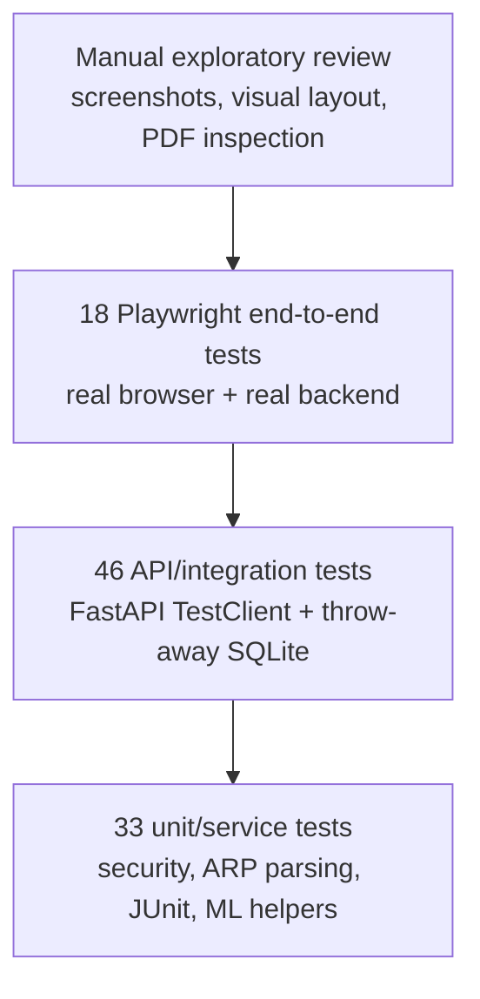

# 5. Testing and Results

## 5.1 Testing objectives

Testing pursued six objectives:

| ID | Objective | Evidence |
|---|---|---|
| TO1 | Verify authentication, authorization and session handling | 12 auth tests + 4 Playwright auth tests |
| TO2 | Verify real-data integrity and simulation isolation | Monitoring, dashboard, AP and device tests |
| TO3 | Verify the AI and rule-based decision logic | Anomaly and troubleshooting tests |
| TO4 | Verify the operational workflow end to end | 10 Playwright interaction tests |
| TO5 | Verify reports, test runner and settings | Report, testing and settings tests |
| TO6 | Verify the interface is usable and responsive | Playwright navigation/responsive tests, 17 screenshots |

---

## 5.2 Test environment

| Item | Value |
|---|---|
| Operating system | Microsoft Windows 11 Home Single Language, build 10.0.26300 |
| Python | 3.12.16 (backend virtual environment) |
| FastAPI | 0.163.0 |
| SQLAlchemy | 2.0.57 |
| scikit-learn | 1.9.1 |
| Pydantic | 2.14.3 |
| ReportLab | 4.5.1 |
| Pytest | 9.2.0 |
| Node.js | 24.19.0 |
| npm | 11.17.0 |
| Browser | Google Chrome 157.0.8103.52 (Playwright `channel: chrome`) |
| Backend URL | `http://127.0.0.1:8000` |
| Frontend URL | `http://127.0.0.1:5173` |
| Verified database | SQLite (`backend/data/netpulse.db` for runtime, throw-away DB for tests) |
| MySQL runtime | **Not executed** — MySQL and Docker are not installed on this machine |

### 5.2.1 Why system Chrome?

The bundled Playwright headless shell is blocked by this machine's Windows
Application Control policy (`spawn UNKNOWN`). The suite therefore uses the
installed Chrome channel:

```js
channel: process.env.PLAYWRIGHT_CHANNEL || 'chrome'
```

On another machine, run with `PLAYWRIGHT_CHANNEL=msedge` or install Chromium and
set `PLAYWRIGHT_CHANNEL=chromium`. This is an environment constraint, not an
application defect, and is documented in the README and conclusion.

---

## 5.3 Test strategy

The project uses a practical test pyramid with two executable layers and a
manual exploratory layer.



The split is approximate: several API tests also exercise services and the
database. The exact 79-test inventory is in
[`test-inventory.generated.md`](test-inventory.generated.md).

### 5.3.1 Backend isolation

`backend/tests/conftest.py` enforces a safe test environment:

- a unique throw-away SQLite file per test session;
- `ENVIRONMENT=testing`;
- the monitoring scheduler disabled;
- live probe execution blocked;
- the built-in test runner disabled to prevent recursion;
- a known administrator and viewer/analyst accounts;
- database tables created and dropped around the session;
- FastAPI dependency overrides for the test session.

This means the backend suite never touches the development database, never
performs a real ping and never spawns a nested pytest process.

### 5.3.2 Frontend isolation

Playwright:

- starts or reuses the Vite and Uvicorn servers;
- reads credentials from `backend/.env` or `E2E_EMAIL`/`E2E_PASSWORD`;
- runs with one worker to avoid mutating shared data concurrently;
- captures a trace and screenshot only on failure;
- asserts that no console errors or page errors occur while visiting all modules;
- verifies mobile layout at 390 × 844;
- uses real backend mutations for AP CRUD and ticket lifecycle, then cleans up
  the AP it created.

### 5.3.3 Test data policy

| Data | Source in tests |
|---|---|
| Admin account | Deterministic test fixture |
| Viewer/analyst accounts | Created by auth tests |
| APs | Fixtures and test-created records |
| Measurements | Synthetic rows inserted directly, marked `live` or `simulation` |
| Live probes | Blocked in the test environment |
| Devices | Mocked discovery and parsed ARP samples |
| Tickets | Created through services and API |
| Reports | Generated into a temporary report directory |
| Test runner | Disabled; parser tested with synthetic JUnit XML |

---

## 5.4 Backend test suite

### 5.4.1 Summary by file

| Test file | Tests | Focus |
|---|---:|---|
| `test_auth.py` | 12 | Health, login, wrong password, unknown email, `/me`, missing/invalid token, user creation, RBAC, validation, viewer read access |
| `test_access_points.py` | 8 | Seeded simulations, CRUD + history + performance, duplicates, invalid IP/MAC, RBAC, simulated checks, search/filter, 404 |
| `test_monitoring.py` | 8 | Network info, history scope, simulated inclusion, live run blocked in tests, probe persistence + ticket, scheduler status, latest live-only, simulation never live |
| `test_anomaly.py` | 7 | Deterministic baseline, cold-start disclosure, no live data, extreme detection + explanation, offline critical, model info, filter validation |
| `test_devices.py` | 6 | ARP parser scope/duplicates, privacy note, update/approval/activity, mocked discovery, viewer restrictions, approval filter |
| `test_reports.py` | 7 | Eight types, generate/list/download, specialised report metadata, invalid requests, missing file, path traversal, authentication |
| `test_security.py` | 7 | Argon2 round trip, oversized password, JWT claims, tampered signature, role hierarchy, production secrets, test defaults |
| `test_settings.py` | 5 | Settings contract, admin update/restore, invalid values, analyst denial, system status |
| `test_testing.py` | 6 | Testing dashboard contract, disabled runner, suite mapping, JUnit statuses, no active run, missing run |
| `test_tickets.py` | 5 | Manual lifecycle, filters/stats, duplicate suppression + resolution reopen, low-anomaly policy, validation/RBAC |
| `test_troubleshooting.py` | 4 | Simulated AP refusal, latency/loss/outage escalation, list/latest, invalid AP + RBAC |
| `test_dashboard.py` | 4 | Overview contract, simulation exclusion, window validation, health calculation |
| **Total** | **79** | |

### 5.4.2 Final result

```text
79 passed, 1 warning in 4.60s
```

The warning is a Starlette deprecation notice about the `httpx` test client
adapter. It does not affect application behaviour.

JUnit XML reports 79 tests, 0 failures, 0 errors, 0 skipped:

```text
testsuite name="pytest" errors="0" failures="0" skipped="0" tests="79"
```

### 5.4.3 Coverage

Coverage was measured with `pytest-cov` against the `app` package:

```text
TOTAL   2216 statements   350 missed   84%
```

| Area | Coverage | Notes |
|---|---:|---|
| Models | 100% | All tables imported and used |
| Schemas | 97% | Validation paths exercised |
| Settings API/service | 97–100% | Contract and update paths |
| Anomaly service | 93% | Training, cold start, detection, explanation |
| Auth API | 93% | Login, RBAC, user creation |
| Dashboard | 94% | Aggregation, simulation exclusion, health |
| Access point API | 91% | CRUD, checks, history, performance |
| Reports service | 96% | All report builders and listing metadata exercised |
| Main app | 87% | Lifespan, static mount, errors |
| Monitoring API | 80% | History, latest, scheduler, blocked run |
| Monitoring service | 80% | Probe persistence, AP checks |
| Seed service | 77% | Admin/settings/demo AP seeding |
| Ticketing service | 72% | Threshold, anomaly and AP rules |
| Device discovery | 71% | ARP parsing and discovery logic |
| Test runner | 50% | Subprocess execution intentionally disabled in tests |
| Diagnostics | 41% | OS command execution branches not run in CI-like tests |
| Scheduler | 40% | Async loop and timing branches not unit-tested |

The lower coverage in diagnostics and the scheduler is expected: the tests
deliberately avoid live pings and long-running loops. Their core parsing and
orchestration paths are covered by service tests and the real browser suite,
while the actual OS command branches were exercised manually during the live
application run.

Coverage XML: `reports/test-runs/coverage.xml`.

---

## 5.5 Frontend test suite

### 5.5.1 Summary by spec

| Spec | Tests | Focus |
|---|---:|---|
| `auth.spec.js` | 4 | Anonymous redirect, wrong password, admin login + reload persistence, sign out |
| `interactions.spec.js` | 10 | Theme persistence, command palette, AP detail/check, AP CRUD, device discovery/privacy, AI + troubleshooting, ticket lifecycle, PDF generate/download, settings save, notifications |
| `navigation.spec.js` | 2 | All ten modules render without console errors; deep links and 404 |
| `responsive.spec.js` | 2 | Mobile drawer navigation; no horizontal overflow |
| **Total** | **18** | |

### 5.5.2 Final result

```text
18 passed (48.9s)
```

JUnit XML reports 18 tests, 0 failures.

### 5.5.3 What the E2E suite proves

- The React application can authenticate against the real FastAPI backend.
- Every sidebar module renders its own content, not a placeholder.
- No console or page errors occur while traversing all modules.
- Access point CRUD and ticket lifecycle work against the real database.
- Device discovery invokes the real ARP adapter and displays the privacy dialog.
- AI detection and troubleshooting execute real backend services.
- Report generation writes a real PDF and the download event produces a
  `netpulse_*.pdf` file.
- Settings save through the real administration form.
- Theme and session state survive a reload.
- The command palette and notifications are keyboard/click accessible.
- The mobile layout does not overflow horizontally.

---

## 5.6 Consolidated results

| Suite | Tests | Passed | Failed | Skipped | Duration |
|---|---:|---:|---:|---:|---:|
| Backend Pytest | 79 | 79 | 0 | 0 | 2.49 s (JUnit) / 4.60 s with coverage |
| Frontend Playwright | 18 | 18 | 0 | 0 | 48.91 s |
| **Total** | **97** | **97** | **0** | **0** | — |

Additional verification:

| Check | Result |
|---|---|
| Backend line coverage | 84% |
| Built-in test runner | Run `run-20261115-090130-a8cc`, 79 passed, 0 failed |
| PDF `%PDF-` signature | Verified |
| Security headers | `nosniff`, `DENY`, `no-referrer`, restrictive Permissions-Policy, `no-store` |
| MySQL DDL | Generated and reviewed; runtime import not executed |
| Documentation screenshots | 17 captured from the running build |
| Responsive overflow | No horizontal overflow at 390 px |
| Console errors during module traversal | None |

---

## 5.7 Functional test cases

The following table records representative manual/automated test cases. “Auto”
indicates an automated test or E2E spec; “Manual” indicates a scripted human
check. All results were observed on the final build.

| ID | Module | Scenario | Steps / input | Expected result | Actual | Status | Type |
|---|---|---|---|---|---|---|---|
| TC-01 | Auth | Valid administrator login | Open `/login`, enter `ADMIN_EMAIL` and `ADMIN_PASSWORD`, submit | Redirect to Overview; token stored; profile visible | Redirected; session persisted after reload | Pass | Auto |
| TC-02 | Auth | Wrong password | Enter valid email and wrong password | 401 message “Invalid email or password”; stay on login | Error shown; no token | Pass | Auto |
| TC-03 | Auth | Unknown email | Enter unregistered email | Generic 401; account existence not revealed | Generic error | Pass | Auto |
| TC-04 | Auth | Protected route without token | Visit `/monitoring` while signed out | Redirect to `/login` | Redirected | Pass | Auto |
| TC-05 | Auth | Invalid/tampered token | Call `/api/dashboard/overview` with modified JWT | 401 | 401 | Pass | Auto |
| TC-06 | Auth | Viewer creates AP | Sign in as viewer, `POST /api/access-points` | 403 required admin | 403 | Pass | Auto |
| TC-07 | Auth | Analyst changes settings | Sign in as analyst, `PATCH /api/settings` | 403 required admin | 403 | Pass | Auto |
| TC-08 | Dashboard | Overview contract | `GET /api/dashboard/overview?hours=24` | Summary, series, alerts, monitoring, disclaimer | All keys present | Pass | Auto |
| TC-09 | Dashboard | Simulation exclusion | Insert live + simulated measurements; load overview | Health/series use live only | Simulated rows excluded | Pass | Auto |
| TC-10 | Dashboard | Invalid window | `hours=0` and `hours=9999` | 422 validation error | 422 | Pass | Auto |
| TC-11 | Monitoring | Live run in test env | `POST /api/monitoring/run` under `ENVIRONMENT=testing` | 409; no probe executed | 409 | Pass | Auto |
| TC-12 | Monitoring | Live probe persistence + ticket | Mock diagnostic above threshold; run service | Measurement saved; ticket created | Saved and ticketed | Pass | Auto |
| TC-13 | Monitoring | Latest endpoint live-only | Insert simulation after live; `GET /latest` | Live measurement returned | Live only | Pass | Auto |
| TC-14 | Monitoring | Network context | `GET /api/monitoring/network-info` | Hostname, platform, interfaces, target | Present, no secrets | Pass | Auto |
| TC-15 | AP | Create/update/history/delete | Admin CRUD an AP | Row changes; history entries; delete succeeds | All operations succeeded | Pass | Auto/E2E |
| TC-16 | AP | Duplicate AP | Create same name + IP twice | 409 duplicate | 409 | Pass | Auto |
| TC-17 | AP | Invalid IP/MAC | Submit malformed values | 422 field errors | 422 | Pass | Auto |
| TC-18 | AP | Simulated check isolation | Check a `[DEMO]` AP | `data_origin=simulation`; status simulated; excluded from health | Labelled and excluded | Pass | Auto/E2E |
| TC-19 | AP | AP detail dialog | Open AP details, then close | Metadata, history, simulation notice; closes cleanly | Rendered and closed | Pass | E2E |
| TC-20 | Devices | ARP parser scope | Parse sample ARP table containing own, loopback, out-of-subnet and duplicate entries | Only valid in-subnet unique neighbours returned | Correct filtering | Pass | Auto |
| TC-21 | Devices | Discovery + approval | Trigger discovery, approve a device, add metadata | New unapproved device; approval persists; activity recorded | Correct | Pass | Auto/E2E |
| TC-22 | Devices | Privacy | Open device detail | Masked MAC and privacy notice; no raw MAC | Displayed | Pass | E2E |
| TC-23 | AI | Cold start | Fewer than minimum real samples; run detection | `sample_baseline_used=true`; disclosure message | Disclosed | Pass | Auto |
| TC-24 | AI | Extreme measurement | Insert live extreme latency/loss; run detection | Anomaly event with severity and robust-z explanation | Detected and explained | Pass | Auto |
| TC-25 | AI | Offline measurement | Detection over an offline live row | Critical explanation; no live values invented | Critical explanation | Pass | Auto |
| TC-26 | AI | No live data | Run detection with no live measurements | `no_live_data` message; no fake events | Correct | Pass | Auto |
| TC-27 | Troubleshooting | Latency/loss/outage rules | Create conditions at thresholds; run diagnosis | Corresponding issue type, causes and steps | Correct escalation | Pass | Auto |
| TC-28 | Troubleshooting | Simulated AP | Diagnose a demo AP | Refuses real diagnosis; explains simulation | Correct | Pass | Auto |
| TC-29 | Tickets | Manual lifecycle | Create ticket, comment, change status | Ticket row; comment; status/resolved timestamp | Complete | Pass | Auto/E2E |
| TC-30 | Tickets | Dedup + reopen | Trigger same threshold twice; resolve; trigger again | One active ticket; new ticket after resolution | Correct | Pass | Auto |
| TC-31 | Tickets | Low anomaly policy | Medium/Low anomaly | No automatic AI ticket | No ticket | Pass | Auto |
| TC-32 | Reports | All eight types | `GET /api/reports/types` and generate each | Eight types; PDF starts with `%PDF-` | Generated | Pass | Auto/Manual |
| TC-33 | Reports | Download | Download generated report | `application/pdf`, correct filename | Downloaded | Pass | Auto/E2E |
| TC-34 | Reports | Path traversal | Request `../` or absolute path | 400/404; no file outside reports | Blocked | Pass | Auto |
| TC-35 | Reports | Unauthenticated download | Call download without token | 401 | 401 | Pass | Auto |
| TC-36 | Testing | Dashboard + parser | Load testing dashboard; parse JUnit statuses | Suite counts; pass/fail/error/skip parsed | Correct | Pass | Auto |
| TC-37 | Testing | Disabled runner | Disable runner; start run | 403 | 403 | Pass | Auto |
| TC-38 | Testing | Missing run | Request unknown run ID | 404 | 404 | Pass | Auto |
| TC-39 | Settings | Admin update | Change thresholds/toggles; save | Persisted and reflected in system | Saved | Pass | Auto/E2E |
| TC-40 | Settings | Invalid values | Negative latency, loss > 100 | 422 | 422 | Pass | Auto |
| TC-41 | Settings | Non-admin read-only | Analyst opens Settings | Read-only notice; save hidden/disabled | Read-only | Pass | Auto/E2E |
| TC-42 | UI | All modules render | Visit all ten modules | Heading and marker visible; no console errors | All rendered | Pass | E2E |
| TC-43 | UI | Theme persistence | Toggle light, reload, toggle dark | Preference persists; `html.dark` correct | Correct | Pass | E2E |
| TC-44 | UI | Command palette | `Ctrl+K`, search Reports, select, Escape | Navigates to Reports; dialog closes | Correct | Pass | E2E |
| TC-45 | UI | Notifications | Open and close panel | Alerts panel visible; closes | Correct | Pass | E2E |
| TC-46 | UI | Mobile navigation | 390 px viewport, open drawer, navigate | Navigation visible, page changes, drawer closes | Correct | Pass | E2E |
| TC-47 | UI | Mobile overflow | 390 px viewport | `scrollWidth <= innerWidth + 1` | No overflow | Pass | E2E |
| TC-48 | Security | Headers | `GET /api/health` | Security headers present | Present | Pass | Manual |
| TC-49 | Security | Password hash | Hash and verify a password; reject wrong | Argon2 hash; wrong rejected | Correct | Pass | Auto |
| TC-50 | Security | Production config | Production with empty/placeholder secrets | Startup validation error | Rejected | Pass | Auto |

### 5.7.1 Test-case distribution

| Area | Cases |
|---|---:|
| Authentication and security | 12 |
| Dashboard and monitoring | 7 |
| Access points | 5 |
| Devices | 3 |
| AI and troubleshooting | 6 |
| Tickets | 3 |
| Reports | 4 |
| Test runner and settings | 5 |
| UI/responsive | 5 |
| **Total** | **50** |

---

## 5.8 Defects found and fixed

Testing was not only confirmatory; several real defects were found and corrected.

| ID | Defect | Impact | Root cause | Fix | Verification |
|---|---|---|---|---|---|
| D-01 | Device detail modal crashed when closed | Page error after closing dialog | Modal component accessed a null selected device during exit | Guarded the detail content and reset state safely | E2E device test, console check |
| D-02 | AP detail modal crashed when closed | Page error after closing dialog | Same null-detail pattern | Guarded detail rendering and close handler | E2E AP detail test |
| D-03 | Recharts Y-axis labels clipped | Metrics partially unreadable | Default chart margins too narrow | Explicit axis widths/margins across charts | Visual review, screenshots |
| D-04 | Sidebar email capitalization | Profile identity rendered incorrectly | CSS transform applied to email | Removed text transform for email | E2E/admin profile check |
| D-05 | Pytest suite mapping incorrect | Built-in runner grouped tests under wrong suites | `_suite_for()` matched only the first classname segment | Map classname to known suite names, fallback to module | `test_suite_mapping` |
| D-06 | Playwright strict label conflict | Login test failed on “Password” | Password visibility button also had label “Show password” | Exact label matching in helper/tests | Auth E2E suite |
| D-07 | Playwright headless shell blocked | All E2E tests failed to launch | Windows Application Control policy blocks bundled shell | Use installed Chrome channel | 18 E2E tests pass |
| D-08 | Automation screenshot captured entire page | Unreadable giant image | `fullPage: true` for dense pages | Per-page viewport/full-page configuration | Refreshed screenshots |
| D-09 | Testing report predated final 79-pass run | Report evidence stale | PDF generated before final test run | Regenerate PDFs after final run | Final report set |
| D-10 | Pytest class mapping test added after runner fix | Regression risk | No direct test for mapping | Added `test_suite_mapping` | 79-test suite |

The defect log demonstrates an iterative verification process rather than a
single “happy path” demonstration.

---

## 5.9 Security verification

| Control | Test / check | Result |
|---|---|---|
| Argon2 hashing | `test_password_hash_round_trip` | Pass |
| Oversized password rejection | `test_password_hash_rejects_oversized_input` | Pass |
| JWT claims | `test_access_token_contains_required_claims` | Pass |
| Tampered JWT | `test_token_with_wrong_signature_is_rejected` | Pass |
| Role hierarchy | `test_role_hierarchy` | Pass |
| Production secret enforcement | `test_production_secret_requirements_are_enforced` | Pass |
| Test environment isolation | `test_test_environment_has_ephemeral_safe_defaults` | Pass |
| Missing token | `test_protected_routes_require_a_token` | Pass |
| Invalid token | `test_invalid_token_is_rejected` | Pass |
| Viewer/analyst RBAC | Auth, AP, device, settings, ticket tests | Pass |
| Report path traversal | `test_report_path_traversal_is_blocked` | Pass |
| Security headers | Manual HTTP inspection | Pass |
| Login throttling | Implemented; not exhaustively load-tested | Code review |

### 5.9.1 Residual security risks

- JWT logout is client-side only; a stolen token remains valid until expiry.
- No refresh-token rotation or server-side denylist.
- No multi-factor authentication.
- Login throttling is in-memory and per-process.
- No database-level CHECK constraints.
- HTTP is used locally; production must terminate TLS.
- Backups contain operational metadata and hashed credentials and must be
  protected.

These risks are acceptable for a local academic deployment and are listed in the
future-work chapter.

---

## 5.10 Test evidence and screenshots

| Evidence | Path |
|---|---|
| Backend JUnit | `reports/test-runs/backend-junit.xml` |
| Backend coverage | `reports/test-runs/coverage.xml` |
| Frontend JUnit | `reports/test-runs/frontend-junit.xml` |
| Playwright HTML report | `reports/playwright-report/index.html` |
| Built-in runner JUnit | `reports/test-runs/run-20261115-090130-a8cc-junit.xml` |
| Test inventory | `documentation/test-inventory.generated.md` |
| PDF reports | `reports/*.pdf` |
| Screenshots | `documentation/screenshots/01…17` |

Relevant screenshots:

- **Automation Testing** — `documentation/screenshots/11-automation-testing.png`
- **Reports** — `documentation/screenshots/12-reports.png`
- **AI detection** — `documentation/screenshots/07-ai-anomaly-detection.png`
- **Troubleshooting** — `documentation/screenshots/08-smart-troubleshooting.png`
- **Issue management** — `documentation/screenshots/09-issue-management.png`
- **Mobile layout** — `documentation/screenshots/16-mobile-overview.png`

### 5.10.1 Reproducing the results

```powershell
# From the NetPulse-AI root
powershell -ExecutionPolicy Bypass -File .\scripts\test-all.ps1
```

Or individually:

```powershell
cd backend
.\.venv\Scripts\python.exe -m pytest --junitxml=..\reports\test-runs\backend-junit.xml
.\.venv\Scripts\python.exe -m pytest --cov=app --cov-report=term --cov-report=xml:..\reports\test-runs\coverage.xml

cd ..\frontend
npm.cmd run test:e2e
```

The E2E suite needs both servers. It reuses them if already running, otherwise it
starts them through the Playwright `webServer` configuration.

---

## 5.11 What was not tested

Honesty about test boundaries is part of good engineering.

| Area | Status | Reason / next step |
|---|---|---|
| MySQL runtime import | Not executed | MySQL and Docker not installed; import on a MySQL 8 host before deployment |
| Multi-worker concurrency | Not tested | Scheduler assumes one API process |
| Long-duration soak test | Not performed | Requires hours/days of runtime; add retention and monitoring |
| High load / performance | Not benchmarked | Single-user academic scope; use Locust/k6 for load testing |
| Real AP hardware checks | Limited | Only the authorized local target and demo APs were used |
| Cross-browser matrix | Chrome only | Playwright can add Firefox/WebKit on an unmanaged host |
| Screen-reader audit | Not performed | Manual accessibility audit recommended |
| Penetration testing | Not performed | Code-level security tests only |
| Email/SMS alerting | Not implemented | Out of scope |
| Automatic remediation | Intentionally absent | Safety design decision |

### 5.11.1 MySQL verification note

The SQL files were generated from the same SQLAlchemy metadata used by the
passing SQLite tests. They were reviewed for MySQL-specific syntax (InnoDB,
`AUTO_INCREMENT`, native JSON, index names, foreign-key actions) but were **not
executed** because neither MySQL nor Docker is available on this machine. This
remains the main deployment risk and is repeated in the conclusion.

---

## 5.12 Chapter summary

The final build passed **97 automated tests** (79 backend + 18 E2E) with **84%
backend line coverage**. Testing found and fixed real UI and test-infrastructure
defects. The evidence is stored as JUnit XML, coverage XML, a Playwright HTML
report, PDFs and 17 screenshots. The main unverified area is the MySQL runtime
import, which is explicitly marked as deployment-only rather than presented as
tested.

The next chapter explains how to install and operate the verified build.
