# 6. User Manual

## 6.1 About this manual

This manual explains how to install, start and operate the verified NetPulse AI
build. It is written for three audiences:

| Audience | Recommended sections |
|---|---|
| Student or demonstrator | 6.2 to 6.8 |
| Network operator | 6.5 to 6.11 |
| System administrator | 6.3, 6.7, 6.9, 6.12 to 6.14 |

### 6.1.1 Conventions

- Interface labels appear in **bold**, for example **Run live check**.
- File names, commands and environment variables appear in `monospace`.
- "Live" means a real operating-system observation. "Simulation" means a
  clearly labelled demonstration record that is excluded from health metrics.
- All stored timestamps are UTC. The interface formats them for the browser's
  locale and timezone.
- Screenshots are relative to this document, for example
  `screenshots/02-overview.png`.

### 6.1.2 What the application does not do

NetPulse AI does **not**:

- change router, access-point, firewall or Wi-Fi configuration;
- capture packets, URLs, DNS queries or payload content;
- perform an active network or Wi-Fi scan, or a port scan (it reads only the
  current Wi-Fi association and the local ARP cache);
- invent measurements when a probe fails;
- predict a future outage with certainty.

These boundaries are design decisions, not missing features.

---

## 6.2 Roles and permissions

Three roles are enforced by the backend and reflected in the interface.

| Capability | Viewer | Analyst | Administrator |
|---|:---:|:---:|:---:|
| Sign in and view all dashboards | Yes | Yes | Yes |
| Read monitoring history, APs, devices, anomalies, diagnoses and tickets | Yes | Yes | Yes |
| Download generated PDF reports | Yes | Yes | Yes |
| Run a live network probe | No | Yes | Yes |
| Check an access point's availability | No | Yes | Yes |
| Discover devices from the ARP cache | No | Yes | Yes |
| Run AI anomaly detection | No | Yes | Yes |
| Run smart troubleshooting | No | Yes | Yes |
| Create and update tickets, add comments | No | Yes | Yes |
| Generate PDF reports | No | Yes | Yes |
| Register, edit and delete access points | No | No | Yes |
| Detect the current Wi-Fi and prefill its gateway | No | No | Yes |
| Approve devices and edit device metadata | No | No | Yes |
| Save settings and create user accounts | No | No | Yes |
| Run the built-in backend test suite | No | No | Yes |

A higher role inherits every capability of the lower role. The API returns
`403` when a role is insufficient, and the interface hides controls that the
signed-in user cannot use.

> **Security practice:** assign the minimum role required. Use **Viewer** for
> observers and management demonstrations, **Analyst** for the person running
> diagnostics, and **Administrator** only for configuration owners.

---

## 6.3 System requirements

### 6.3.1 Verified environment

| Item | Verified value |
|---|---|
| Operating system | Windows 11 Home Single Language, build 10.0.26300 |
| Python | 3.12.16 |
| Node.js | 24.19.0 |
| npm | 11.17.0 |
| Browser | Google Chrome 157.0.8103.52 |
| Database | SQLite (default and verified) |
| Optional database | MySQL 8 (schema and Docker Compose included, runtime not verified here) |

### 6.3.2 Minimum practical requirements

- Windows 10/11, macOS or Linux with Python 3.11 or newer.
- Node.js 18 LTS or newer, including npm.
- A modern Chromium-based browser for the best experience and for Playwright.
- At least 1 GB of free disk space for dependencies, the database, PDFs and
  test reports.
- Permission to send ICMP echo requests. If ICMP is blocked, the application
  records the real failure and may use a labelled TCP fallback where permitted.
- Authorization to monitor the selected network and access points.

### 6.3.3 Network and port requirements

| Service | Default address |
|---|---|
| Frontend development server | `http://127.0.0.1:5173` |
| Backend API | `http://127.0.0.1:8000` |
| Swagger UI | `http://127.0.0.1:8000/docs` |
| ReDoc | `http://127.0.0.1:8000/redoc` |
| Health check | `http://127.0.0.1:8000/api/health` |
| Optional MySQL host port | `127.0.0.1:3307` |
| Optional phpMyAdmin | `http://127.0.0.1:8081` |

Only ports 5173 and 8000 are required for normal use. The optional MySQL ports
are defined in `docker-compose.yml`.

---

## 6.4 Installation

### 6.4.1 One-command setup (recommended)

Open PowerShell in the `NetPulse-AI` folder and run:

```powershell
powershell -ExecutionPolicy Bypass -File .\scripts\setup.ps1
```

The script performs these steps:

1. Verifies Python 3.11+ and Node.js 18+.
2. Creates `backend\.venv` if it does not exist.
3. Installs `backend\requirements.txt`.
4. Creates `backend\.env` from `backend\.env.example` with a random JWT secret
   and a random administrator password.
5. Installs frontend npm dependencies.
6. Checks whether Google Chrome is installed for Playwright.
7. Prints the administrator email and the generated password once.

The `.env` file is never overwritten. If it already exists, the script leaves
the existing credentials untouched.

> **Record the generated password immediately.** It is stored in
> `backend\.env`, but the setup output is the only time it is displayed in
> plaintext.

### 6.4.2 Manual setup

Use this path if you prefer to control each step or if script execution is
restricted.

```powershell
# Backend
cd backend
python -m venv .venv
.\.venv\Scripts\python.exe -m pip install --upgrade pip
.\.venv\Scripts\python.exe -m pip install -r requirements.txt

# Configuration
Copy-Item .env.example .env
notepad .env
```

Before the first start, replace at least:

- `JWT_SECRET_KEY` with a long random value;
- `ADMIN_PASSWORD` with a strong password of 10 or more characters;
- optionally `ADMIN_EMAIL`, `MONITOR_TARGET` and the thresholds.

Generate a JWT secret with:

```powershell
python -c "import secrets; print(secrets.token_urlsafe(48))"
```

Then install the frontend:

```powershell
cd ..\frontend
npm.cmd install
```

On Windows PowerShell, use `npm.cmd` rather than `npm` if script execution is
disabled by policy.

### 6.4.3 First start and seed behaviour

Start the backend once. During startup the seed service runs three idempotent
steps:

1. Inserts any missing default settings.
2. Creates the first administrator only when the `users` table is empty. If
   `ADMIN_PASSWORD` is missing or still a placeholder, a random password is
   generated and written to the server log once.
3. Inserts two `[DEMO]` access points only when the access-point table is empty.
   These records are labelled simulated and use RFC 5737 documentation
   addresses.

No production password is embedded in source code. A second start does not
recreate users or demo APs.

### 6.4.4 Verify the installation

Start both services (Section 6.5), then open:

```text
http://127.0.0.1:8000/api/health
```

A healthy response resembles:

```json
{
  "status": "ok",
  "database": "connected",
  "environment": "development"
}
```

If the status is `degraded`, inspect the backend console and
`backend\logs\netpulse.log`.

### 6.4.5 Production-style build

```powershell
powershell -ExecutionPolicy Bypass -File .\scripts\build.ps1
```

The command builds the React application into `frontend\dist`. On the next
backend start, FastAPI serves the built interface from
`http://127.0.0.1:8000`. The Vite development server is then unnecessary.

### 6.4.6 Optional MySQL deployment

SQLite is the verified default. MySQL 8 support is deployment-only:

```powershell
Copy-Item .env.docker.example .env.docker
# edit all passwords in .env.docker
docker compose --env-file .env.docker up -d
```

Then change `DATABASE_URL` in `backend\.env` to the connection string in
`database\README.md` and restart the backend.

> **Verification status:** MySQL and Docker were not installed on the
> development machine. The SQL was generated from the same SQLAlchemy metadata
> used by the passing SQLite tests, but it was not executed here. Import and
> smoke-test the schema on a MySQL 8 host before a live deployment.

---

## 6.5 Starting and stopping the application

### 6.5.1 Start both services

```powershell
powershell -ExecutionPolicy Bypass -File .\scripts\run-all.ps1
```

This opens two PowerShell windows, one for each service, waits briefly, and
opens the frontend in the default browser.

### 6.5.2 Start services separately

```powershell
# Terminal 1 - backend
powershell -ExecutionPolicy Bypass -File .\scripts\run-backend.ps1

# Terminal 2 - frontend
powershell -ExecutionPolicy Bypass -File .\scripts\run-frontend.ps1
```

Or start them manually:

```powershell
cd backend
.\.venv\Scripts\python.exe -m uvicorn app.main:app --host 127.0.0.1 --port 8000 --reload

cd ..\frontend
npm.cmd run dev -- --port 5173 --strictPort
```

### 6.5.3 Stop the services

- Close the two PowerShell windows, or press `Ctrl+C` in each terminal.
- Do not close only the browser tab; the servers continue running.
- The SQLite database persists in `backend\data\netpulse.db`.
- Generated PDFs persist in `reports\`.

### 6.5.4 Restart checklist

| Situation | Action |
|---|---|
| Changed `backend\.env` | Restart the backend |
| Changed frontend code | Vite hot-reloads; refresh the browser if needed |
| Rebuilt `frontend\dist` | Restart the backend so it serves the new assets |
| Database file moved | Stop the backend, restore the file, restart |
| Port already in use | Stop the other process or choose another port |

---

## 6.6 Signing in and session handling

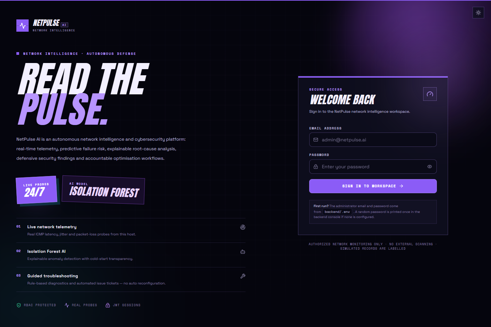

### 6.6.1 First sign-in

1. Open `http://127.0.0.1:5173` (development) or
   `http://127.0.0.1:8000` (built application).
2. Enter the administrator email shown by setup.
3. Enter the generated administrator password.
4. Select **Sign in**.

The session is stored as a JWT access token in browser storage. The default
lifetime is 480 minutes (8 hours) and can be changed with
`ACCESS_TOKEN_EXPIRE_MINUTES`.

### 6.6.2 Session restore and expiry

- Reloading the page validates the token with `GET /api/auth/me`.
- An expired or invalid token clears the session and returns the user to the
  login screen with an explanatory message.
- Signing out calls the logout endpoint and removes the browser token. The JWT
  is stateless, so logout is client-side; a copied token remains valid until it
  expires.
- Always sign out on a shared machine.

### 6.6.3 Login errors

| Message | Meaning | Action |
|---|---|---|
| `Invalid email or password` | Email unknown or password wrong | Re-enter carefully; the message intentionally does not reveal which field failed |
| `This account is disabled` | Administrator deactivated the account | Contact an administrator |
| `Too many failed sign-in attempts. Wait five minutes and try again.` | Eight failures within five minutes from the same client and email | Wait five minutes |
| `Authentication required or session expired` | Token missing, malformed or expired | Sign in again |

### 6.6.4 Account management limits

- Accounts are created by an administrator in **Settings > Team access**.
- Password hashes use Argon2.
- The interface has no self-service password reset or password-change screen.
  If a password is lost, an administrator must handle the account outside the
  normal UI workflow. Creating a replacement account is the supported
  administrative action in the current build.

---

## 6.7 Workspace interface

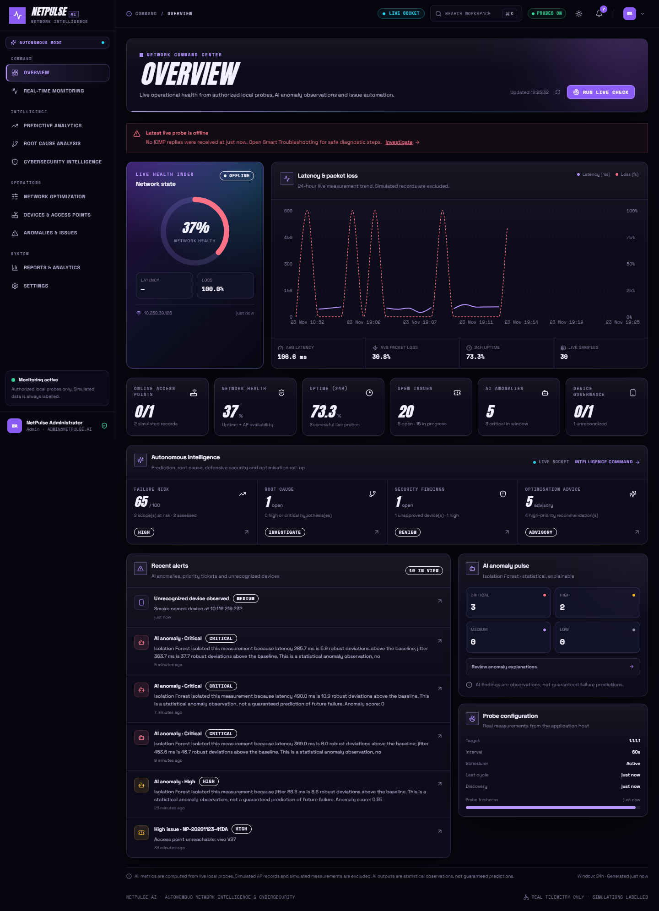

### 6.7.1 Navigation groups

| Group | Modules |
|---|---|
| Workspace | Overview, Network Monitoring, Access Points, Connected Devices |
| Intelligence | AI Anomaly Detection, Smart Troubleshooting, Issue Management |
| Operations | Automation Testing, Reports, Settings |

On screens narrower than 1024 px, the sidebar becomes a slide-in drawer. Open it
with the menu button in the header. The current page is shown in the header
breadcrumb.

### 6.7.2 Header controls

| Control | Purpose |
|---|---|
| **Search workspace** / `Ctrl+K` | Opens the command palette |
| **Live probes** badge | Indicates the live-monitoring feature area |
| Theme button | Switches between the dark espresso/wine and light beige/white themes |
| Bell | Opens recent operational alerts |
| Avatar and chevron | Account menu, settings link and **Sign out** |

### 6.7.3 Command palette

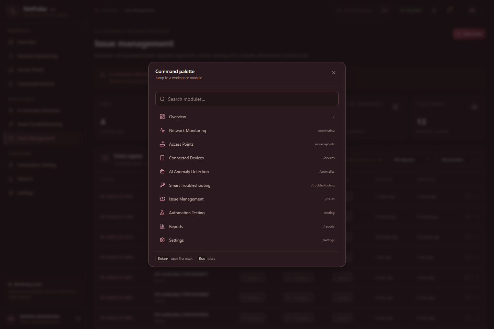

1. Press `Ctrl+K` (or `Cmd+K` on macOS), or select **Search workspace**.
2. Type part of a module name.
3. Use the arrow keys to move through results.
4. Press `Enter` to open the first result, or select a row.
5. Press `Esc` to close without navigating.

### 6.7.4 Notifications

The bell shows a dot when recent alerts exist. The panel lists current AI
anomalies, high-priority open tickets and unrecognized devices. Selecting an
alert opens the related module. The panel closes when you select outside it or
press the close layer.

### 6.7.5 Theme

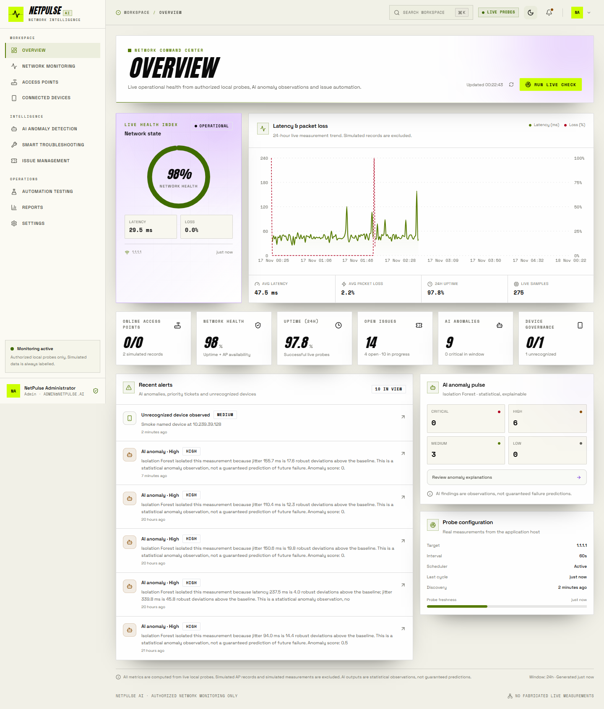

- The header button toggles dark and light immediately.
- The choice is stored in browser local storage and survives a reload.
- Administrators can choose a default theme in **Settings**. Saving applies it
  to the current browser; each browser still remembers its own toggle.

### 6.7.6 Mobile layout

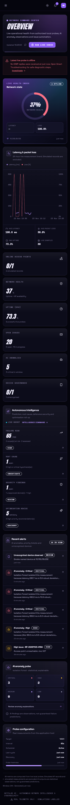

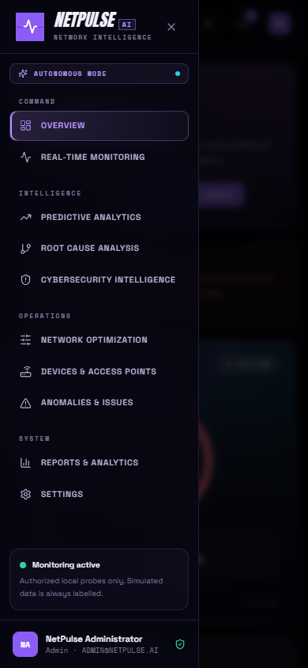

Cards stack vertically, charts resize, tables remain usable, and the navigation
drawer closes after a module is selected. The verified viewport is 390 x 844,
with no horizontal overflow.

### 6.7.7 Feedback states

Every module provides:

- a skeleton while initial data loads;
- an error panel with **Retry** when the API is unavailable;
- an empty state that explains how to create the first record;
- toast notifications for successful and failed actions;
- inline field validation in dialogs.

---

## 6.8 Module walkthrough

### 6.8.1 Overview

**Purpose:** provide a single operational summary.

**What it shows:**

- **Live health index** ring and current network state.
- Latest probe target, latency, loss and freshness.
- **Uptime (24h)**, average latency, average packet loss and live sample count.
- 24-hour latency and packet-loss trend using live measurements only.
- **Online access points**, **Open issues**, **AI anomalies** and
  **Device governance** cards.
- **Recent alerts** for AI findings, priority tickets and unrecognized devices.
- **Probe configuration** and scheduler context.

**How health is calculated:**

- Probe uptime = online live probes / total live probes in the window.
- AP health = online real APs / all real APs, once at least one AP has been
  checked.
- The health index is the mean of the available components. If neither
  component exists yet, the ring shows no value rather than a fabricated score.

**Actions:**

1. Select **Run live check** (Analyst or Administrator) to create a real
   measurement immediately.
2. Select **Investigate** in an offline banner to open Smart Troubleshooting.
3. Use the sidebar or an alert to move to the relevant module.

**Notes:** simulated APs and simulation measurements are excluded from every
number and chart on this page.

### 6.8.2 Network Monitoring

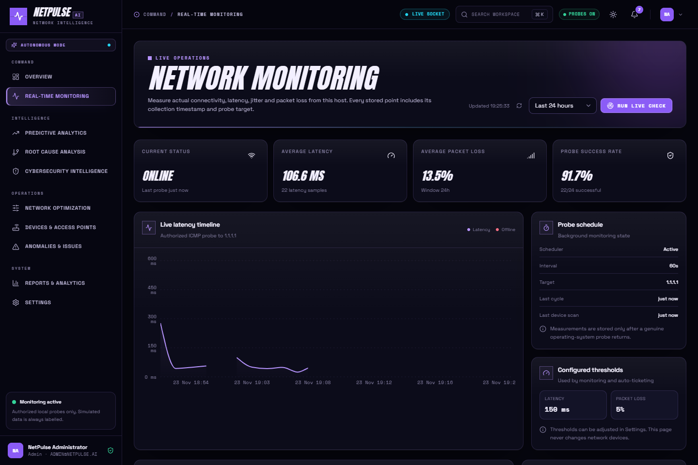

**Purpose:** inspect real probe history and scheduler behaviour.

**How to use:**

1. Choose a window: **Last 1 hour**, **Last 6 hours**, **Last 24 hours** or
   **Last 7 days**.
2. Review the latest measurement, latency timeline, packet-loss history and
   stored measurement table.
3. Select **Run live check** (Analyst or Administrator) to probe immediately.
4. Review **Probe schedule** for interval, target, last cycle time and last
   error.
5. Review **Configured thresholds** and **Host & interfaces**.

**Fields in the history table:** timestamp, status, latency, jitter, packet
loss, target, origin and error.

**Notes:**

- Only live measurements appear in the chart and history.
- A failed probe is stored as offline with the real error and 100% loss; no
  value is filled in.
- The default scheduler interval is 60 seconds and is configured in
  `backend\.env`.
- If the page reports a scheduler error, inspect `backend\logs\netpulse.log`.

### 6.8.3 Access Points

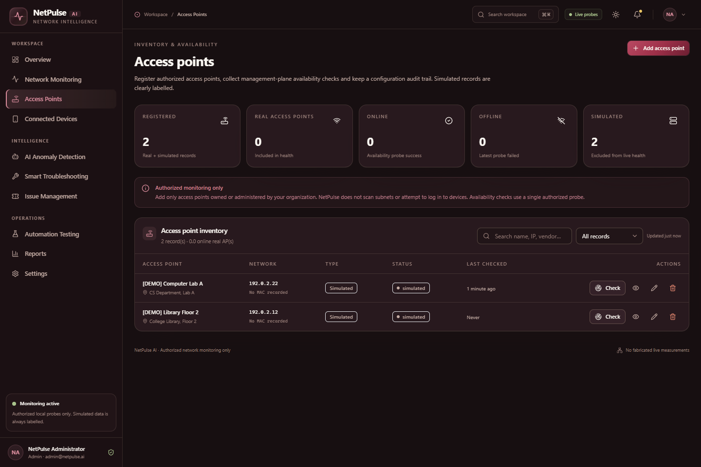

**Purpose:** maintain an authorized inventory of access points and check their
availability.

**How to use:**

1. Search by name, IP or vendor.
2. Filter by **All records**, **Real only**, **Online**, **Offline** or
   **Simulated**.
3. Select **Check** on a row (Analyst or Administrator) to run an availability
   check.
4. Select **View details** to inspect registered metadata, the simulation
   notice, 24-hour performance and configuration history.
5. Administrators can select **Add access point**, edit a row, or delete a row
   after confirmation.
6. Administrators on a Wi-Fi-connected host can select **Use current Wi-Fi**.
   NetPulse reads the operating system's current association (SSID, BSSID,
   signal, band, channel and default gateway) and opens the form prefilled with
   the gateway as the management IP. The submit button becomes **Register & run
   live check**.

**Registration fields:** name, location, management IP, optional MAC address,
vendor, model, notes and simulated flag.

**Current Wi-Fi detection:** the backend only reads its own association through
read-only OS commands. It does not scan neighbouring networks, capture frames or
retrieve Wi-Fi passwords. If that gateway is already registered as a real AP,
**Use current Wi-Fi** runs another live check on the existing record instead of
creating a duplicate. The check is a real ICMP probe (with a labelled TCP
fallback) from the backend host, so it works only while the backend is on that
Wi-Fi network. The public Vercel deployment has no wireless association and
cannot reach private addresses; it shows a clear unavailable message.

**Validation:** duplicate name/IP pairs return `409`; malformed IP or MAC
addresses return `422`.

**Simulation behaviour:** checking a simulated AP writes a measurement with
`data_origin = simulation` and keeps the status **Simulated**. It is excluded
from live health. The detail dialog displays a simulation warning.

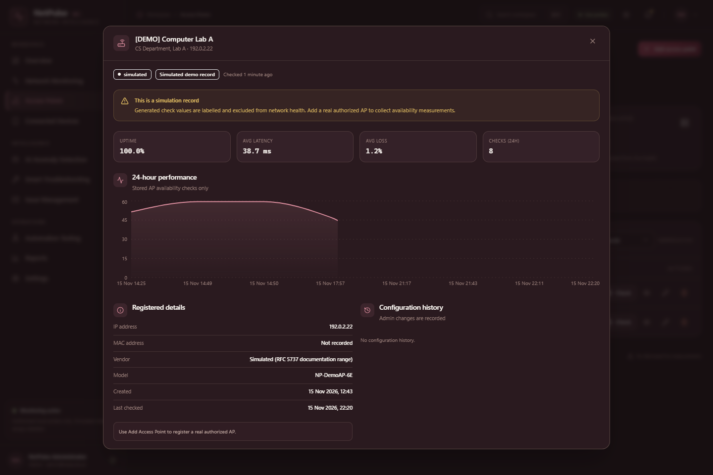

**Notes:**

- Only register devices you are authorized to monitor.
- Deleting an AP cascades its measurements and configuration history. Tickets
  and recommendations keep their text but lose the AP reference.
- A real AP starts as **Unknown** and moves to **Online** or **Offline** after
  the first real check.

### 6.8.4 Connected Devices

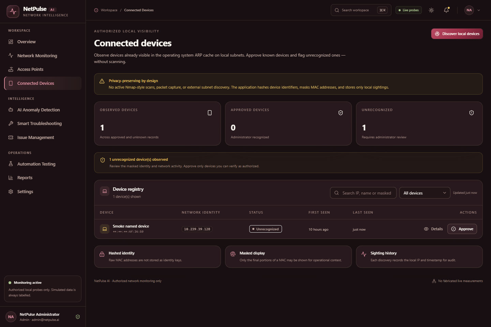

**Purpose:** provide privacy-preserving visibility of devices already visible in
the operating-system ARP cache.

**How to use:**

1. Select **Discover local devices** (Analyst or Administrator).
2. Review the summary: observed, approved and unrecognized.
3. Search by IP, display name or masked MAC.
4. Filter by **All devices**, **Approved** or **Unrecognized**.
5. Open **Details** to review network identity, approval state, observation
   history and notes.
6. Administrators can edit the display name and notes, or approve the device.

**Privacy design:**

- Only the OS ARP cache is read. There is no active ping sweep, port scan or
  packet capture.
- Identity is stored as a SHA-256 hash of the normalized MAC.
- The displayed MAC is masked to the last three octets.
- Hostnames are usually unresolved by design.

**Notes:**

- Devices on other VLANs or subnets may not appear.
- Discovery runs every five minutes when enabled, and on demand.
- Approval is an administrative decision. Approve only devices you can verify
  as authorized.

### 6.8.5 AI Anomaly Detection

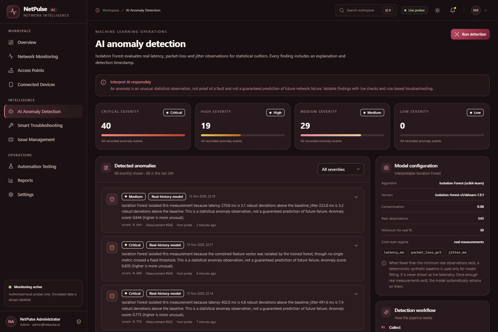

**Purpose:** identify statistical outliers in real latency, packet loss and
jitter observations.

**How to use:**

1. Select **Run detection** (Analyst or Administrator).
2. Review the severity cards and the detected-event list.
3. Filter by severity.
4. Expand an event to read **Why this was flagged**.
5. Review **Model configuration** for algorithm, version, contamination,
   real-observation count, minimum samples and cold-start regime.
6. Follow the event explanation into troubleshooting or the related ticket.

**Severity guidance:** severity combines the Isolation Forest decision with
robust deviations from the baseline. An offline probe is always treated as a
critical observation. The explanation lists the metrics that contributed.

**Cold start:** when fewer than the configured minimum real observations exist
(default 30), the model fits a deterministic synthetic baseline. The interface
and API disclose this with `used_sample_baseline`. The baseline is never stored
or displayed as live telemetry. Once enough real observations exist, the model
automatically trains on real history.

**Notes:**

- An anomaly is not proof of a fault and not a forecast.
- High and Critical events can create an automatic ticket when automation is
  enabled.
- Detection is idempotent per measurement; re-running it does not duplicate
  events.

### 6.8.6 Smart Troubleshooting

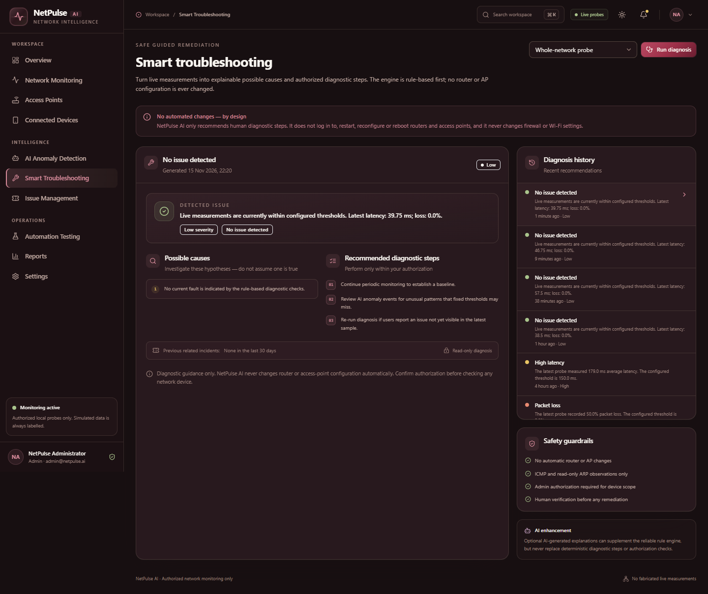

**Purpose:** convert measurements into explainable possible causes and safe,
authorized diagnostic steps.

**How to use:**

1. Choose **Whole-network probe** or a specific access point. Simulated APs are
   marked `[SIMULATED]`.
2. Select **Run diagnosis** (Analyst or Administrator).
3. Read **Detected issue**, severity and issue type.
4. Review **Possible causes** and **Recommended diagnostic steps**.
5. Check **Related tickets** and the permanent safety note.
6. Use **Diagnosis history** to revisit earlier recommendations.

**Rule coverage:** connectivity failure, high latency, packet loss, access point
unavailable, insufficient data, simulated AP and no issue detected. Thresholds
come from Settings.

**Safety:** the engine never logs in to, restarts, reconfigures or reboots
network equipment. It never changes firewall or Wi-Fi settings. Simulated APs
are refused for real diagnosis and receive simulation-specific guidance.

### 6.8.7 Issue Management

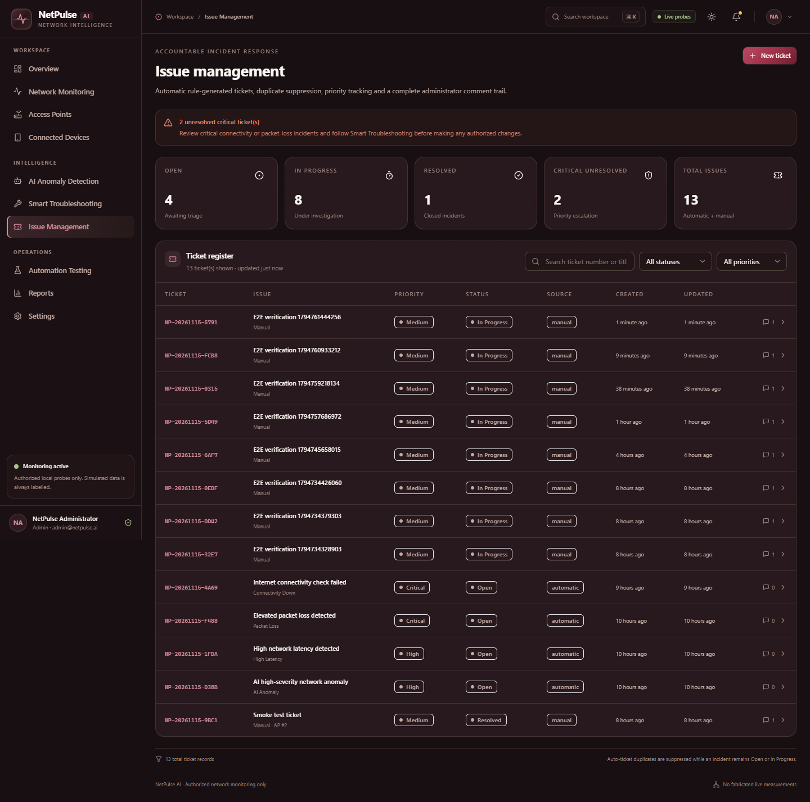

**Purpose:** track automatic and manual incidents through a controlled workflow.

**How to use:**

1. Review the statistics: total issues, open, in progress and critical
   unresolved.
2. Search by ticket number or title.
3. Filter by status and priority.
4. Select a ticket to open its detail dialog.
5. Analysts and administrators can change status and priority, save, and add
   comments.
6. Select **New ticket** to create a manual ticket.

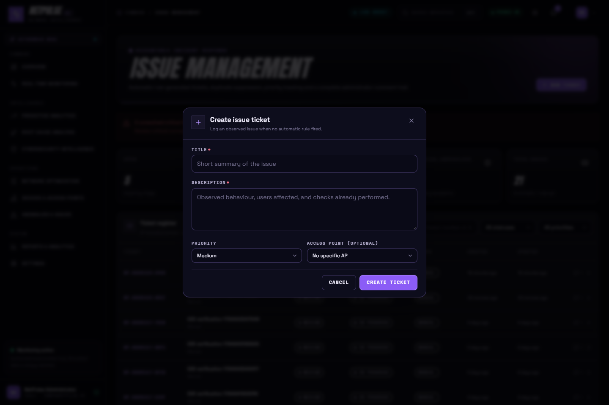

**Manual ticket fields:** title, description, priority and optional real access
point. Manual tickets are assigned to the creating analyst and use a random
fingerprint, so they are never suppressed as duplicates.

**Automatic tickets:** created by threshold rules, AP-offline checks and
High/Critical AI events. Ticket numbers, source, issue type, AP reference and
anomaly reference are stored.

**Statuses:** **Open**, **In Progress** and **Resolved**. Setting a ticket to
Resolved records `resolved_at`; reopening clears it.

**Duplicate suppression:** an automatic rule reuses an active ticket with the
same fingerprint (Open or In Progress). After the ticket is Resolved, the same
condition can create a new ticket for a new incident.

**Notes:** the interface is read-only for Viewers. Comments are attributed to
the signed-in user.

### 6.8.8 Automation Testing

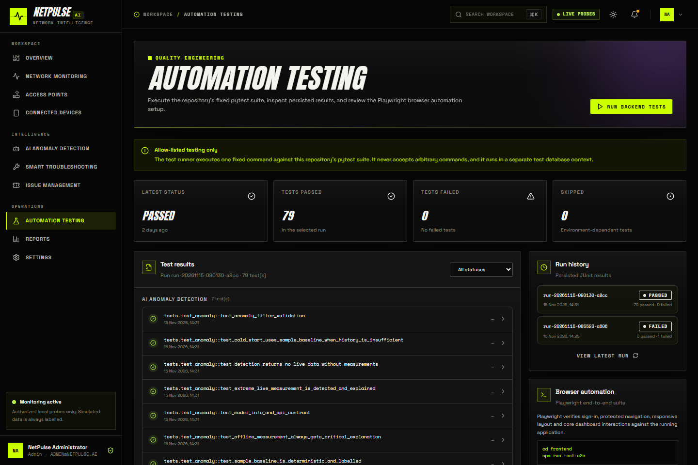

**Purpose:** run the backend Pytest suite from the application and inspect
persisted results.

**How to use:**

1. Administrators select **Run backend tests**.
2. Wait for the progress banner to finish; the page polls the run status.
3. Review passed, failed and skipped counts.
4. Filter test results by status.
5. Select a test row to view its suite, duration and failure details.
6. Use **Run history** to select an earlier run, or **View latest run** to
   return to the newest.

**Safety:** the runner executes one fixed, allow-listed pytest command. It does
not accept arbitrary commands. Tests use a throw-away database and do not touch
the development data.

**Notes:**

- Only administrators can start a run; all signed-in users can view results.
- Only one run can be active at a time; a second request returns `409`.
- Playwright browser tests are executed separately with
  `npm.cmd run test:e2e` and are intentionally not launchable from the API.
- If the runner is disabled by environment configuration, the start control
  returns `403`.

### 6.8.9 Reports

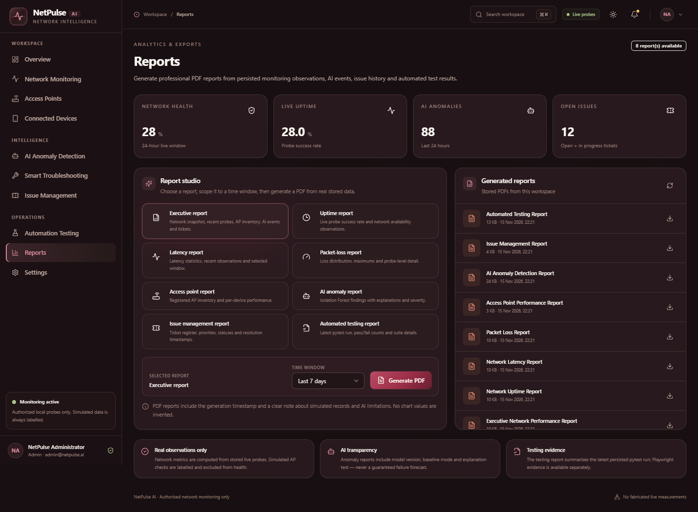

**Purpose:** generate PDF reports from persisted observations.

**Available reports:**

| Type | Contents |
|---|---|
| Executive report | Network snapshot, recent probes, AP inventory, AI events and tickets |
| Uptime report | Live probe success rate and availability observations |
| Latency report | Latency statistics and recent observations |
| Packet-loss report | Loss distribution, maximums and probe detail |
| Access point report | AP inventory and per-device performance |
| AI anomaly report | Isolation Forest findings with explanations and severity |
| Issue management report | Ticket register, priorities, statuses and resolution timestamps |
| Automated testing report | Latest persisted pytest run, counts and suite details |

**How to use:**

1. Select one of the eight report cards.
2. Choose a window: **Last 24 hours**, **Last 7 days**, **Last 30 days** or
   **Last 90 days**.
3. Select **Generate PDF** (Analyst or Administrator).
4. Find the file in **Generated reports** and select the download button.

**Report content:** each PDF includes a generation timestamp, reporting window
and a note about simulated records and AI limitations. No chart value is
invented. If a window contains no data, the report states that explicitly.

**Storage:** PDFs are written to `reports\` with names such as
`netpulse_executive_YYYYMMDD_HHMMSS.pdf`. Downloads require authentication and
are restricted to the reports directory.

### 6.8.10 Settings

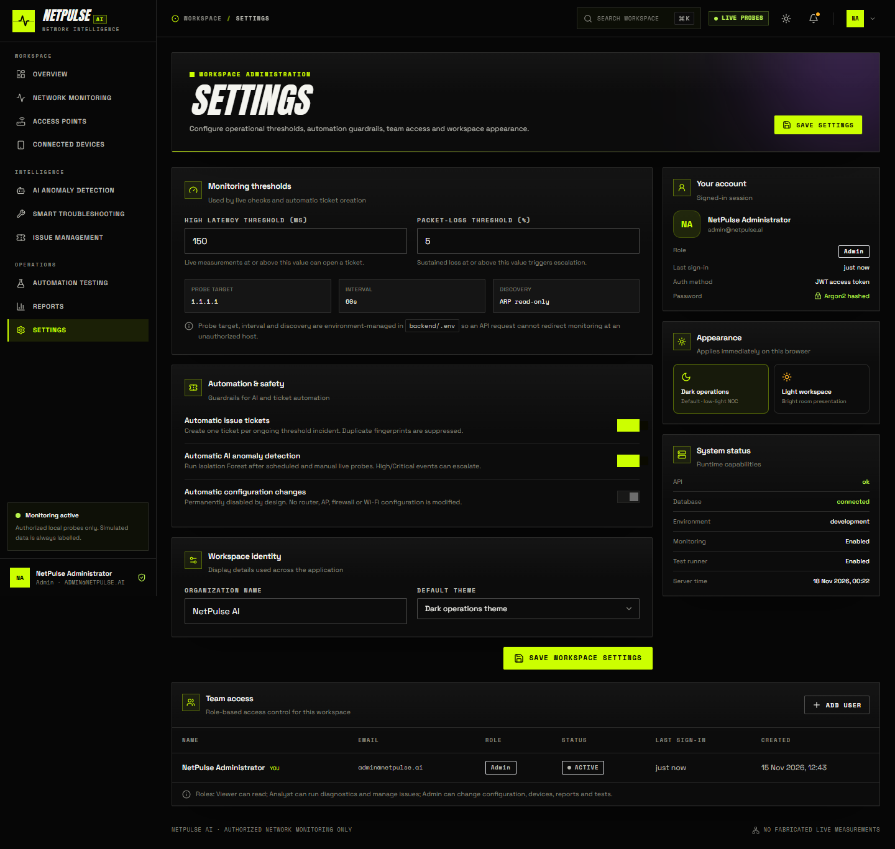

**Purpose:** configure thresholds, automation, workspace identity, appearance,
system status and team access.

**Sections:**

- **Monitoring thresholds:** high-latency threshold in milliseconds and
  packet-loss threshold in percent. These are used by live checks, automatic
  tickets and troubleshooting.
- **Automation & safety:** automatic issue tickets, automatic AI anomaly
  detection, and the permanently disabled automatic-configuration-change
  control.
- **Workspace identity:** organization name and default theme.
- **Your account:** role, last sign-in, JWT auth method and Argon2 note.
- **Appearance:** dark and light previews that apply immediately.
- **System status:** monitoring, scheduler, test runner, database and report
  directory capabilities.
- **Team access (Administrators):** user list and **Add user** dialog.

**Saving:** Administrators select **Save settings**. Viewers and Analysts see a
read-only notice and disabled fields. Invalid thresholds return `422`.

**Adding a user:**

1. Select **Add user**.
2. Enter full name, email, temporary password (10 or more characters) and role.
3. Select **Create user**.
4. Give the password to the user through a secure channel.
5. Ask the user to sign in and verify the assigned role.

**Notes:**

- Probe target, interval and discovery are environment-managed in
  `backend\.env`. They are displayed but cannot be changed through the API, so a
  request cannot redirect monitoring at an unauthorized host.
- Automatic configuration changes are permanently disabled by design.

---

## 6.9 Common workflows

### 6.9.1 First-day acceptance checklist

1. Start both services.
2. Confirm `/api/health` reports `ok`.
3. Sign in as administrator.
4. Open **Overview** and run a live check.
5. Confirm a new measurement appears in **Network Monitoring**.
6. Open **Access Points** and check a real AP if one is registered.
7. Open **Connected Devices** and run discovery.
8. Open **AI Anomaly Detection** and run detection.
9. Open **Smart Troubleshooting** and run a whole-network diagnosis.
10. Open **Issue Management** and confirm the register renders.
11. Open **Automation Testing** and confirm the latest run is visible.
12. Generate one PDF report and download it.
13. Open **Settings** and confirm the system status.
14. Sign out.

### 6.9.2 Register and validate an access point

1. Sign in as Administrator.
2. Open **Access Points**.
3. Select **Add access point**.
4. Enter name and location.
5. Enter the authorized management IP.
6. Optionally enter MAC, vendor, model and notes.
7. Leave the simulated flag off for a real device.
8. Select the submit button in the dialog.
9. Select **Check** on the new row.
10. Open **View details** to confirm status, performance and history.

If the check fails, the AP is marked offline and the real error is recorded.
Use Smart Troubleshooting before changing any configuration.

**Shortcut for the local Wi-Fi gateway:**

1. Sign in as Administrator on the Wi-Fi-connected computer.
2. Open **Access Points** and select **Use current Wi-Fi**.
3. Confirm the detected SSID, signal, band, channel and gateway in the banner.
4. Select **Register & run live check**; the first real measurement appears
   immediately and the AP moves from **Unknown** to **Online** or **Offline**.
5. Select **Use current Wi-Fi** again later to run another check against the
   registered gateway without creating a duplicate.

The same button on the Vercel deployment explains that the cloud function has no
Wi-Fi association; it never attempts to probe a private address from the cloud.

### 6.9.3 Investigate an AI anomaly

1. Open **AI Anomaly Detection**.
2. Run detection or wait for the scheduler.
3. Expand a High or Critical event.
4. Read which metrics crossed robust thresholds.
5. Open **Smart Troubleshooting** and diagnose the whole network or the related
   AP.
6. Compare the rule-based diagnosis with the statistical explanation.
7. Create or review the linked ticket in **Issue Management**.
8. Record the checks performed as ticket comments.
9. Resolve only after verification.

### 6.9.4 Create and resolve a manual ticket

1. Open **Issue Management**.
2. Select **New ticket**.
3. Enter a clear title and a description containing observed behaviour, users
   affected and checks already performed.
4. Choose priority and, optionally, a real AP.
5. Select **Create ticket**.
6. Open the new ticket.
7. Change status to **In Progress** and save.
8. Add diagnostic comments.
9. After verification, change status to **Resolved** and save.
10. Confirm the resolution timestamp appears.

### 6.9.5 Approve a local device

1. Open **Connected Devices**.
2. Select **Discover local devices**.
3. Filter to **Unrecognized**.
4. Open **Details** for a device.
5. Verify the masked identity and IP against your inventory.
6. As Administrator, enter a recognizable display name and notes.
7. Select **Save metadata**, then **Approve device**.
8. Confirm the device badge changes to **Approved**.

Never approve a device you cannot verify.

### 6.9.6 Generate and distribute a report

1. Open **Reports**.
2. Select the report type.
3. Select the time window.
4. Generate the PDF.
5. Download it from the library.
6. Verify the file opens and contains the expected timestamp and window.

### 6.9.7 Run the verification suites

From the project root:

```powershell
powershell -ExecutionPolicy Bypass -File .\scripts\test-all.ps1
```

Or separately:

```powershell
cd backend
.\.venv\Scripts\python.exe -m pytest
.\.venv\Scripts\python.exe -m pytest --cov=app --cov-report=xml:..\reports\test-runs\coverage.xml

cd ..\frontend
npm.cmd run test:e2e
```

The latest verified results are 89 backend tests and 20 Playwright tests, all
passing, with 82% backend line coverage.

### 6.9.8 Add a team member

1. Sign in as Administrator.
2. Open **Settings**.
3. In **Team access**, select **Add user**.
4. Enter name, email, temporary password and the minimum role.
5. Select **Create user**.
6. Confirm the account appears in the table.
7. Ask the user to sign in and report any access problem.

---

## 6.10 Reading the data correctly

### 6.10.1 Live versus simulation

| Indicator | Meaning |
|---|---|
| `Live` badge, `data_origin=live` | Real OS probe result |
| `Simulation` badge, `data_origin=simulation` | Labelled demonstration record |
| `[DEMO]` AP name | Seeded demonstration AP with a documentation IP |
| `used_sample_baseline=true` | The model was fitted on the disclosed cold-start baseline |

Simulation records are excluded from live health, live charts, model training
and automatic ticket rules. They exist to demonstrate the workflow without
pretending to be real telemetry.

### 6.10.2 Health and uptime

- **Uptime** is the percentage of live probes that received replies in the
  selected window.
- **Network health** averages probe uptime and AP online ratio when both are
  available.
- A missing value is displayed as a dash, not as zero or a guessed number.
- Freshness compares the last scheduler cycle with the configured interval. A
  stale timestamp usually means the scheduler is disabled or the backend was
  stopped.

### 6.10.3 Anomaly score and severity

- The anomaly score is derived from the Isolation Forest decision. Higher means
  more unusual.
- Severity adds robust-z evidence and offline state.
- A Low event means the forest did not classify the row as an outlier, even if
  the row is retained for review.
- The explanation is diagnostic evidence, not a root-cause conclusion.

### 6.10.4 Ticket priority

| Priority | Typical source |
|---|---|
| Critical | Connectivity failure, loss of 20% or more, or a Critical AI event |
| High | High latency, loss of 5% or more, offline AP, or a High AI event |
| Medium | Manual ticket default or lower-severity workflow |
| Low | Manual ticket with limited impact |

Thresholds are configurable; the values above describe the default rules.

### 6.10.5 Time and timezone

All persisted timestamps are UTC. The interface converts them for display. When
comparing a screenshot with a database row, expect a timezone offset unless the
browser is set to UTC.

---

## 6.11 Error handling and recovery

### 6.11.1 HTTP and interface errors

| Symptom | Likely cause | Safe recovery |
|---|---|---|
| Error panel with **Retry** | Backend stopped or unreachable | Start the backend, confirm `/api/health`, retry |
| `401 Authentication required` | Expired or missing token | Sign in again |
| `403 This action requires the ... role` | Insufficient role | Ask an administrator for the minimum required role |
| `404` | Record was deleted or the URL is wrong | Refresh the list; use in-app navigation |
| `409` on AP creation | Duplicate name/IP | Edit the existing AP or choose a unique name/IP |
| `409` on user creation | Email already exists | Use the existing account or another email |
| `409` on test start | A test run is already active | Wait for completion |
| `422` | Invalid field value | Read the inline field error and correct the value |
| `429` at login | Too many failures | Wait five minutes |
| `500` | Unhandled server error | Check `backend\logs\netpulse.log`; restart if necessary |

### 6.11.2 Monitoring errors

| Symptom | Meaning | Action |
|---|---|---|
| Latest probe offline | No ICMP replies | Verify the target, local connectivity and firewall/ICMP policy |
| `Probe failed` toast | The OS command failed or timed out | Check the target and backend log; retry |
| No live measurements | Scheduler disabled or no probe yet | Run a live check; confirm `MONITORING_ENABLED=true` |
| Scheduler issue banner | Last cycle recorded an exception | Read the error in the banner and log, then restart the backend |
| Health shows a dash | No usable live data or no checked APs | Run a probe and check a real AP |
| TCP fallback label | ICMP unavailable, fallback used | Treat the result as a labelled fallback, not pure ICMP |

### 6.11.3 Device discovery errors

| Symptom | Meaning | Action |
|---|---|---|
| No devices found | ARP cache empty, different subnet or discovery disabled | Browse the local network from this host, confirm `DEVICE_DISCOVERY_ENABLED=true`, retry |
| Device IP changes | DHCP lease change | Approval is tied to the hashed MAC, so the device remains approved |
| Hostname not resolved | Deliberate privacy design | Identify the device from its masked MAC and IP inventory |

### 6.11.4 AI and troubleshooting issues

| Symptom | Meaning | Action |
|---|---|---|
| `No live measurements yet` | Detection has nothing real to score | Run a live check first |
| Cold-start notice | Too few real observations | Continue collecting; the model retrains automatically |
| No anomalies found | Current data is within the learned distribution | This is a valid result, not a failure |
| Simulated AP refused | Real diagnosis is not possible for a simulation | Select a real AP or use the whole-network probe |
| `Insufficient data` diagnosis | No usable live measurement | Run a live probe, then diagnose again |

### 6.11.5 Report and test errors

| Symptom | Meaning | Action |
|---|---|---|
| `Unknown report type` | Invalid type value | Choose one of the eight cards |
| `Invalid report filename` | Path traversal or malformed name | Download through the report library |
| Report not found | File was moved or deleted | Regenerate the report |
| Test runner disabled | Environment disables it | Set `TEST_RUNNER_ENABLED=true` and restart |
| Test run fails | A real test failure | Open the failing test details and backend log |
| Playwright cannot launch | Bundled headless shell blocked | Use installed Chrome (`PLAYWRIGHT_CHANNEL=chrome`) or Edge/Chromium |

### 6.11.6 Database errors

| Symptom | Meaning | Action |
|---|---|---|
| `degraded` health | Database check failed | Confirm the database file/permissions or MySQL service |
| MySQL access denied | Wrong user, password or database | Correct `DATABASE_URL`; verify the schema was imported |
| MySQL table missing | Schema not imported | Run `database\schema.sql` or the migration |
| SQLite file locked | Another process holds a write lock | Stop duplicate backend processes |

### 6.11.7 Logs and diagnostics

- Backend log: `backend\logs\netpulse.log`, rotated at 2 MB with three backups.
- Console output: the backend PowerShell window.
- API schema: `http://127.0.0.1:8000/docs`.
- Health: `http://127.0.0.1:8000/api/health`.
- Test evidence: `reports\test-runs\`.
- Playwright report: `reports\playwright-report\index.html`.

When reporting a problem, include the timestamp, the module, the visible error
message, the relevant log lines and whether the record was live or simulated.
Never include passwords, JWT tokens or raw `.env` contents.

---

## 6.12 Backup, restore and reset

### 6.12.1 SQLite backup

Stop the backend before copying the file:

```powershell
Copy-Item backend\data\netpulse.db reports\netpulse-backup.db
```

For a live consistent snapshot, use SQLite's backup mechanism:

```sql
VACUUM INTO 'reports/netpulse-backup.db';
```

### 6.12.2 Restore SQLite

1. Stop the backend.
2. Replace `backend\data\netpulse.db` with the backup.
3. Start the backend.
4. Sign in and verify the dashboard and a recent measurement.

### 6.12.3 MySQL backup

See `database\README.md` for `mysqldump`, restore and verification commands.

### 6.12.4 Reset a demonstration database

A reset is destructive. Only do this on a disposable demonstration instance.

1. Stop the backend.
2. Back up or rename `backend\data\netpulse.db`.
3. Start the backend.
4. The seed service recreates settings, the first administrator (if the user
   table is empty) and the two demo APs.
5. Retrieve the administrator password from `backend\.env` or the server log.

Never reset a database that contains evidence you still need.

---

## 6.13 Security and authorized use

- Monitor only networks and devices you own or are explicitly authorized to
  observe.
- Device discovery reads the local ARP cache only. Do not attempt to extend it
  into unauthorized scanning.
- The troubleshooting engine is advisory. Perform only the steps permitted by
  your organization's change-control policy.
- Protect `backend\.env`, the SQLite database, backups and generated reports.
  They contain hashed credentials, device hashes and operational metadata.
- Use a strong, unique administrator password. Do not reuse a college or
  personal password.
- Serve the application over HTTPS in any non-local deployment. Local HTTP is
  acceptable only for the isolated demonstration host.
- Sign out on shared machines. Treat a JWT as a bearer credential.
- Do not expose MySQL port 3307 or phpMyAdmin port 8081 beyond localhost.
- Keep dependencies updated and review security advisories before deployment.

---

## 6.14 Keyboard shortcuts and accessibility

| Shortcut | Action |
|---|---|
| `Ctrl+K` / `Cmd+K` | Open the command palette |
| `Enter` | Open the first command-palette result |
| `Esc` | Close the palette or an open overlay |
| `Tab` / `Shift+Tab` | Move focus through controls |
| `Space` / `Enter` | Activate a focused button or link |

The interface uses semantic buttons, labelled form fields, dialog titles, focus
styles and accessible names for icon-only controls. Browser zoom and operating
system contrast settings should be used where needed. A formal screen-reader
audit was not part of the project test scope.

---

## 6.15 Frequently asked questions

**Why do I see two `[DEMO]` access points?**
They are seeded only when the access-point table is empty, to demonstrate the
interface. They are labelled simulated, use documentation addresses and never
contribute to live health.

**Why is the health ring empty?**
There is no usable live probe yet, or no real AP has been checked. Run a live
check and check a real AP. The application does not substitute a fake score.

**Why did my probe fail while the internet works?**
ICMP may be blocked by the target or a local firewall. The application records
the real failure. Confirm with an OS `ping` command and review firewall policy.
A labelled TCP fallback may be used where the OS permits it.

**Why are few or no devices listed?**
Only devices already present in the local ARP cache are visible. Devices on
other subnets may not appear, and the cache may be empty until the host
communicates on the local network.

**Why does the AI report an anomaly when thresholds are normal?**
Isolation Forest can isolate a combination of values that is unusual relative to
the learned distribution, even if no single fixed threshold was crossed. Read the
robust-z explanation and validate with a live check and troubleshooting.

**Can the AI fix the network?**
No. It detects and explains. Configuration changes are permanently disabled by
design.

**Can I run any test command from the interface?**
No. The runner executes one fixed, allow-listed pytest command.

**Why do Playwright tests use Chrome?**
The bundled Playwright headless shell is blocked by this machine's Application
Control policy. The suite defaults to the installed Chrome channel. Use
`PLAYWRIGHT_CHANNEL=msedge` or install Chromium on other hosts.

**Can I change the probe target from Settings?**
No. It is environment-managed in `backend\.env` to prevent an API request from
redirecting monitoring at an unauthorized host.

**How do I change a password?**
The current interface has no self-service password change. An administrator must
manage the account. Create a replacement account with the correct role if
needed.

**Is MySQL verified?**
SQLite is the verified runtime. MySQL 8 DDL, migration and Docker Compose are
provided, but the import was not executed on this machine. Verify on a MySQL 8
host before deployment.

---

## 6.16 Chapter summary

This manual covered installation, startup, sign-in, roles, every workspace
module, common operational workflows, data interpretation, error recovery,
backup, security and accessibility. Following the safe operating rules keeps
NetPulse AI within its design boundary: observe real measurements, explain
statistical findings, recommend human action and preserve evidence.

The next chapter evaluates the project against its objectives and sets out
future work.
