<div align="center">

# NetPulse AI

## Intelligent Wi-Fi Network Monitoring & Diagnostics Platform

**A Final-Year Project Report**

Submitted in partial fulfilment of the requirements for the degree of

**Bachelor of Science (B.Sc.)**

---

| Field | Detail |
|---|---|
| Student name | _[Student Name]_ |
| Roll number / registration | _[Roll Number]_ |
| Programme | B.Sc. - Final-Year Project |
| Department | _[Department]_ |
| Institution | _[College / University]_ |
| Academic year | _[Year]_ |
| Project guide | _[Guide Name]_ |
| Submitted on | _[Submission Date]_ |

</div>

<div style="page-break-before: always;"></div>

## Declaration

I declare that this report and the associated NetPulse AI implementation are my
own work, except where explicitly acknowledged. All external libraries,
standards, research papers and documentation are cited in Chapter 8. The project
was developed and tested on an authorized local network. No third-party network
was monitored, and no fabricated measurement is presented as live telemetry.

Place: _[Place]_

Date: _[Date]_

Signature: ______________________________

_[Student Name]_

---

## Certificate

This is to certify that _[Student Name]_, roll number _[Roll Number]_, has
completed the final-year project titled **NetPulse AI - Intelligent Wi-Fi Network
Monitoring & Diagnostics Platform** under my supervision. The report has been
reviewed and is submitted for evaluation.

Project guide: ______________________________

Head of department: ______________________________

External examiner: ______________________________

Date: _[Date]_

---

## Acknowledgements

I thank my project guide for guidance on scope, testing and documentation, the
department for laboratory access, and the open-source maintainers of FastAPI,
React, scikit-learn, SQLAlchemy, Playwright and the other libraries used in this
project. I also acknowledge the authors of the standards and research cited in
Chapter 8. Finally, I thank my classmates and family for their support during the
project.

---

## Abstract

Wireless networks have become the primary access path for teaching, laboratory
work, remote collaboration and everyday communication. Yet the tools available
to students and small network administrators are often split between expensive
enterprise platforms that require SNMP credentials and infrastructure agents,
and low-level utilities that produce raw output without interpretation. As a
result, intermittent latency, packet loss, jitter and access-point outages are
difficult to reproduce, explain and document.

**NetPulse AI** is a full-stack, local-first Wi-Fi monitoring and diagnostics
platform designed for authorized college laboratory and home networks. It
combines real operating-system measurements with machine learning, rule-based
reasoning and incident automation. A background scheduler executes ICMP echo
probes against a configurable target, records latency, packet loss and jitter,
and stores each observation with an explicit data origin. An Isolation Forest
model identifies statistical outliers and explains them with robust z-scores.
A deterministic troubleshooting engine converts observations into possible
causes and safe diagnostic steps. Threshold breaches and high-severity anomalies
create deduplicated issue tickets with priorities, statuses and comments. A
privacy-preserving device inventory reads only the local ARP cache, hashes MAC
identities and masks their display. Ten workspace modules and eight PDF report
types make the results presentable to a supervisor or network administrator.

The system is implemented with React 18, Vite, Tailwind CSS and Recharts on the
frontend, and FastAPI, SQLAlchemy, Pydantic, scikit-learn and ReportLab on the
backend. It supports SQLite for zero-setup operation and MySQL 8 for deployment.
Role-based access control, Argon2 password hashing, JWT sessions, login
throttling, security headers and an allow-listed test runner address the main
security concerns of a network-facing student project.

The final verification run executed **103 backend Pytest tests** and **21
Playwright end-to-end tests**, all passing, with **80% backend line coverage**.
Twenty-one screenshots were captured from the running application. A key design
principle is that the platform **never fabricates live telemetry**: simulated
records are explicitly labelled, excluded from live health calculations and
disclosed in both the interface and the database.

**Keywords:** Wi-Fi monitoring, network diagnostics, Isolation Forest, anomaly
detection, explainable AI, FastAPI, React, SQLAlchemy, automated testing, PDF
reporting, network operations.

---

## List of Abbreviations

| Abbreviation | Meaning |
|---|---|
| AI | Artificial Intelligence |
| AP | Access Point |
| API | Application Programming Interface |
| ARP | Address Resolution Protocol |
| ASVS | Application Security Verification Standard |
| CORS | Cross-Origin Resource Sharing |
| CRUD | Create, Read, Update, Delete |
| DFD | Data-Flow Diagram |
| DHCP | Dynamic Host Configuration Protocol |
| ER | Entity-Relationship |
| HTTP / HTTPS | Hypertext Transfer Protocol / Secure |
| ICMP | Internet Control Message Protocol |
| JSON | JavaScript Object Notation |
| JWT | JSON Web Token |
| MAC | Media Access Control |
| MAD | Median Absolute Deviation |
| MFA | Multi-Factor Authentication |
| ML | Machine Learning |
| NMS | Network Management System |
| OS | Operating System |
| PDF | Portable Document Format |
| RBAC | Role-Based Access Control |
| REST | Representational State Transfer |
| RSSI | Received Signal Strength Indicator |
| SHA | Secure Hash Algorithm |
| SNR | Signal-to-Noise Ratio |
| SQL | Structured Query Language |
| TLS | Transport Layer Security |
| UML | Unified Modeling Language |
| UTC | Coordinated Universal Time |
| WCAG | Web Content Accessibility Guidelines |
| Wi-Fi | Wireless Fidelity (IEEE 802.11) |

---

## List of Screenshots

| Figure | Caption |
|---|---|
| D.1 | Login |
| D.2 | Overview dashboard |
| D.3 | Network monitoring |
| D.4 | Access points |
| D.5 | Access point detail |
| D.6 | Connected devices |
| D.7 | AI anomaly detection |
| D.8 | Smart troubleshooting |
| D.9 | Issue management |
| D.10 | Create issue ticket |
| D.11 | Automation testing |
| D.12 | Reports |
| D.13 | Settings |
| D.14 | Command palette |
| D.15 | Light theme |
| D.16 | Mobile overview |
| D.17 | Mobile navigation |

---

<div style="page-break-before: always;"></div>

## Table of Contents

- [Declaration](#declaration)
- [Certificate](#certificate)
- [Acknowledgements](#acknowledgements)
- [Abstract](#abstract)
- [List of Abbreviations](#list-of-abbreviations)
- [List of Screenshots](#list-of-screenshots)
- [1. Abstract and Introduction](#1-abstract-and-introduction)
  - [1.1 Introduction](#11-introduction)
  - [1.2 Problem statement](#12-problem-statement)
  - [1.3 Objectives](#13-objectives)
  - [1.4 Scope](#14-scope)
  - [1.5 Existing systems and their limitations](#15-existing-systems-and-their-limitations)
  - [1.6 Proposed solution](#16-proposed-solution)
  - [1.7 Methodology](#17-methodology)
  - [1.8 Expected outcomes and contributions](#18-expected-outcomes-and-contributions)
  - [1.9 Report organization](#19-report-organization)
- [2. System Architecture](#2-system-architecture)
  - [2.1 Architectural requirements](#21-architectural-requirements)
  - [2.2 High-level architecture](#22-high-level-architecture)
  - [2.3 Layer responsibilities](#23-layer-responsibilities)
  - [2.4 Component catalogue](#24-component-catalogue)
  - [2.5 Frontend architecture](#25-frontend-architecture)
  - [2.6 Backend architecture](#26-backend-architecture)
  - [2.7 Monitoring pipeline](#27-monitoring-pipeline)
  - [2.8 AI anomaly detection pipeline](#28-ai-anomaly-detection-pipeline)
  - [2.9 Ticketing and troubleshooting pipeline](#29-ticketing-and-troubleshooting-pipeline)
  - [2.10 Request lifecycle sequence](#210-request-lifecycle-sequence)
  - [2.11 Deployment architecture](#211-deployment-architecture)
  - [2.12 Security architecture](#212-security-architecture)
  - [2.13 Reliability and error handling](#213-reliability-and-error-handling)
  - [2.14 Key design decisions and trade-offs](#214-key-design-decisions-and-trade-offs)
  - [2.15 Non-functional requirements mapping](#215-non-functional-requirements-mapping)
  - [2.16 Project folder structure](#216-project-folder-structure)
  - [2.17 Chapter summary](#217-chapter-summary)
- [3. Database Design](#3-database-design)
  - [3.1 Design goals](#31-design-goals)
  - [3.2 Entity-relationship model](#32-entity-relationship-model)
  - [3.3 Table overview](#33-table-overview)
  - [3.4 Complete data dictionary](#34-complete-data-dictionary)
  - [3.5 Normalization](#35-normalization)
  - [3.6 Keys, constraints and integrity](#36-keys-constraints-and-integrity)
  - [3.7 Index strategy](#37-index-strategy)
  - [3.8 JSON column rationale](#38-json-column-rationale)
  - [3.9 Data provenance and simulation policy](#39-data-provenance-and-simulation-policy)
  - [3.10 Data lifecycle and retention](#310-data-lifecycle-and-retention)
  - [3.11 Sample analytical queries](#311-sample-analytical-queries)
  - [3.12 SQLite and MySQL compatibility](#312-sqlite-and-mysql-compatibility)
  - [3.13 Seeding and migrations](#313-seeding-and-migrations)
  - [3.14 Security and privacy in the data model](#314-security-and-privacy-in-the-data-model)
  - [3.15 Backup and recovery](#315-backup-and-recovery)
  - [3.16 Data-model limitations](#316-data-model-limitations)
  - [3.17 Chapter summary](#317-chapter-summary)
- [4. UML and Process Models](#4-uml-and-process-models)
  - [4.1 Actors](#41-actors)
  - [4.2 Use-case diagram](#42-use-case-diagram)
  - [4.3 Class model](#43-class-model)
  - [4.4 Sequence diagrams](#44-sequence-diagrams)
  - [4.5 Activity diagrams](#45-activity-diagrams)
  - [4.6 State models](#46-state-models)
  - [4.7 Data-flow diagrams](#47-data-flow-diagrams)
  - [4.8 Component diagram](#48-component-diagram)
  - [4.9 Deployment diagram](#49-deployment-diagram)
  - [4.10 Navigation model](#410-navigation-model)
  - [4.11 Model-to-implementation traceability](#411-model-to-implementation-traceability)
  - [4.12 Chapter summary](#412-chapter-summary)
- [5. Testing and Results](#5-testing-and-results)
  - [5.1 Testing objectives](#51-testing-objectives)
  - [5.2 Test environment](#52-test-environment)
  - [5.3 Test strategy](#53-test-strategy)
  - [5.4 Backend test suite](#54-backend-test-suite)
  - [5.5 Frontend test suite](#55-frontend-test-suite)
  - [5.6 Consolidated results](#56-consolidated-results)
  - [5.7 Functional test cases](#57-functional-test-cases)
  - [5.8 Defects found and fixed](#58-defects-found-and-fixed)
  - [5.9 Security verification](#59-security-verification)
  - [5.10 Test evidence and screenshots](#510-test-evidence-and-screenshots)
  - [5.11 What was not tested](#511-what-was-not-tested)
  - [5.12 Chapter summary](#512-chapter-summary)
- [6. User Manual](#6-user-manual)
  - [6.1 About this manual](#61-about-this-manual)
  - [6.2 Roles and permissions](#62-roles-and-permissions)
  - [6.3 System requirements](#63-system-requirements)
  - [6.4 Installation](#64-installation)
  - [6.5 Starting and stopping the application](#65-starting-and-stopping-the-application)
  - [6.6 Signing in and session handling](#66-signing-in-and-session-handling)
  - [6.7 Workspace interface](#67-workspace-interface)
  - [6.8 Module walkthrough](#68-module-walkthrough)
  - [6.9 Common workflows](#69-common-workflows)
  - [6.10 Reading the data correctly](#610-reading-the-data-correctly)
  - [6.11 Error handling and recovery](#611-error-handling-and-recovery)
  - [6.12 Backup, restore and reset](#612-backup-restore-and-reset)
  - [6.13 Security and authorized use](#613-security-and-authorized-use)
  - [6.14 Keyboard shortcuts and accessibility](#614-keyboard-shortcuts-and-accessibility)
  - [6.15 Frequently asked questions](#615-frequently-asked-questions)
  - [6.16 Chapter summary](#616-chapter-summary)
- [7. Conclusion and Future Work](#7-conclusion-and-future-work)
  - [7.1 Project recap](#71-project-recap)
  - [7.2 Objective attainment](#72-objective-attainment)
  - [7.3 Contributions](#73-contributions)
  - [7.4 Limitations](#74-limitations)
  - [7.5 Lessons learned](#75-lessons-learned)
  - [7.6 Future work](#76-future-work)
  - [7.7 Conclusion](#77-conclusion)
  - [7.8 Chapter summary](#78-chapter-summary)
- [8. References](#8-references)
  - [8.1 Standards and specifications](#81-standards-and-specifications)
  - [8.2 Research and academic sources](#82-research-and-academic-sources)
  - [8.3 Technical documentation](#83-technical-documentation)
  - [8.4 Reference-to-implementation map](#84-reference-to-implementation-map)
  - [8.5 Citation note](#85-citation-note)
- [Appendix A - API Reference](#appendix-a---api-reference)
- [Appendix B - Configuration Reference](#appendix-b---configuration-reference)
- [Appendix C - Automated Test Inventory](#appendix-c---automated-test-inventory)
- [Appendix D - Screenshot Index](#appendix-d---screenshot-index)
- [Appendix E - Submission Checklist](#appendix-e---submission-checklist)

<div style="page-break-before: always;"></div>

# 1. Abstract and Introduction

## 1.1 Introduction

Modern campuses depend on Wi-Fi for lectures, online examinations, laboratory
submissions, video calls and cloud services. When the network degrades, users
typically report only a symptom: “the internet is slow” or “the connection keeps
dropping”. Diagnosing that symptom requires three different kinds of evidence:

1. **Measurements** — how latency, packet loss and jitter change over time.
2. **Context** — which access point, interface or device is involved.
3. **Interpretation** — whether the values are normal for this network and what
   should be checked next.

Enterprise monitoring suites provide these capabilities, but they assume a
managed infrastructure: SNMP community strings, monitoring agents, dedicated
servers, alerting integrations and often commercial licences. A student or a
small lab administrator rarely has all of them. Conversely, command-line tools
such as `ping`, `tracert` and `arp` provide accurate raw measurements but no
history, no statistics, no explanation and no incident workflow.

NetPulse AI was built to close that gap. It treats a single authorized Windows
machine as a lightweight observation point. The platform performs only
non-invasive measurements, stores them in a relational database, applies
unsupervised machine learning to detect unusual behaviour, and presents the
results through a professional dashboard. It does not attempt to replace an
enterprise network management system; it provides a transparent, reproducible
and defensible monitoring workflow for a small, authorized environment.

### 1.1.1 Motivation

The project was motivated by five practical observations:

- **Intermittent faults are hard to prove.** A single ping cannot demonstrate
  that packet loss recurs every evening. Historical measurements can.
- **Raw metrics are not explanations.** A latency value of 180 ms is only
  meaningful relative to a baseline. The platform therefore reports both the
  value and its statistical deviation.
- **Incident handling is usually manual.** A monitoring alert should become a
  trackable ticket with an owner, priority and audit trail.
- **Privacy matters.** Device discovery is often implemented with active scans or
  packet capture. NetPulse AI deliberately uses only the operating system ARP
  cache and never stores a raw MAC address.
- **Student projects should use real data.** A dashboard filled with random
  numbers is visually attractive but academically weak. Every live metric in
  NetPulse AI originates from a real OS probe, and every simulated record is
  labelled as such.

---

## 1.2 Problem statement

Small and medium wireless environments lack an integrated, affordable and
privacy-aware way to answer the following questions:

1. What is the current quality of the network, expressed through latency,
   packet loss, jitter and availability?
2. Which observations are statistically abnormal relative to recent history?
3. Which access points are authorized, reachable and healthy?
4. Which devices have been observed locally, and have they been approved?
5. What are the likely causes of a detected problem, and which safe diagnostic
   steps should be attempted first?
6. Which incidents are still open, who owns them and what has been done?
7. How can the evidence be exported for a report or supervisor review?
8. How can the platform itself be verified so that its claims are trustworthy?

Existing general-purpose tools answer some of these questions but not in one
coherent workflow. A monitoring tool may graph latency but not explain it; a
ticketing tool may track incidents but not measure them; a machine-learning demo
may detect anomalies but not prove that the data is real. NetPulse AI integrates
the workflow end to end while keeping the measurement policy explicit.

### 1.2.1 Formal problem statement

> Design and implement a secure, local-first Wi-Fi monitoring and diagnostics
> platform that collects real network observations, detects and explains
> statistical anomalies, generates actionable troubleshooting guidance, manages
> authorized access points and locally observed devices, automates issue
> tickets, produces analytical PDF reports, and is verified by automated tests
> and complete documentation.

---

## 1.3 Objectives

The project pursued the following objectives:

| ID | Objective | Success criterion |
|---|---|---|
| O1 | Build a complete full-stack application | React frontend and FastAPI backend running together with authentication and ten modules |
| O2 | Collect real network measurements | Live latency, loss and jitter from OS ICMP probes; no fabricated live values |
| O3 | Detect anomalies with machine learning | Isolation Forest over persisted observations with severity and human-readable explanation |
| O4 | Provide rule-based troubleshooting | Deterministic causes and ordered diagnostic steps for offline, loss, latency and jitter conditions |
| O5 | Manage authorized access points | CRUD, availability checks, performance history, audit trail and explicit simulation labels |
| O6 | Provide privacy-preserving device visibility | Read-only ARP-cache discovery, SHA-256 identity, masked MAC, approval workflow |
| O7 | Automate incident management | Deduplicated automatic tickets, manual tickets, priorities, statuses and comments |
| O8 | Generate analytical reports | Eight PDF report types generated from stored data and downloadable through the API |
| O9 | Verify the implementation | Pytest and Playwright suites with JUnit evidence and documented results |
| O10 | Document the project professionally | Architecture, database, UML/DFD, test cases, user manual, screenshots, conclusion and references |

### 1.3.1 Non-functional objectives

- **Integrity:** no invented live measurements; simulation provenance stored.
- **Security:** Argon2 hashes, JWT expiry, role checks, throttling, CORS and
  security headers.
- **Usability:** responsive dark/light interface, loading/error states, dialogs,
  search, filters and keyboard navigation.
- **Maintainability:** layered backend, shared UI primitives, typed schemas,
  seed service, migration file and environment-based configuration.
- **Reproducibility:** deterministic test fixtures, fixed test commands and
  written setup instructions.

---

## 1.4 Scope

### 1.4.1 In scope

- Monitoring from one authorized Windows 11 host (the implementation also runs on
  Linux and macOS where the OS probe commands are available).
- ICMP echo measurements to a configurable target, with a genuine TCP fallback
  when the OS ping utility is unavailable.
- Persistence of measurement history and aggregation over configurable windows.
- Isolation Forest anomaly detection with statistical explanations.
- Rule-based troubleshooting for a defined set of network conditions.
- Access-point inventory, simulation labels, availability checks and audit trail.
- Local ARP-cache device discovery with hashed identity and approval workflow.
- Automatic and manual issue tickets with duplicate suppression and comments.
- PDF analytics reports generated from persisted data.
- A built-in, allow-listed backend test runner with JUnit import.
- JWT authentication and three roles: administrator, analyst and viewer.
- SQLite as the verified default database and MySQL 8 as a deployment option.
- Automated backend and browser tests, documentation screenshots and a full
  project report.

### 1.4.2 Out of scope

- Active wireless scanning, channel hopping, RF spectrum analysis or packet
  capture.
- SNMP polling of switches, routers or wireless controllers.
- Automatic remediation of router, firewall or access-point configuration.
- Multi-tenant SaaS deployment, billing or organizational onboarding.
- Native Android/iOS applications.
- Distributed scheduling across multiple API workers.
- Long-term time-series warehousing or predictive failure forecasting.
- Legal or organizational network policy enforcement.

### 1.4.3 Assumptions

- The operator owns or is explicitly authorized to monitor the network.
- The monitoring host has a working IPv4 interface and can execute `ping`.
- The backend and database run on a trusted local machine.
- The default probe target (`1.1.1.1`) is reachable; operators may change it.
- A single backend process owns the scheduler; horizontal scaling would require
  an external lock or task queue.

---

## 1.5 Existing systems and their limitations

| Category | Representative tools | Strengths | Limitations for this project |
|---|---|---|---|
| Enterprise monitoring | Nagios, Zabbix, PRTG | Mature polling, alerting, dashboards, scalability | Requires infrastructure access, SNMP/agents, configuration effort and often licensing |
| Packet analysis | Wireshark, tcpdump | Deep protocol visibility | Produces raw captures, requires expertise, may raise privacy/legal concerns, not a monitoring workflow |
| Wi-Fi analyzers | OS Wi-Fi analyzers, commercial survey tools | Signal/channel/AP visibility | Focus on RF survey rather than end-to-end latency, ticketing and reporting |
| Command-line utilities | `ping`, `tracert`, `arp` | Accurate, ubiquitous, no dependencies | No history, no database, no explanation, no dashboard, no incident workflow |
| Uptime services | Public uptime monitors | Simple availability checks | External vantage point, limited LAN visibility, subscription-dependent |
| Academic ML demos | Notebook-based anomaly detection | Demonstrate algorithms | Often disconnected from real measurement, security and operational workflow |

NetPulse AI does not claim that these tools are inadequate in their own domain.
It addresses a different problem: integrating a small set of real measurements,
explainable analytics and an incident workflow into one locally deployable
application that a student can operate and defend academically.

### 1.5.1 Gap analysis

The gap is not the absence of network tools; it is the absence of an **integrated,
transparent and reproducible workflow** for a small authorized environment. The
following capabilities are usually spread across separate products:

- real measurement collection;
- statistical anomaly explanation;
- safe troubleshooting guidance;
- inventory and approval;
- ticket automation;
- report export;
- automated verification.

NetPulse AI combines them and makes the data-origin policy visible at every
layer: database (`data_origin`), API responses, UI badges and report disclaimers.

---

## 1.6 Proposed solution

NetPulse AI is organized as a layered web application.

### 1.6.1 Presentation layer

A React single-page application provides a responsive dashboard shell with a
sidebar, header, command palette, notifications and a light/dark theme. Ten
modules cover the operational workflow:

1. Overview
2. Network Monitoring
3. Access Points
4. Connected Devices
5. AI Anomaly Detection
6. Smart Troubleshooting
7. Issue Management
8. Automation Testing
9. Reports
10. Settings

### 1.6.2 Application layer

FastAPI routers validate requests with Pydantic schemas, enforce role-based
dependencies and delegate business logic to services. The backend exposes a
consistent `/api` surface, returns structured errors and documents itself through
Swagger UI and ReDoc.

### 1.6.3 Monitoring layer

A background scheduler runs a real probe on startup and at a configured interval.
It also refreshes device observations and checks real access points every five
minutes. Overlapping cycles are prevented by an asyncio lock. Failures are
recorded as real offline observations, not hidden or replaced with fake values.

### 1.6.4 Intelligence layer

The Isolation Forest is trained on recent live measurements when at least the
configured minimum number of samples exists. During cold start, a deterministic
synthetic baseline is used solely to fit the model; this is disclosed through
`used_sample_baseline` and never written to the measurement table. Each detected
event stores the normalized score, severity, feature vector, robust z-scores and
a textual explanation.

### 1.6.5 Operations layer

Threshold breaches and high-severity anomalies create tickets through a single
service with fingerprint-based duplicate suppression. The troubleshooting engine
produces advisory recommendations with a permanent safety note. Reports are
generated by ReportLab from persisted observations and downloaded through an
authenticated endpoint.

### 1.6.6 Data layer

SQLAlchemy models define twelve domain tables. SQLite provides a zero-setup
default for development and tests. MySQL 8 DDL and a migration are provided for
deployment. Foreign keys, unique constraints and composite indexes protect
integrity and support the dashboard queries.

### 1.6.7 Verification layer

The backend test suite uses a throw-away SQLite database, disables the scheduler,
blocks live probes and prevents recursive test runs. The frontend suite drives
the real UI with Playwright against the real backend. JUnit XML is imported into
the application so test evidence is visible inside the product.

---

## 1.7 Methodology

The project followed an incremental, test-supported design-science approach.

### 1.7.1 Requirements and domain study

The first phase identified the operational questions listed in Section 1.2,
reviewed the capabilities of common tools and defined the data-integrity policy.
The policy became a hard requirement: live measurements must be real and
simulations must be labelled.

### 1.7.2 Architecture and data design

The domain was decomposed into users, access points, measurements, anomalies,
recommendations, devices, tickets and test results. The relational model was
normalized to third normal form, with JSON used only for variable-length feature
and recommendation payloads.

### 1.7.3 Incremental implementation

Backend endpoints were implemented service by service and verified with API
smoke tests. The frontend was built module by module with shared components for
cards, tables, badges, dialogs, skeletons and error panels. Each module was
connected to the real API rather than mock data.

### 1.7.4 Verification

Pytest tests cover API contracts, permissions, business rules, ML behaviour,
report generation, ARP parsing, settings and security. Playwright tests cover
the user journey through the browser, including console errors, responsive
layout and PDF downloads. Defects discovered during testing were fixed and the
suites were rerun until green.

### 1.7.5 Documentation

Screenshots were captured from the running application with a Playwright script.
The report documents architecture, database design, UML/DFD models, test cases,
results, operation and limitations. Evidence files are stored in `reports/`.

### 1.7.6 Development phases

| Phase | Main activities | Output |
|---|---|---|
| 1. Requirements | Domain study, scope, data-integrity policy, role model | Objectives and requirements |
| 2. Design | Architecture, ER model, API contracts, UI navigation | Design chapters and schemas |
| 3. Backend | Models, services, routers, scheduler, AI, reports, security | Working API |
| 4. Frontend | Design system, pages, charts, dialogs, responsiveness | Working SPA |
| 5. Verification | Pytest, Playwright, coverage, defect fixes | Test evidence |
| 6. Documentation | Screenshots, diagrams, manual, report | Submission package |

---

## 1.8 Expected outcomes and contributions

The project delivers:

1. **A working application**, not a static prototype: real login, real probes,
   real database writes, real PDFs and a real test runner.
2. **A local-first measurement model** that requires no cloud account, SNMP
   credentials or monitoring agent.
3. **Explainable anomaly detection** that pairs a machine-learning score with
   robust-z reasoning and model provenance.
4. **Privacy-preserving device visibility** based on the OS ARP cache, hashed
   identities and masked MAC display.
5. **An integrated incident workflow** from measurement to ticket to report.
6. **A reproducible verification package** with 103 backend tests, 21 E2E tests,
   80% line coverage, JUnit XML, PDFs and 21 screenshots.
7. **An explicit integrity contract** that separates live observations from
   labelled simulations throughout the database, API and interface.

### 1.8.1 Academic contribution

The project demonstrates how a final-year student can combine web engineering,
relational modelling, applied machine learning, security and software testing in
one coherent artefact. It also demonstrates a defensible approach to using AI in
an operational context: the model is treated as an observer that raises
statistical flags, not as an autonomous controller. Human authorization remains
required for every network change.

---

## 1.9 Report organization

| Chapter | Content |
|---|---|
| 1 | Abstract, introduction, problem, objectives, scope and methodology |
| 2 | System architecture, components, data flow and deployment |
| 3 | Database design, ER model, data dictionary and normalization |
| 4 | UML use case, class, sequence, activity, state and DFD models |
| 5 | Testing strategy, test cases, results, coverage and defect log |
| 6 | User manual and operational workflows |
| 7 | Conclusion, limitations and future work |
| 8 | References |
| Appendix | Generated data dictionary, screenshots and evidence files |

The consolidated report in `Final-Year-Project-Report.md` follows the same
structure for submission.

<div style="page-break-before: always;"></div>

# 2. System Architecture

## 2.1 Architectural requirements

The architecture was shaped by six requirements derived from the problem
statement:

| ID | Requirement | Architectural response |
|---|---|---|
| AR1 | Real measurements only | OS probe adapter, `data_origin` column, simulation exclusion in every aggregation |
| AR2 | Secure multi-user access | JWT authentication, Argon2 hashes, role dependencies on every mutating endpoint |
| AR3 | Explainable analytics | Isolation Forest plus robust-z explanation stored with each event |
| AR4 | Complete operational workflow | Monitoring → anomaly → troubleshooting → ticket → report in one backend |
| AR5 | Local deployability | SQLite default, single-port production serving, no cloud dependency |
| AR6 | Verifiability | Isolated test configuration, JUnit import, reproducible seed data |

Additional non-functional drivers were responsiveness (mobile and desktop),
maintainability (layered modules), privacy (no raw MAC storage) and portability
(SQLite for development, MySQL for deployment).

---

## 2.2 High-level architecture

NetPulse AI uses a three-tier architecture with a background monitoring worker
inside the API process.

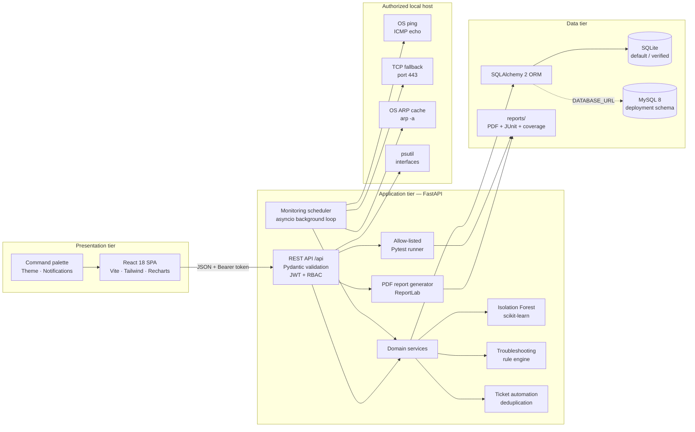

The diagram separates three concerns that are often blurred in student projects:

1. **Observation** — real OS measurements, never synthetic live values.
2. **Interpretation** — statistical and rule-based reasoning over stored data.
3. **Action** — tickets, reports and advisory guidance, with human authorization.

---

## 2.3 Layer responsibilities

| Layer | Components | Responsibilities | Must not do |
|---|---|---|---|
| Presentation | `frontend/src` | Render state, collect input, call API, show loading/error/empty states, theme and responsive layout | Contain business rules or trust client-side authorization |
| Application | `backend/app/api` | Validate requests, enforce roles, serialize responses, map errors | Run long blocking probes inside request handlers where avoidable |
| Domain services | `backend/app/services` | Monitoring orchestration, ticketing, reports, settings, seeding, test execution | Depend on HTTP request objects |
| Intelligence | `backend/app/ai`, `backend/app/troubleshooting` | Train/score Isolation Forest, explain events, apply diagnostic rules | Modify infrastructure or claim future failure |
| Monitoring adapters | `backend/app/monitoring` | Execute OS probes, parse ARP, expose interface information, schedule cycles | Invent values when a probe fails |
| Persistence | `backend/app/models`, `app/core/database.py` | Define tables, relationships, constraints and sessions | Contain presentation logic |
| Verification | `backend/tests`, `frontend/e2e` | Verify API, business rules, ML behaviour and user journeys | Use production data or live probes |

---

## 2.4 Component catalogue

### 2.4.1 Backend modules

| Module | File(s) | Purpose |
|---|---|---|
| Entrypoint | `app/main.py` | FastAPI app, lifespan, middleware, routers, static frontend, health |
| Configuration | `app/core/config.py` | Environment settings, validation, SQLite path resolution, reports path |
| Database | `app/core/database.py` | Engine, session factory, `Base`, `init_db` |
| Security | `app/core/security.py` | Argon2 hashing, JWT creation/decoding, role hierarchy |
| Logging | `app/core/logging_config.py` | Consistent console/file logging |
| Models | `app/models/models.py` | Twelve SQLAlchemy domain tables |
| Schemas | `app/schemas/schemas.py` | Pydantic request/response contracts |
| Auth API | `app/api/auth.py` | Login, session, logout, user listing/creation, throttling |
| Dashboard API | `app/api/dashboard.py` | Health index, series, alerts and summaries |
| Monitoring API | `app/api/monitoring.py` | Network info, current Wi-Fi association, history, latest, manual run, scheduler state |
| Access point API | `app/api/access_points.py` | CRUD, checks, performance, history |
| Device API | `app/api/devices.py` | Discovery, approval, metadata, activity |
| Anomaly API | `app/api/anomalies.py` | Detection, event list, model info |
| Troubleshooting API | `app/api/troubleshooting.py` | Run diagnosis, latest recommendations |
| Ticket API | `app/api/tickets.py` | List, stats, detail, create, update, comments |
| Testing API | `app/api/tests.py` | Start run, list runs, run detail |
| Reports API | `app/api/reports.py` | List, types, generate, download |
| Settings API | `app/api/settings.py` | Read/update settings, system status |
| Monitoring service | `app/services/monitoring.py` | Record probes, run checks, AP availability |
| Ticketing service | `app/services/ticketing.py` | Fingerprint dedup, threshold and anomaly tickets |
| Report service | `app/services/reports.py` | Eight PDF report builders |
| Test runner | `app/services/test_runner.py` | Fixed pytest command, JUnit parse, persisted results |
| Seed service | `app/services/seed.py` | Bootstrap admin, default settings, labelled demo APs |
| Diagnostics | `app/monitoring/diagnostics.py` | ICMP parsing, real TCP fallback, interface info |
| Wi-Fi detector | `app/monitoring/wifi.py` | Read-only current SSID/BSSID/signal/band/gateway detection |
| Device discovery | `app/monitoring/devices.py` | ARP parse, subnet filtering, hashing, masking |
| Scheduler | `app/monitoring/scheduler.py` | Startup and periodic cycles, device/AP refresh |
| Anomaly service | `app/ai/anomaly.py` | Training, scoring, severity, robust-z explanation |
| Baseline | `app/ai/sample_baseline.py` | Deterministic synthetic cold-start baseline |
| Rule engine | `app/troubleshooting/engine.py` | Diagnostic scenarios and safety note |

### 2.4.2 Frontend modules

| Area | File(s) | Purpose |
|---|---|---|
| App shell | `App.jsx`, `layouts/DashboardLayout.jsx` | Routing, sidebar, header, palette, notifications, mobile drawer |
| Auth context | `context/AuthContext.jsx` | Token persistence, user session, role helpers |
| Theme context | `context/ThemeContext.jsx` | Dark/light preference and `html.dark` class |
| Toast context | `context/ToastContext.jsx` | Accessible transient notifications |
| API client | `services/api.js` | Axios instance, bearer injection, 401 handling, PDF download |
| Data hook | `hooks/useApi.js` | Loading/error state and polling |
| UI primitives | `components/ui.jsx` | Buttons, badges, cards, fields, selects, modals, skeletons, alerts |
| Charts | Recharts in pages | Latency, loss, jitter and performance visualisations |
| Pages | `pages/*.jsx` | Ten workspace modules, login and not-found |
| Utilities | `lib/utils.js` | Date/time, bytes, numbers, relative time, title case |

---

## 2.5 Frontend architecture

The single-page application uses React Router with lazy-loaded pages. A protected
route wrapper redirects unauthenticated visitors to `/login`. The dashboard
layout renders the sidebar and header around an `Outlet`, so navigation does not
reload the page.

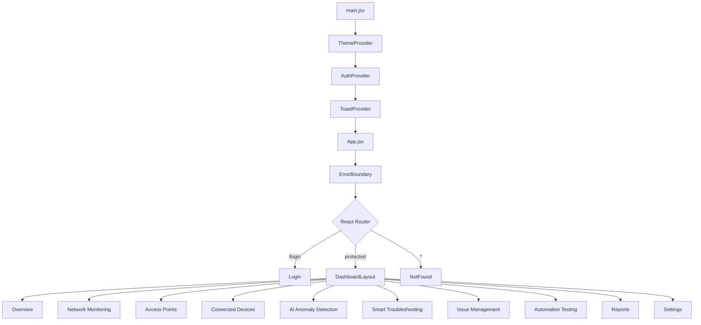

### 2.5.1 State management

The application deliberately avoids a heavy global state library:

- **Authentication** is shared through `AuthContext` and persisted in
  `localStorage` under `netpulse_token` and `netpulse_user`.
- **Theme** is shared through `ThemeContext` and persisted as `netpulse_theme`.
- **Server state** is fetched by `useApi`, which exposes `data`, `loading`,
  `error` and `reload`. Pages that need live updates pass a `pollMs` interval.
- **Local UI state** (filters, dialogs, form fields) remains inside each page.

This keeps the dependency surface small and makes the data flow easy to explain
during a viva.

### 2.5.2 Design system

The UI uses a dark-first professional theme with optional light mode. Shared
primitives ensure consistency:

- `PageHeader`, `SectionHeader`, `StatCard`, `Badge`, `Button`, `Field`, `Select`;
- `Modal` with focus-visible dialog semantics, Escape handling and backdrop close;
- `PageSkeleton`, `ErrorPanel`, `EmptyState`, `Alert`, `InfoNote` for all data
  states;
- Recharts wrappers with responsive containers and explicit axis widths to avoid
  label clipping.

### 2.5.3 Accessibility and responsiveness

- Semantic headings and table structure.
- `aria-label` on icon-only controls (navigation, theme, notifications, dialogs).
- Keyboard command palette (`Ctrl+K`) and Escape-to-close dialogs.
- Mobile drawer below the `lg` breakpoint; E2E tests assert no horizontal
  overflow at 390 × 844.
- Colour is not the only indicator: badges include text and status dots.

---

## 2.6 Backend architecture

FastAPI provides dependency injection, request validation, OpenAPI generation
and exception handling. The backend is organized by feature rather than by
technical layer alone: each API module owns its routes, while shared services
hold cross-cutting business logic.

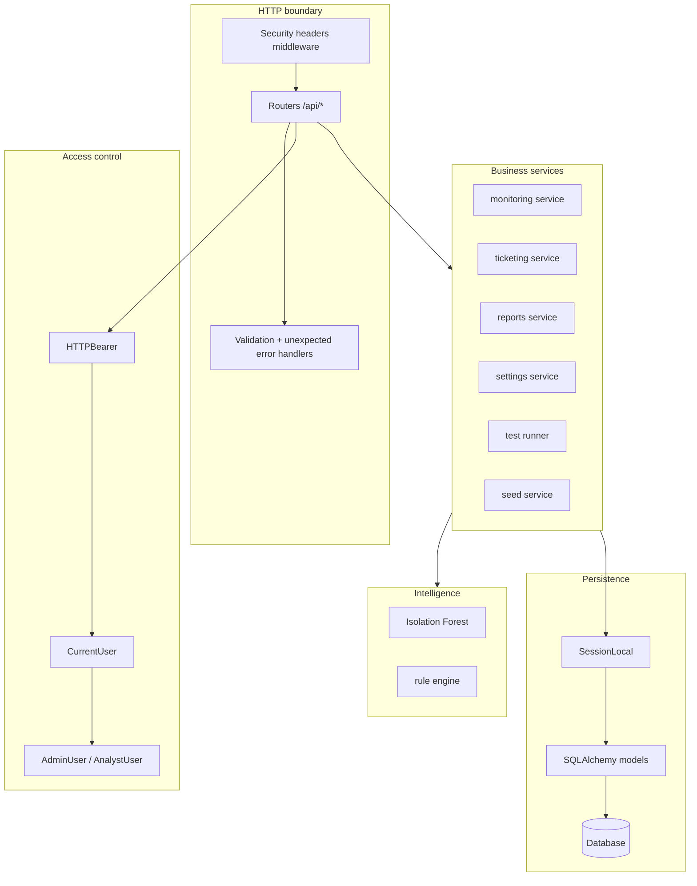

### 2.6.1 Request lifecycle

1. Security middleware adds `X-Content-Type-Options`, `X-Frame-Options`,
   `Referrer-Policy`, `Permissions-Policy` and `Cache-Control`.
2. CORS validates the browser origin.
3. The router validates the body/query through Pydantic.
4. `CurrentUser` decodes the JWT, loads the user and checks `is_active`.
5. `AdminUser`/`AnalystUser` enforce the role hierarchy.
6. The service executes business logic in a SQLAlchemy session.
7. The response model serializes the result.
8. Validation errors return a simplified `{detail, errors}` payload; unexpected
   errors are logged and return a generic message without leaking internals.

### 2.6.2 Role hierarchy

`role_at_least` defines a simple ordered hierarchy:

```text
viewer < analyst < admin
```

| Capability | Viewer | Analyst | Admin |
|---|---:|---:|---:|
| View dashboard, monitoring, APs, devices, AI, tickets, reports | ✓ | ✓ | ✓ |
| Run live check, detect anomalies, run troubleshooting | — | ✓ | ✓ |
| Check access point, create/update tickets, comment | — | ✓ | ✓ |
| Create/edit/delete access points | — | — | ✓ |
| Approve devices, edit device metadata | — | — | ✓ |
| Generate PDF reports | — | ✓ | ✓ |
| Change settings, create users | — | — | ✓ |
| Run the built-in backend test suite | — | ✓ | ✓ |

The frontend hides actions based on `hasRole`, but the backend is authoritative;
every mutating route declares the required dependency.

### 2.6.3 Database session management

`get_db()` yields a session and closes it in a `finally` block. Services commit
explicitly after a unit of work. SQLite uses `check_same_thread=False` so the
scheduler thread can use a separate session. `init_db()` creates missing tables
at startup and the seed service inserts defaults only when they are absent.

---

## 2.7 Monitoring pipeline

The scheduler is the only component that writes live measurements on a timer.
Manual checks use the same service functions.

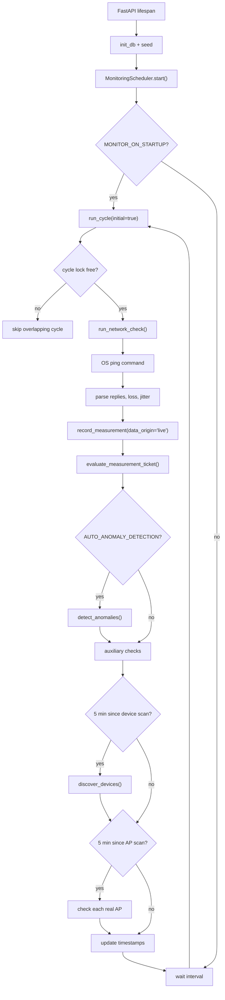

### 2.7.1 Probe behavior

| Situation | Result stored |
|---|---|
| Replies received | `is_online=true`, average latency, parsed loss, population standard deviation as jitter |
| No replies | `is_online=false`, `latency_ms=null`, `packet_loss_pct=100`, error message |
| Timeout | Offline measurement with `Network probe timed out` |
| Ping utility missing | Genuine TCP handshake fallback to port 443, target labelled `(TCP fallback)` |
| Unexpected exception | Offline measurement with a safe error type, exception logged |

The probe target for AP checks is the AP's registered IP address. The global
probe target defaults to `1.1.1.1` and is configurable. Values are never
generated when the probe fails.

### 2.7.2 Simulation isolation

Simulation is confined to one path: `check_access_point()` when
`access_point.is_simulated` is true. It writes `data_origin="simulation"` and a
`SIMULATED:` probe target. Every health query filters to `data_origin="live"`,
and the ticket service rejects non-live measurements. The UI displays a
simulation notice in the AP list and detail dialog.

### 2.7.3 Device discovery

Device discovery is intentionally read-only:

1. Enumerate active IPv4 subnets with `psutil`.
2. Run `arp -a` (timeout 10 s, no shell).
3. Parse IP/MAC pairs with a strict regular expression.
4. Exclude own addresses, loopback, link-local, network/broadcast addresses and
   any IP outside an active local subnet.
5. Hash the normalized MAC with SHA-256 for identity.
6. Store a masked form only (`**:**:**:xx:xx:xx`).
7. Insert a `device_activity` observation and update `last_seen_at`.

There is no port scan, packet capture or active subnet sweep.

---

## 2.8 AI anomaly detection pipeline

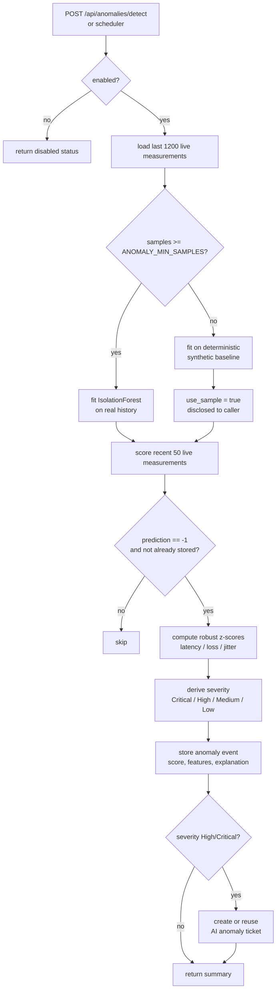

### 2.8.1 Model configuration

| Parameter | Value |
|---|---|
| Algorithm | `sklearn.ensemble.IsolationForest` |
| Estimators | 200 |
| Contamination | 0.08 (configurable from settings) |
| Random state | 42 (reproducible) |
| Features | `latency_ms`, `packet_loss_pct`, `jitter_ms` |
| Training window | Most recent 1,200 live measurements |
| Scoring window | Most recent 50 live measurements per run |
| Minimum real samples | 30 by default |
| Model version | `isolation-forest-v1/sklearn-<version>` |

### 2.8.2 Explanation contract

Each event stores:

- `anomaly_score`: negated decision-function score, higher = more unusual;
- `severity`: Critical, High, Medium or Low;
- `explanation`: human-readable sentence listing the contributing metrics;
- `features`: observed values, baseline medians, robust z-scores and raw score;
- `model_version` and `used_sample_baseline` for provenance.

The explanation explicitly states that the result is a statistical observation,
not a guaranteed prediction of future failure.

### 2.8.3 Cold-start disclosure

When fewer than `ANOMALY_MIN_SAMPLES` real observations exist, the model is fit
on a deterministic synthetic baseline (Gamma/Exponential distributions, seed
2026, 120 rows). Those rows are **not written to `network_measurements`** and are
never displayed as telemetry. The API returns `sample_baseline_used=true`, the UI
shows a warning and each event stores `used_sample_baseline`.

---

## 2.9 Ticketing and troubleshooting pipeline

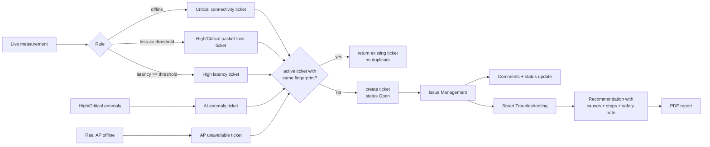

### 2.9.1 Fingerprint strategy

| Incident | Fingerprint | Suppression window |
|---|---|---|
| Connectivity down | `connectivity_down[:ap_id]` | While Open or In Progress |
| Packet loss | `packet_loss[:ap_id]` | While Open or In Progress |
| High latency | `high_latency[:ap_id]` | While Open or In Progress |
| AP unavailable | `ap_offline:<ap_id>` | While Open or In Progress |
| AI anomaly | `ai_anomaly:active` | While Open or In Progress |
| Manual ticket | Random 16-hex fingerprint | No suppression (manual intent) |

Once a ticket is Resolved, the same condition can create a new ticket
for a new incident.

### 2.9.2 Safety model

The troubleshooting engine returns advisory content only. A constant safety note
is attached to every recommendation:

> Diagnostic guidance only. NetPulse AI never changes router or access-point
> configuration automatically. Confirm authorization before checking any network
> device.

The UI repeats this in a dedicated guardrail panel. There is no code path that
writes device configuration, executes remediation or stores router credentials.

---

## 2.10 Request lifecycle sequence

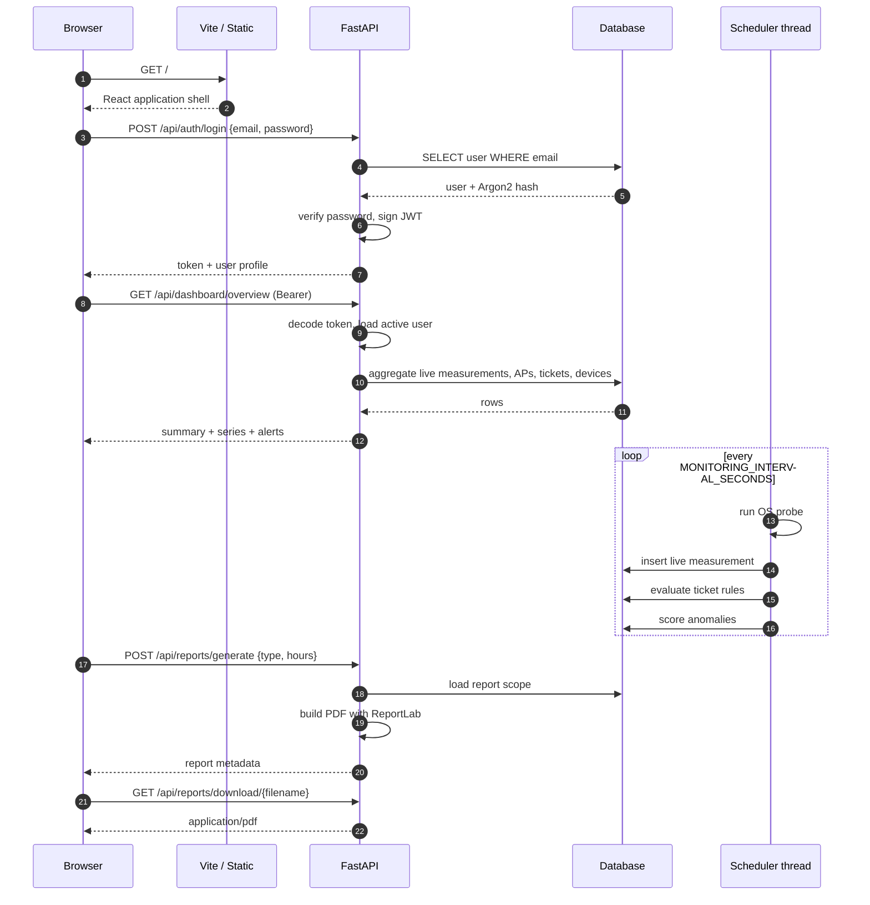

---

## 2.11 Deployment architecture

### 2.11.1 Development deployment

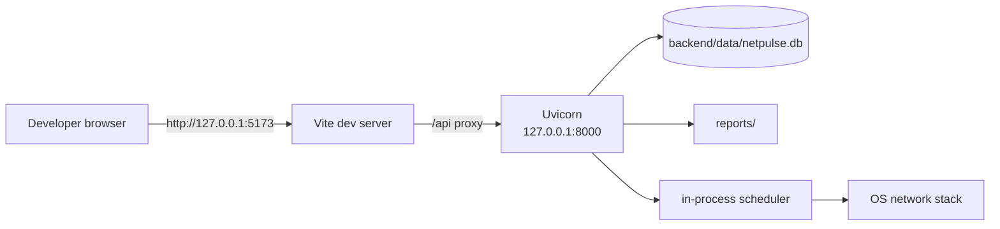

- Vite serves the SPA with hot module replacement and proxies `/api` to port
  8000.
- Uvicorn runs the FastAPI app with optional `--reload`.
- SQLite stores data in `backend/data/netpulse.db`.
- Reports are written to `reports/` at the project root.

### 2.11.2 Single-port production-style deployment

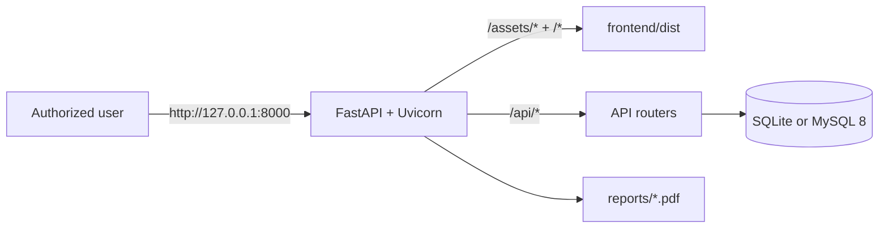

After `npm run build`, FastAPI mounts `frontend/dist/assets` and serves
`index.html` for client-side routes. Unknown `/api` paths return a JSON 404
rather than the SPA shell.

### 2.11.3 MySQL deployment

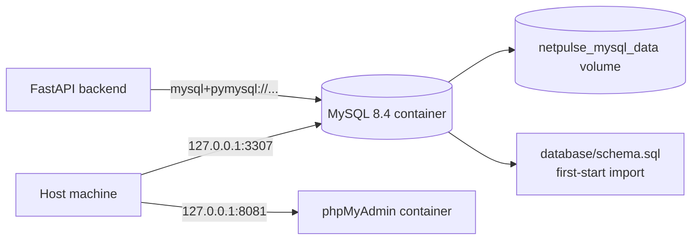

The host port 3307 avoids a collision with an existing MySQL on 3306. The
schema is imported only when the data volume is empty. phpMyAdmin is optional
and should not be exposed beyond localhost.

### 2.11.4 Ports and processes

| Process | Default address | Notes |
|---|---|---|
| FastAPI / Uvicorn | `127.0.0.1:8000` | API, Swagger, optional static frontend |
| Vite dev server | `127.0.0.1:5173` | Proxies `/api` to 8000 |
| Vite preview | `127.0.0.1:4173` | Preview of the production build |
| MySQL container | `127.0.0.1:3307` | Host mapping of container 3306 |
| phpMyAdmin | `127.0.0.1:8081` | Optional database UI |

---

## 2.12 Security architecture

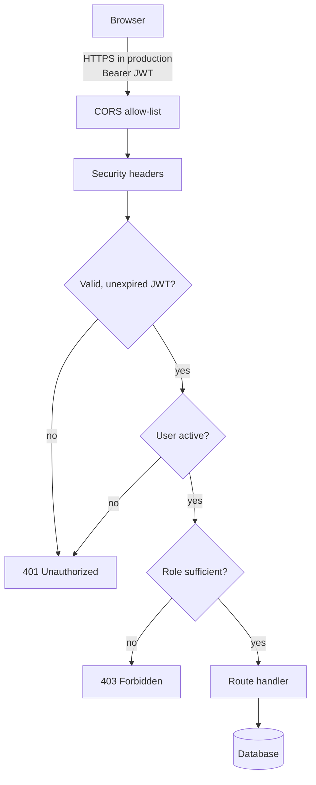

### 2.12.1 Authentication

- Passwords are hashed with Argon2 through `pwdlib`.
- Login uses a dummy hash verification when the email is unknown, reducing
  timing-based user enumeration.
- Failed attempts are tracked per client/email for five minutes; eight failures
  trigger HTTP 429.
- JWT contains `sub`, `role`, `email`, `name`, `exp` and `iat`.
- Tokens expire after 480 minutes by default.
- Logout is stateless: the client discards the token. Revocation would require a
  denylist or short-lived refresh tokens.

### 2.12.2 Authorization

- `viewer`: read-only operational access.
- `analyst`: read plus monitoring, detection, troubleshooting, tickets and
  reports.
- `admin`: full access including APs, devices, settings and users.

The frontend hides unavailable actions, but every protected backend route has an
explicit dependency.

### 2.12.3 Transport and headers

- Development uses HTTP on loopback only.
- Production should terminate TLS at a reverse proxy.
- `X-Content-Type-Options: nosniff`, `X-Frame-Options: DENY`,
  `Referrer-Policy: no-referrer` and a restrictive `Permissions-Policy`.
- API responses use `Cache-Control: no-store`.
- CORS is restricted to configured origins, not `*`.

### 2.12.4 Input validation

Pydantic validates IP addresses, MAC addresses, emails, password length, role
values, thresholds, report types and query bounds. SQLAlchemy uses bound
parameters. The test runner accepts no user-supplied command: it runs a fixed
`python -m pytest` invocation with a generated JUnit path.

### 2.12.5 Secret management

- `backend/.env` is ignored by Git.
- The setup script generates a random JWT secret and administrator password.
- Production mode rejects placeholder secrets and weak configuration.
- No password, token or raw MAC is written to reports or logs.

---

## 2.13 Reliability and error handling

| Failure | Handling |
|---|---|
| Probe timeout | Offline measurement with real error; scheduler continues |
| Ping utility missing | TCP fallback; result labelled |
| Scheduler cycle overlap | Lock skips the overlapping cycle |
| Scheduler exception | `last_error` recorded, exposed in dashboard, logged |
| Database unavailable | `/api/health` reports `degraded`; request returns controlled error |
| Invalid request | 422 with field-level errors |
| Unauthorized | 401 with `WWW-Authenticate` |
| Forbidden | 403 with required role message |
| Not found | 404 with resource-specific message |
| Duplicate AP name/IP | 409 with validation message |
| Test runner busy | 409; only one run at a time |
| PDF missing or invalid name | 404/400 without path traversal |
| Frontend API failure | `ErrorPanel` with retry; toasts for mutations |
| React render error | Error boundary with reset action |

### 2.13.1 Data integrity safeguards

- APS and measurements use `data_origin` to separate live from simulation.
- Anomaly events are unique per measurement (`measurement_id` unique index).
- Ticket numbers are unique; fingerprints suppress duplicates only while active.
- AP name/IP pairs are unique.
- Foreign keys use `CASCADE` for owned history and `SET NULL` for optional actor
  references, preserving audit rows when a user is removed.
- Reports are resolved by filename through a safe path check.

---

## 2.14 Key design decisions and trade-offs

| Decision | Rationale | Trade-off |
|---|---|---|
| SQLite default | Zero-setup demo, reliable tests, no external service | Single-writer limits; not suited to high concurrency |
| MySQL schema provided | Demonstrates deployment-ready relational design | Runtime import not verified on this machine |
| Scheduler inside API | Simple deployment, shared service code | Multiple workers would duplicate cycles |
| ICMP as primary probe | Ubiquitous, accurate round-trip signal | May be blocked by policy; fallback is labelled |
| ARP cache only | Privacy-preserving, no active scanning | Local subnet visibility only |
| Isolation Forest | Unsupervised, works without labelled failures | Statistical outlier ≠ root cause |
| Synthetic cold start | Allows demonstration before history accumulates | Must be disclosed; not live data |
| Rule-based troubleshooting | Deterministic, explainable, auditable | Limited to known scenarios |
| JSON columns | Flexible feature/recommendation payloads | Less queryable than normalized rows |
| Fixed test command | Prevents remote code execution | Only the backend suite can be run from the UI |
| System Chrome for Playwright | Bundled headless shell blocked by policy | Requires Chrome or Edge on the test host |

### 2.14.1 Why not SNMP?

SNMP would provide richer AP and switch metrics, but it requires credentials,
device support and careful authorization. It also expands the security and legal
scope. The project deliberately focuses on end-to-end observations that any
authorized host can collect without infrastructure credentials.

### 2.14.2 Why not active Wi-Fi scanning?

Active scanning and packet capture can reveal other users' traffic and may
violate privacy or institutional policy. The ARP cache provides a defensible,
read-only inventory of devices the host has already communicated with.

The **Use current Wi-Fi** flow does not weaken this boundary. It reads only the
operating system's existing association for the backend host (SSID, BSSID,
signal, band, channel and default gateway) through read-only commands. It does
not enumerate nearby networks, capture frames or read Wi-Fi credentials. The
detected gateway is not probed until an administrator registers it as an
authorized access point, and the endpoint is authenticated. Because the address
is usually private (for example `10.239.39.128`), the flow is useful only when
the backend runs on the connected computer; the serverless deployment returns an
explicit unavailable reason.

### 2.14.3 Why keep the synthetic baseline?

An Isolation Forest needs training data. Without a baseline, the first live
sample cannot be scored meaningfully. The synthetic baseline enables a
demonstration and is clearly marked. As real history accumulates, the model
automatically switches to real observations.

---

## 2.15 Non-functional requirements mapping

| NFR | Implementation | Evidence |
|---|---|---|
| Performance | Indexed queries, 2,000-row dashboard cap, lazy pages, polling intervals | Dashboard test, E2E timings |
| Security | Argon2, JWT, RBAC, throttle, headers, validation | 7 security tests, 12 auth tests |
| Reliability | Error handling, offline records, scheduler lock | Monitoring tests, smoke tests |
| Usability | Dark/light theme, responsive layout, skeletons, toasts, palette | 21 E2E tests, 21 screenshots |
| Maintainability | Layered modules, shared UI, typed schemas, env config | Code structure, 80% coverage |
| Portability | SQLite/MySQL, OS-specific ping commands, env paths | Tested Windows; Linux/macOS commands included |
| Privacy | ARP only, SHA-256 identity, masked MAC, no raw capture | Device tests, UI privacy notice |
| Integrity | `data_origin`, simulation exclusion, disclaimers | AP/device/monitoring tests |
| Testability | Isolated fixtures, no live probes in tests, JUnit import | 103 + 21 passing tests |

---

## 2.16 Project folder structure

```text
NetPulse-AI/
├── backend/
│   ├── app/
│   │   ├── ai/                 anomaly.py, sample_baseline.py
│   │   ├── api/                11 routers + dependencies
│   │   ├── core/               config, database, security, logging
│   │   ├── models/             SQLAlchemy domain model
│   │   ├── monitoring/         diagnostics, devices, scheduler
│   │   ├── schemas/            Pydantic contracts
│   │   ├── services/           monitoring, ticketing, reports, seed,
│   │   │                        settings, test_runner
│   │   ├── troubleshooting/    rule engine
│   │   └── main.py
│   ├── tests/                  103 Pytest tests + isolated conftest
│   ├── .env.example
│   └── requirements.txt
├── frontend/
│   ├── src/
│   │   ├── components/         UI primitives, brand, chart tooltip, boundary
│   │   ├── context/            auth, theme, toast
│   │   ├── hooks/              useApi
│   │   ├── layouts/            dashboard shell
│   │   ├── lib/                formatting utilities
│   │   ├── pages/              10 modules + login + 404
│   │   └── services/           API client
│   ├── e2e/                    4 Playwright specs
│   ├── scripts/                screenshot capture
│   ├── playwright.config.js
│   └── package.json
├── database/                   schema.sql, migration, guide
├── documentation/              report chapters, diagrams, screenshots
├── reports/                    PDFs, JUnit, coverage, Playwright report
├── scripts/                    setup, run, test, build
├── docker-compose.yml
└── README.md
```

---

## 2.17 Chapter summary

NetPulse AI uses a conventional three-tier web architecture with a small,
well-defined intelligence layer. The important architectural choices are not
exotic: they are about **separation of measurement from interpretation**, **explicit
provenance for every record**, **human authority over network changes** and
**repeatable verification**. These choices make the system understandable in a
viva and defensible in operation.

The next chapter describes the relational model that supports these flows.

<div style="page-break-before: always;"></div>

# 3. Database Design

## 3.1 Design goals

The database must preserve **what was observed**, **how it was interpreted** and
**what action was taken**, without ever mixing real measurements with
demonstration data. The design therefore pursues six goals:

| ID | Goal | Design response |
|---|---|---|
| DG1 | Preserve measurement provenance | `data_origin`, `probe_target`, `recorded_at`, model provenance |
| DG2 | Support the operational workflow | Users, APs, measurements, anomalies, recommendations, tickets, comments |
| DG3 | Protect referential integrity | Foreign keys, unique constraints, explicit delete behaviour |
| DG4 | Keep dashboard queries fast | Composite indexes on time, status and approval fields |
| DG5 | Support both SQLite and MySQL | Portable SQLAlchemy types and matching DDL |
| DG6 | Avoid storing sensitive raw identities | SHA-256 device identity, masked MAC display, Argon2 passwords |

---

## 3.2 Entity-relationship model

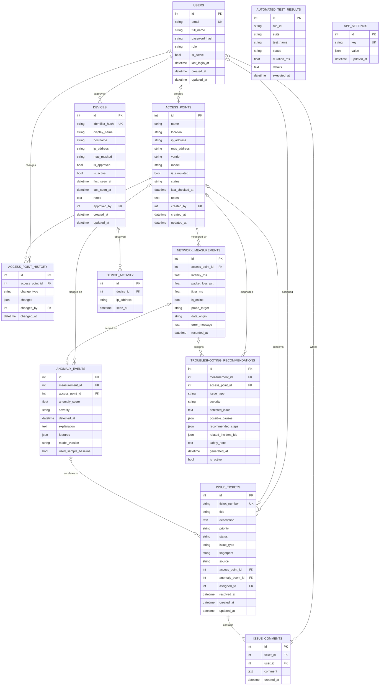

The `AUTOMATED_TEST_RESULTS` and `APP_SETTINGS` tables are operational support
tables with no foreign keys. `schema_migrations` is a thirteenth table used only
by the deployment migration.

### 3.2.1 Relationship summary

| Parent | Child | Cardinality | Delete behaviour |
|---|---|---|---|
| `users` | `access_points.created_by` | 1 : 0..N | `SET NULL` |
| `users` | `access_point_history.changed_by` | 1 : 0..N | `SET NULL` |
| `users` | `devices.approved_by` | 1 : 0..N | `SET NULL` |
| `users` | `issue_tickets.assigned_to` | 1 : 0..N | `SET NULL` |
| `users` | `issue_comments.user_id` | 1 : 0..N | `SET NULL` |
| `access_points` | `access_point_history` | 1 : 0..N | `CASCADE` |
| `access_points` | `network_measurements` | 1 : 0..N | `CASCADE` |
| `access_points` | `anomaly_events` | 1 : 0..N | `CASCADE` |
| `access_points` | `troubleshooting_recommendations` | 1 : 0..N | `SET NULL` |
| `access_points` | `issue_tickets` | 1 : 0..N | `SET NULL` |
| `devices` | `device_activity` | 1 : 0..N | `CASCADE` |
| `network_measurements` | `anomaly_events` | 1 : 0..1 | `CASCADE` |
| `network_measurements` | `troubleshooting_recommendations` | 1 : 0..N | `SET NULL` |
| `anomaly_events` | `issue_tickets` | 1 : 0..N | `SET NULL` |
| `issue_tickets` | `issue_comments` | 1 : 0..N | `CASCADE` |

The asymmetry is intentional: history and observations are owned by their parent
and disappear with it, while tickets and recommendations preserve their text even
if the referenced AP or measurement is removed. This keeps incident records
auditable.

---

## 3.3 Table overview

| # | Table | Purpose | Typical growth |
|---|---|---|---|
| 1 | `users` | Accounts and roles | Very low |
| 2 | `access_points` | Authorized AP inventory | Low |
| 3 | `access_point_history` | AP configuration audit trail | Low |
| 4 | `devices` | Locally observed devices | Low to medium |
| 5 | `device_activity` | Every ARP observation | Medium (one row per scan per device) |
| 6 | `network_measurements` | Real probe observations and labelled simulations | High (scheduler interval) |
| 7 | `anomaly_events` | Isolation Forest findings | Low to medium |
| 8 | `troubleshooting_recommendations` | Rule-engine output | Low |
| 9 | `issue_tickets` | Incidents and workflow state | Low |
| 10 | `issue_comments` | Ticket audit trail | Low |
| 11 | `automated_test_results` | One row per imported test case | Medium (per test run) |
| 12 | `app_settings` | Runtime settings as JSON | Very low |
| 13 | `schema_migrations` | Applied schema versions | Very low |

At the default one-minute interval, `network_measurements` grows by 1,440 rows
per day for the global probe, plus one row per AP check every five minutes. This
is modest for SQLite and trivial for MySQL, but long-running deployments should
add a retention policy (Section 3.10).

---

## 3.4 Complete data dictionary

The following dictionary was generated directly from the SQLAlchemy metadata to
avoid transcription errors. Types are shown for the MySQL dialect; SQLite maps
them to its dynamic type system.

### `app_settings`

| Column | Type | Nullable | Key / Notes |
|---|---|---|---|
| `id` | INTEGER | no | PK |
| `key` | VARCHAR(80) | no | unique |
| `value` | JSON | no |  |
| `updated_at` | DATETIME | no |  |

Indexes: `ix_app_settings_key` (key) UNIQUE

### `automated_test_results`

| Column | Type | Nullable | Key / Notes |
|---|---|---|---|
| `id` | INTEGER | no | PK |
| `run_id` | VARCHAR(50) | no |  |
| `suite` | VARCHAR(60) | no |  |
| `test_name` | VARCHAR(255) | no |  |
| `status` | VARCHAR(20) | no |  |
| `duration_ms` | FLOAT | no |  |
| `details` | TEXT | yes |  |
| `executed_at` | DATETIME | no |  |

Indexes: `ix_automated_test_results_status` (status); `ix_test_results_executed` (executed_at); `ix_automated_test_results_run_id` (run_id); `ix_automated_test_results_suite` (suite); `ix_test_results_run` (run_id)

### `users`

| Column | Type | Nullable | Key / Notes |
|---|---|---|---|
| `id` | INTEGER | no | PK |
| `email` | VARCHAR(255) | no | unique |
| `full_name` | VARCHAR(120) | no |  |
| `password_hash` | VARCHAR(255) | no |  |
| `role` | VARCHAR(20) | no |  |
| `is_active` | BOOL | no |  |
| `last_login_at` | DATETIME | yes |  |
| `created_at` | DATETIME | no |  |
| `updated_at` | DATETIME | no |  |

Indexes: `ix_users_email` (email) UNIQUE; `ix_users_role` (role)

### `access_points`

| Column | Type | Nullable | Key / Notes |
|---|---|---|---|
| `id` | INTEGER | no | PK |
| `name` | VARCHAR(120) | no |  |
| `location` | VARCHAR(160) | no |  |
| `ip_address` | VARCHAR(45) | no |  |
| `mac_address` | VARCHAR(32) | yes |  |
| `vendor` | VARCHAR(100) | yes |  |
| `model` | VARCHAR(100) | yes |  |
| `is_simulated` | BOOL | no |  |
| `status` | VARCHAR(20) | no |  |
| `last_checked_at` | DATETIME | yes |  |
| `notes` | TEXT | yes |  |
| `created_by` | INTEGER | yes | FK -> users.id (SET NULL) |
| `created_at` | DATETIME | no |  |
| `updated_at` | DATETIME | no |  |

Indexes: `ix_access_points_is_simulated` (is_simulated); `ix_access_points_status` (status)

### `devices`

| Column | Type | Nullable | Key / Notes |
|---|---|---|---|
| `id` | INTEGER | no | PK |
| `identifier_hash` | VARCHAR(64) | no | unique |
| `display_name` | VARCHAR(120) | yes |  |
| `hostname` | VARCHAR(255) | yes |  |
| `ip_address` | VARCHAR(45) | no |  |
| `mac_masked` | VARCHAR(24) | yes |  |
| `is_approved` | BOOL | no |  |
| `is_active` | BOOL | no |  |
| `first_seen_at` | DATETIME | no |  |
| `last_seen_at` | DATETIME | no |  |
| `notes` | TEXT | yes |  |
| `approved_by` | INTEGER | yes | FK -> users.id (SET NULL) |
| `created_at` | DATETIME | no |  |
| `updated_at` | DATETIME | no |  |

Indexes: `ix_devices_approval_seen` (is_approved, last_seen_at)

### `access_point_history`

| Column | Type | Nullable | Key / Notes |
|---|---|---|---|
| `id` | INTEGER | no | PK |
| `access_point_id` | INTEGER | no | FK -> access_points.id (CASCADE) |
| `change_type` | VARCHAR(30) | no |  |
| `changes` | JSON | no |  |
| `changed_by` | INTEGER | yes | FK -> users.id (SET NULL) |
| `changed_at` | DATETIME | no |  |

Indexes: `ix_access_point_history_access_point_id` (access_point_id)

### `device_activity`

| Column | Type | Nullable | Key / Notes |
|---|---|---|---|
| `id` | INTEGER | no | PK |
| `device_id` | INTEGER | no | FK -> devices.id (CASCADE) |
| `ip_address` | VARCHAR(45) | no |  |
| `seen_at` | DATETIME | no |  |

Indexes: `ix_device_activity_seen` (seen_at); `ix_device_activity_device_id` (device_id)

### `network_measurements`

| Column | Type | Nullable | Key / Notes |
|---|---|---|---|
| `id` | INTEGER | no | PK |
| `access_point_id` | INTEGER | yes | FK -> access_points.id (CASCADE) |
| `latency_ms` | FLOAT | yes |  |
| `packet_loss_pct` | FLOAT | no |  |
| `jitter_ms` | FLOAT | yes |  |
| `is_online` | BOOL | no |  |
| `probe_target` | VARCHAR(255) | no |  |
| `data_origin` | VARCHAR(20) | no |  |
| `error_message` | TEXT | yes |  |
| `recorded_at` | DATETIME | no |  |

Indexes: `ix_measurements_online_time` (is_online, recorded_at); `ix_measurements_recorded_at` (recorded_at); `ix_network_measurements_data_origin` (data_origin); `ix_network_measurements_access_point_id` (access_point_id)

### `anomaly_events`

| Column | Type | Nullable | Key / Notes |
|---|---|---|---|
| `id` | INTEGER | no | PK |
| `measurement_id` | INTEGER | yes | unique, FK -> network_measurements.id (CASCADE) |
| `access_point_id` | INTEGER | yes | FK -> access_points.id (CASCADE) |
| `anomaly_score` | FLOAT | no |  |
| `severity` | VARCHAR(20) | no |  |
| `detected_at` | DATETIME | no |  |
| `explanation` | TEXT | no |  |
| `features` | JSON | no |  |
| `model_version` | VARCHAR(80) | no |  |
| `used_sample_baseline` | BOOL | no |  |

Indexes: `ix_anomaly_events_access_point_id` (access_point_id); `ix_anomalies_detected` (detected_at); `ix_anomaly_events_severity` (severity); `ix_anomaly_events_measurement_id` (measurement_id) UNIQUE

### `troubleshooting_recommendations`

| Column | Type | Nullable | Key / Notes |
|---|---|---|---|
| `id` | INTEGER | no | PK |
| `measurement_id` | INTEGER | yes | FK -> network_measurements.id (SET NULL) |
| `access_point_id` | INTEGER | yes | FK -> access_points.id (SET NULL) |
| `issue_type` | VARCHAR(60) | no |  |
| `severity` | VARCHAR(20) | no |  |
| `detected_issue` | TEXT | no |  |
| `possible_causes` | JSON | no |  |
| `recommended_steps` | JSON | no |  |
| `related_incident_ids` | JSON | no |  |
| `safety_note` | TEXT | no |  |
| `generated_at` | DATETIME | no |  |
| `is_active` | BOOL | no |  |

Indexes: `ix_troubleshooting_recommendations_access_point_id` (access_point_id); `ix_troubleshooting_recommendations_measurement_id` (measurement_id); `ix_recommendations_generated` (generated_at)

### `issue_tickets`

| Column | Type | Nullable | Key / Notes |
|---|---|---|---|
| `id` | INTEGER | no | PK |
| `ticket_number` | VARCHAR(32) | no | unique |
| `title` | VARCHAR(200) | no |  |
| `description` | TEXT | no |  |
| `priority` | VARCHAR(20) | no |  |
| `status` | VARCHAR(20) | no |  |
| `issue_type` | VARCHAR(60) | no |  |
| `fingerprint` | VARCHAR(120) | no |  |
| `source` | VARCHAR(30) | no |  |
| `access_point_id` | INTEGER | yes | FK -> access_points.id (SET NULL) |
| `anomaly_event_id` | INTEGER | yes | FK -> anomaly_events.id (SET NULL) |
| `assigned_to` | INTEGER | yes | FK -> users.id (SET NULL) |
| `resolved_at` | DATETIME | yes |  |
| `created_at` | DATETIME | no |  |
| `updated_at` | DATETIME | no |  |

Indexes: `ix_issue_tickets_anomaly_event_id` (anomaly_event_id); `ix_issue_tickets_priority` (priority); `ix_tickets_status_priority` (status, priority); `ix_tickets_fingerprint_status` (fingerprint, status); `ix_issue_tickets_issue_type` (issue_type); `ix_issue_tickets_ticket_number` (ticket_number) UNIQUE; `ix_issue_tickets_fingerprint` (fingerprint); `ix_issue_tickets_access_point_id` (access_point_id); `ix_issue_tickets_status` (status)

### `issue_comments`

| Column | Type | Nullable | Key / Notes |
|---|---|---|---|
| `id` | INTEGER | no | PK |
| `ticket_id` | INTEGER | no | FK -> issue_tickets.id (CASCADE) |
| `user_id` | INTEGER | yes | FK -> users.id (SET NULL) |
| `comment` | TEXT | no |  |
| `created_at` | DATETIME | no |  |

Indexes: `ix_issue_comments_ticket_id` (ticket_id)


---

## 3.5 Normalization

### 3.5.1 First normal form (1NF)

All scalar columns hold a single value. The exception is deliberate: JSON columns
(`features`, `changes`, `possible_causes`, `recommended_steps`,
`related_incident_ids`, `value`) hold variable-length documents. These are not
relational attributes used for joins or filters; they are payloads whose shape
changes with the model or rule version. They are documented and validated at the
application layer.

### 3.5.2 Second normal form (2NF)

Every table uses a single surrogate primary key (`id`). There are no composite
keys and therefore no partial dependencies. The natural unique keys
(`users.email`, `access_points(name, ip_address)`, `ticket_number`,
`identifier_hash`) are enforced with unique constraints rather than used as
primary keys.

### 3.5.3 Third normal form (3NF)

Non-key attributes depend only on the primary key. Examples:

- `access_points` stores AP metadata, not user details; `created_by` references
  `users`.
- `issue_tickets` stores workflow state, not the assigned user's name;
  `assigned_to` references `users`.
- `device_activity` stores observations, not the device's display name; it
  references `devices`.
- `anomaly_events` stores its own score and explanation, not duplicated
  measurement values (the measurement is referenced).

### 3.5.4 Deliberate denormalization

| Denormalized field | Reason | Consistency safeguard |
|---|---|---|
| `anomaly_events.features` | Preserves the exact feature vector used at detection time, even if the measurement later changes | Immutable snapshot; measurement values normally do not change |
| `issue_tickets.title` and `description` | Keeps the incident text stable if the source AP is renamed or deleted | Written once at creation |
| `issue_tickets.fingerprint` | Fast duplicate lookup without parsing text | Derived deterministically at creation |
| `automated_test_results.run_id` | Groups rows without a separate runs table | Indexed; parsed from JUnit |
| `app_settings.value` | Flexible settings without schema changes per key | Allowed keys validated by the settings service |

The model is normalized where joins and integrity matter, and denormalized only
for immutable audit snapshots and flexible payloads.

---

## 3.6 Keys, constraints and integrity

### 3.6.1 Primary keys

All domain tables use an auto-incrementing integer primary key. This is simple,
compact and well supported by both SQLite and MySQL.

### 3.6.2 Natural unique keys

| Table | Constraint | Purpose |
|---|---|---|
| `users` | `ix_users_email` unique | One account per email |
| `access_points` | `uq_access_point_name_ip` | Prevent duplicate inventory entries |
| `devices` | `uq_devices_identifier_hash` | One row per observed device identity |
| `anomaly_events` | `ix_anomaly_events_measurement_id` unique | One anomaly per measurement |
| `issue_tickets` | `ix_issue_tickets_ticket_number` unique | Human-readable ticket identity |
| `app_settings` | `ix_app_settings_key` unique | One value per setting key |
| `schema_migrations` | primary key on `version` | One row per migration |

### 3.6.3 Check constraints at the application layer

SQLAlchemy models do not declare database `CHECK` constraints, so the following
rules are enforced by Pydantic and services rather than by the database:

- `role` ∈ {admin, analyst, viewer};
- `priority` ∈ {Low, Medium, High, Critical};
- `status` ∈ {Open, In Progress, Resolved};
- `severity` ∈ {Low, Medium, High, Critical};
- `data_origin` ∈ {live, simulation};
- password length ≥ 10 characters;
- email format, IPv4/IPv6 address format, MAC address format;
- thresholds within configured numeric bounds.

This keeps the schema portable across SQLite and MySQL. A production hardening
step would add database-level `CHECK` constraints for defense in depth.

### 3.6.4 Referential actions

- `CASCADE` is used when the child is meaningless without the parent (AP history,
  measurements, device observations, ticket comments).
- `SET NULL` is used when the child must survive (tickets, recommendations) or
  when an actor reference is optional (creator, approver, assignee).
- `RESTRICT` is not used because the application never hard-deletes users and
  because preserving incidents is more important than blocking an AP deletion.

---

## 3.7 Index strategy

### 3.7.1 Time-series access

| Index | Columns | Query supported |
|---|---|---|
| `ix_measurements_recorded_at` | `recorded_at` | Dashboard window, history pagination |
| `ix_measurements_online_time` | `is_online, recorded_at` | Uptime calculations |
| `ix_network_measurements_access_point_id` | `access_point_id` | AP performance history |
| `ix_network_measurements_data_origin` | `data_origin` | Live-only filtering |
| `ix_anomalies_detected` | `detected_at` | Recent anomalies |
| `ix_anomaly_events_severity` | `severity` | Severity filters |
| `ix_recommendations_generated` | `generated_at` | Latest diagnosis |

### 3.7.2 Workflow access

| Index | Columns | Query supported |
|---|---|---|
| `ix_tickets_status_priority` | `status, priority` | Open critical/high lists |
| `ix_tickets_fingerprint_status` | `fingerprint, status` | Duplicate suppression |
| `ix_issue_tickets_status` | `status` | Dashboard counts |
| `ix_issue_tickets_priority` | `priority` | Priority filters |
| `ix_issue_tickets_issue_type` | `issue_type` | Related-ticket lookup |
| `ix_devices_approval_seen` | `is_approved, last_seen_at` | Unknown-device alerts |
| `ix_device_activity_seen` | `seen_at` | Device observation timeline |
| `ix_access_points_is_simulated` | `is_simulated` | Live-vs-simulation filtering |
| `ix_access_points_status` | `status` | Online/offline counts |

### 3.7.3 Test and settings access

- `ix_automated_test_results_run_id` and `ix_test_results_run` support run
  grouping (the duplicate index reflects the model definition; it is harmless).
- `ix_automated_test_results_suite` and `ix_automated_test_results_status`
  support suite and status summaries.
- `ix_test_results_executed` supports recent-run ordering.

### 3.7.4 Index trade-offs

Indexes accelerate reads but add write cost. Measurements are write-heavy, so
only the columns used by dashboard, history and uptime queries are indexed. AP
and ticket tables are read-heavy but small, so broader indexing is acceptable.
No index is added speculatively for columns that are not queried.

---

## 3.8 JSON column rationale

| Column | Shape | Why JSON |
|---|---|---|
| `anomaly_events.features` | latency, loss, jitter, baseline medians, robust z-scores, raw score | Model diagnostics evolve; no joins needed |
| `access_point_history.changes` | field-level before/after values | Different fields change per update |
| `troubleshooting_recommendations.possible_causes` | array of strings | Variable-length narrative |
| `troubleshooting_recommendations.recommended_steps` | array of strings | Variable-length ordered actions |
| `troubleshooting_recommendations.related_incident_ids` | array of integers | Small reference list, not a join table |
| `app_settings.value` | scalar or object depending on key | Settings are schema-less by design |

JSON is supported natively by MySQL 8 and stored as text by SQLite. The backend
always reads and writes Python objects, so the API is portable. If reporting
later needs to query inside these documents, the fields should be promoted to
normalized columns or generated columns.

---

## 3.9 Data provenance and simulation policy

The most important integrity rule in the schema is the separation of real and
simulated observations.

### 3.9.1 `network_measurements.data_origin`

| Value | Meaning | Used in live health? | Used in ML training? |
|---|---|---|---|
| `live` | Real OS probe result | Yes | Yes |
| `simulation` | Clearly labelled demonstration record | No | No |

Every dashboard aggregation filters `data_origin = "live"`. The anomaly service
trains and scores only live measurements. The ticket service returns early for
non-live records. The AP performance endpoint filters live observations.

### 3.9.2 Simulation labels

Simulated APs use `is_simulated = 1`, a `SIMULATED:` probe target, and RFC 5737
documentation addresses (`192.0.2.0/24`). The UI shows a warning in the AP list
and detail dialog. The seed service creates two demo APs only when the AP table
is empty.

### 3.9.3 Model provenance

`anomaly_events` stores:

- `model_version` — algorithm and scikit-learn version;
- `used_sample_baseline` — whether the cold-start synthetic baseline was used;
- `features` — exact values and baselines used for the explanation.

A reviewer can therefore determine whether an event was produced by a real-data
model or a cold-start model.

### 3.9.4 Ticket provenance

`issue_tickets.source` records `automatic` or `manual`. Automatic tickets retain
their fingerprint, AP reference and optional anomaly reference. Manual tickets
use a random fingerprint and are assigned to the creating analyst.

### 3.9.5 Test provenance

`automated_test_results.run_id` groups one execution; `suite` records the test
class or Playwright spec; `executed_at` records import time. The runner stores
JUnit output as well as a summary.

---

## 3.10 Data lifecycle and retention

The application does not automatically delete monitoring history. This is a
deliberate choice for a final-year project: evidence should not disappear during
a demonstration. For long-running deployments, add a scheduled retention job.

### 3.10.1 Suggested retention policy

| Data | Suggested retention | Reason |
|---|---|---|
| Live measurements | 90 days | Supports trend analysis while bounding growth |
| Simulation measurements | 7 days | Demonstration only |
| Anomaly events | 180 days | Incident evidence |
| Recommendations | 180 days | Diagnostic history |
| Resolved tickets | 2 years | Academic/operational audit |
| Device activity | 30 days | Privacy minimization |
| Automated test results | 1 year | Verification evidence |

### 3.10.2 Example cleanup queries

```sql
-- Remove simulation measurements older than seven days
DELETE FROM network_measurements
WHERE data_origin = 'simulation'
  AND recorded_at < UTC_TIMESTAMP() - INTERVAL 7 DAY;

-- Remove device observations older than 30 days
DELETE FROM device_activity
WHERE seen_at < UTC_TIMESTAMP() - INTERVAL 30 DAY;

-- Remove measurements older than 90 days that are not referenced by an anomaly
DELETE nm FROM network_measurements nm
LEFT JOIN anomaly_events ae ON ae.measurement_id = nm.id
WHERE nm.recorded_at < UTC_TIMESTAMP() - INTERVAL 90 DAY
  AND ae.id IS NULL;
```

Always back up before running retention queries. Foreign keys cascade or null
references as documented.

---

## 3.11 Sample analytical queries

### 3.11.1 Latest live measurements

```sql
SELECT id, latency_ms, packet_loss_pct, jitter_ms, is_online,
       probe_target, recorded_at
FROM network_measurements
WHERE data_origin = 'live'
ORDER BY recorded_at DESC
LIMIT 20;
```

### 3.11.2 24-hour uptime

```sql
SELECT
  COUNT(*) AS total_probes,
  SUM(CASE WHEN is_online THEN 1 ELSE 0 END) AS online_probes,
  ROUND(SUM(CASE WHEN is_online THEN 1 ELSE 0 END) / COUNT(*) * 100, 2) AS uptime_pct
FROM network_measurements
WHERE data_origin = 'live'
  AND recorded_at >= UTC_TIMESTAMP() - INTERVAL 24 HOUR;
```

### 3.11.3 Average latency by AP

```sql
SELECT ap.name, COUNT(*) AS samples,
       ROUND(AVG(nm.latency_ms), 2) AS avg_latency_ms,
       ROUND(AVG(nm.packet_loss_pct), 2) AS avg_loss_pct
FROM network_measurements nm
JOIN access_points ap ON ap.id = nm.access_point_id
WHERE nm.data_origin = 'live'
  AND nm.recorded_at >= UTC_TIMESTAMP() - INTERVAL 7 DAY
GROUP BY ap.id, ap.name
ORDER BY avg_latency_ms DESC;
```

### 3.11.4 Open high-priority tickets

```sql
SELECT ticket_number, title, priority, status, created_at
FROM issue_tickets
WHERE status IN ('Open', 'In Progress')
  AND priority IN ('High', 'Critical')
ORDER BY FIELD(priority, 'Critical', 'High'), created_at ASC;
```

### 3.11.5 Anomaly severity breakdown

```sql
SELECT severity, COUNT(*) AS events
FROM anomaly_events
WHERE detected_at >= UTC_TIMESTAMP() - INTERVAL 24 HOUR
GROUP BY severity
ORDER BY FIELD(severity, 'Critical', 'High', 'Medium', 'Low');
```

### 3.11.6 Duplicate suppression check

```sql
SELECT id, ticket_number, status
FROM issue_tickets
WHERE fingerprint = 'packet_loss:3'
  AND status IN ('Open', 'In Progress');
```

### 3.11.7 Test results for the latest run

```sql
SELECT run_id, suite, status, COUNT(*) AS tests,
       ROUND(SUM(duration_ms) / 1000, 2) AS seconds
FROM automated_test_results
WHERE run_id = (
  SELECT run_id FROM automated_test_results
  ORDER BY executed_at DESC LIMIT 1
)
GROUP BY run_id, suite, status
ORDER BY suite;
```

### 3.11.8 Device approval summary

```sql
SELECT is_approved, COUNT(*) AS devices,
       MAX(last_seen_at) AS last_observed
FROM devices
GROUP BY is_approved;
```

### 3.11.9 AP configuration history

```sql
SELECT aph.change_type, aph.changes, u.full_name AS changed_by, aph.changed_at
FROM access_point_history aph
LEFT JOIN users u ON u.id = aph.changed_by
WHERE aph.access_point_id = ?
ORDER BY aph.changed_at DESC;
```

### 3.11.10 Live-vs-simulation count

```sql
SELECT data_origin, COUNT(*) AS measurements
FROM network_measurements
GROUP BY data_origin;
```

---

## 3.12 SQLite and MySQL compatibility

| Aspect | SQLite (verified) | MySQL 8 (deployment) |
|---|---|---|
| Setup | File created automatically | Import `database/schema.sql` |
| Connection | `sqlite:///.../netpulse.db` | `mysql+pymysql://...` |
| JSON | Stored as text, read/written by SQLAlchemy | Native `JSON` |
| Boolean | 0/1 integer | `BOOL` (TINYINT(1)) |
| Datetime | ISO text; no timezone | `DATETIME`; application writes UTC |
| Auto-increment | `INTEGER PRIMARY KEY` | `AUTO_INCREMENT` |
| Concurrency | Single writer, WAL not enabled | InnoDB row-level locking |
| Case sensitivity | Depends on collation | `utf8mb4_unicode_ci` |
| Full-text | Not used | Not used |
| Schema creation | `Base.metadata.create_all()` at startup | `schema.sql` + migration, `create_all` safety net |

### 3.12.1 Timezone handling

MySQL `DATETIME` does not store a timezone. The backend always uses
`datetime.now(timezone.utc)` and serializes with an explicit UTC offset in API
responses. The schema import sets `time_zone = '+00:00'` for the session. The
Docker Compose service sets `TZ=UTC` and `--default-time-zone=+00:00`.

### 3.12.2 MySQL-specific index DDL

The final `database/schema.sql` declares indexes inside `CREATE TABLE` so the
script is idempotent. The migration uses the same structure. The SQLAlchemy model
still declares indexes separately, which is equivalent in effect.

---

## 3.13 Seeding and migrations

### 3.13.1 First-run seed

On startup, `seed_database()` performs three idempotent steps:

1. `ensure_default_settings()` inserts any missing keys from `DEFAULT_SETTINGS`.
2. `_ensure_admin()` creates the first administrator only when the `users` table
   is empty. If `ADMIN_PASSWORD` is missing or a placeholder, a random password
   is generated and printed once to the server log.
3. `_seed_demo_access_points()` inserts two clearly labelled `[DEMO]` APs only
   when the `access_points` table is empty.

No production password is embedded in source code. The repository contains no
real secrets.

### 3.13.2 Default settings

| Key | Default | Meaning |
|---|---|---|
| `latency_threshold_ms` | 150 | Ticket and diagnosis threshold |
| `packet_loss_threshold_pct` | 5 | Ticket and diagnosis threshold |
| `auto_tickets_enabled` | true | Automatic ticket creation |
| `auto_anomaly_detection` | true | Run detection after probes |
| `theme_default` | dark | Initial UI theme preference |
| `organization_name` | NetPulse AI | Display identity |

### 3.13.3 Schema versioning

`schema_migrations` records applied versions:

```sql
SELECT version, description, applied_at FROM schema_migrations;
```

`database/migrations/001_initial_schema.sql` inserts version `001` with
`INSERT IGNORE`. Future migrations should follow the same pattern and must not
edit an already-applied file.

### 3.13.4 `create_all` safety net

`init_db()` calls `Base.metadata.create_all(bind=engine)`. Against MySQL, this
creates missing tables but does not alter existing columns. It is a convenience,
not a replacement for migrations. Schema changes must be shipped as migrations.

---

## 3.14 Security and privacy in the data model

### 3.14.1 Credentials

- `users.password_hash` stores an Argon2 hash, never plaintext.
- JWT secrets live in environment configuration, not the database.
- Login failures are tracked in memory, not persisted, so the throttling table
  does not become a privacy liability.

### 3.14.2 Device identity

- `devices.identifier_hash` is SHA-256 of the normalized MAC.
- `devices.mac_masked` shows only the last three octets: `**:**:**:xx:xx:xx`.
- Raw MAC addresses are not stored anywhere.
- Device discovery reads only the OS ARP cache; no traffic content is captured.

### 3.14.3 Data minimization

- No packet payloads, URLs, DNS queries or user content are stored.
- No Wi-Fi passwords or SNMP credentials are stored.
- Probe targets and interface addresses are operational metadata, not user data.
- Reports contain aggregate and diagnostic information, not credentials.

### 3.14.4 Database access

- Use a dedicated MySQL user with only the required privileges.
- Do not expose MySQL port 3307 beyond localhost.
- Protect backups: they contain hashed passwords, device hashes and network
  observations.
- Restrict access to `backend/.env` and `backend/data/netpulse.db`.
- Enable disk encryption where available.

### 3.14.5 SQL injection

All queries use SQLAlchemy expressions or bound parameters. The only raw SQL is
`SELECT 1` in the health check. Report filenames are resolved with a path check;
user input is never concatenated into SQL.

---

## 3.15 Backup and recovery

### 3.15.1 MySQL

```powershell
# Backup
mysqldump -u netpulse -p --single-transaction --routines --triggers netpulse_ai > netpulse_backup.sql

# Restore
mysql -u netpulse -p netpulse_ai < netpulse_backup.sql

# Verify
mysql -u netpulse -p -e "USE netpulse_ai; SELECT COUNT(*) FROM network_measurements;"
```

### 3.15.2 SQLite

Stop the backend before copying the file to ensure a consistent snapshot:

```powershell
Copy-Item backend\data\netpulse.db reports\netpulse-backup.db
```

For a live backup, use SQLite's backup API or `VACUUM INTO`:

```sql
VACUUM INTO 'reports/netpulse-backup.db';
```

### 3.15.3 Recovery testing

A backup is only useful if restoration is tested. The recommended drill is:

1. Create a scratch database.
2. Restore the dump.
3. Run the verification queries from Section 3.11.
4. Start the backend against the restored database.
5. Confirm login and dashboard rendering.

---

## 3.16 Data-model limitations

1. **No automatic retention** — history grows until an operator cleans it.
2. **No table partitioning** — very large measurement tables would benefit from
   monthly partitions in MySQL.
3. **JSON is not indexed** — feature-level queries require application parsing or
   generated columns.
4. **No soft delete** — AP deletion cascades measurements and history; tickets are
   preserved with `SET NULL`, but the AP itself is gone.
5. **No database-level CHECK constraints** — validation is application-level.
6. **No audit table for reads** — only changes and comments are auditable.
7. **No encrypted columns** — encryption at rest depends on the host/volume.
8. **Single timezone convention** — all times are UTC; local display is a UI
   concern.
9. **Test results are append-only** — no pruning or run-level metadata table.
10. **No dedicated retention job** — the scheduler does not purge old data.

These limitations are documented rather than concealed and form part of the
future-work chapter.

---

## 3.17 Chapter summary

The database design separates observation, interpretation and action. Twelve
domain tables support the workflow; `schema_migrations` tracks deployment
changes. Foreign keys and unique constraints protect integrity, composite indexes
support the dashboard and duplicate suppression, and `data_origin` together with
`used_sample_baseline` makes the live/simulated boundary explicit at the storage
layer.

The next chapter presents the UML and process models that describe how users and
components interact with this data.

<div style="page-break-before: always;"></div>

# 4. UML and Process Models

This chapter models NetPulse AI with UML 2.5-inspired views and structured
analysis diagrams. Mermaid is used so the diagrams remain version-controlled and
render on GitHub. Each model is followed by a short explanation suitable for a
project viva.

---

## 4.1 Actors

| Actor | Type | Description |
|---|---|---|
| **Viewer** | Human | Read-only operational user. Can inspect dashboards, measurements, APs, devices, anomalies, recommendations, tickets, reports and test history. |
| **Analyst** | Human | Viewer capabilities plus manual checks, anomaly detection, troubleshooting, ticket creation/updates/comments, PDF generation and backend test execution. |
| **Administrator** | Human | Analyst capabilities plus AP CRUD, device approval/metadata, settings and user creation. |
| **Scheduler** | System | Internal timer that runs live probes, device discovery, AP checks and automatic anomaly detection. |
| **Operating system** | External system | Executes ICMP echo and `arp -a`; provides interface information through psutil. |
| **Database** | External system | Persists users, measurements, anomalies, tickets, devices and settings. |
| **ReportLab / pytest** | External system | Generates PDFs and executes the allow-listed backend test suite. |

### 4.1.1 Actor generalization

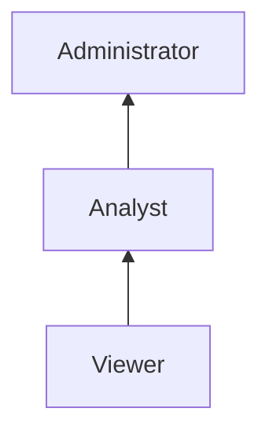

An administrator can perform every analyst action, and an analyst can perform
every viewer action. The backend enforces this hierarchy with
`role_at_least()`; the frontend uses the same rule to hide unavailable controls.

---

## 4.2 Use-case diagram

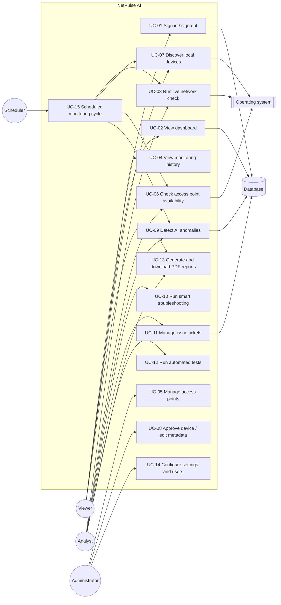

### 4.2.1 Use-case summary

| ID | Use case | Primary actor | Trigger | Result |
|---|---|---|---|---|
| UC-01 | Sign in / sign out | Any user | Credentials | JWT session or cleared session |
| UC-02 | View dashboard | Viewer+ | Page load / poll | Health index, series, alerts |
| UC-03 | Run live network check | Analyst+ | Button or scheduler | New live measurement |
| UC-04 | View monitoring history | Viewer+ | Page load | Measurement history and scheduler state |
| UC-05 | Manage access points | Admin | CRUD action | Inventory change + audit entry |
| UC-06 | Check AP availability | Analyst+ | Button or scheduler | Live/simulated AP observation |
| UC-07 | Discover local devices | Viewer+ (read) | Button or scheduler | ARP observations, hashed identity |
| UC-08 | Approve device / edit metadata | Admin | Approval/edit | Approved device with display metadata |
| UC-09 | Detect AI anomalies | Analyst+ or scheduler | Button/cycle | Anomaly events with explanations |
| UC-10 | Run smart troubleshooting | Analyst+ | Button | Recommendation with causes and steps |
| UC-11 | Manage issue tickets | Analyst+ | Automatic rule or manual action | Ticket with workflow state and comments |
| UC-12 | Run automated tests | Analyst+ | Button | Persisted JUnit results |
| UC-13 | Generate and download PDF reports | Analyst+ / Viewer+ | Generate/download | PDF in report library |
| UC-14 | Configure settings and users | Admin | Save/create | Updated runtime configuration/user |
| UC-15 | Scheduled monitoring cycle | Scheduler | Timer | Measurement + optional anomaly/ticket |

### 4.2.2 Use-case specifications

#### UC-01 — Sign in

| Field | Detail |
|---|---|
| Actors | Viewer, Analyst, Administrator |
| Preconditions | Backend and database available; user account exists and is active |
| Main flow | 1. User opens `/login`. 2. Enters email and password. 3. Frontend posts `/api/auth/login`. 4. Backend verifies Argon2 hash. 5. Backend returns JWT and profile. 6. Frontend stores token and redirects to `/`. |
| Alternative flows | Unknown email or wrong password → 401 “Invalid email or password”. Disabled account → 403. Eight failures in five minutes → 429 throttle. |
| Postconditions | Valid session in browser; `last_login_at` updated |
| Security | Dummy hash verification for unknown emails; token expiry; no password logging |

#### UC-03 — Run live network check

| Field | Detail |
|---|---|
| Actors | Analyst, Administrator, Scheduler |
| Preconditions | Monitoring enabled; probe target reachable or failure to be recorded |
| Main flow | 1. Request reaches `POST /api/monitoring/run`. 2. Service executes OS ping. 3. Parser extracts replies, loss and jitter. 4. Measurement is saved with `data_origin='live'`. 5. Ticket rules are evaluated. 6. Optional AI detection runs. 7. API returns measurement summary. |
| Alternative flows | No replies → offline measurement, 100% loss, error text. Timeout → offline with timeout text. Ping missing → genuine TCP fallback, labelled. Testing environment → 409 to prevent live probes. |
| Postconditions | One new measurement; possible ticket/anomaly |
| Integrity | No generated values; failure is stored as failure |

#### UC-05 — Register an access point

| Field | Detail |
|---|---|
| Actors | Administrator |
| Preconditions | Signed in as admin |
| Main flow | 1. Open Access Points. 2. Select “Add access point”. 3. Enter name, location, management IP, optional MAC/vendor/model/notes, simulation flag. 4. Submit. 5. Backend validates uniqueness and formats. 6. AP row and `created` history entry are written. |
| Alternative flows | Duplicate name/IP → 409. Invalid IP/MAC → 422. Analyst/viewer → 403. |
| Postconditions | AP visible in inventory with `unknown` status (or `simulated`) |
| Audit | History entry records creator, timestamp and fields |

#### UC-07 — Discover local devices

| Field | Detail |
|---|---|
| Actors | Viewer+ (trigger), Scheduler |
| Preconditions | Active local IPv4 subnet; `arp` command available |
| Main flow | 1. Enumerate local subnets. 2. Run `arp -a`. 3. Parse IP/MAC pairs. 4. Filter own/loopback/link-local/network/broadcast/out-of-subnet. 5. Hash MAC, mask display. 6. Insert/update device and append activity. |
| Alternative flows | No subnet → explanatory message. ARP unavailable → empty result, warning logged. |
| Postconditions | Devices and observation timestamps updated |
| Privacy | No active scan, no packet capture, no raw MAC storage |

#### UC-09 — Detect AI anomalies

| Field | Detail |
|---|---|
| Actors | Analyst+, Scheduler |
| Preconditions | Detection enabled; live measurements exist |
| Main flow | 1. Load recent live measurements. 2. Train Isolation Forest on real history or disclosed synthetic baseline. 3. Score recent measurements. 4. Store new events with severity, robust-z explanation and provenance. 5. Escalate High/Critical events to tickets. |
| Alternative flows | No live data → `no_live_data`. Detection disabled → `disabled`. Existing event → skipped. |
| Postconditions | Zero or more anomaly events; possible AI tickets |
| Explainability | Each event states which metrics contributed and warns that it is not a prediction |

#### UC-10 — Run smart troubleshooting

| Field | Detail |
|---|---|
| Actors | Analyst+ |
| Preconditions | Signed in; optional AP selection |
| Main flow | 1. Open Smart Troubleshooting. 2. Optionally select an AP. 3. Run diagnosis. 4. Engine inspects latest live measurement and thresholds. 5. Recommendation is saved and returned. |
| Alternative flows | Simulated AP → `simulated_access_point` guidance. No live data → `insufficient_data` steps. AP offline → `ap_unavailable`. Loss/latency above threshold → corresponding recommendation. Healthy → `no_issue_detected`. |
| Postconditions | Recommendation with causes, steps, related tickets and safety note |
| Safety | No configuration change; constant advisory note |

#### UC-11 — Manage an issue ticket

| Field | Detail |
|---|---|
| Actors | Analyst+ |
| Preconditions | Ticket exists or manual creation requested |
| Main flow | 1. Open Issue Management. 2. Select a ticket or create one. 3. Update status/priority. 4. Add a comment. 5. Backend persists changes. 6. UI refreshes statistics and row state. |
| Alternative flows | Ticket not found → 404. Viewer → 403. |
| Postconditions | Updated ticket; `resolved_at` set when status becomes Resolved; comment recorded |
| Duplicate rule | Automatic tickets reuse an active ticket with the same fingerprint |

#### UC-13 — Generate and download a PDF report

| Field | Detail |
|---|---|
| Actors | Analyst+ (generate), Viewer+ (download) |
| Preconditions | Signed in; report data available |
| Main flow | 1. Choose report type and window. 2. Generate. 3. Backend builds PDF with ReportLab. 4. Saved under `reports/`. 5. Metadata returned. 6. User downloads through authenticated endpoint. |
| Alternative flows | Invalid type → 400. Unknown filename/path traversal → 400/404. Empty scope → report with no-data notes. |
| Postconditions | PDF file and report metadata |
| Types | Executive, uptime, latency, packet loss, access points, anomalies, issues, testing |

#### UC-14 — Configure settings and users

| Field | Detail |
|---|---|
| Actors | Administrator |
| Preconditions | Signed in as admin |
| Main flow | 1. Open Settings. 2. Edit thresholds, toggles, organization, theme. 3. Save. 4. Backend updates `app_settings`. 5. Create user through the team access dialog. |
| Alternative flows | Non-admin save attempted → 403 (UI read-only). Invalid threshold → 422. Duplicate email → 409. |
| Postconditions | Runtime settings updated; new user can sign in |
| Guardrail | “Automatic configuration changes” is permanently disabled |

#### UC-15 — Scheduled monitoring cycle

| Field | Detail |
|---|---|
| Actors | Scheduler |
| Preconditions | Monitoring enabled in configuration |
| Main flow | 1. Startup runs an initial cycle after one second. 2. Loop waits for the configured interval. 3. A cycle acquires a lock. 4. Live probe + ticket rules + optional AI. 5. Device discovery every five minutes. 6. Real AP checks every five minutes. 7. Timestamps updated. |
| Alternative flows | Overlap → skipped. Exception → recorded in `last_error`, loop continues. |
| Postconditions | Fresh live measurement and periodic auxiliary observations |
| Reliability | Exceptions never terminate the loop |

---

## 4.3 Class model

The class diagram shows the principal domain entities and the service classes
that operate on them. Getters/setters are omitted for readability; SQLAlchemy
provides persistence mapping.

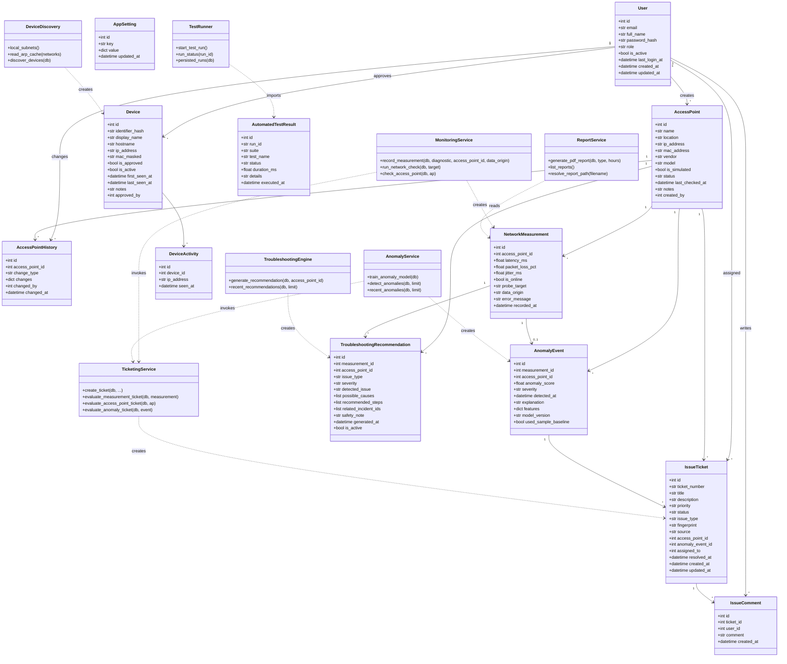

### 4.3.1 Class responsibilities

| Class | Responsibility | Key collaborators |
|---|---|---|
| `User` | Identity, role, active state | Auth API, role dependencies |
| `AccessPoint` | Authorized inventory and health state | AP API, monitoring service |
| `NetworkMeasurement` | Immutable observation | Dashboard, AI, reporting |
| `AnomalyEvent` | Explainable statistical finding | Ticket service, dashboard |
| `TroubleshootingRecommendation` | Advisory diagnosis | Troubleshooting API |
| `Device` / `DeviceActivity` | Privacy-preserving local inventory | Discovery service |
| `IssueTicket` / `IssueComment` | Incident workflow and audit trail | Ticket service, reports |
| `AutomatedTestResult` | Verification evidence | Test runner |
| `AppSetting` | Runtime configuration | Settings service |
| `MonitoringService` | Orchestrates probes and persistence | Diagnostics, ticketing |
| `AnomalyService` | Trains, scores and explains | scikit-learn, settings |
| `TicketingService` | Applies thresholds and deduplication | Models |
| `TroubleshootingEngine` | Rule-based diagnosis | Measurements, settings |
| `ReportService` | Builds PDFs | ReportLab |
| `DeviceDiscovery` | ARP parsing and privacy transforms | psutil, hashlib |
| `TestRunner` | Fixed test execution and JUnit import | pytest, filesystem |

---

## 4.4 Sequence diagrams

### 4.4.1 Login and session restore

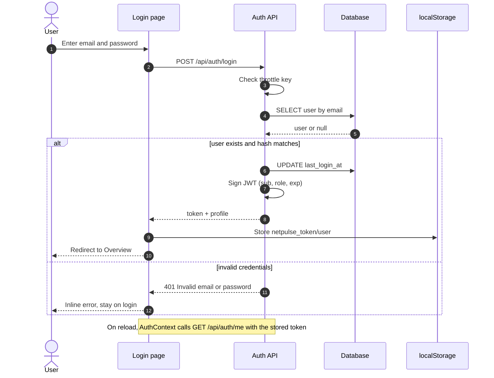

### 4.4.2 Scheduled live check with AI and ticket escalation

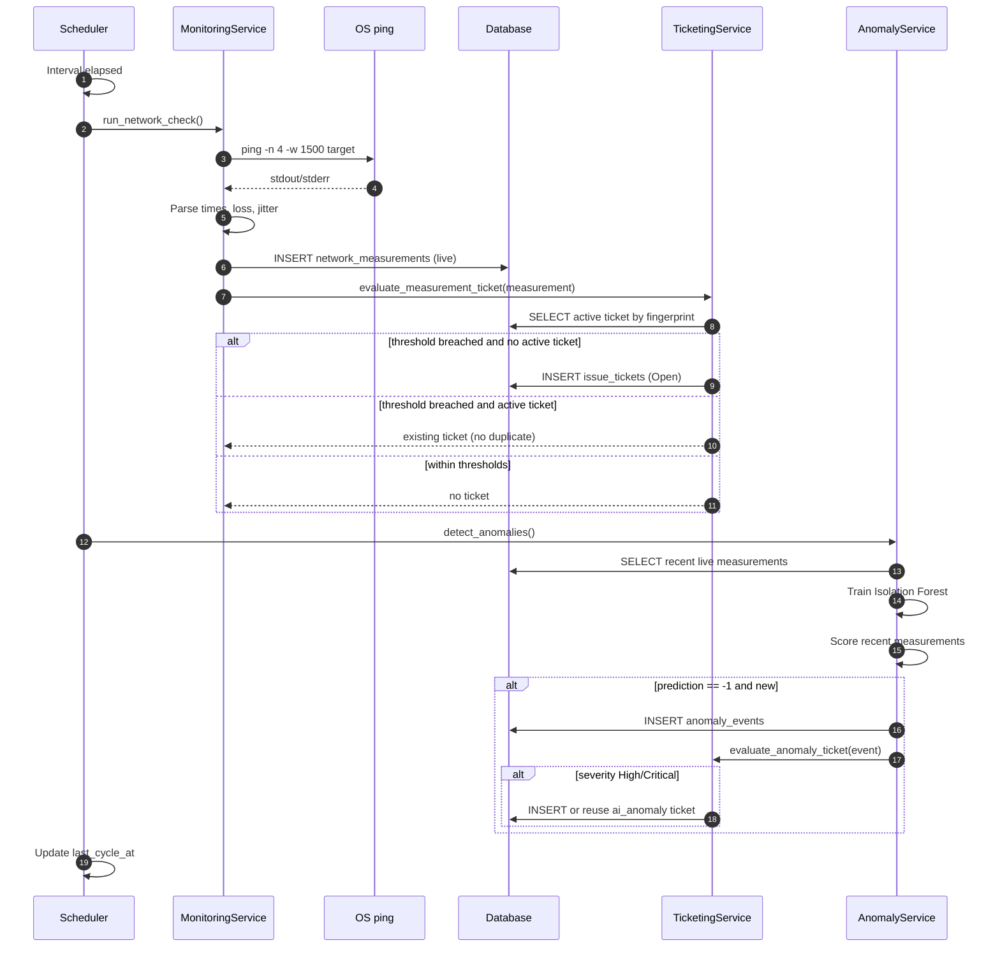

### 4.4.3 Access point availability check

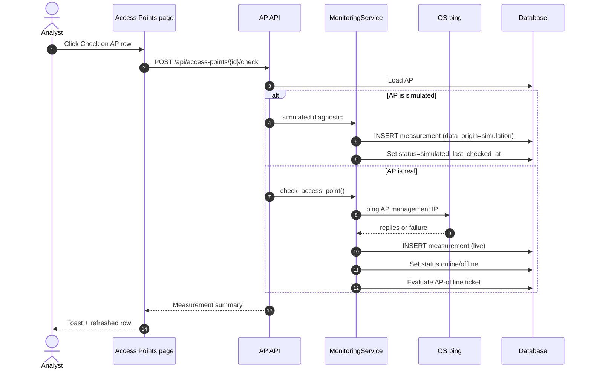

### 4.4.4 Manual ticket and comment

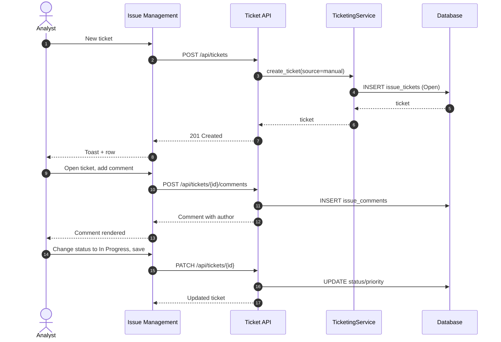

### 4.4.5 PDF report generation and download

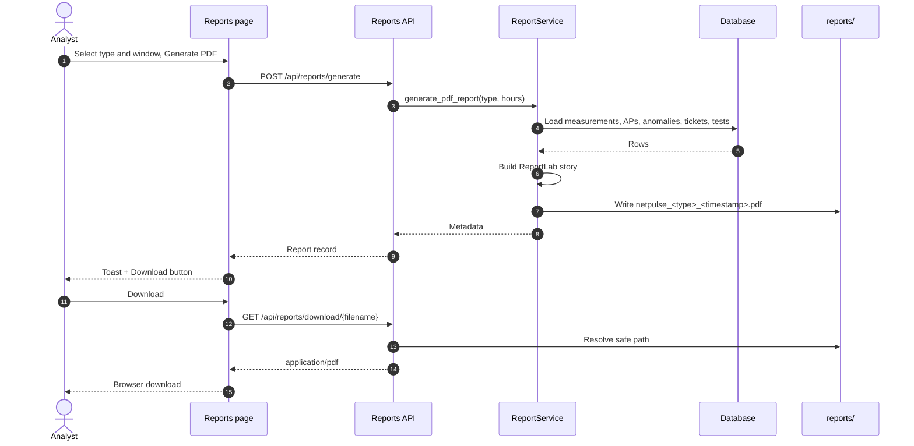

### 4.4.6 Built-in automated test run

```mermaid
sequenceDiagram
    autonumber
    actor A as Analyst
    participant UI as Automation Testing
    participant API as Tests API
    participant TR as TestRunner
    participant PY as pytest
    participant DB as Database

    A->>UI: Start backend run
    UI->>API: POST /api/tests/run
    API->>TR: start_test_run()
    alt run already active
        TR-->>API: conflict
        API-->>UI: 409
    else allowed
        TR->>TR: Generate run_id
        TR->>PY: python -m pytest --junitxml=...
        PY-->>TR: JUnit XML
        TR->>TR: Parse suites and cases
        TR->>DB: INSERT automated_test_results
        TR-->>API: run_id
        API-->>UI: 202 Accepted
    end
    loop polling
        UI->>API: GET /api/tests/runs/{run_id}
        API-->>UI: status + progress + results
    end
```

### 4.4.7 Device discovery

```mermaid
sequenceDiagram
    autonumber
    actor A as Analyst
    participant UI as Devices page
    participant API as Device API
    participant DD as DeviceDiscovery
    participant OS as arp -a
    participant DB as Database

    A->>UI: Discover local devices
    UI->>API: POST /api/devices/discover
    API->>DD: discover_devices(db)
    DD->>DD: local_subnets() via psutil
    DD->>OS: arp -a
    OS-->>DD: ARP table
    DD->>DD: Parse, filter, hash, mask
    loop each neighbour
        DD->>DB: SELECT device by identifier_hash
        alt new
            DD->>DB: INSERT device (unapproved)
        else known
            DD->>DB: UPDATE IP, last_seen
        end
        DD->>DB: INSERT device_activity
    end
    DD-->>API: Summary + devices
    API-->>UI: Counts and method
    UI-->>A: Toast + refreshed list
```

---

## 4.5 Activity diagrams

### 4.5.1 User authentication and authorization

```mermaid
flowchart TD
    START([Start]) --> OPEN[Open application]
    OPEN --> TOKEN{Token present?}
    TOKEN -->|"no"| LOGIN[Show login page]
    TOKEN -->|"yes"| ME[GET /api/auth/me]
    ME --> VALID{Valid and active?}
    VALID -->|"no"| CLEAR[Clear session] --> LOGIN
    VALID -->|"yes"| DASH[Load dashboard]
    LOGIN --> CREDS[Enter credentials]
    CREDS --> POST[POST /api/auth/login]
    POST --> OK{200 OK?}
    OK -->|"no"| ERROR[Show error] --> LOGIN
    OK -->|"yes"| STORE[Store token + profile] --> DASH
    DASH --> ACTION{User action}
    ACTION -->|"read"| VIEW[View data]
    ACTION -->|"mutate"| ROLE{Sufficient role?}
    ROLE -->|"no"| FORBID[403 / hidden control]
    ROLE -->|"yes"| EXEC[Execute action]
    EXEC --> DASH
```

### 4.5.2 Monitoring cycle

```mermaid
flowchart TD
    START([Lifespan start]) --> DB[init_db + seed]
    DB --> EN{Monitoring enabled?}
    EN -->|"no"| IDLE([Scheduler inactive])
    EN -->|"yes"| INITIAL{Monitor on startup?}
    INITIAL -->|"yes"| CYCLE[Run initial cycle]
    INITIAL -->|"no"| WAIT[Wait interval]
    CYCLE --> LOCK{Lock acquired?}
    WAIT --> LOCK
    LOCK -->|"no"| WAIT
    LOCK -->|"yes"| PROBE[Run live probe]
    PROBE --> STORE[Store measurement]
    STORE --> RULES[Evaluate ticket rules]
    RULES --> AI{AI enabled?}
    AI -->|"yes"| DETECT[Detect anomalies]
    AI -->|"no"| AUX
    DETECT --> AUX[Device scan due?]
    AUX -->|"yes"| DISCOVER[ARP discovery]
    AUX -->|"no"| APS
    DISCOVER --> APS[AP checks due?]
    APS -->|"yes"| CHECK[Check real APs]
    APS -->|"no"| STAMP[Update cycle timestamp]
    CHECK --> STAMP
    STAMP --> WAIT
```

### 4.5.3 Ticket lifecycle

```mermaid
flowchart TD
    START([Trigger]) --> AUTO{Source}
    AUTO -->|"automatic"| RULE[Threshold / anomaly / AP rule]
    AUTO -->|"manual"| FORM[Analyst creates ticket]
    RULE --> FP{Active fingerprint?}
    FP -->|"yes"| REUSE[Return existing ticket]
    FP -->|"no"| CREATE[Create Open ticket]
    FORM --> CREATE
    CREATE --> TRIAGE[Analyst reviews]
    TRIAGE --> PROG[Set In Progress]
    PROG --> COMMENT[Add diagnostic comments]
    COMMENT --> FIX[Authorized human action]
    FIX --> RESOLVE[Set Resolved]
    RESOLVE --> END([End])
    REUSE --> TRIAGE
```

### 4.5.4 Report generation

```mermaid
flowchart TD
    START([Open Reports]) --> LOAD[Load report library + types]
    LOAD --> CHOOSE[Choose type + hours]
    CHOOSE --> GEN[POST generate]
    GEN --> VALID{Valid type and hours?}
    VALID -->|"no"| ERR[Show error]
    VALID -->|"yes"| QUERY[Query persisted data]
    QUERY --> BUILD[Build ReportLab document]
    BUILD --> SAVE[Save PDF to reports/]
    SAVE --> META[Return metadata]
    META --> LIST[Add to report library]
    LIST --> DOWNLOAD[Authenticated download]
```

---

## 4.6 State models

### 4.6.1 Access point state

```mermaid
stateDiagram-v2
    [*] --> Unknown: registered real AP
    [*] --> Simulated: registered demo AP
    Unknown --> Online: live check succeeds
    Unknown --> Offline: live check fails
    Online --> Online: successful check
    Online --> Offline: failed check
    Offline --> Online: successful check
    Offline --> Offline: failed check
    Simulated --> Simulated: simulated check
    Online --> [*]: AP deleted
    Offline --> [*]: AP deleted
    Simulated --> [*]: AP deleted
```

`status` is stored as a string. A real AP starts as `unknown` and moves to
`online` or `offline` after a check. A simulated AP remains `simulated` and is
excluded from health calculations.

### 4.6.2 Ticket state

```mermaid
stateDiagram-v2
    [*] --> Open: automatic or manual creation
    Open --> InProgress: analyst starts work
    InProgress --> Resolved: fix verified
    Open --> Resolved: immediate resolution
    InProgress --> Open: returned to queue
    Resolved --> InProgress: reopened
    Resolved --> [*]
```

The UI exposes statuses `Open`, `In Progress` and `Resolved`. The API
sets `resolved_at` when the status becomes `Resolved` and clears it otherwise.
The intended workflow is shown above; the API does not enforce a strict
transition graph, which allows an administrator to correct mistakes.

### 4.6.3 Device approval state

```mermaid
stateDiagram-v2
    [*] --> Unrecognized: first ARP observation
    Unrecognized --> Approved: administrator approves
    Approved --> Approved: observed again
    Unrecognized --> Unrecognized: observed again
    Approved --> [*]: device record removed
    Unrecognized --> [*]: device record removed
```

Device identity is stable through the hashed MAC. An approved device remains
approved when its IP changes; `last_seen_at` and `is_active` update on discovery.

### 4.6.4 Service health state

```mermaid
stateDiagram-v2
    [*] --> Starting
    Starting --> Healthy: SELECT 1 succeeds
    Starting --> Degraded: database unavailable
    Healthy --> Degraded: database check fails
    Degraded --> Healthy: database recovers
    Healthy --> Stopping: shutdown
    Degraded --> Stopping: shutdown
    Stopping --> [*]
```

`GET /api/health` returns `status=ok` when the database responds and `degraded`
otherwise. The scheduler status is exposed separately in the dashboard.

---

## 4.7 Data-flow diagrams

### 4.7.1 Level 0 — context diagram

```mermaid
flowchart LR
    USER["Authorized user"]
    SCHED["Scheduler / time"]
    OS["Operating system<br/>ping · arp · interfaces"]
    SYSTEM(("NetPulse AI"))
    DB[("Database")]
    FILES["reports/ PDF + JUnit"]

    USER -->|"credentials, actions, filters"| SYSTEM
    SYSTEM -->|"dashboard, recommendations, tickets, PDFs"| USER
    SCHED -->|"interval tick"| SYSTEM
    SYSTEM -->|"probe / ARP command"| OS
    OS -->|"latency, loss, jitter, neighbours"| SYSTEM
    SYSTEM <-->|"read/write domain data"| DB
    SYSTEM -->|"generated reports"| FILES
```

### 4.7.2 Level 1 — major processes

```mermaid
flowchart TB
    USER["User"]
    OS["OS network stack"]
    P1["1. Authenticate<br/>and authorize"]
    P2["2. Collect and store<br/>network measurements"]
    P3["3. Detect and explain<br/>AI anomalies"]
    P4["4. Diagnose with<br/>rule engine"]
    P5["5. Govern APs and<br/>local devices"]
    P6["6. Manage issue<br/>tickets"]
    P7["7. Generate reports<br/>and test evidence"]

    D1[("D1 users")]
    D2[("D2 access points<br/>+ history")]
    D3[("D3 measurements")]
    D4[("D4 anomalies")]
    D5[("D5 recommendations")]
    D6[("D6 devices<br/>+ activity")]
    D7[("D7 tickets<br/>+ comments")]
    D8[("D8 test results<br/>+ settings")]

    USER -->|"credentials"| P1
    P1 <--> D1
    USER -->|"run check"| P2
    OS -->|"real probe output"| P2
    P2 --> D3
    P2 -->|"measurement"| P3
    P3 --> D4
    P3 -->|"High/Critical"| P6
    USER -->|"diagnose"| P4
    P4 <--> D3
    P4 --> D5
    P4 -->|"related tickets"| D7
    USER -->|"AP/device actions"| P5
    P5 <--> D2
    OS -->|"ARP cache"| P5
    P5 <--> D6
    USER -->|"ticket actions"| P6
    P6 <--> D7
    USER -->|"report / test run"| P7
    P7 <--> D3
    P7 <--> D4
    P7 <--> D7
    P7 <--> D8
    P7 -->|"PDF + JUnit"| USER
```

### 4.7.3 Level 2 — monitoring process (P2)

```mermaid
flowchart TD
    TICK["Scheduler tick or<br/>manual request"] --> CFG["Read configuration<br/>target, count, timeout, interval"]
    CFG --> RUN["Execute OS ping"]
    RUN --> OK{"Replies?"}
    OK -->|"yes"| PARSE["Parse times, loss, jitter"]
    OK -->|"no"| FAIL["Build offline observation<br/>loss=100, error text"]
    PARSE --> STORE[("Store measurement<br/>data_origin=live")]
    FAIL --> STORE
    STORE --> THRESH{"Threshold rule<br/>breached?"}
    THRESH -->|"yes"| DUP{"Active ticket with<br/>same fingerprint?"}
    THRESH -->|"no"| AI["Trigger anomaly check"]
    DUP -->|"yes"| REUSE["Reuse ticket"]
    DUP -->|"no"| CREATE["Create ticket"]
    REUSE --> AI
    CREATE --> AI
    AI --> OUT["Return measurement<br/>and status"]
```

### 4.7.4 Level 2 — AI process (P3)

```mermaid
flowchart TD
    IN["Recent live measurements"] --> ENOUGH{"Count >= min samples?"}
    ENOUGH -->|"yes"| REAL["Train on real history"]
    ENOUGH -->|"no"| SYN["Train on labelled<br/>synthetic baseline"]
    REAL --> MODEL["Isolation Forest"]
    SYN --> MODEL
    MODEL --> SCORE["Score recent measurements"]
    SCORE --> OUT{"Prediction -1?"}
    OUT -->|"no"| DONE["No event"]
    OUT -->|"yes"| NEW{"Already stored?"}
    NEW -->|"yes"| DONE
    NEW -->|"no"| Z["Robust z-scores"]
    Z --> SEV["Severity + explanation"]
    SEV --> SAVE[("anomaly_events")]
    SAVE --> ESC{"High/Critical?"}
    ESC -->|"yes"| TICKET[("issue_tickets")]
    ESC -->|"no"| DONE
```

### 4.7.5 Level 2 — device governance (P5)

```mermaid
flowchart TD
    REQ["Discovery request<br/>or 5-minute timer"] --> SUBNET["Enumerate active<br/>IPv4 subnets"]
    SUBNET --> NONE{"Subnet available?"}
    NONE -->|"no"| MSG["Return explanatory message"]
    NONE -->|"yes"| ARP["Execute arp -a"]
    ARP --> PARSE["Parse IP/MAC pairs"]
    PARSE --> FILTER["Filter own, loopback,<br/>link-local, network,<br/>broadcast, out-of-subnet"]
    FILTER --> HASH["SHA-256 identity<br/>+ masked MAC"]
    HASH --> EXISTS{"Device exists?"}
    EXISTS -->|"no"| INSERT["Insert unapproved device"]
    EXISTS -->|"yes"| UPDATE["Update IP + last_seen"]
    INSERT --> ACTIVITY[("device_activity")]
    UPDATE --> ACTIVITY
    ACTIVITY --> RESP["Return counts"]
```

---

## 4.8 Component diagram

```mermaid
flowchart TB
    subgraph Frontend["frontend/src"]
        PAGES["Pages (10 modules)"]
        UI["UI primitives"]
        CTX["Context providers"]
        APIC["Axios API client"]
    end
    subgraph Backend["backend/app"]
        ROUTERS["API routers"]
        SCHEMAS["Pydantic schemas"]
        SERVICES["Domain services"]
        MON["Monitoring adapters"]
        AI["AI + rule engine"]
        MODELS["SQLAlchemy models"]
        CORE["Config, security,<br/>database, logging"]
    end
    subgraph Infra["Local infrastructure"]
        DB[("SQLite / MySQL")]
        FS["reports/"]
        OS["OS ping / arp / psutil"]
    end

    PAGES --> UI
    PAGES --> CTX
    PAGES --> APIC
    APIC -->|"JSON + JWT"| ROUTERS
    ROUTERS --> SCHEMAS
    ROUTERS --> SERVICES
    SERVICES --> MON
    SERVICES --> AI
    SERVICES --> MODELS
    ROUTERS --> CORE
    MODELS --> DB
    MON --> OS
    SERVICES --> FS
```

### 4.8.1 Component interfaces

| Provider | Interface | Consumer |
|---|---|---|
| Auth API | `POST /api/auth/login`, `GET /api/auth/me` | Login page, AuthContext |
| Dashboard API | `GET /api/dashboard/overview` | Overview, header notifications |
| Monitoring API | `GET /api/monitoring/*`, `POST /api/monitoring/run` | Network Monitoring page, dashboard |
| AP API | `/api/access-points/*` | Access Points page |
| Device API | `/api/devices/*` | Connected Devices page |
| Anomaly API | `/api/anomalies/*` | AI page, dashboard |
| Troubleshooting API | `/api/troubleshooting/*` | Troubleshooting page |
| Ticket API | `/api/tickets/*` | Issue Management page |
| Tests API | `/api/tests/*` | Automation Testing page |
| Reports API | `/api/reports/*` | Reports page |
| Settings API | `/api/settings/*` | Settings page |

---

## 4.9 Deployment diagram

```mermaid
flowchart TB
    subgraph Browser["Client device"]
        CHROME["Chrome / Edge browser"]
    end
    subgraph Host["Authorized Windows host"]
        subgraph Dev["Development profile"]
            VITE["Vite dev server<br/>:5173"]
        end
        subgraph Prod["Production-style profile"]
            UV["Uvicorn + FastAPI<br/>:8000"]
            DIST["frontend/dist<br/>static assets"]
        end
        subgraph Data["Local data"]
            SQLITE[("SQLite<br/>backend/data/netpulse.db")]
            REPORTS["reports/<br/>PDF + JUnit + coverage"]
        end
        subgraph Net["Network stack"]
            ICMP["ICMP echo"]
            ARP["ARP cache"]
        end
    end
    subgraph Optional["Optional Docker profile"]
        MYSQL[("MySQL 8.4<br/>:3307")]
        PMA["phpMyAdmin<br/>:8081"]
    end

    CHROME -->|"HTTP :5173"| VITE
    CHROME -->|"HTTP :8000"| UV
    VITE -->|"/api proxy"| UV
    UV --> DIST
    UV --> SQLITE
    UV -.->|"DATABASE_URL"| MYSQL
    UV --> REPORTS
    UV --> ICMP
    UV --> ARP
    PMA --> MYSQL
```

### 4.9.1 Node responsibilities

| Node | Responsibility |
|---|---|
| Browser | Render SPA, store JWT, call API, download PDFs |
| Vite | Development serving, HMR, `/api` proxy |
| Uvicorn/FastAPI | API, auth, scheduler, AI, reports, static frontend |
| SQLite | Verified local persistence |
| MySQL 8 | Optional deployment persistence |
| `reports/` | Generated PDFs, JUnit XML, coverage, Playwright report |
| OS network stack | Real ICMP and ARP observations |
| phpMyAdmin | Optional database inspection |

---

## 4.10 Navigation model

```mermaid
flowchart LR
    LOGIN["/login"] --> SHELL["DashboardLayout"]
    SHELL --> OV["/ — Overview"]
    SHELL --> MON["/monitoring"]
    SHELL --> AP["/access-points"]
    SHELL --> DEV["/devices"]
    SHELL --> AI["/anomalies"]
    SHELL --> TR["/troubleshooting"]
    SHELL --> ISS["/issues"]
    SHELL --> TST["/testing"]
    SHELL --> REP["/reports"]
    SHELL --> SET["/settings"]
    SHELL --> NF["* — NotFound"]
```

| Route | Module | Required access |
|---|---|---|
| `/login` | Login | Anonymous |
| `/` | Overview | Any authenticated user |
| `/monitoring` | Network Monitoring | Any authenticated user |
| `/access-points` | Access Points | Any authenticated user (mutations admin) |
| `/devices` | Connected Devices | Any authenticated user (approval admin) |
| `/anomalies` | AI Anomaly Detection | Any authenticated user (detection analyst+) |
| `/troubleshooting` | Smart Troubleshooting | Any authenticated user (run analyst+) |
| `/issues` | Issue Management | Any authenticated user (mutations analyst+) |
| `/testing` | Automation Testing | Any authenticated user (run analyst+) |
| `/reports` | Reports | Any authenticated user (generate analyst+) |
| `/settings` | Settings | Any authenticated user (save admin) |
| `*` | NotFound | Any authenticated user |

---

## 4.11 Model-to-implementation traceability

| Model element | Implementation |
|---|---|
| Use cases | React pages and FastAPI routers |
| Class model | `backend/app/models/models.py` |
| Sequence: login | `api/auth.py`, `context/AuthContext.jsx` |
| Sequence: monitoring | `monitoring/scheduler.py`, `services/monitoring.py` |
| Sequence: AI | `ai/anomaly.py`, `services/ticketing.py` |
| Sequence: report | `services/reports.py`, `api/reports.py` |
| Sequence: test runner | `services/test_runner.py`, `api/tests.py` |
| State: AP status | `services/monitoring.py` |
| State: ticket | `api/tickets.py` |
| DFD stores | SQLAlchemy tables |
| Deployment | `README.md`, `docker-compose.yml`, Vite config |

---

## 4.12 Chapter summary

The models show a deliberately bounded system. Human actors initiate or approve
risky actions; the scheduler performs only measurements and analysis; the
intelligence layer produces explanations rather than commands; and every action
is persisted in a form that can be reported and audited.

The next chapter verifies that the implemented system behaves as these models
describe.

<div style="page-break-before: always;"></div>

# 5. Testing and Results

## 5.1 Testing objectives

Testing pursued six objectives:

| ID | Objective | Evidence |
|---|---|---|
| TO1 | Verify authentication, authorization and session handling | 12 auth tests + 4 Playwright auth tests |
| TO2 | Verify real-data integrity and simulation isolation | Monitoring, dashboard, AP and device tests |
| TO3 | Verify the AI and rule-based decision logic | Anomaly and troubleshooting tests |
| TO4 | Verify the operational workflow end to end | 12 Playwright interaction tests |
| TO5 | Verify reports, test runner and settings | Report, testing and settings tests |
| TO6 | Verify the interface is usable and responsive | Playwright navigation/responsive tests, 21 screenshots |

---

## 5.2 Test environment

| Item | Value |
|---|---|
| Operating system | Microsoft Windows 11 Home Single Language, build 10.0.26300 |
| Python | 3.12.16 (backend virtual environment) |
| FastAPI | 0.163.0 |
| SQLAlchemy | 2.0.57 |
| scikit-learn | 1.9.1 |
| Pydantic | 2.14.3 |
| ReportLab | 4.5.1 |
| Pytest | 9.2.0 |
| Node.js | 24.19.0 |
| npm | 11.17.0 |
| Browser | Google Chrome 157.0.8103.52 (Playwright `channel: chrome`) |
| Backend URL | `http://127.0.0.1:8000` |
| Frontend URL | `http://127.0.0.1:5173` |
| Verified database | SQLite (`backend/data/netpulse.db` for runtime, throw-away DB for tests) |
| MySQL runtime | **Not executed** — MySQL and Docker are not installed on this machine |

### 5.2.1 Why system Chrome?

The bundled Playwright headless shell is blocked by this machine's Windows
Application Control policy (`spawn UNKNOWN`). The suite therefore uses the
installed Chrome channel:

```js
channel: process.env.PLAYWRIGHT_CHANNEL || 'chrome'
```

On another machine, run with `PLAYWRIGHT_CHANNEL=msedge` or install Chromium and
set `PLAYWRIGHT_CHANNEL=chromium`. This is an environment constraint, not an
application defect, and is documented in the README and conclusion.

---

## 5.3 Test strategy

The project uses a practical test pyramid with two executable layers and a
manual exploratory layer.

```mermaid
flowchart TB
    E2E["21 Playwright end-to-end tests<br/>real browser + real backend"]
    BACK["103 backend tests<br/>API, services, security, ML, intelligence"]
    MAN["Manual exploratory review<br/>screenshots, visual layout, PDF inspection"]

    MAN --> E2E --> BACK
```

Several backend tests exercise more than one layer. The exact 103-test inventory
plus the 21 browser tests is in
[`test-inventory.generated.md`](test-inventory.generated.md).

### 5.3.1 Backend isolation

`backend/tests/conftest.py` enforces a safe test environment:

- a unique throw-away SQLite file per test session;
- `ENVIRONMENT=testing`;
- the monitoring scheduler disabled;
- live probe execution blocked;
- the built-in test runner disabled to prevent recursion;
- a known administrator and viewer/analyst accounts;
- database tables created and dropped around the session;
- FastAPI dependency overrides for the test session.

This means the backend suite never touches the development database, never
performs a real ping and never spawns a nested pytest process.

### 5.3.2 Frontend isolation

Playwright:

- starts or reuses the Vite and Uvicorn servers;
- reads credentials from `backend/.env` or `E2E_EMAIL`/`E2E_PASSWORD`;
- runs with one worker to avoid mutating shared data concurrently;
- captures a trace and screenshot only on failure;
- asserts that no console errors or page errors occur while visiting all modules;
- verifies mobile layout at 390 × 844;
- uses real backend mutations for AP CRUD and ticket lifecycle, then cleans up
  the AP it created.

### 5.3.3 Test data policy

| Data | Source in tests |
|---|---|
| Admin account | Deterministic test fixture |
| Viewer/analyst accounts | Created by auth tests |
| APs | Fixtures and test-created records |
| Measurements | Synthetic rows inserted directly, marked `live` or `simulation` |
| Live probes | Blocked in the test environment |
| Devices | Mocked discovery and parsed ARP samples |
| Tickets | Created through services and API |
| Reports | Generated into a temporary report directory |
| Test runner | Disabled; parser tested with synthetic JUnit XML |

---

## 5.4 Backend test suite

### 5.4.1 Summary by file

| Test file | Tests | Focus |
|---|---:|---|
| `test_auth.py` | 12 | Health, login, wrong password, unknown email, `/me`, missing/invalid token, user creation, RBAC, validation, viewer read access |
| `test_access_points.py` | 8 | Seeded simulations, CRUD + history + performance, duplicates, invalid IP/MAC, RBAC, simulated checks, search/filter, 404 |
| `test_monitoring.py` | 8 | Network info, history scope, simulated inclusion, live run blocked in tests, probe persistence + ticket, scheduler status, latest live-only, simulation never live |
| `test_anomaly.py` | 7 | Deterministic baseline, cold-start disclosure, no live data, extreme detection + explanation, offline critical, model info, filter validation |
| `test_devices.py` | 6 | ARP parser scope/duplicates, privacy note, update/approval/activity, mocked discovery, viewer restrictions, approval filter |
| `test_reports.py` | 7 | Eight types, generate/list/download, specialised report metadata, invalid requests, missing file, path traversal, authentication |
| `test_security.py` | 7 | Argon2 round trip, oversized password, JWT claims, tampered signature, role hierarchy, production secrets, test defaults |
| `test_settings.py` | 5 | Settings contract, admin update/restore, invalid values, analyst denial, system status |
| `test_testing.py` | 6 | Testing dashboard contract, disabled runner, suite mapping, JUnit statuses, no active run, missing run |
| `test_tickets.py` | 5 | Manual lifecycle, filters/stats, duplicate suppression + resolution reopen, low-anomaly policy, validation/RBAC |
| `test_troubleshooting.py` | 4 | Simulated AP refusal, latency/loss/outage escalation, list/latest, invalid AP + RBAC |
| `test_dashboard.py` | 4 | Overview contract, simulation exclusion, window validation, health calculation |
| `test_intelligence.py` | 14 | Prediction states/weights, RCA evidence, security dedupe, optimisation thresholds, CSV exports, notifications, live status, dashboard roll-up |
| `test_wifi.py` | 9 | Windows association parsing, frequency/band mapping, fallback payloads, authenticated endpoint |
| **Total** | **103** | |

### 5.4.2 Final result

```text
103 passed, 1 warning in 20.51s
```

The warning is a Starlette deprecation notice about the `httpx` test client
adapter. It does not affect application behaviour.

JUnit XML reports 103 tests, 0 failures, 0 errors, 0 skipped:

```text
testsuite name="pytest" errors="0" failures="0" skipped="0" tests="103"
```

### 5.4.3 Coverage

Coverage was measured with `pytest-cov` against the `app` package:

```text
TOTAL   3416 statements   684 missed   80%
```

| Area | Coverage | Notes |
|---|---:|---|
| Models | 100% | All tables imported and used |
| Schemas | 97% | Validation paths exercised |
| Settings API/service | 97–100% | Contract and update paths |
| Anomaly service | 93% | Training, cold start, detection, explanation |
| Auth API | 90% | Login, RBAC, audit, user creation |
| Dashboard | 96% | Aggregation, simulation exclusion, health, intelligence roll-up |
| Access point API | 91% | CRUD, checks, history, performance |
| Reports service | 96% | All report builders and listing metadata exercised |
| Main app | 84% | Lifespan, static mount, routers, errors |
| Monitoring API | 77% | History, latest, scheduler, blocked run, Wi-Fi endpoint |
| Wi-Fi detector | 47% | Parser branches covered; OS command paths exercised manually |
| Monitoring service | 69% | Probe persistence, AP checks, traffic sampling |
| Seed service | 78% | Admin/settings/demo AP seeding |
| Ticketing service | 72% | Threshold, anomaly and AP rules |
| Device discovery | 71% | ARP parsing and discovery logic |
| Test runner | 50% | Subprocess execution intentionally disabled in tests |
| Diagnostics | 41% | OS command execution branches not run in CI-like tests |
| Scheduler | 39% | Async loop and timing branches not unit-tested |
| Prediction engine | 89% | Insufficient-data state, weighted scoring, explanations |
| Root-cause engine | 70% | Evidence gates, rule ranking, workflow |
| Security scanner | 83% | Local evidence sources, dedupe, posture score |
| Optimisation engine | 77% | Threshold advisories and confidence |
| Intelligence API | 65% | Feed, run, action and CSV endpoints |
| Notifications API | 71% | Unread count, mark-read and clear-read |
| Live API | 48% | WebSocket hub and REST fallback (serverless paths unexercised) |

The lower coverage in diagnostics, Wi-Fi detection and the scheduler is
expected: the tests deliberately avoid live pings, host-specific OS commands and
long-running loops. Their core parsing and orchestration paths are covered by
unit/service tests and the real browser suite, while the actual OS command
branches were exercised manually during the live application run.

Coverage XML: `reports/test-runs/coverage.xml`.

---

## 5.5 Frontend test suite

### 5.5.1 Summary by spec

| Spec | Tests | Focus |
|---|---:|---|
| `auth.spec.js` | 4 | Anonymous redirect, wrong password, admin login + reload persistence, sign out |
| `interactions.spec.js` | 12 | Theme persistence, command palette, AP detail/check, AP CRUD, current Wi-Fi prefill/unavailable states, device discovery/privacy, AI + troubleshooting, ticket lifecycle, PDF generate/download, settings save, notifications |
| `navigation.spec.js` | 3 | All ten modules render without console errors; legacy deep links; command-palette access; 404 |
| `responsive.spec.js` | 2 | Mobile drawer navigation; no horizontal overflow |
| **Total** | **21** | |

### 5.5.2 Final result

```text
21 passed (62.1s)
```

JUnit XML reports 21 tests, 0 failures.

### 5.5.3 What the E2E suite proves

- The React application can authenticate against the real FastAPI backend.
- Every sidebar module renders its own content, not a placeholder.
- No console or page errors occur while traversing all modules.
- Access point CRUD and ticket lifecycle work against the real database.
- The current Wi-Fi dialog prefills the detected gateway without writing a
  record, and the cloud-unavailable response is explained without a probe.
- Device discovery invokes the real ARP adapter and displays the privacy dialog.
- AI detection and troubleshooting execute real backend services.
- Report generation writes a real PDF and the download event produces a
  `netpulse_*.pdf` file.
- Settings save through the real administration form.
- Theme and session state survive a reload.
- The command palette and notifications are keyboard/click accessible.
- The mobile layout does not overflow horizontally.

---

## 5.6 Consolidated results

| Suite | Tests | Passed | Failed | Skipped | Duration |
|---|---:|---:|---:|---:|---:|
| Backend Pytest | 103 | 103 | 0 | 0 | 20.51 s (JUnit) |
| Frontend Playwright | 21 | 21 | 0 | 0 | 62.05 s |
| **Total** | **124** | **124** | **0** | **0** | — |

Additional verification:

| Check | Result |
|---|---|
| Backend line coverage | 80% |
| Built-in test runner | 103 tests imported from the final JUnit evidence |
| PDF `%PDF-` signature | Verified |
| Security headers | `nosniff`, `DENY`, `no-referrer`, restrictive Permissions-Policy, `no-store` |
| MySQL DDL | Generated and reviewed; runtime import not executed |
| Documentation screenshots | 21 captured from the current purple build |
| Responsive overflow | No horizontal overflow at 390 px |
| Console errors during module traversal | None |

---

## 5.7 Functional test cases

The following table records representative manual/automated test cases. “Auto”
indicates an automated test or E2E spec; “Manual” indicates a scripted human
check. All results were observed on the final build.

| ID | Module | Scenario | Steps / input | Expected result | Actual | Status | Type |
|---|---|---|---|---|---|---|---|
| TC-01 | Auth | Valid administrator login | Open `/login`, enter `ADMIN_EMAIL` and `ADMIN_PASSWORD`, submit | Redirect to Overview; token stored; profile visible | Redirected; session persisted after reload | Pass | Auto |
| TC-02 | Auth | Wrong password | Enter valid email and wrong password | 401 message “Invalid email or password”; stay on login | Error shown; no token | Pass | Auto |
| TC-03 | Auth | Unknown email | Enter unregistered email | Generic 401; account existence not revealed | Generic error | Pass | Auto |
| TC-04 | Auth | Protected route without token | Visit `/monitoring` while signed out | Redirect to `/login` | Redirected | Pass | Auto |
| TC-05 | Auth | Invalid/tampered token | Call `/api/dashboard/overview` with modified JWT | 401 | 401 | Pass | Auto |
| TC-06 | Auth | Viewer creates AP | Sign in as viewer, `POST /api/access-points` | 403 required admin | 403 | Pass | Auto |
| TC-07 | Auth | Analyst changes settings | Sign in as analyst, `PATCH /api/settings` | 403 required admin | 403 | Pass | Auto |
| TC-08 | Dashboard | Overview contract | `GET /api/dashboard/overview?hours=24` | Summary, series, alerts, monitoring, disclaimer | All keys present | Pass | Auto |
| TC-09 | Dashboard | Simulation exclusion | Insert live + simulated measurements; load overview | Health/series use live only | Simulated rows excluded | Pass | Auto |
| TC-10 | Dashboard | Invalid window | `hours=0` and `hours=9999` | 422 validation error | 422 | Pass | Auto |
| TC-11 | Monitoring | Live run in test env | `POST /api/monitoring/run` under `ENVIRONMENT=testing` | 409; no probe executed | 409 | Pass | Auto |
| TC-12 | Monitoring | Live probe persistence + ticket | Mock diagnostic above threshold; run service | Measurement saved; ticket created | Saved and ticketed | Pass | Auto |
| TC-13 | Monitoring | Latest endpoint live-only | Insert simulation after live; `GET /latest` | Live measurement returned | Live only | Pass | Auto |
| TC-14 | Monitoring | Network context | `GET /api/monitoring/network-info` | Hostname, platform, interfaces, target | Present, no secrets | Pass | Auto |
| TC-15 | AP | Create/update/history/delete | Admin CRUD an AP | Row changes; history entries; delete succeeds | All operations succeeded | Pass | Auto/E2E |
| TC-16 | AP | Duplicate AP | Create same name + IP twice | 409 duplicate | 409 | Pass | Auto |
| TC-17 | AP | Invalid IP/MAC | Submit malformed values | 422 field errors | 422 | Pass | Auto |
| TC-18 | AP | Simulated check isolation | Check a `[DEMO]` AP | `data_origin=simulation`; status simulated; excluded from health | Labelled and excluded | Pass | Auto/E2E |
| TC-19 | AP | AP detail dialog | Open AP details, then close | Metadata, history, simulation notice; closes cleanly | Rendered and closed | Pass | E2E |
| TC-20 | Devices | ARP parser scope | Parse sample ARP table containing own, loopback, out-of-subnet and duplicate entries | Only valid in-subnet unique neighbours returned | Correct filtering | Pass | Auto |
| TC-21 | Devices | Discovery + approval | Trigger discovery, approve a device, add metadata | New unapproved device; approval persists; activity recorded | Correct | Pass | Auto/E2E |
| TC-22 | Devices | Privacy | Open device detail | Masked MAC and privacy notice; no raw MAC | Displayed | Pass | E2E |
| TC-23 | AI | Cold start | Fewer than minimum real samples; run detection | `sample_baseline_used=true`; disclosure message | Disclosed | Pass | Auto |
| TC-24 | AI | Extreme measurement | Insert live extreme latency/loss; run detection | Anomaly event with severity and robust-z explanation | Detected and explained | Pass | Auto |
| TC-25 | AI | Offline measurement | Detection over an offline live row | Critical explanation; no live values invented | Critical explanation | Pass | Auto |
| TC-26 | AI | No live data | Run detection with no live measurements | `no_live_data` message; no fake events | Correct | Pass | Auto |
| TC-27 | Troubleshooting | Latency/loss/outage rules | Create conditions at thresholds; run diagnosis | Corresponding issue type, causes and steps | Correct escalation | Pass | Auto |
| TC-28 | Troubleshooting | Simulated AP | Diagnose a demo AP | Refuses real diagnosis; explains simulation | Correct | Pass | Auto |
| TC-29 | Tickets | Manual lifecycle | Create ticket, comment, change status | Ticket row; comment; status/resolved timestamp | Complete | Pass | Auto/E2E |
| TC-30 | Tickets | Dedup + reopen | Trigger same threshold twice; resolve; trigger again | One active ticket; new ticket after resolution | Correct | Pass | Auto |
| TC-31 | Tickets | Low anomaly policy | Medium/Low anomaly | No automatic AI ticket | No ticket | Pass | Auto |
| TC-32 | Reports | All eight types | `GET /api/reports/types` and generate each | Eight types; PDF starts with `%PDF-` | Generated | Pass | Auto/Manual |
| TC-33 | Reports | Download | Download generated report | `application/pdf`, correct filename | Downloaded | Pass | Auto/E2E |
| TC-34 | Reports | Path traversal | Request `../` or absolute path | 400/404; no file outside reports | Blocked | Pass | Auto |
| TC-35 | Reports | Unauthenticated download | Call download without token | 401 | 401 | Pass | Auto |
| TC-36 | Testing | Dashboard + parser | Load testing dashboard; parse JUnit statuses | Suite counts; pass/fail/error/skip parsed | Correct | Pass | Auto |
| TC-37 | Testing | Disabled runner | Disable runner; start run | 403 | 403 | Pass | Auto |
| TC-38 | Testing | Missing run | Request unknown run ID | 404 | 404 | Pass | Auto |
| TC-39 | Settings | Admin update | Change thresholds/toggles; save | Persisted and reflected in system | Saved | Pass | Auto/E2E |
| TC-40 | Settings | Invalid values | Negative latency, loss > 100 | 422 | 422 | Pass | Auto |
| TC-41 | Settings | Non-admin read-only | Analyst opens Settings | Read-only notice; save hidden/disabled | Read-only | Pass | Auto/E2E |
| TC-42 | UI | All modules render | Visit all ten modules | Heading and marker visible; no console errors | All rendered | Pass | E2E |
| TC-43 | UI | Theme persistence | Toggle light, reload, toggle dark | Preference persists; `html.dark` correct | Correct | Pass | E2E |
| TC-44 | UI | Command palette | `Ctrl+K`, search Reports, select, Escape | Navigates to Reports; dialog closes | Correct | Pass | E2E |
| TC-45 | UI | Notifications | Open and close panel | Alerts panel visible; closes | Correct | Pass | E2E |
| TC-46 | UI | Mobile navigation | 390 px viewport, open drawer, navigate | Navigation visible, page changes, drawer closes | Correct | Pass | E2E |
| TC-47 | UI | Mobile overflow | 390 px viewport | `scrollWidth <= innerWidth + 1` | No overflow | Pass | E2E |
| TC-48 | Security | Headers | `GET /api/health` | Security headers present | Present | Pass | Manual |
| TC-49 | Security | Password hash | Hash and verify a password; reject wrong | Argon2 hash; wrong rejected | Correct | Pass | Auto |
| TC-50 | Security | Production config | Production with empty/placeholder secrets | Startup validation error | Rejected | Pass | Auto |

### 5.7.1 Test-case distribution

| Area | Cases |
|---|---:|
| Authentication and security | 12 |
| Dashboard and monitoring | 7 |
| Access points | 5 |
| Devices | 3 |
| AI and troubleshooting | 6 |
| Tickets | 3 |
| Reports | 4 |
| Test runner and settings | 5 |
| UI/responsive | 5 |
| **Total** | **50** |

---

## 5.8 Defects found and fixed

Testing was not only confirmatory; several real defects were found and corrected.

| ID | Defect | Impact | Root cause | Fix | Verification |
|---|---|---|---|---|---|
| D-01 | Device detail modal crashed when closed | Page error after closing dialog | Modal component accessed a null selected device during exit | Guarded the detail content and reset state safely | E2E device test, console check |
| D-02 | AP detail modal crashed when closed | Page error after closing dialog | Same null-detail pattern | Guarded detail rendering and close handler | E2E AP detail test |
| D-03 | Recharts Y-axis labels clipped | Metrics partially unreadable | Default chart margins too narrow | Explicit axis widths/margins across charts | Visual review, screenshots |
| D-04 | Sidebar email capitalization | Profile identity rendered incorrectly | CSS transform applied to email | Removed text transform for email | E2E/admin profile check |
| D-05 | Pytest suite mapping incorrect | Built-in runner grouped tests under wrong suites | `_suite_for()` matched only the first classname segment | Map classname to known suite names, fallback to module | `test_suite_mapping` |
| D-06 | Playwright strict label conflict | Login test failed on “Password” | Password visibility button also had label “Show password” | Exact label matching in helper/tests | Auth E2E suite |
| D-07 | Playwright headless shell blocked | All E2E tests failed to launch | Windows Application Control policy blocks bundled shell | Use installed Chrome channel | 21 E2E tests pass |
| D-08 | Automation screenshot captured entire page | Unreadable giant image | `fullPage: true` for dense pages | Per-page viewport/full-page configuration | Refreshed screenshots |
| D-09 | Testing report predated final 103-pass run | Report evidence stale | PDF generated before final test run | Regenerate PDFs after final run | Final report set |
| D-10 | Pytest class mapping test added after runner fix | Regression risk | No direct test for mapping | Added `test_suite_mapping` | 103-test suite |

The defect log demonstrates an iterative verification process rather than a
single “happy path” demonstration.

---

## 5.9 Security verification

| Control | Test / check | Result |
|---|---|---|
| Argon2 hashing | `test_password_hash_round_trip` | Pass |
| Oversized password rejection | `test_password_hash_rejects_oversized_input` | Pass |
| JWT claims | `test_access_token_contains_required_claims` | Pass |
| Tampered JWT | `test_token_with_wrong_signature_is_rejected` | Pass |
| Role hierarchy | `test_role_hierarchy` | Pass |
| Production secret enforcement | `test_production_secret_requirements_are_enforced` | Pass |
| Test environment isolation | `test_test_environment_has_ephemeral_safe_defaults` | Pass |
| Missing token | `test_protected_routes_require_a_token` | Pass |
| Invalid token | `test_invalid_token_is_rejected` | Pass |
| Viewer/analyst RBAC | Auth, AP, device, settings, ticket tests | Pass |
| Report path traversal | `test_report_path_traversal_is_blocked` | Pass |
| Security headers | Manual HTTP inspection | Pass |
| Login throttling | Implemented; not exhaustively load-tested | Code review |

### 5.9.1 Residual security risks

- JWT logout is client-side only; a stolen token remains valid until expiry.
- No refresh-token rotation or server-side denylist.
- No multi-factor authentication.
- Login throttling is in-memory and per-process.
- No database-level CHECK constraints.
- HTTP is used locally; production must terminate TLS.
- Backups contain operational metadata and hashed credentials and must be
  protected.

These risks are acceptable for a local academic deployment and are listed in the
future-work chapter.

---

## 5.10 Test evidence and screenshots

| Evidence | Path |
|---|---|
| Backend JUnit | `reports/test-runs/backend-junit.xml` |
| Backend coverage | `reports/test-runs/coverage.xml` |
| Frontend JUnit | `reports/test-runs/frontend-junit.xml` |
| Playwright HTML report | `reports/playwright-report/index.html` |
| Built-in runner JUnit | `reports/test-runs/run-20261115-090130-a8cc-junit.xml` |
| Test inventory | `documentation/test-inventory.generated.md` |
| PDF reports | `reports/*.pdf` |
| Screenshots | `documentation/screenshots/01-21` |

Relevant screenshots:

- **Automation Testing** — `documentation/screenshots/11-automation-testing.png`
- **Reports** — `documentation/screenshots/12-reports.png`
- **AI detection** — `documentation/screenshots/07-ai-anomaly-detection.png`
- **Troubleshooting** — `documentation/screenshots/08-smart-troubleshooting.png`
- **Issue management** — `documentation/screenshots/09-issue-management.png`
- **Mobile layout** — `documentation/screenshots/16-mobile-overview.png`

### 5.10.1 Reproducing the results

```powershell
# From the NetPulse-AI root
powershell -ExecutionPolicy Bypass -File .\scripts\test-all.ps1
```

Or individually:

```powershell
cd backend
.\.venv\Scripts\python.exe -m pytest --junitxml=..\reports\test-runs\backend-junit.xml
.\.venv\Scripts\python.exe -m pytest --cov=app --cov-report=term --cov-report=xml:..\reports\test-runs\coverage.xml

cd ..\frontend
npm.cmd run test:e2e
```

The E2E suite needs both servers. It reuses them if already running, otherwise it
starts them through the Playwright `webServer` configuration.

---

## 5.11 What was not tested

Honesty about test boundaries is part of good engineering.

| Area | Status | Reason / next step |
|---|---|---|
| MySQL runtime import | Not executed | MySQL and Docker not installed; import on a MySQL 8 host before deployment |
| Multi-worker concurrency | Not tested | Scheduler assumes one API process |
| Long-duration soak test | Not performed | Requires hours/days of runtime; add retention and monitoring |
| High load / performance | Not benchmarked | Single-user academic scope; use Locust/k6 for load testing |
| Real AP hardware checks | Limited | Only the authorized local target and demo APs were used |
| Cross-browser matrix | Chrome only | Playwright can add Firefox/WebKit on an unmanaged host |
| Screen-reader audit | Not performed | Manual accessibility audit recommended |
| Penetration testing | Not performed | Code-level security tests only |
| Email/SMS alerting | Not implemented | Out of scope |
| Automatic remediation | Intentionally absent | Safety design decision |

### 5.11.1 MySQL verification note

The SQL files were generated from the same SQLAlchemy metadata used by the
passing SQLite tests. They were reviewed for MySQL-specific syntax (InnoDB,
`AUTO_INCREMENT`, native JSON, index names, foreign-key actions) but were **not
executed** because neither MySQL nor Docker is available on this machine. This
remains the main deployment risk and is repeated in the conclusion.

---

## 5.12 Chapter summary

The final build passed **124 automated tests** (103 backend + 21 E2E) with **80%
backend line coverage**. Testing found and fixed real UI and test-infrastructure
defects. The evidence is stored as JUnit XML, coverage XML, a Playwright HTML
report, PDFs and 21 screenshots. The main unverified area is the MySQL runtime
import, which is explicitly marked as deployment-only rather than presented as
tested.

The next chapter explains how to install and operate the verified build.

<div style="page-break-before: always;"></div>

# 6. User Manual

## 6.1 About this manual

This manual explains how to install, start and operate the verified NetPulse AI
build. It is written for three audiences:

| Audience | Recommended sections |
|---|---|
| Student or demonstrator | 6.2 to 6.8 |
| Network operator | 6.5 to 6.11 |
| System administrator | 6.3, 6.7, 6.9, 6.12 to 6.14 |

### 6.1.1 Conventions

- Interface labels appear in **bold**, for example **Run live check**.
- File names, commands and environment variables appear in `monospace`.
- "Live" means a real operating-system observation. "Simulation" means a
  clearly labelled demonstration record that is excluded from health metrics.
- All stored timestamps are UTC. The interface formats them for the browser's
  locale and timezone.
- Screenshots are relative to this document, for example
  `screenshots/02-overview.png`.

### 6.1.2 What the application does not do

NetPulse AI does **not**:

- change router, access-point, firewall or Wi-Fi configuration;
- capture packets, URLs, DNS queries or payload content;
- perform an active network or Wi-Fi scan, or a port scan (it reads only the
  current Wi-Fi association and the local ARP cache);
- invent measurements when a probe fails;
- predict a future outage with certainty.

These boundaries are design decisions, not missing features.

---

## 6.2 Roles and permissions

Three roles are enforced by the backend and reflected in the interface.

| Capability | Viewer | Analyst | Administrator |
|---|:---:|:---:|:---:|
| Sign in and view all dashboards | Yes | Yes | Yes |
| Read monitoring history, APs, devices, anomalies, diagnoses and tickets | Yes | Yes | Yes |
| Download generated PDF reports | Yes | Yes | Yes |
| Run a live network probe | No | Yes | Yes |
| Check an access point's availability | No | Yes | Yes |
| Discover devices from the ARP cache | No | Yes | Yes |
| Run AI anomaly detection | No | Yes | Yes |
| Run smart troubleshooting | No | Yes | Yes |
| Create and update tickets, add comments | No | Yes | Yes |
| Generate PDF reports | No | Yes | Yes |
| Register, edit and delete access points | No | No | Yes |
| Detect the current Wi-Fi and prefill its gateway | No | No | Yes |
| Approve devices and edit device metadata | No | No | Yes |
| Save settings and create user accounts | No | No | Yes |
| Run the built-in backend test suite | No | No | Yes |

A higher role inherits every capability of the lower role. The API returns
`403` when a role is insufficient, and the interface hides controls that the
signed-in user cannot use.

> **Security practice:** assign the minimum role required. Use **Viewer** for
> observers and management demonstrations, **Analyst** for the person running
> diagnostics, and **Administrator** only for configuration owners.

---

## 6.3 System requirements

### 6.3.1 Verified environment

| Item | Verified value |
|---|---|
| Operating system | Windows 11 Home Single Language, build 10.0.26300 |
| Python | 3.12.16 |
| Node.js | 24.19.0 |
| npm | 11.17.0 |
| Browser | Google Chrome 157.0.8103.52 |
| Database | SQLite (default and verified) |
| Optional database | MySQL 8 (schema and Docker Compose included, runtime not verified here) |

### 6.3.2 Minimum practical requirements

- Windows 10/11, macOS or Linux with Python 3.11 or newer.
- Node.js 18 LTS or newer, including npm.
- A modern Chromium-based browser for the best experience and for Playwright.
- At least 1 GB of free disk space for dependencies, the database, PDFs and
  test reports.
- Permission to send ICMP echo requests. If ICMP is blocked, the application
  records the real failure and may use a labelled TCP fallback where permitted.
- Authorization to monitor the selected network and access points.

### 6.3.3 Network and port requirements

| Service | Default address |
|---|---|
| Frontend development server | `http://127.0.0.1:5173` |
| Backend API | `http://127.0.0.1:8000` |
| Swagger UI | `http://127.0.0.1:8000/docs` |
| ReDoc | `http://127.0.0.1:8000/redoc` |
| Health check | `http://127.0.0.1:8000/api/health` |
| Optional MySQL host port | `127.0.0.1:3307` |
| Optional phpMyAdmin | `http://127.0.0.1:8081` |

Only ports 5173 and 8000 are required for normal use. The optional MySQL ports
are defined in `docker-compose.yml`.

---

## 6.4 Installation

### 6.4.1 One-command setup (recommended)

Open PowerShell in the `NetPulse-AI` folder and run:

```powershell
powershell -ExecutionPolicy Bypass -File .\scripts\setup.ps1
```

The script performs these steps:

1. Verifies Python 3.11+ and Node.js 18+.
2. Creates `backend\.venv` if it does not exist.
3. Installs `backend\requirements.txt`.
4. Creates `backend\.env` from `backend\.env.example` with a random JWT secret
   and a random administrator password.
5. Installs frontend npm dependencies.
6. Checks whether Google Chrome is installed for Playwright.
7. Prints the administrator email and the generated password once.

The `.env` file is never overwritten. If it already exists, the script leaves
the existing credentials untouched.

> **Record the generated password immediately.** It is stored in
> `backend\.env`, but the setup output is the only time it is displayed in
> plaintext.

### 6.4.2 Manual setup

Use this path if you prefer to control each step or if script execution is
restricted.

```powershell
# Backend
cd backend
python -m venv .venv
.\.venv\Scripts\python.exe -m pip install --upgrade pip
.\.venv\Scripts\python.exe -m pip install -r requirements.txt

# Configuration
Copy-Item .env.example .env
notepad .env
```

Before the first start, replace at least:

- `JWT_SECRET_KEY` with a long random value;
- `ADMIN_PASSWORD` with a strong password of 10 or more characters;
- optionally `ADMIN_EMAIL`, `MONITOR_TARGET` and the thresholds.

Generate a JWT secret with:

```powershell
python -c "import secrets; print(secrets.token_urlsafe(48))"
```

Then install the frontend:

```powershell
cd ..\frontend
npm.cmd install
```

On Windows PowerShell, use `npm.cmd` rather than `npm` if script execution is
disabled by policy.

### 6.4.3 First start and seed behaviour

Start the backend once. During startup the seed service runs three idempotent
steps:

1. Inserts any missing default settings.
2. Creates the first administrator only when the `users` table is empty. If
   `ADMIN_PASSWORD` is missing or still a placeholder, a random password is
   generated and written to the server log once.
3. Inserts two `[DEMO]` access points only when the access-point table is empty.
   These records are labelled simulated and use RFC 5737 documentation
   addresses.

No production password is embedded in source code. A second start does not
recreate users or demo APs.

### 6.4.4 Verify the installation

Start both services (Section 6.5), then open:

```text
http://127.0.0.1:8000/api/health
```

A healthy response resembles:

```json
{
  "status": "ok",
  "database": "connected",
  "environment": "development"
}
```

If the status is `degraded`, inspect the backend console and
`backend\logs\netpulse.log`.

### 6.4.5 Production-style build

```powershell
powershell -ExecutionPolicy Bypass -File .\scripts\build.ps1
```

The command builds the React application into `frontend\dist`. On the next
backend start, FastAPI serves the built interface from
`http://127.0.0.1:8000`. The Vite development server is then unnecessary.

### 6.4.6 Optional MySQL deployment

SQLite is the verified default. MySQL 8 support is deployment-only:

```powershell
Copy-Item .env.docker.example .env.docker
# edit all passwords in .env.docker
docker compose --env-file .env.docker up -d
```

Then change `DATABASE_URL` in `backend\.env` to the connection string in
`database\README.md` and restart the backend.

> **Verification status:** MySQL and Docker were not installed on the
> development machine. The SQL was generated from the same SQLAlchemy metadata
> used by the passing SQLite tests, but it was not executed here. Import and
> smoke-test the schema on a MySQL 8 host before a live deployment.

---

## 6.5 Starting and stopping the application

### 6.5.1 Start both services

```powershell
powershell -ExecutionPolicy Bypass -File .\scripts\run-all.ps1
```

This opens two PowerShell windows, one for each service, waits briefly, and
opens the frontend in the default browser.

### 6.5.2 Start services separately

```powershell
# Terminal 1 - backend
powershell -ExecutionPolicy Bypass -File .\scripts\run-backend.ps1

# Terminal 2 - frontend
powershell -ExecutionPolicy Bypass -File .\scripts\run-frontend.ps1
```

Or start them manually:

```powershell
cd backend
.\.venv\Scripts\python.exe -m uvicorn app.main:app --host 127.0.0.1 --port 8000 --reload

cd ..\frontend
npm.cmd run dev -- --port 5173 --strictPort
```

### 6.5.3 Stop the services

- Close the two PowerShell windows, or press `Ctrl+C` in each terminal.
- Do not close only the browser tab; the servers continue running.
- The SQLite database persists in `backend\data\netpulse.db`.
- Generated PDFs persist in `reports\`.

### 6.5.4 Restart checklist

| Situation | Action |
|---|---|
| Changed `backend\.env` | Restart the backend |
| Changed frontend code | Vite hot-reloads; refresh the browser if needed |
| Rebuilt `frontend\dist` | Restart the backend so it serves the new assets |
| Database file moved | Stop the backend, restore the file, restart |
| Port already in use | Stop the other process or choose another port |

---

## 6.6 Signing in and session handling

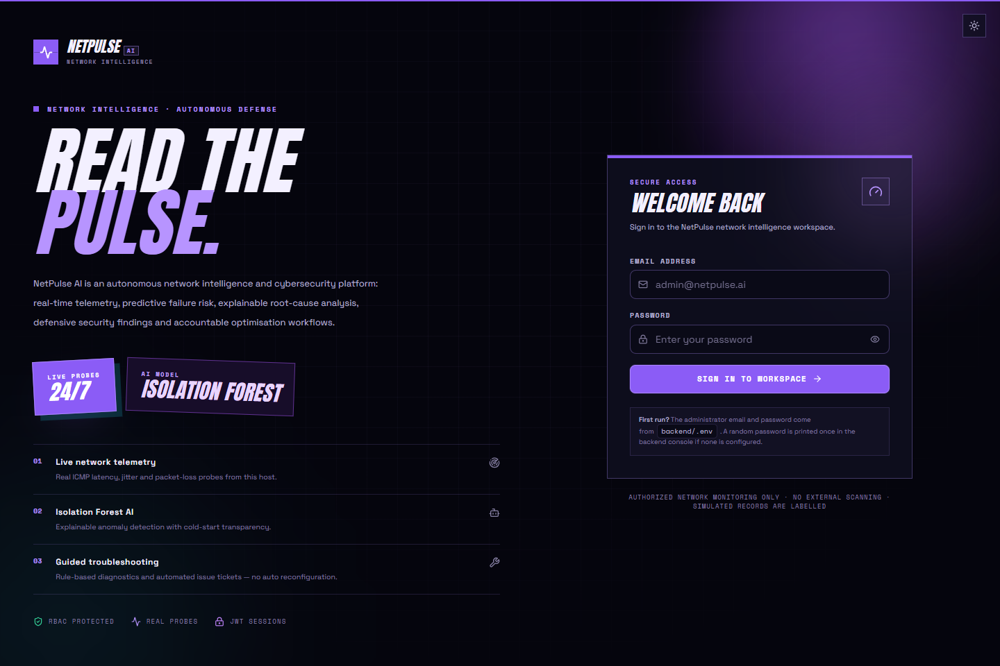

### 6.6.1 First sign-in

1. Open `http://127.0.0.1:5173` (development) or
   `http://127.0.0.1:8000` (built application).
2. Enter the administrator email shown by setup.
3. Enter the generated administrator password.
4. Select **Sign in**.

The session is stored as a JWT access token in browser storage. The default
lifetime is 480 minutes (8 hours) and can be changed with
`ACCESS_TOKEN_EXPIRE_MINUTES`.

### 6.6.2 Session restore and expiry

- Reloading the page validates the token with `GET /api/auth/me`.
- An expired or invalid token clears the session and returns the user to the
  login screen with an explanatory message.
- Signing out calls the logout endpoint and removes the browser token. The JWT
  is stateless, so logout is client-side; a copied token remains valid until it
  expires.
- Always sign out on a shared machine.

### 6.6.3 Login errors

| Message | Meaning | Action |
|---|---|---|
| `Invalid email or password` | Email unknown or password wrong | Re-enter carefully; the message intentionally does not reveal which field failed |
| `This account is disabled` | Administrator deactivated the account | Contact an administrator |
| `Too many failed sign-in attempts. Wait five minutes and try again.` | Eight failures within five minutes from the same client and email | Wait five minutes |
| `Authentication required or session expired` | Token missing, malformed or expired | Sign in again |

### 6.6.4 Account management limits

- Accounts are created by an administrator in **Settings > Team access**.
- Password hashes use Argon2.
- The interface has no self-service password reset or password-change screen.
  If a password is lost, an administrator must handle the account outside the
  normal UI workflow. Creating a replacement account is the supported
  administrative action in the current build.

---

## 6.7 Workspace interface

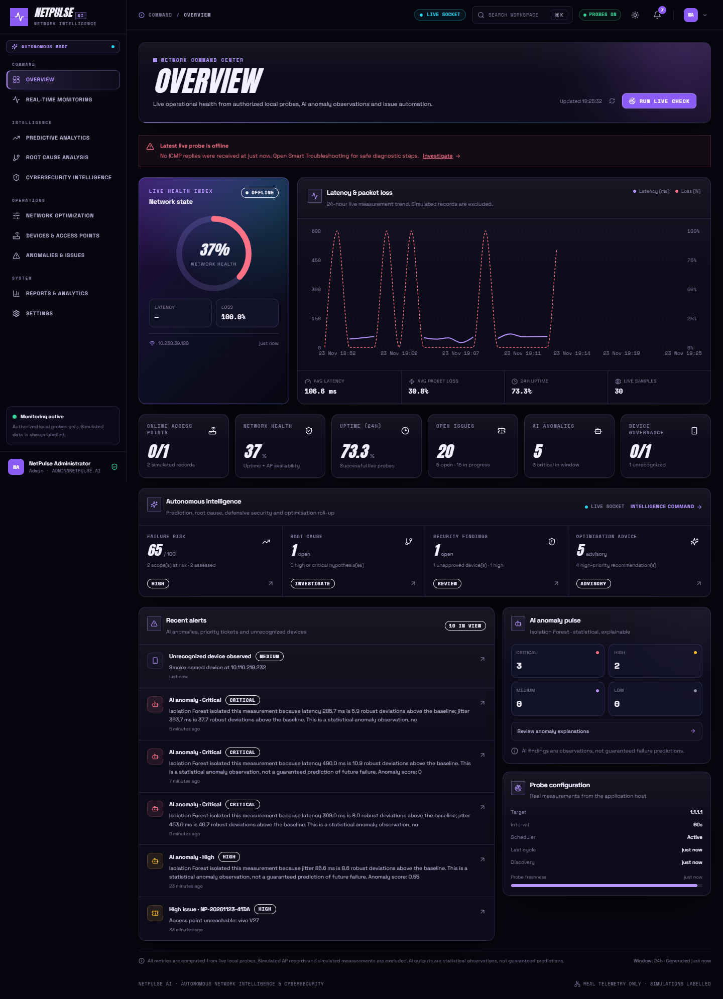

### 6.7.1 Navigation groups

| Group | Modules |
|---|---|
| Command | Overview, Real-Time Monitoring |
| Intelligence | Predictive Analytics, Root Cause Analysis, Cybersecurity Intelligence |
| Operations | Network Optimization, Devices & Access Points, Anomalies & Issues |
| System | Reports & Analytics, Settings |

The primary sidebar contains exactly these ten links. Legacy deep links such as
`/access-points`, `/troubleshooting`, `/issues` and `/testing` remain available
through the command palette and direct navigation, so existing bookmarks do not
break.

On screens narrower than 1024 px, the sidebar becomes a slide-in drawer. Open it
with the menu button in the header. The current page is shown in the header
breadcrumb.

### 6.7.2 Header controls

| Control | Purpose |
|---|---|
| **Search workspace** / `Ctrl+K` | Opens the command palette |
| **Live socket** / **Polling** pill | Shows whether real-time updates use WebSocket or the REST fallback |
| Theme button | Switches between the dark navy/purple and light violet/white themes |
| Bell | Opens the notification centre for predictions, security findings, RCA, optimisation, anomalies, tickets and devices |
| Avatar and chevron | Account menu, settings link and **Sign out** |

### 6.7.3 Command palette

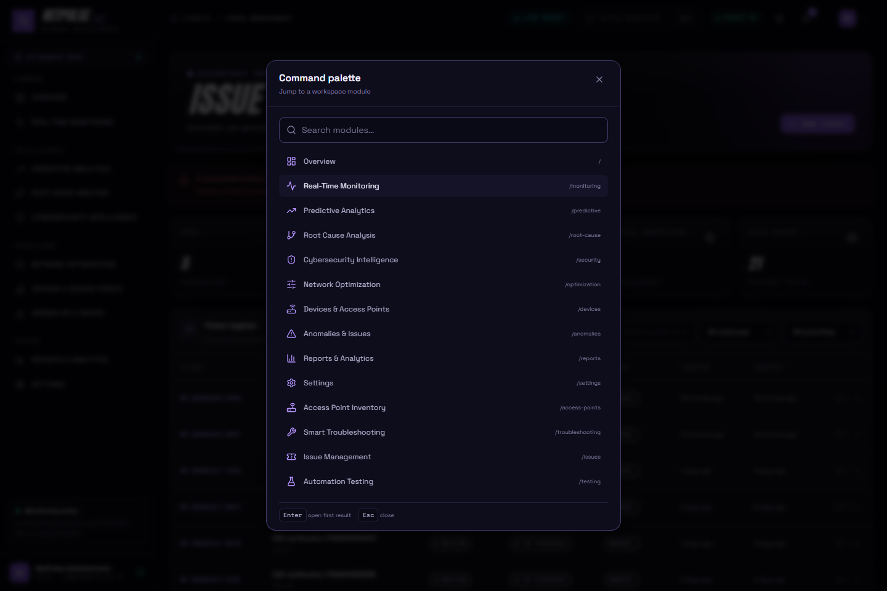

1. Press `Ctrl+K` (or `Cmd+K` on macOS), or select **Search workspace**.
2. Type part of a module name.
3. Use the arrow keys to move through results.
4. Press `Enter` to open the first result, or select a row.
5. Press `Esc` to close without navigating.

### 6.7.4 Notifications

The bell shows an unread count when new notifications exist. The panel lists
persisted prediction risks, security findings, root-cause investigations,
optimisation advice, AI anomalies, high-priority tickets and unrecognised
devices. Selecting a notification opens the related module, and the panel
supports mark-as-read and clear-read actions. It closes when you select outside
it or press the close layer.

### 6.7.5 Theme

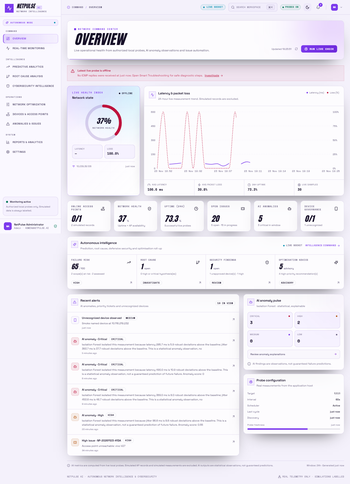

- The header button toggles dark and light immediately.
- The choice is stored in browser local storage and survives a reload.
- Administrators can choose a default theme in **Settings**. Saving applies it
  to the current browser; each browser still remembers its own toggle.

### 6.7.6 Mobile layout

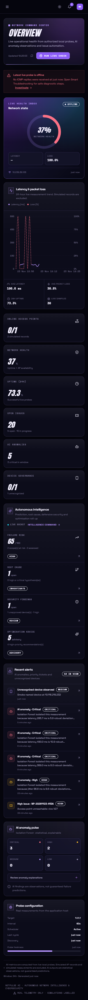

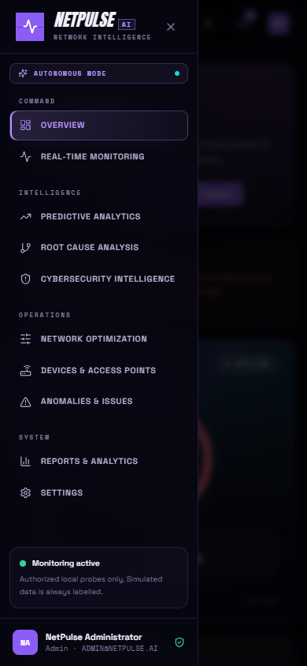

Cards stack vertically, charts resize, tables remain usable, and the navigation
drawer closes after a module is selected. The verified viewport is 390 x 844,
with no horizontal overflow.

### 6.7.7 Feedback states

Every module provides:

- a skeleton while initial data loads;
- an error panel with **Retry** when the API is unavailable;
- an empty state that explains how to create the first record;
- toast notifications for successful and failed actions;
- inline field validation in dialogs.

---

## 6.8 Module walkthrough

### 6.8.1 Overview

**Purpose:** provide a single operational summary.

**What it shows:**

- **Live health index** ring and current network state.
- Latest probe target, latency, loss and freshness.
- **Uptime (24h)**, average latency, average packet loss and live sample count.
- 24-hour latency and packet-loss trend using live measurements only.
- **Online access points**, **Open issues**, **AI anomalies** and
  **Device governance** cards.
- **Recent alerts** for AI findings, priority tickets and unrecognized devices.
- **Probe configuration** and scheduler context.

**How health is calculated:**

- Probe uptime = online live probes / total live probes in the window.
- AP health = online real APs / all real APs, once at least one AP has been
  checked.
- The health index is the mean of the available components. If neither
  component exists yet, the ring shows no value rather than a fabricated score.

**Actions:**

1. Select **Run live check** (Analyst or Administrator) to create a real
   measurement immediately.
2. Select **Investigate** in an offline banner to open Smart Troubleshooting.
3. Use the sidebar or an alert to move to the relevant module.

**Notes:** simulated APs and simulation measurements are excluded from every
number and chart on this page.

### 6.8.2 Network Monitoring

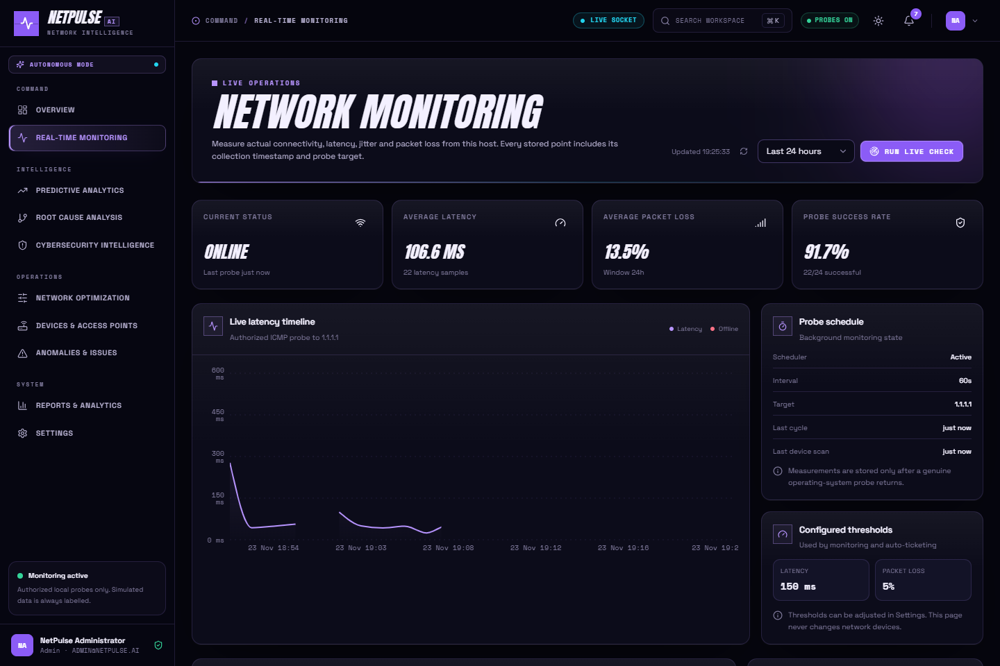

**Purpose:** inspect real probe history and scheduler behaviour.

**How to use:**

1. Choose a window: **Last 1 hour**, **Last 6 hours**, **Last 24 hours** or
   **Last 7 days**.
2. Review the latest measurement, latency timeline, packet-loss history and
   stored measurement table.
3. Select **Run live check** (Analyst or Administrator) to probe immediately.
4. Review **Probe schedule** for interval, target, last cycle time and last
   error.
5. Review **Configured thresholds** and **Host & interfaces**.

**Fields in the history table:** timestamp, status, latency, jitter, packet
loss, target, origin and error.

**Notes:**

- Only live measurements appear in the chart and history.
- A failed probe is stored as offline with the real error and 100% loss; no
  value is filled in.
- The default scheduler interval is 60 seconds and is configured in
  `backend\.env`.
- If the page reports a scheduler error, inspect `backend\logs\netpulse.log`.

### 6.8.3 Access Points

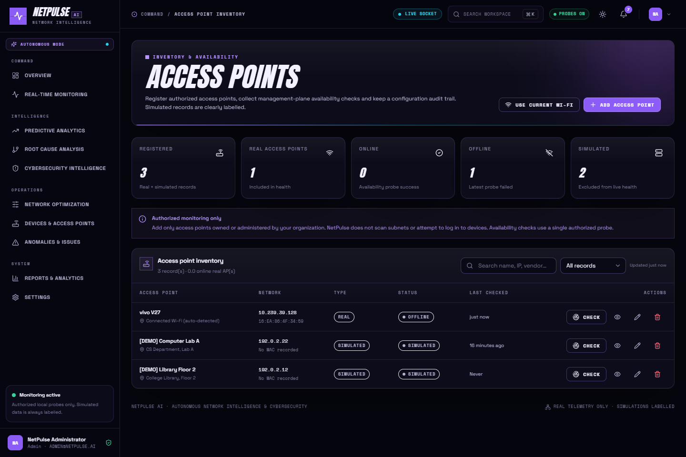

**Purpose:** maintain an authorized inventory of access points and check their
availability.

**How to use:**

1. Search by name, IP or vendor.
2. Filter by **All records**, **Real only**, **Online**, **Offline** or
   **Simulated**.
3. Select **Check** on a row (Analyst or Administrator) to run an availability
   check.
4. Select **View details** to inspect registered metadata, the simulation
   notice, 24-hour performance and configuration history.
5. Administrators can select **Add access point**, edit a row, or delete a row
   after confirmation.
6. Administrators on a Wi-Fi-connected host can select **Use current Wi-Fi**.
   NetPulse reads the operating system's current association (SSID, BSSID,
   signal, band, channel and default gateway) and opens the form prefilled with
   the gateway as the management IP. The submit button becomes **Register & run
   live check**.

**Registration fields:** name, location, management IP, optional MAC address,
vendor, model, notes and simulated flag.

**Current Wi-Fi detection:** the backend only reads its own association through
read-only OS commands. It does not scan neighbouring networks, capture frames or
retrieve Wi-Fi passwords. If that gateway is already registered as a real AP,
**Use current Wi-Fi** runs another live check on the existing record instead of
creating a duplicate. The check is a real ICMP probe (with a labelled TCP
fallback) from the backend host, so it works only while the backend is on that
Wi-Fi network. The public Vercel deployment has no wireless association and
cannot reach private addresses; it shows a clear unavailable message.

**Validation:** duplicate name/IP pairs return `409`; malformed IP or MAC
addresses return `422`.

**Simulation behaviour:** checking a simulated AP writes a measurement with
`data_origin = simulation` and keeps the status **Simulated**. It is excluded
from live health. The detail dialog displays a simulation warning.

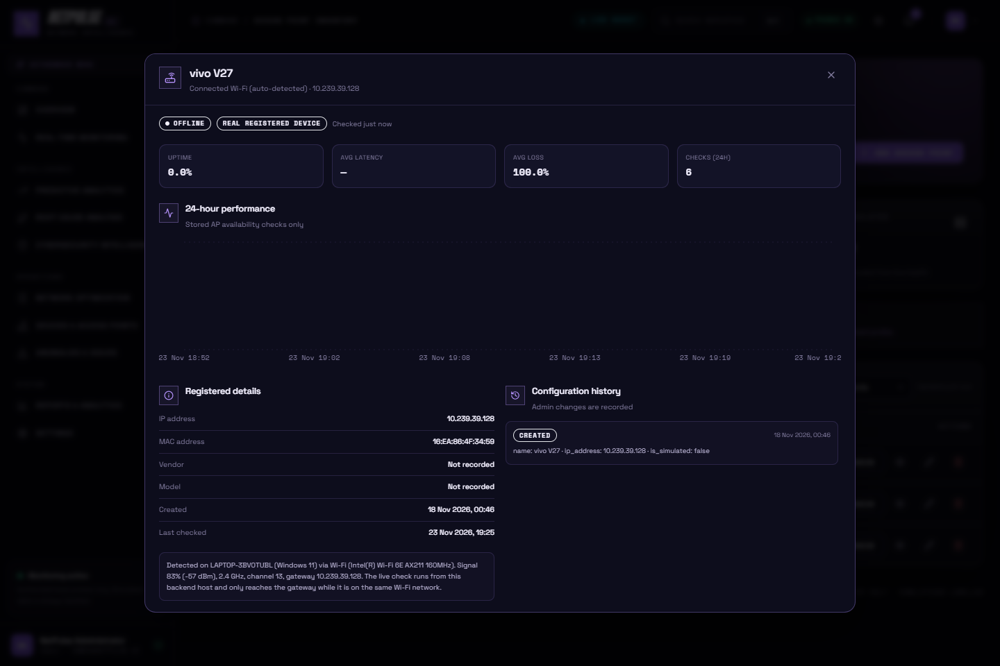

**Notes:**

- Only register devices you are authorized to monitor.
- Deleting an AP cascades its measurements and configuration history. Tickets
  and recommendations keep their text but lose the AP reference.
- A real AP starts as **Unknown** and moves to **Online** or **Offline** after
  the first real check.

### 6.8.4 Connected Devices

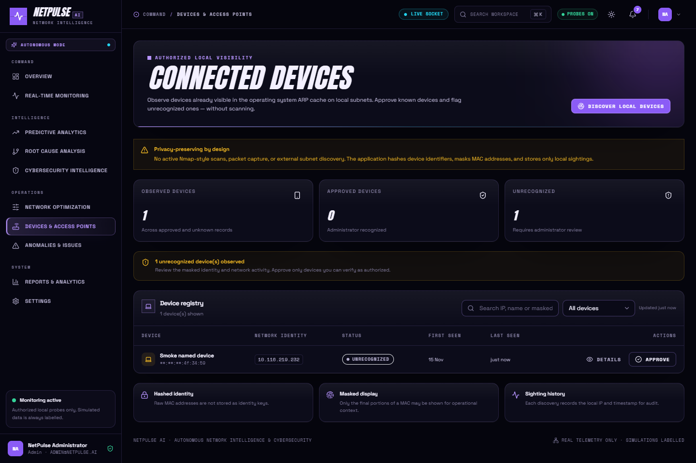

**Purpose:** provide privacy-preserving visibility of devices already visible in
the operating-system ARP cache.

**How to use:**

1. Select **Discover local devices** (Analyst or Administrator).
2. Review the summary: observed, approved and unrecognized.
3. Search by IP, display name or masked MAC.
4. Filter by **All devices**, **Approved** or **Unrecognized**.
5. Open **Details** to review network identity, approval state, observation
   history and notes.
6. Administrators can edit the display name and notes, or approve the device.

**Privacy design:**

- Only the OS ARP cache is read. There is no active ping sweep, port scan or
  packet capture.
- Identity is stored as a SHA-256 hash of the normalized MAC.
- The displayed MAC is masked to the last three octets.
- Hostnames are usually unresolved by design.

**Notes:**

- Devices on other VLANs or subnets may not appear.
- Discovery runs every five minutes when enabled, and on demand.
- Approval is an administrative decision. Approve only devices you can verify
  as authorized.

### 6.8.5 AI Anomaly Detection

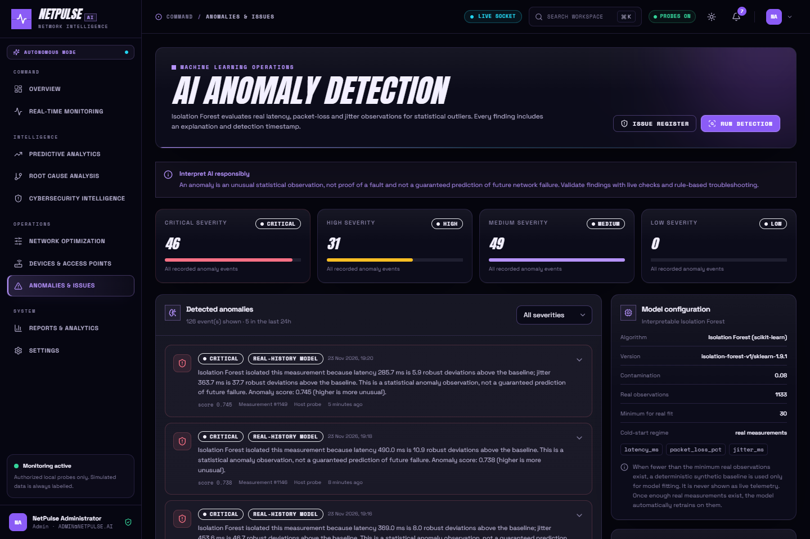

**Purpose:** identify statistical outliers in real latency, packet loss and
jitter observations.

**How to use:**

1. Select **Run detection** (Analyst or Administrator).
2. Review the severity cards and the detected-event list.
3. Filter by severity.
4. Expand an event to read **Why this was flagged**.
5. Review **Model configuration** for algorithm, version, contamination,
   real-observation count, minimum samples and cold-start regime.
6. Follow the event explanation into troubleshooting or the related ticket.

**Severity guidance:** severity combines the Isolation Forest decision with
robust deviations from the baseline. An offline probe is always treated as a
critical observation. The explanation lists the metrics that contributed.

**Cold start:** when fewer than the configured minimum real observations exist
(default 30), the model fits a deterministic synthetic baseline. The interface
and API disclose this with `used_sample_baseline`. The baseline is never stored
or displayed as live telemetry. Once enough real observations exist, the model
automatically trains on real history.

**Notes:**

- An anomaly is not proof of a fault and not a forecast.
- High and Critical events can create an automatic ticket when automation is
  enabled.
- Detection is idempotent per measurement; re-running it does not duplicate
  events.

### 6.8.6 Smart Troubleshooting

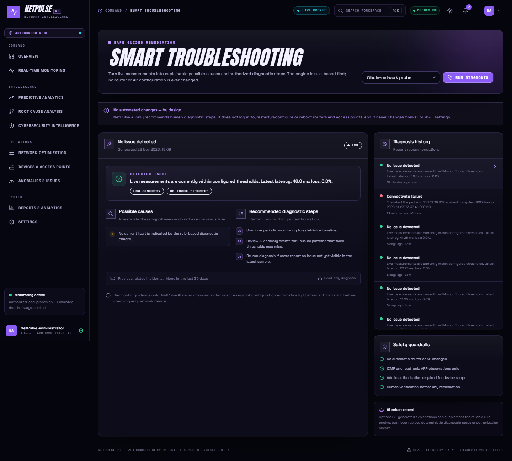

**Purpose:** convert measurements into explainable possible causes and safe,
authorized diagnostic steps.

**How to use:**

1. Choose **Whole-network probe** or a specific access point. Simulated APs are
   marked `[SIMULATED]`.
2. Select **Run diagnosis** (Analyst or Administrator).
3. Read **Detected issue**, severity and issue type.
4. Review **Possible causes** and **Recommended diagnostic steps**.
5. Check **Related tickets** and the permanent safety note.
6. Use **Diagnosis history** to revisit earlier recommendations.

**Rule coverage:** connectivity failure, high latency, packet loss, access point
unavailable, insufficient data, simulated AP and no issue detected. Thresholds
come from Settings.

**Safety:** the engine never logs in to, restarts, reconfigures or reboots
network equipment. It never changes firewall or Wi-Fi settings. Simulated APs
are refused for real diagnosis and receive simulation-specific guidance.

### 6.8.7 Issue Management

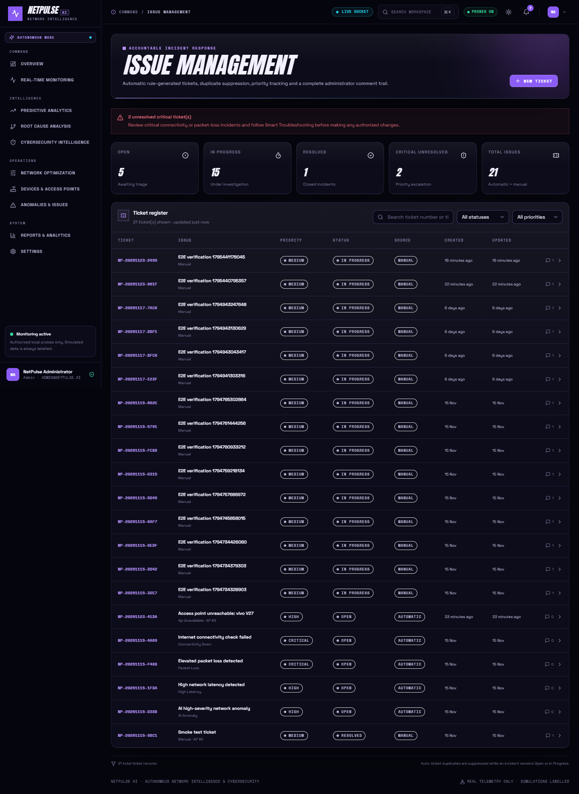

**Purpose:** track automatic and manual incidents through a controlled workflow.

**How to use:**

1. Review the statistics: total issues, open, in progress and critical
   unresolved.
2. Search by ticket number or title.
3. Filter by status and priority.
4. Select a ticket to open its detail dialog.
5. Analysts and administrators can change status and priority, save, and add
   comments.
6. Select **New ticket** to create a manual ticket.

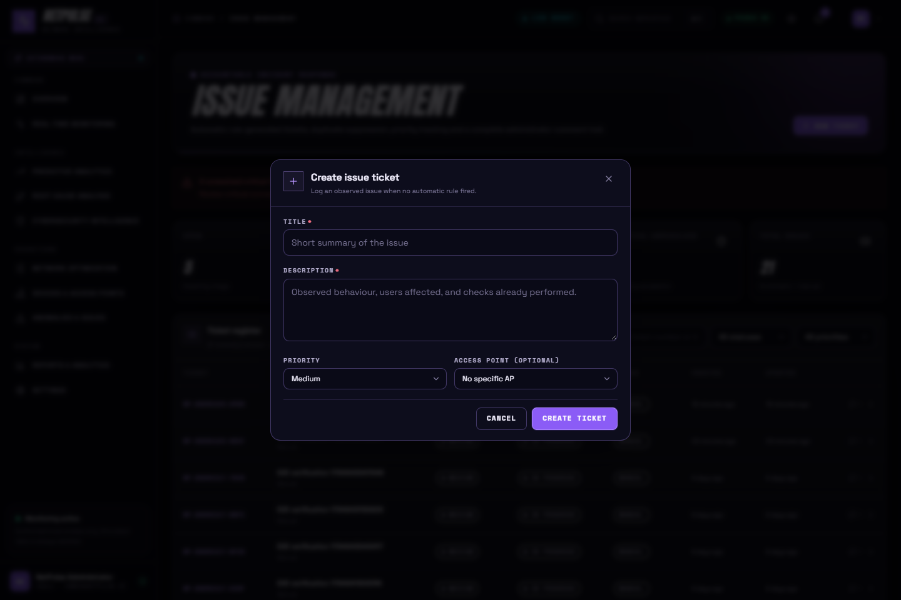

**Manual ticket fields:** title, description, priority and optional real access
point. Manual tickets are assigned to the creating analyst and use a random
fingerprint, so they are never suppressed as duplicates.

**Automatic tickets:** created by threshold rules, AP-offline checks and
High/Critical AI events. Ticket numbers, source, issue type, AP reference and
anomaly reference are stored.

**Statuses:** **Open**, **In Progress** and **Resolved**. Setting a ticket to
Resolved records `resolved_at`; reopening clears it.

**Duplicate suppression:** an automatic rule reuses an active ticket with the
same fingerprint (Open or In Progress). After the ticket is Resolved, the same
condition can create a new ticket for a new incident.

**Notes:** the interface is read-only for Viewers. Comments are attributed to
the signed-in user.

### 6.8.8 Automation Testing

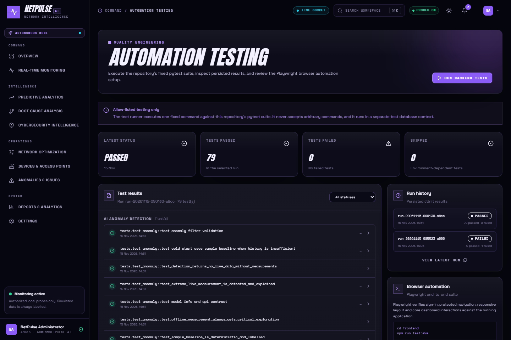

**Purpose:** run the backend Pytest suite from the application and inspect
persisted results.

**How to use:**

1. Administrators select **Run backend tests**.
2. Wait for the progress banner to finish; the page polls the run status.
3. Review passed, failed and skipped counts.
4. Filter test results by status.
5. Select a test row to view its suite, duration and failure details.
6. Use **Run history** to select an earlier run, or **View latest run** to
   return to the newest.

**Safety:** the runner executes one fixed, allow-listed pytest command. It does
not accept arbitrary commands. Tests use a throw-away database and do not touch
the development data.

**Notes:**

- Only administrators can start a run; all signed-in users can view results.
- Only one run can be active at a time; a second request returns `409`.
- Playwright browser tests are executed separately with
  `npm.cmd run test:e2e` and are intentionally not launchable from the API.
- If the runner is disabled by environment configuration, the start control
  returns `403`.

### 6.8.9 Reports

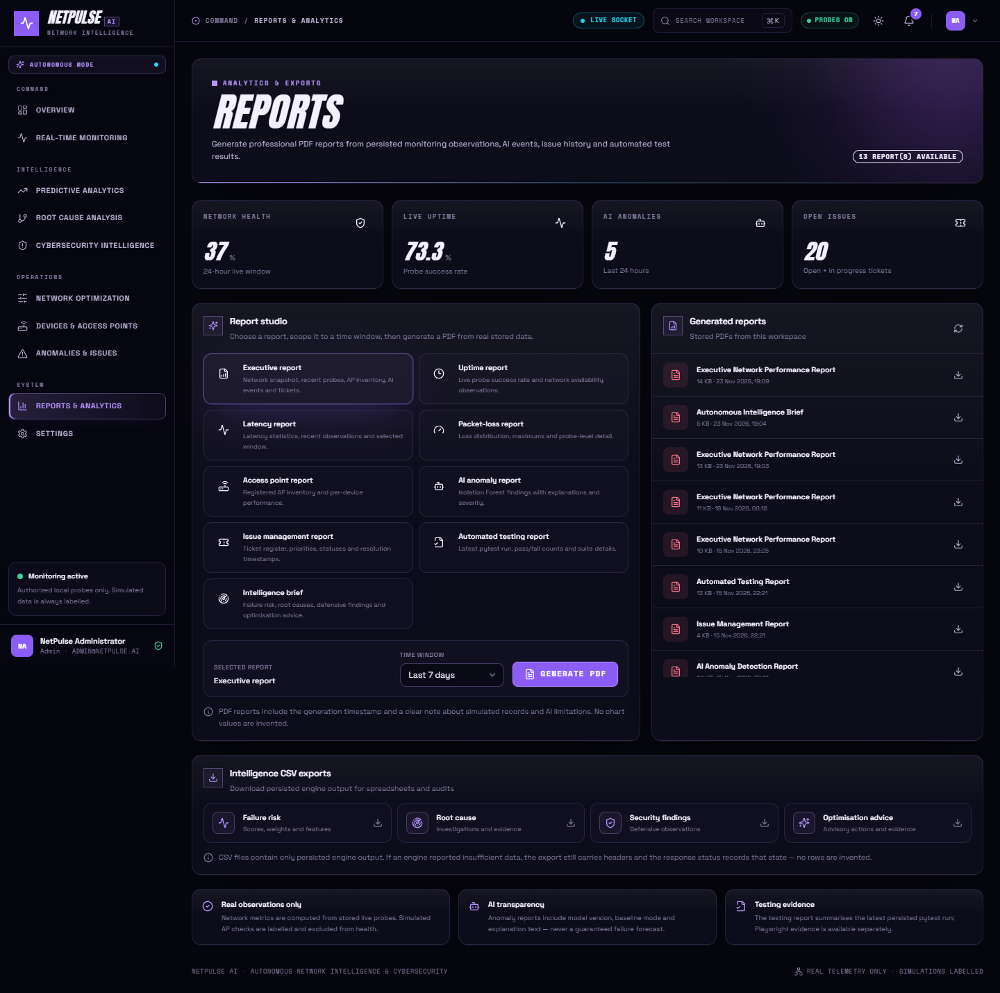

**Purpose:** generate PDF reports from persisted observations.

**Available reports:**

| Type | Contents |
|---|---|
| Executive report | Network snapshot, recent probes, AP inventory, AI events and tickets |
| Uptime report | Live probe success rate and availability observations |
| Latency report | Latency statistics and recent observations |
| Packet-loss report | Loss distribution, maximums and probe detail |
| Access point report | AP inventory and per-device performance |
| AI anomaly report | Isolation Forest findings with explanations and severity |
| Issue management report | Ticket register, priorities, statuses and resolution timestamps |
| Automated testing report | Latest persisted pytest run, counts and suite details |
| Intelligence brief | Prediction, security, optimisation and root-cause summaries with states, evidence and disclaimers |

**How to use:**

1. Select one of the nine report cards.
2. Choose a window: **Last 24 hours**, **Last 7 days**, **Last 30 days** or
   **Last 90 days**.
3. Select **Generate PDF** (Analyst or Administrator).
4. Find the file in **Generated reports** and select the download button.

**Report content:** each PDF includes a generation timestamp, reporting window
and a note about simulated records and AI limitations. No chart value is
invented. If a window contains no data, the report states that explicitly.

**Storage:** PDFs are written to `reports\` with names such as
`netpulse_executive_YYYYMMDD_HHMMSS.pdf`. Downloads require authentication and
are restricted to the reports directory.

### 6.8.10 Settings

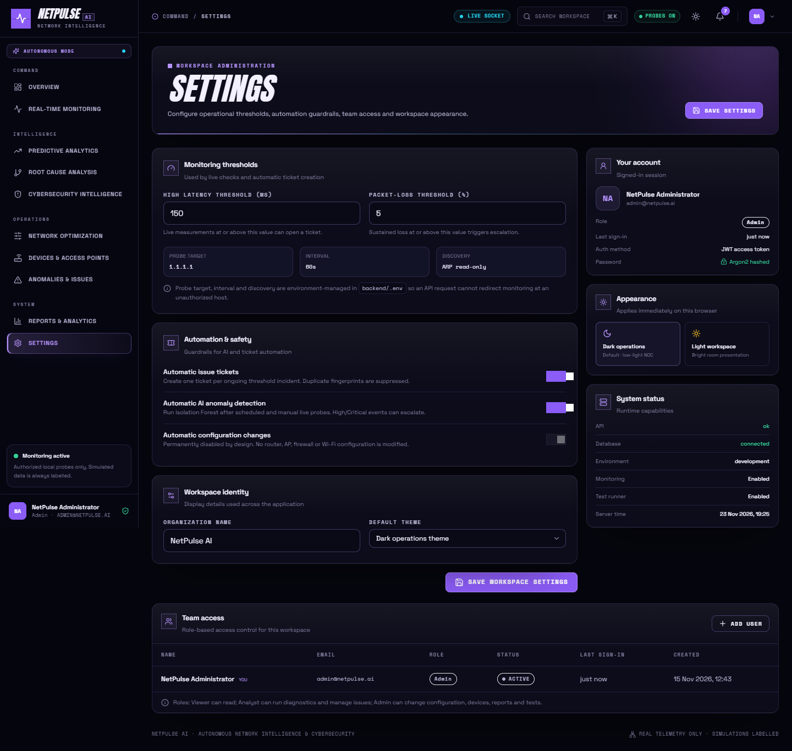

**Purpose:** configure thresholds, automation, workspace identity, appearance,
system status and team access.

**Sections:**

- **Monitoring thresholds:** high-latency threshold in milliseconds and
  packet-loss threshold in percent. These are used by live checks, automatic
  tickets and troubleshooting.
- **Automation & safety:** automatic issue tickets, automatic AI anomaly
  detection, and the permanently disabled automatic-configuration-change
  control.
- **Workspace identity:** organization name and default theme.
- **Your account:** role, last sign-in, JWT auth method and Argon2 note.
- **Appearance:** dark and light previews that apply immediately.
- **System status:** monitoring, scheduler, test runner, database and report
  directory capabilities.
- **Team access (Administrators):** user list and **Add user** dialog.

**Saving:** Administrators select **Save settings**. Viewers and Analysts see a
read-only notice and disabled fields. Invalid thresholds return `422`.

**Adding a user:**

1. Select **Add user**.
2. Enter full name, email, temporary password (10 or more characters) and role.
3. Select **Create user**.
4. Give the password to the user through a secure channel.
5. Ask the user to sign in and verify the assigned role.

**Notes:**

- Probe target, interval and discovery are environment-managed in
  `backend\.env`. They are displayed but cannot be changed through the API, so a
  request cannot redirect monitoring at an unauthorized host.
- Automatic configuration changes are permanently disabled by design.

### 6.8.11 Predictive analytics

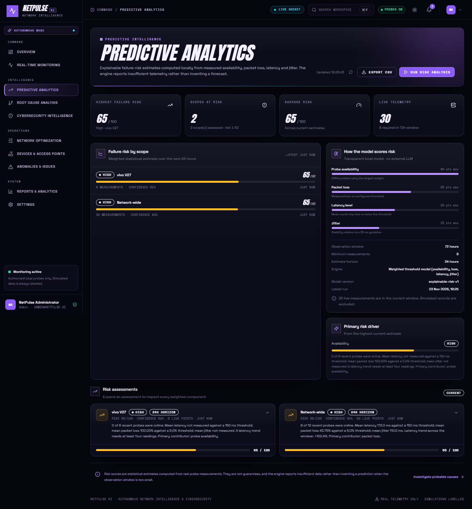

**Purpose:** estimate failure risk over the next 24 hours from persisted live
measurements.

**What it shows:** per-scope risk (network and each real access point), severity,
confidence, observation count, weighted features and the primary measured
driver. The page states the model version and the 72-hour observation window.

**How to use:**

1. Open **Predictive Analytics**.
2. Confirm the telemetry card shows enough live observations.
3. Select **Run risk analysis** (Analyst or Administrator).
4. Expand a risk assessment to inspect availability, packet loss, latency and
   jitter contributions.
5. Use **Export CSV** to download the exact persisted estimates.

If there are fewer than eight live observations, the engine returns
`insufficient_data` and does not invent a score. Simulated access points are
excluded from the fit.

### 6.8.12 Root cause analysis

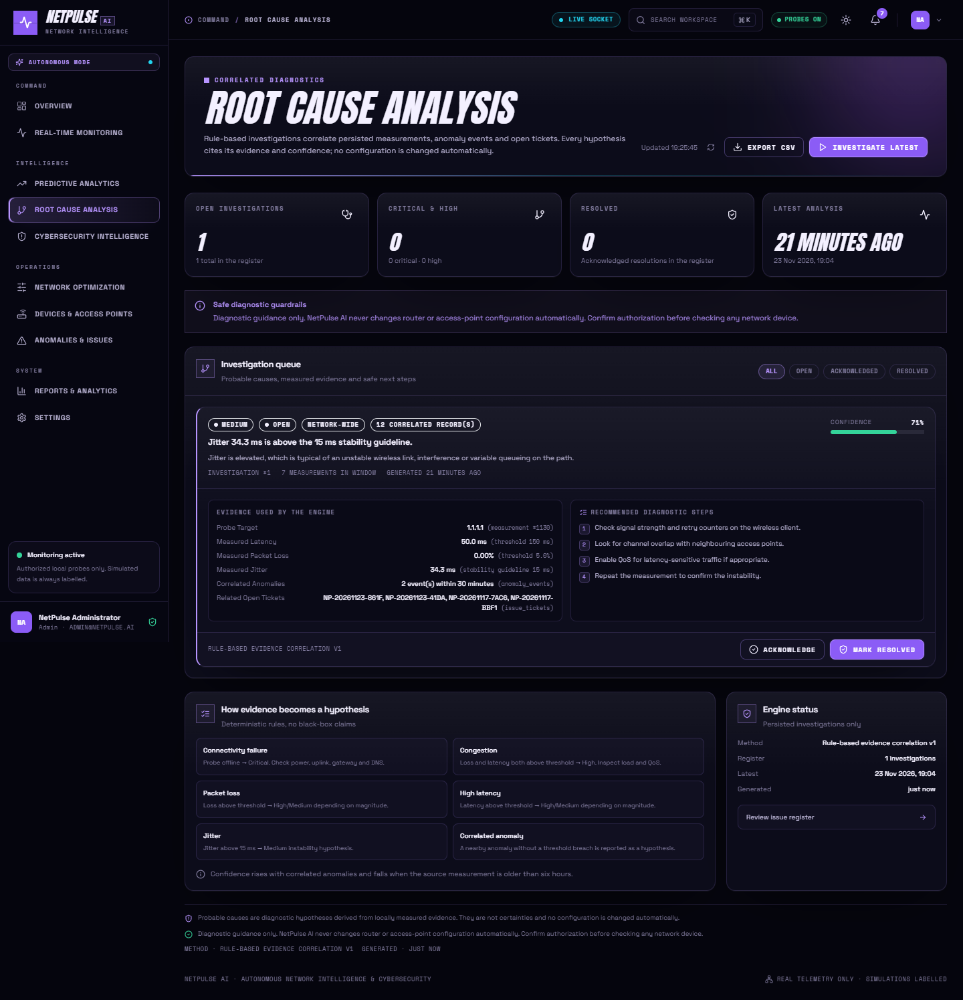

**Purpose:** turn an unhealthy measurement into an explainable hypothesis and a
safe action plan.

**What it shows:** investigation status, severity, confidence, probable cause,
the measured evidence used, ranked diagnostic actions and related incident IDs.

**How to use:**

1. Open **Root Cause Analysis**.
2. Select **Investigate latest** to analyse the most recent live measurement.
3. Review the evidence values, not just the hypothesis.
4. Acknowledge or resolve an investigation once the suggested checks are done.

The engine is rule-based and deterministic. It does not execute configuration
changes and does not claim a root cause when the evidence is incomplete.

### 6.8.13 Cybersecurity intelligence

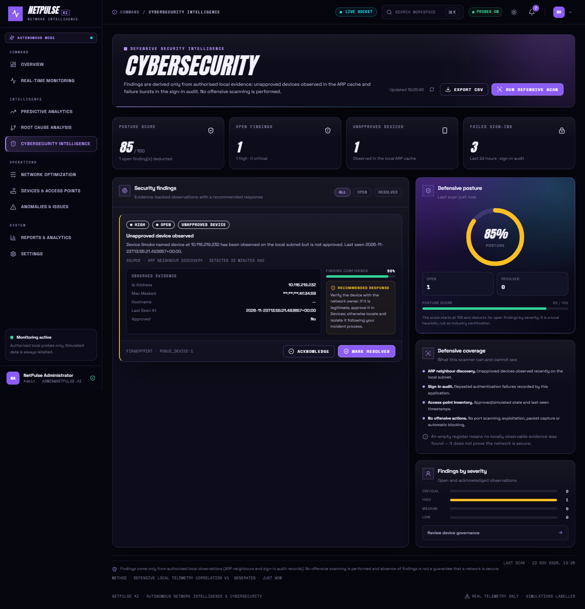

**Purpose:** surface locally observable defensive concerns without offensive
scanning.

**What it shows:** posture score, open findings, unapproved devices, failed
sign-ins, evidence, recommended response and coverage limits. Findings are
derived only from the local ARP neighbour cache, sign-in audit records and AP
inventory.

**How to use:**

1. Open **Cybersecurity Intelligence**.
2. Select **Run defensive scan** (Analyst or Administrator).
3. Review each finding's evidence and recommended response.
4. Acknowledge or resolve findings after verification.

No port scanning, exploitation, packet capture or automatic blocking is
performed. An empty register means no local evidence was found; it does not prove
the network is secure.

### 6.8.14 Network optimization

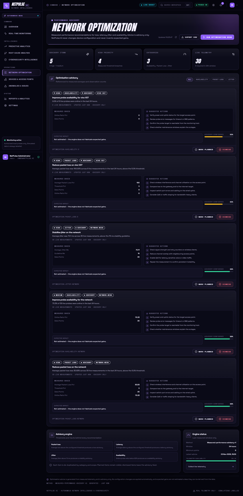

**Purpose:** generate advisory recommendations from measured threshold breaches.

**What it shows:** advisory items by category and severity, measured basis,
observation counts, suggested actions and advisory confidence.

**How to use:**

1. Open **Network Optimization**.
2. Select **Run optimisation scan** (Analyst or Administrator).
3. Review the measured values and suggested actions.
4. Mark an advisory as planned or dismiss it after review.

Recommendations never change device configuration. Expected gains are shown as
"not estimated" unless they can be derived from the measured data, so the page
never fabricates a saving.

---

## 6.9 Common workflows

### 6.9.1 First-day acceptance checklist

1. Start both services.
2. Confirm `/api/health` reports `ok`.
3. Sign in as administrator.
4. Open **Overview** and run a live check.
5. Confirm a new measurement appears in **Network Monitoring**.
6. Open **Access Points** and check a real AP if one is registered.
7. Open **Connected Devices** and run discovery.
8. Open **AI Anomaly Detection** and run detection.
9. Open **Smart Troubleshooting** and run a whole-network diagnosis.
10. Open **Issue Management** and confirm the register renders.
11. Open **Automation Testing** and confirm the latest run is visible.
12. Generate one PDF report and download it.
13. Open **Settings** and confirm the system status.
14. Sign out.

### 6.9.2 Register and validate an access point

1. Sign in as Administrator.
2. Open **Access Points**.
3. Select **Add access point**.
4. Enter name and location.
5. Enter the authorized management IP.
6. Optionally enter MAC, vendor, model and notes.
7. Leave the simulated flag off for a real device.
8. Select the submit button in the dialog.
9. Select **Check** on the new row.
10. Open **View details** to confirm status, performance and history.

If the check fails, the AP is marked offline and the real error is recorded.
Use Smart Troubleshooting before changing any configuration.

**Shortcut for the local Wi-Fi gateway:**

1. Sign in as Administrator on the Wi-Fi-connected computer.
2. Open **Access Points** and select **Use current Wi-Fi**.
3. Confirm the detected SSID, signal, band, channel and gateway in the banner.
4. Select **Register & run live check**; the first real measurement appears
   immediately and the AP moves from **Unknown** to **Online** or **Offline**.
5. Select **Use current Wi-Fi** again later to run another check against the
   registered gateway without creating a duplicate.

The same button on the Vercel deployment explains that the cloud function has no
Wi-Fi association; it never attempts to probe a private address from the cloud.

### 6.9.3 Investigate an AI anomaly

1. Open **AI Anomaly Detection**.
2. Run detection or wait for the scheduler.
3. Expand a High or Critical event.
4. Read which metrics crossed robust thresholds.
5. Open **Smart Troubleshooting** and diagnose the whole network or the related
   AP.
6. Compare the rule-based diagnosis with the statistical explanation.
7. Create or review the linked ticket in **Issue Management**.
8. Record the checks performed as ticket comments.
9. Resolve only after verification.

### 6.9.4 Create and resolve a manual ticket

1. Open **Issue Management**.
2. Select **New ticket**.
3. Enter a clear title and a description containing observed behaviour, users
   affected and checks already performed.
4. Choose priority and, optionally, a real AP.
5. Select **Create ticket**.
6. Open the new ticket.
7. Change status to **In Progress** and save.
8. Add diagnostic comments.
9. After verification, change status to **Resolved** and save.
10. Confirm the resolution timestamp appears.

### 6.9.5 Approve a local device

1. Open **Connected Devices**.
2. Select **Discover local devices**.
3. Filter to **Unrecognized**.
4. Open **Details** for a device.
5. Verify the masked identity and IP against your inventory.
6. As Administrator, enter a recognizable display name and notes.
7. Select **Save metadata**, then **Approve device**.
8. Confirm the device badge changes to **Approved**.

Never approve a device you cannot verify.

### 6.9.6 Generate and distribute a report

1. Open **Reports**.
2. Select the report type.
3. Select the time window.
4. Generate the PDF.
5. Download it from the library.
6. Verify the file opens and contains the expected timestamp and window.

### 6.9.7 Run the verification suites

From the project root:

```powershell
powershell -ExecutionPolicy Bypass -File .\scripts\test-all.ps1
```

Or separately:

```powershell
cd backend
.\.venv\Scripts\python.exe -m pytest
.\.venv\Scripts\python.exe -m pytest --cov=app --cov-report=xml:..\reports\test-runs\coverage.xml

cd ..\frontend
npm.cmd run test:e2e
```

The latest verified results are 103 backend tests and 21 Playwright tests, all
passing, with 80% backend line coverage.

### 6.9.8 Add a team member

1. Sign in as Administrator.
2. Open **Settings**.
3. In **Team access**, select **Add user**.
4. Enter name, email, temporary password and the minimum role.
5. Select **Create user**.
6. Confirm the account appears in the table.
7. Ask the user to sign in and report any access problem.

---

## 6.10 Reading the data correctly

### 6.10.1 Live versus simulation

| Indicator | Meaning |
|---|---|
| `Live` badge, `data_origin=live` | Real OS probe result |
| `Simulation` badge, `data_origin=simulation` | Labelled demonstration record |
| `[DEMO]` AP name | Seeded demonstration AP with a documentation IP |
| `used_sample_baseline=true` | The model was fitted on the disclosed cold-start baseline |

Simulation records are excluded from live health, live charts, model training
and automatic ticket rules. They exist to demonstrate the workflow without
pretending to be real telemetry.

### 6.10.2 Health and uptime

- **Uptime** is the percentage of live probes that received replies in the
  selected window.
- **Network health** averages probe uptime and AP online ratio when both are
  available.
- A missing value is displayed as a dash, not as zero or a guessed number.
- Freshness compares the last scheduler cycle with the configured interval. A
  stale timestamp usually means the scheduler is disabled or the backend was
  stopped.

### 6.10.3 Anomaly score and severity

- The anomaly score is derived from the Isolation Forest decision. Higher means
  more unusual.
- Severity adds robust-z evidence and offline state.
- A Low event means the forest did not classify the row as an outlier, even if
  the row is retained for review.
- The explanation is diagnostic evidence, not a root-cause conclusion.

### 6.10.4 Ticket priority

| Priority | Typical source |
|---|---|
| Critical | Connectivity failure, loss of 20% or more, or a Critical AI event |
| High | High latency, loss of 5% or more, offline AP, or a High AI event |
| Medium | Manual ticket default or lower-severity workflow |
| Low | Manual ticket with limited impact |

Thresholds are configurable; the values above describe the default rules.

### 6.10.5 Time and timezone

All persisted timestamps are UTC. The interface converts them for display. When
comparing a screenshot with a database row, expect a timezone offset unless the
browser is set to UTC.

---

## 6.11 Error handling and recovery

### 6.11.1 HTTP and interface errors

| Symptom | Likely cause | Safe recovery |
|---|---|---|
| Error panel with **Retry** | Backend stopped or unreachable | Start the backend, confirm `/api/health`, retry |
| `401 Authentication required` | Expired or missing token | Sign in again |
| `403 This action requires the ... role` | Insufficient role | Ask an administrator for the minimum required role |
| `404` | Record was deleted or the URL is wrong | Refresh the list; use in-app navigation |
| `409` on AP creation | Duplicate name/IP | Edit the existing AP or choose a unique name/IP |
| `409` on user creation | Email already exists | Use the existing account or another email |
| `409` on test start | A test run is already active | Wait for completion |
| `422` | Invalid field value | Read the inline field error and correct the value |
| `429` at login | Too many failures | Wait five minutes |
| `500` | Unhandled server error | Check `backend\logs\netpulse.log`; restart if necessary |

### 6.11.2 Monitoring errors

| Symptom | Meaning | Action |
|---|---|---|
| Latest probe offline | No ICMP replies | Verify the target, local connectivity and firewall/ICMP policy |
| `Probe failed` toast | The OS command failed or timed out | Check the target and backend log; retry |
| No live measurements | Scheduler disabled or no probe yet | Run a live check; confirm `MONITORING_ENABLED=true` |
| Scheduler issue banner | Last cycle recorded an exception | Read the error in the banner and log, then restart the backend |
| Health shows a dash | No usable live data or no checked APs | Run a probe and check a real AP |
| TCP fallback label | ICMP unavailable, fallback used | Treat the result as a labelled fallback, not pure ICMP |

### 6.11.3 Device discovery errors

| Symptom | Meaning | Action |
|---|---|---|
| No devices found | ARP cache empty, different subnet or discovery disabled | Browse the local network from this host, confirm `DEVICE_DISCOVERY_ENABLED=true`, retry |
| Device IP changes | DHCP lease change | Approval is tied to the hashed MAC, so the device remains approved |
| Hostname not resolved | Deliberate privacy design | Identify the device from its masked MAC and IP inventory |

### 6.11.4 AI and troubleshooting issues

| Symptom | Meaning | Action |
|---|---|---|
| `No live measurements yet` | Detection has nothing real to score | Run a live check first |
| Cold-start notice | Too few real observations | Continue collecting; the model retrains automatically |
| No anomalies found | Current data is within the learned distribution | This is a valid result, not a failure |
| Simulated AP refused | Real diagnosis is not possible for a simulation | Select a real AP or use the whole-network probe |
| `Insufficient data` diagnosis | No usable live measurement | Run a live probe, then diagnose again |

### 6.11.5 Report and test errors

| Symptom | Meaning | Action |
|---|---|---|
| `Unknown report type` | Invalid type value | Choose one of the eight cards |
| `Invalid report filename` | Path traversal or malformed name | Download through the report library |
| Report not found | File was moved or deleted | Regenerate the report |
| Test runner disabled | Environment disables it | Set `TEST_RUNNER_ENABLED=true` and restart |
| Test run fails | A real test failure | Open the failing test details and backend log |
| Playwright cannot launch | Bundled headless shell blocked | Use installed Chrome (`PLAYWRIGHT_CHANNEL=chrome`) or Edge/Chromium |

### 6.11.6 Database errors

| Symptom | Meaning | Action |
|---|---|---|
| `degraded` health | Database check failed | Confirm the database file/permissions or MySQL service |
| MySQL access denied | Wrong user, password or database | Correct `DATABASE_URL`; verify the schema was imported |
| MySQL table missing | Schema not imported | Run `database\schema.sql` or the migration |
| SQLite file locked | Another process holds a write lock | Stop duplicate backend processes |

### 6.11.7 Logs and diagnostics

- Backend log: `backend\logs\netpulse.log`, rotated at 2 MB with three backups.
- Console output: the backend PowerShell window.
- API schema: `http://127.0.0.1:8000/docs`.
- Health: `http://127.0.0.1:8000/api/health`.
- Test evidence: `reports\test-runs\`.
- Playwright report: `reports\playwright-report\index.html`.

When reporting a problem, include the timestamp, the module, the visible error
message, the relevant log lines and whether the record was live or simulated.
Never include passwords, JWT tokens or raw `.env` contents.

---

## 6.12 Backup, restore and reset

### 6.12.1 SQLite backup

Stop the backend before copying the file:

```powershell
Copy-Item backend\data\netpulse.db reports\netpulse-backup.db
```

For a live consistent snapshot, use SQLite's backup mechanism:

```sql
VACUUM INTO 'reports/netpulse-backup.db';
```

### 6.12.2 Restore SQLite

1. Stop the backend.
2. Replace `backend\data\netpulse.db` with the backup.
3. Start the backend.
4. Sign in and verify the dashboard and a recent measurement.

### 6.12.3 MySQL backup

See `database\README.md` for `mysqldump`, restore and verification commands.

### 6.12.4 Reset a demonstration database

A reset is destructive. Only do this on a disposable demonstration instance.

1. Stop the backend.
2. Back up or rename `backend\data\netpulse.db`.
3. Start the backend.
4. The seed service recreates settings, the first administrator (if the user
   table is empty) and the two demo APs.
5. Retrieve the administrator password from `backend\.env` or the server log.

Never reset a database that contains evidence you still need.

---

## 6.13 Security and authorized use

- Monitor only networks and devices you own or are explicitly authorized to
  observe.
- Device discovery reads the local ARP cache only. Do not attempt to extend it
  into unauthorized scanning.
- The troubleshooting engine is advisory. Perform only the steps permitted by
  your organization's change-control policy.
- Protect `backend\.env`, the SQLite database, backups and generated reports.
  They contain hashed credentials, device hashes and operational metadata.
- Use a strong, unique administrator password. Do not reuse a college or
  personal password.
- Serve the application over HTTPS in any non-local deployment. Local HTTP is
  acceptable only for the isolated demonstration host.
- Sign out on shared machines. Treat a JWT as a bearer credential.
- Do not expose MySQL port 3307 or phpMyAdmin port 8081 beyond localhost.
- Keep dependencies updated and review security advisories before deployment.

---

## 6.14 Keyboard shortcuts and accessibility

| Shortcut | Action |
|---|---|
| `Ctrl+K` / `Cmd+K` | Open the command palette |
| `Enter` | Open the first command-palette result |
| `Esc` | Close the palette or an open overlay |
| `Tab` / `Shift+Tab` | Move focus through controls |
| `Space` / `Enter` | Activate a focused button or link |

The interface uses semantic buttons, labelled form fields, dialog titles, focus
styles and accessible names for icon-only controls. Browser zoom and operating
system contrast settings should be used where needed. A formal screen-reader
audit was not part of the project test scope.

---

## 6.15 Frequently asked questions

**Why do I see two `[DEMO]` access points?**
They are seeded only when the access-point table is empty, to demonstrate the
interface. They are labelled simulated, use documentation addresses and never
contribute to live health.

**Why is the health ring empty?**
There is no usable live probe yet, or no real AP has been checked. Run a live
check and check a real AP. The application does not substitute a fake score.

**Why did my probe fail while the internet works?**
ICMP may be blocked by the target or a local firewall. The application records
the real failure. Confirm with an OS `ping` command and review firewall policy.
A labelled TCP fallback may be used where the OS permits it.

**Why are few or no devices listed?**
Only devices already present in the local ARP cache are visible. Devices on
other subnets may not appear, and the cache may be empty until the host
communicates on the local network.

**Why does the AI report an anomaly when thresholds are normal?**
Isolation Forest can isolate a combination of values that is unusual relative to
the learned distribution, even if no single fixed threshold was crossed. Read the
robust-z explanation and validate with a live check and troubleshooting.

**Can the AI fix the network?**
No. It detects and explains. Configuration changes are permanently disabled by
design.

**Can I run any test command from the interface?**
No. The runner executes one fixed, allow-listed pytest command.

**Why do Playwright tests use Chrome?**
The bundled Playwright headless shell is blocked by this machine's Application
Control policy. The suite defaults to the installed Chrome channel. Use
`PLAYWRIGHT_CHANNEL=msedge` or install Chromium on other hosts.

**Can I change the probe target from Settings?**
No. It is environment-managed in `backend\.env` to prevent an API request from
redirecting monitoring at an unauthorized host.

**How do I change a password?**
The current interface has no self-service password change. An administrator must
manage the account. Create a replacement account with the correct role if
needed.

**Is MySQL verified?**
SQLite is the verified runtime. MySQL 8 DDL, migration and Docker Compose are
provided, but the import was not executed on this machine. Verify on a MySQL 8
host before deployment.

---

## 6.16 Chapter summary

This manual covered installation, startup, sign-in, roles, every workspace
module, common operational workflows, data interpretation, error recovery,
backup, security and accessibility. Following the safe operating rules keeps
NetPulse AI within its design boundary: observe real measurements, explain
statistical findings, recommend human action and preserve evidence.

The next chapter evaluates the project against its objectives and sets out
future work.

<div style="page-break-before: always;"></div>

# 7. Conclusion and Future Work

## 7.1 Project recap

NetPulse AI was built to answer a practical question: can a final-year student
deliver a network-monitoring platform that produces trustworthy measurements,
explains statistical findings and supports a complete incident workflow without
pretending to be an enterprise product?

The result is a working full-stack application with ten workspace modules, a
FastAPI backend, a React frontend, real OS-level probes, a privacy-preserving
device inventory, an Isolation Forest detector, a deterministic troubleshooting
engine, automated ticketing, eight PDF report types, a built-in test runner and a
documented verification trail.

The project deliberately chose depth over breadth. It does not claim to replace a
commercial network management system. It demonstrates a coherent, defensible
slice of one, with explicit boundaries and evidence for every claim.

---

## 7.2 Objective attainment

The objectives from Chapter 1 are repeated with the evidence that demonstrates
attainment.

| ID | Objective | Evidence | Status |
|---|---|---|---|
| O1 | Build a complete full-stack application | React SPA with login and ten modules; FastAPI API; shared authentication; responsive shell; verified in 21 Playwright tests | Achieved |
| O2 | Collect real network measurements | OS ICMP probes persist latency, loss and jitter; failures are stored as real failures; simulation is separated by `data_origin`; 8 monitoring tests | Achieved |
| O3 | Detect anomalies with machine learning | Isolation Forest over live observations; robust-z explanation; severity; model provenance; cold-start disclosure; 7 anomaly tests | Achieved |
| O4 | Provide rule-based troubleshooting | Deterministic rules for outage, latency, loss, simulation and insufficient data; causes, ordered steps, related tickets and safety note; 4 tests | Achieved |
| O5 | Manage authorized access points | CRUD, availability checks, performance history, configuration audit trail, duplicate protection and simulation labels; 8 tests | Achieved |
| O6 | Provide privacy-preserving device visibility | Read-only ARP-cache discovery, SHA-256 identity, masked MAC, approval workflow and observation history; 6 tests | Achieved |
| O7 | Automate incident management | Deduplicated automatic tickets, manual tickets, priorities, three workflow statuses, comments and statistics; 5 tests | Achieved |
| O8 | Generate analytical reports | Eight PDF types generated from stored data, report library, secure download and path-traversal protection; 7 tests | Achieved |
| O9 | Verify the implementation | 103 Pytest tests, 21 Playwright tests, 80% backend line coverage, JUnit XML, HTML report and built-in runner evidence | Achieved |
| O10 | Document the project professionally | Nine chapters, architecture and UML/DFD models, generated data dictionary, test inventory, 21 screenshots and consolidated report | Achieved |

### 7.2.1 Non-functional outcomes

| Quality | Outcome |
|---|---|
| Usability | Responsive dark/light interface, command palette, notifications, explicit empty/error/loading states |
| Security | Argon2, JWT, role checks, login throttling, CORS, security headers, report path protection, fixed test command |
| Performance | Dashboard aggregation over indexed queries; measurement limits; polling intervals; modest local footprint |
| Reliability | Scheduler exceptions are recorded and do not terminate the loop; failed probes are persisted as failures |
| Maintainability | Layered backend, typed schemas, service boundaries, focused React pages and shared UI primitives |
| Portability | SQLite default; MySQL DDL and Docker Compose provided |
| Testability | Isolated test database, blocked live probes, recursive-runner protection, service and API tests |
| Integrity | Explicit `data_origin`, model provenance, cold-start disclosure and simulation isolation |

---

## 7.3 Contributions

### 7.3.1 Provenance-first data design

Most student monitoring projects mix generated demonstration rows with real
measurements. NetPulse AI makes provenance a first-class database attribute.
Every measurement is `live` or `simulation`; every anomaly records its model
version and whether the cold-start baseline was used; every ticket records its
source and fingerprint. Dashboard queries filter to live data, and tests assert
that simulation never contributes to health.

This is a small design decision with a large effect: the application can be
demonstrated safely without misleading the audience.

### 7.3.2 An end-to-end operational workflow

The modules are not isolated demos. A measurement can become an anomaly, an
anomaly can become a ticket, a ticket can be diagnosed and resolved, and every
step can appear in a report. The same persisted records feed the dashboard, the
AI detector, the rule engine, the PDF generator and the automated tests.

### 7.3.3 Explainable anomaly detection

The Isolation Forest supplies the outlier decision, but the interface does not
stop at a score. Robust z-scores identify which metrics departed from the
baseline, and the explanation states that the result is a statistical
observation rather than a prediction. Cold-start behaviour is disclosed instead
of hidden.

### 7.3.4 Safety-first automation

NetPulse AI automates observation, analysis, ticket creation and reporting. It
does not automate configuration changes. The troubleshooting engine is advisory,
the test runner is allow-listed, the probe target is environment-managed and the
"automatic configuration changes" control is permanently disabled. These are
product decisions that reduce the risk of a demonstration causing real damage.

### 7.3.5 Reproducible verification

The project ships its evidence: 103 backend tests, 21 browser tests, JUnit XML,
coverage XML, a Playwright HTML report, a built-in runner, a generated test
inventory and 21 screenshots. A reviewer can rerun the commands rather than
trust a claim in a slide.

---

## 7.4 Limitations

A credible conclusion must state what the project does not establish.

### 7.4.1 Radio-layer visibility

NetPulse AI measures IP reachability, latency, loss and jitter. The **Use
current Wi-Fi** form reads the host's current association and displays its
signal/RSSI, band and channel as descriptive metadata, but the project does
**not** perform an RF survey or read SNR, channel utilization, retry rate,
airtime or neighbouring AP interference. Real access-point checks use the
management IP, not a controller or SNMP agent. Because the detected gateway is
usually a private address, the feature is limited to a backend running on the
same Wi-Fi network and is unavailable in the serverless deployment.

This is the most important scope limitation for a project with "Wi-Fi" in its
title. The application observes the network experience above the radio layer. A
production Wi-Fi monitor would integrate the Windows WLAN API, a vendor
controller or SNMP.

### 7.4.2 Model evaluation

The detector is unsupervised. The project did not have a labelled incident
dataset, so precision, recall, F1, ROC-AUC and calibration were not measured.
Testing verifies deterministic behaviour, cold-start disclosure, explanation
content and escalation policy, not detection accuracy on a representative
network.

The contamination parameter is a modelling assumption, not a measured base rate.
Anomaly quality will vary with network conditions and improves only after enough
real observations exist.

### 7.4.3 Scale and concurrency

The scheduler runs inside a single API process. There is no distributed lock,
queue or worker pool. Multi-worker deployment would duplicate probes or require
an external scheduler. The project was tested with a single local user and a
small dataset, not with hundreds of concurrent operators or thousands of APs.

### 7.4.4 Database verification

SQLite is the verified runtime. MySQL 8 schema, migration and Docker Compose
files are provided, but MySQL and Docker were unavailable on the development
machine, so the import was not executed. This remains the main deployment risk.

### 7.4.5 Security scope

- Logout is client-side because the JWT is stateless; there is no token denylist.
- There is no refresh-token rotation, MFA, SSO or self-service password reset.
- Login throttling is in-memory and per-process.
- HTTP is used locally; TLS termination is a deployment responsibility.
- No penetration test, dependency audit or formal threat model was completed.
- Database-level `CHECK` constraints are not used; validation is application-side.

### 7.4.6 Operational scope

- No automatic data retention or partitioning; measurement history grows.
- No email, SMS, webhook or push alerting.
- Reports are generated on demand, not scheduled.
- No mobile application; the responsive web interface is the mobile experience.
- No multi-tenancy, asset ownership groups or per-site isolation.
- No read-audit trail; only changes and comments are auditable.
- No automated configuration change or remediation, by design.

### 7.4.7 Evaluation scope

- Tested only on Windows 11 and Chrome.
- No long-duration soak test, load test or failover test.
- No formal accessibility audit or screen-reader test.
- No real AP hardware beyond the authorized local target and labelled demo
  records.
- No comparative benchmark against commercial or open-source NMS products.

These limitations are stated so that a reviewer can judge the project for what
it is: a carefully verified academic prototype, not a production NMS.

---

## 7.5 Lessons learned

### 7.5.1 Data integrity must be architectural

Adding a "demo" flag late in development would not have been enough. Provenance
had to influence the schema, every query, the AI training set, the ticket rules
and the tests. The earliest design decision that paid off most was separating
`live` from `simulation` at the storage layer.

### 7.5.2 Network applications need hostile test isolation

A test that accidentally sends a real ping or starts the scheduler is slow,
unreliable and potentially disruptive. The isolated test database, blocked live
probes and disabled nested test runner made the suite fast and repeatable. This
is a reusable pattern for any project that touches the operating system.

### 7.5.3 Explanations create trust

A bare anomaly score invites either blind trust or dismissal. Showing which
metrics deviated, disclosing the cold-start baseline and stating the limits of
the method made the AI module defensible in review. Explainability was not an
afterthought; it shaped the event schema and the interface.

### 7.5.4 Safety constraints clarify the product

Refusing to change router configuration could look like a missing feature. In
practice it sharpened the product: the system is an adviser and evidence
recorder, not a risky remote-control tool. The permanent disabled control makes
the boundary visible to the user.

### 7.5.5 Incremental verification finds real defects

The test suites found modal crashes, chart clipping, suite-mapping errors,
label conflicts and stale evidence. Those defects would have been difficult to
notice in a scripted happy-path demonstration. Running the suites repeatedly
after each change was more valuable than a single final test pass.

### 7.5.6 Honest limitations strengthen the report

Stating that MySQL was not executed, that radio metrics are absent and that the
model has no labelled accuracy estimate makes the achieved results more
credible, not less. A reviewer can distinguish verified behaviour from planned
work.

---

## 7.6 Future work

The roadmap is ordered by value and risk.

### 7.6.1 Near-term priorities

| Priority | Item | Rationale |
|---|---|---|
| P1 | Import and smoke-test the MySQL schema on a MySQL 8 host | Remove the main deployment uncertainty |
| P1 | Add a password-change and administrator reset flow | Close a basic account-management gap |
| P1 | Add retention jobs and measurement partitioning | Bound long-running database growth |
| P1 | Add a distributed lock or external scheduler | Support more than one API worker |
| P1 | Add unit tests for scheduler timing and diagnostics branches | Raise coverage where it is currently lowest |
| P1 | Add CI (lint, tests, build) | Prevent regressions between demonstrations |

### 7.6.2 Medium-term enhancements

| Priority | Item | Rationale |
|---|---|---|
| P2 | Integrate Windows WLAN API or a vendor controller for RSSI, SNR and channel data | Make the Wi-Fi monitoring claim complete |
| P2 | Add SNMP polling for AP CPU, memory, clients and interface counters | Turn AP checks into real device monitoring |
| P2 | Add email/webhook alerting with severity routing | Make incidents actionable outside the UI |
| P2 | Schedule recurring PDF reports | Support management reporting |
| P2 | Add token rotation, server-side revocation and MFA | Strengthen authentication |
| P2 | Add model drift monitoring and periodic retraining reports | Keep anomaly detection relevant |
| P2 | Add a labelled incident dataset and measure precision/recall | Evaluate the model scientifically |
| P2 | Add SHAP or feature-attribution explanations | Deepen model interpretability |
| P2 | Complete a WCAG 2.2 AA audit and screen-reader test | Improve accessibility |
| P2 | Commission a penetration test and dependency audit | Validate the security posture |

### 7.6.3 Longer-term direction

| Priority | Item | Rationale |
|---|---|---|
| P3 | Move measurements to a time-series store or partitioned MySQL tables | Support months of high-frequency data |
| P3 | Introduce a task queue (Celery/RQ) and distributed workers | Scale collection and analysis |
| P3 | Add multi-site and multi-tenant isolation | Support an institutional deployment |
| P3 | Add a supervised or hybrid model trained on confirmed incidents | Improve detection quality |
| P3 | Build a PWA or mobile companion | Improve operator mobility |
| P3 | Add SSO (OIDC/SAML) and directory integration | Fit college IT environments |
| P3 | Add configuration backup and drift detection for APs (read-only) | Extend governance without automated changes |

### 7.6.4 What should not change

The following principles should survive future development:

1. Live and simulated data remain distinguishable at the storage layer.
2. A failed probe is recorded as a failure, never replaced with a plausible
   value.
3. AI findings remain explanations, not guarantees.
4. Automated configuration changes remain out of scope unless a separate,
   explicitly authorized change-management design is introduced.
5. Test evidence remains reproducible from the repository.

---

## 7.7 Conclusion

NetPulse AI met its ten objectives. It delivers a real, working monitoring and
diagnostics platform with a coherent data model, a complete operational
workflow, an explainable machine-learning component and a substantial automated
verification trail. The final build passed 124 automated tests, produced 80%
backend line coverage, generated eight report types, and documented its design
with architecture, database, UML, DFD, test and user-manual chapters.

The project also demonstrates the value of constraints. Refusing to fabricate
telemetry, refusing to change configuration automatically and refusing to hide
the cold-start baseline made the system more credible. The unresolved items are
clearly identified: radio-layer visibility, MySQL runtime validation, model
accuracy evaluation, concurrency, retention and several security hardening
steps.

For a B.Sc. final-year project, the result is both a usable prototype and a
defensible engineering argument: observe honestly, explain carefully, act only
with human authorization, and keep the evidence.

---

## 7.8 Chapter summary

This chapter evaluated the project against its objectives, summarised its
contributions, stated its limitations and proposed a prioritised roadmap. The
next chapter lists the standards, research and technical documentation that
supported the work.

<div style="page-break-before: always;"></div>

# 8. References

The following sources informed the design, implementation, testing and
documentation of NetPulse AI. Standards and research are listed first, followed
by the technical documentation of the libraries and platforms used by the
verified build. Online sources were accessed on 15 November 2026.

---

## 8.1 Standards and specifications

[1] IEEE, *IEEE Standard for Information Technology - Telecommunications and
Information Exchange between Systems - Local and Metropolitan Area Networks -
Specific Requirements - Part 11: Wireless LAN Medium Access Control (MAC) and
Physical Layer (PHY) Specifications*, IEEE Std 802.11-2020, 2021.
<https://doi.org/10.1109/IEEESTD.2021.9363693>

[2] J. Postel, *Internet Control Message Protocol*, RFC 792, IETF, September
1981. <https://www.rfc-editor.org/rfc/rfc792>

[3] T. Narten, R. Hinden, and S. Bradner, *IPv4 Address Blocks Reserved for
Documentation*, RFC 5737, IETF, January 2010.
<https://www.rfc-editor.org/rfc/rfc5737>

[4] M. Jones, J. Bradley, and N. Sakimura, *JSON Web Token (JWT)*, RFC 7519,
IETF, May 2015. <https://www.rfc-editor.org/rfc/rfc7519>

[5] A. Biryukov, D. Dinu, D. Khovratovich, and S. Josefsson, *Argon2 Memory-Hard
Function for Password Hashing and Proof-of-Work Applications*, RFC 9106, IETF,
September 2021. <https://www.rfc-editor.org/rfc/rfc9106>

[6] National Institute of Standards and Technology, *Digital Identity
Guidelines: Authentication and Lifecycle Management*, NIST Special Publication
800-63B, 2017 (updated 2020). <https://doi.org/10.6028/NIST.SP.800-63b>

[7] OWASP Foundation, *Application Security Verification Standard (ASVS) 4.0.3*,
2021. <https://owasp.org/www-project-application-security-verification-standard/>

[8] OWASP Foundation, *OWASP Top 10:2021 - The Ten Most Critical Web Application
Security Risks*, 2021. <https://owasp.org/Top10/>

[9] W3C, *Web Content Accessibility Guidelines (WCAG) 2.2*, W3C Recommendation,
5 October 2023. <https://www.w3.org/TR/WCAG22/>

[10] Object Management Group, *OMG Unified Modeling Language (OMG UML), Version
2.5.1*, December 2017. <https://www.omg.org/spec/UML/2.5.1/>

[11] International Organization for Standardization, *ISO/IEC 25010:2011 -
Systems and Software Engineering - Systems and Software Quality Requirements
and Evaluation (SQuaRE) - System and Software Quality Models*, 2011.
<https://www.iso.org/standard/35733.html>

---

## 8.2 Research and academic sources

[12] F. T. Liu, K. M. Ting, and Z.-H. Zhou, "Isolation Forest," in *Proceedings
of the Eighth IEEE International Conference on Data Mining (ICDM)*, 2008,
pp. 413-422. <https://doi.org/10.1109/ICDM.2008.17>

[13] V. Chandola, A. Banerjee, and V. Kumar, "Anomaly Detection: A Survey," *ACM
Computing Surveys*, vol. 41, no. 3, pp. 1-58, 2009.
<https://doi.org/10.1145/1541880.1541882>

[14] P. J. Rousseeuw and C. Croux, "Alternatives to the Median Absolute
Deviation," *Journal of the American Statistical Association*, vol. 88, no. 424,
pp. 1273-1283, 1993. <https://doi.org/10.1080/01621459.1993.10476408>

[15] J. H. Saltzer and M. D. Schroeder, "The Protection of Information in
Computer Systems," *Proceedings of the IEEE*, vol. 63, no. 9, pp. 1278-1308,
1975. <https://doi.org/10.1109/PROC.1975.9939>

[16] F. Pedregosa et al., "Scikit-learn: Machine Learning in Python," *Journal
of Machine Learning Research*, vol. 12, pp. 2825-2830, 2011.
<https://jmlr.org/papers/v12/pedregosa11a.html>

[17] I. Sommerville, *Software Engineering*, 10th ed. Boston, MA, USA: Pearson,
2016.

[18] A. S. Tanenbaum and D. J. Wetherall, *Computer Networks*, 5th ed. Boston,
MA, USA: Pearson, 2011.

---

## 8.3 Technical documentation

[19] S. Ramirez, *FastAPI Documentation*, 2026. <https://fastapi.tiangolo.com/>

[20] SQLAlchemy Project, *SQLAlchemy 2.0 Documentation*, 2026.
<https://docs.sqlalchemy.org/en/20/>

[21] Pydantic Services Inc., *Pydantic Documentation*, 2026.
<https://docs.pydantic.dev/latest/>

[22] Meta Open Source, *React Documentation*, 2026. <https://react.dev/>

[23] Vite Team, *Vite Documentation*, 2026. <https://vite.dev/>

[24] Tailwind Labs, *Tailwind CSS Documentation*, 2026.
<https://tailwindcss.com/docs>

[25] Recharts Group, *Recharts Documentation*, 2026.
<https://recharts.org/>

[26] Axios, *Axios Documentation*, 2026. <https://axios-http.com/docs/intro>

[27] Remix Software, *React Router Documentation*, 2026.
<https://reactrouter.com/>

[28] scikit-learn Developers, *IsolationForest - scikit-learn Documentation*,
2026.
<https://scikit-learn.org/stable/modules/generated/sklearn.ensemble.IsolationForest.html>

[29] ReportLab, *ReportLab PDF Library Documentation*, 2026.
<https://docs.reportlab.com/>

[30] pytest Development Team, *pytest Documentation*, 2026.
<https://docs.pytest.org/>

[31] Microsoft, *Playwright Documentation*, 2026. <https://playwright.dev/>

[32] G. Rodola, *psutil Documentation*, 2026.
<https://psutil.readthedocs.io/>

[33] Oracle Corporation, *MySQL 8.4 Reference Manual*, 2026.
<https://dev.mysql.com/doc/refman/8.4/en/>

[34] SQLite Consortium, *SQLite Documentation*, 2026.
<https://www.sqlite.org/docs.html>

[35] Encode OSS Ltd., *Uvicorn Documentation*, 2026.
<https://www.uvicorn.org/>

[36] Argon2-cffi Project, *Argon2-cffi Documentation*, 2026.
<https://argon2-cffi.readthedocs.io/>

[37] PyJWT Project, *PyJWT Documentation*, 2026.
<https://pyjwt.readthedocs.io/>

[38] Mermaid Project, *Mermaid Documentation*, 2026.
<https://mermaid.js.org/>

[39] Microsoft, *ping Command Reference*, Microsoft Learn, 2026.
<https://learn.microsoft.com/en-us/windows-server/administration/windows-commands/ping>

[40] Microsoft, *arp Command Reference*, Microsoft Learn, 2026.
<https://learn.microsoft.com/en-us/windows-server/administration/windows-commands/arp>

---

## 8.4 Reference-to-implementation map

| Area | Primary sources | Implementation |
|---|---|---|
| Network probing | [2], [18], [39] | `backend/app/monitoring/diagnostics.py` |
| Local device discovery | [3], [18], [40] | `backend/app/monitoring/devices.py` |
| Anomaly detection | [12], [13], [14], [16], [28] | `backend/app/ai/anomaly.py` |
| Authentication and hashing | [4], [5], [6], [7], [36], [37] | `backend/app/core/security.py`, `api/auth.py` |
| Web security | [7], [8], [15] | CORS, headers, RBAC, path protection |
| API and persistence | [19], [20], [21], [33], [34] | FastAPI routers, SQLAlchemy models, MySQL schema |
| Frontend | [22], [23], [24], [25], [26], [27] | `frontend/src` |
| Reports | [29] | `backend/app/services/reports.py` |
| Testing | [30], [31] | `backend/tests`, `frontend/e2e` |
| Accessibility | [9] | Semantic controls, labels, focus states |
| Modelling notation | [10] | Architecture and UML chapters |
| Quality model | [11] | Non-functional evaluation in Chapter 7 |
| Diagrams | [38] | Mermaid blocks throughout the documentation |

---

## 8.5 Citation note

Standards and research sources are cited for the concepts and protocols the
project relies on. Library documentation is cited for the exact APIs used by the
verified build. Where the project makes a design choice that is not prescribed by
a source (for example, excluding simulation from health calculations), the
choice is explained in the relevant chapter rather than attributed to an external
authority.

All URLs were selected as stable project homes or canonical standards pages.
If a library reorganizes its documentation, the version pins in
`backend/requirements.txt` and `frontend/package.json` identify the exact
release used for verification.


<div style="page-break-before: always;"></div>

# Appendix A - API Reference

All routes are prefixed with `/api`. Authentication uses a Bearer JWT except for
the login and health routes. "Any authenticated" means Viewer, Analyst and
Administrator.

| Method | Path | Access | Purpose |
|---|---|---|---|
| POST | `/auth/login` | Public | Authenticate and issue a JWT |
| GET | `/auth/me` | Any authenticated | Return the current profile |
| POST | `/auth/logout` | Any authenticated | Acknowledge client-side logout |
| GET | `/auth/users` | Administrator | List user accounts |
| POST | `/auth/users` | Administrator | Create a user account |
| GET | `/dashboard/overview` | Any authenticated | Dashboard aggregation |
| GET | `/monitoring/network-info` | Any authenticated | Host and interface context |
| GET | `/monitoring/wifi` | Any authenticated | Read-only current Wi-Fi association |
| GET | `/monitoring/history` | Any authenticated | Live measurement history |
| GET | `/monitoring/latest` | Any authenticated | Latest live measurement |
| POST | `/monitoring/run` | Analyst+ | Run a real probe |
| GET | `/monitoring/scheduler` | Any authenticated | Scheduler state |
| GET | `/monitoring/traffic` | Any authenticated | Host-interface traffic samples |
| GET | `/intelligence/predictions` | Any authenticated | Persisted failure-risk assessments |
| POST | `/intelligence/predictions/run` | Analyst+ | Run the local risk model |
| GET | `/intelligence/root-cause` | Any authenticated | Persisted investigations |
| POST | `/intelligence/root-cause/run` | Analyst+ | Investigate the latest measurement |
| PATCH | `/intelligence/root-cause/<built-in function id>` | Analyst+ | Acknowledge or resolve an investigation |
| GET | `/intelligence/security` | Any authenticated | Persisted defensive findings |
| POST | `/intelligence/security/scan` | Analyst+ | Run the local defensive scan |
| PATCH | `/intelligence/security/<built-in function id>` | Analyst+ | Acknowledge or resolve a finding |
| GET | `/intelligence/optimization` | Any authenticated | Persisted optimisation advice |
| POST | `/intelligence/optimization/scan` | Analyst+ | Run the optimisation engine |
| PATCH | `/intelligence/optimization/<built-in function id>` | Analyst+ | Mark planned or dismiss advice |
| GET | `/intelligence/summary` | Any authenticated | Cross-engine roll-up |
| GET | `/intelligence/export.csv` | Any authenticated | CSV export with status header |
| GET | `/notifications` | Any authenticated | Notification centre |
| GET | `/notifications/unread-count` | Any authenticated | Unread count |
| POST | `/notifications/<built-in function id>/read` | Any authenticated | Mark one notification read |
| POST | `/notifications/read-all` | Any authenticated | Mark all notifications read |
| DELETE | `/notifications/read` | Any authenticated | Clear read notifications |
| GET | `/live/status` | Any authenticated | Transport capabilities |
| GET | `/live/snapshot` | Any authenticated | Current live snapshot |
| WS | `/live/ws` | Authenticated token | Real-time WebSocket stream |
| GET | `/access-points` | Any authenticated | List and search APs |
| GET | `/access-points/{access_point_id}` | Any authenticated | AP detail and history |
| POST | `/access-points` | Administrator | Register an AP |
| PATCH | `/access-points/{access_point_id}` | Administrator | Update an AP |
| DELETE | `/access-points/{access_point_id}` | Administrator | Delete an AP |
| POST | `/access-points/{access_point_id}/check` | Analyst+ | Check AP availability |
| GET | `/access-points/{access_point_id}/performance` | Any authenticated | AP performance series |
| GET | `/devices` | Any authenticated | List observed devices |
| POST | `/devices/discover` | Analyst+ | Read the OS ARP cache |
| PATCH | `/devices/{device_id}` | Administrator | Edit device metadata |
| POST | `/devices/{device_id}/approve` | Administrator | Approve a device |
| GET | `/devices/{device_id}/activity` | Any authenticated | Device observation history |
| GET | `/anomalies` | Any authenticated | List anomaly events |
| POST | `/anomalies/detect` | Analyst+ | Train and score live observations |
| GET | `/anomalies/model-info` | Any authenticated | Model metadata and cold-start state |
| GET | `/troubleshooting` | Any authenticated | Recommendation history |
| POST | `/troubleshooting/run` | Analyst+ | Run the rule engine |
| GET | `/troubleshooting/latest` | Any authenticated | Latest recommendation |
| GET | `/tickets` | Any authenticated | Ticket register and statistics |
| GET | `/tickets/stats` | Any authenticated | Ticket statistics |
| GET | `/tickets/{ticket_id}` | Any authenticated | Ticket detail and comments |
| POST | `/tickets` | Analyst+ | Create a manual ticket |
| PATCH | `/tickets/{ticket_id}` | Analyst+ | Update status or priority |
| POST | `/tickets/{ticket_id}/comments` | Analyst+ | Add a comment |
| GET | `/tests` | Any authenticated | Testing dashboard |
| POST | `/tests/run` | Administrator | Start the fixed pytest run |
| GET | `/tests/runs/{run_id}` | Any authenticated | Run status and results |
| GET | `/reports` | Any authenticated | List generated reports |
| GET | `/reports/types` | Any authenticated | List report types |
| POST | `/reports/generate` | Analyst+ | Generate a PDF report |
| GET | `/reports/download/{filename}` | Any authenticated | Download a PDF |
| GET | `/settings` | Any authenticated | Read runtime settings |
| PATCH | `/settings` | Administrator | Update runtime settings |
| GET | `/settings/system` | Any authenticated | System capability status |
| GET | `/health` | Public | Database and service health |

Interactive documentation is available at `/docs` and `/redoc`.

---

<div style="page-break-before: always;"></div>

# Appendix B - Configuration Reference

Configuration is read from `backend/.env`. Changes require a backend restart.

| Variable | Default | Purpose |
|---|---|---|
| `APP_NAME` | `NetPulse AI` | Display name |
| `ENVIRONMENT` | `development` | `development`, `testing` or `production` |
| `DEBUG` | `false` | Verbose logging |
| `API_PREFIX` | `/api` | API route prefix |
| `DATABASE_URL` | SQLite path | SQLAlchemy connection string |
| `JWT_SECRET_KEY` | generated locally | Token signing key |
| `JWT_ALGORITHM` | `HS256` | JWT algorithm |
| `ACCESS_TOKEN_EXPIRE_MINUTES` | `480` | Session lifetime |
| `CORS_ORIGINS` | local Vite origins | Allowed browser origins |
| `ADMIN_EMAIL` | set locally | First-run administrator email |
| `ADMIN_PASSWORD` | set locally | First-run administrator password |
| `ADMIN_FULL_NAME` | `NetPulse Administrator` | First-run administrator name |
| `MONITOR_TARGET` | `1.1.1.1` | Live probe target |
| `MONITOR_PACKET_COUNT` | `4` | ICMP echo count |
| `MONITOR_TIMEOUT_MS` | `1500` | Per-reply timeout |
| `MONITORING_INTERVAL_SECONDS` | `60` | Scheduler interval |
| `MONITORING_ENABLED` | `true` | Enable the scheduler |
| `MONITOR_ON_STARTUP` | `true` | Run one cycle at startup |
| `DEVICE_DISCOVERY_ENABLED` | `true` | Enable ARP-cache discovery |
| `LATENCY_THRESHOLD_MS` | `150` | Ticket and diagnosis threshold |
| `PACKET_LOSS_THRESHOLD_PCT` | `5` | Ticket and diagnosis threshold |
| `AUTO_TICKETS_ENABLED` | `true` | Automatic issue tickets |
| `AUTO_ANOMALY_DETECTION` | `true` | Automatic AI detection |
| `ANOMALY_MIN_SAMPLES` | `30` | Minimum real samples before real-data fitting |
| `ANOMALY_CONTAMINATION` | `0.08` | Isolation Forest contamination |
| `TEST_RUNNER_ENABLED` | `true` | Allow the built-in runner |
| `REPORTS_DIR` | `../reports` | PDF output directory |

Runtime thresholds and automation toggles are also stored in `app_settings` and
can be changed from **Settings**. Probe target, interval and discovery remain
environment-managed.

---

<div style="page-break-before: always;"></div>

# Appendix C - Automated Test Inventory

This inventory is generated from the final JUnit XML files in
`reports/test-runs/` by `documentation/generate_test_inventory.py`.

Generated from the final JUnit XML files in `reports/test-runs/`.

### Backend Pytest inventory (103 tests)

### `test_access_points` — 8 tests

| # | Test | Result | Time (s) |
|---|---|---|---:|
| 1 | test_seeded_access_points_are_labelled_simulations | PASS | 1.053 |
| 2 | test_create_update_history_performance_and_delete | PASS | 0.219 |
| 3 | test_duplicate_access_point_is_rejected | PASS | 0.101 |
| 4 | test_invalid_ip_and_mac_are_validated | PASS | 0.040 |
| 5 | test_analyst_and_viewer_cannot_create_access_points | PASS | 0.774 |
| 6 | test_simulated_check_is_clearly_labelled_and_excluded | PASS | 0.119 |
| 7 | test_access_point_search_and_simulation_filter | PASS | 0.052 |
| 8 | test_missing_access_point_returns_404 | PASS | 0.041 |

### `test_anomaly` — 7 tests

| # | Test | Result | Time (s) |
|---|---|---|---:|
| 1 | test_sample_baseline_is_deterministic_and_labelled | PASS | 0.014 |
| 2 | test_cold_start_uses_sample_baseline_when_history_is_insufficient | PASS | 1.298 |
| 3 | test_detection_returns_no_live_data_without_measurements | PASS | 1.275 |
| 4 | test_extreme_live_measurement_is_detected_and_explained | PASS | 3.022 |
| 5 | test_offline_measurement_always_gets_critical_explanation | PASS | 0.012 |
| 6 | test_model_info_and_api_contract | PASS | 1.157 |
| 7 | test_anomaly_filter_validation | PASS | 0.016 |

### `test_auth` — 12 tests

| # | Test | Result | Time (s) |
|---|---|---|---:|
| 1 | test_health_is_public | PASS | 0.400 |
| 2 | test_admin_can_log_in | PASS | 0.213 |
| 3 | test_wrong_password_is_rejected | PASS | 0.186 |
| 4 | test_unknown_email_is_rejected_without_leaking_account_state | PASS | 0.189 |
| 5 | test_me_returns_signed_in_user | PASS | 0.027 |
| 6 | test_protected_routes_require_a_token | PASS | 0.023 |
| 7 | test_invalid_token_is_rejected | PASS | 0.016 |
| 8 | test_admin_creates_viewer_and_duplicate_is_rejected | PASS | 0.227 |
| 9 | test_viewer_cannot_manage_users | PASS | 0.020 |
| 10 | test_analyst_cannot_manage_users | PASS | 0.018 |
| 11 | test_user_validation_returns_field_errors | PASS | 0.018 |
| 12 | test_viewer_can_read_dashboard_but_not_change_configuration | PASS | 0.418 |

### `test_dashboard` — 4 tests

| # | Test | Result | Time (s) |
|---|---|---|---:|
| 1 | test_dashboard_overview_contract | PASS | 0.051 |
| 2 | test_dashboard_excludes_simulated_measurements | PASS | 0.093 |
| 3 | test_dashboard_validates_window | PASS | 0.039 |
| 4 | test_dashboard_calculates_health_from_live_measurements | PASS | 0.081 |

### `test_devices` — 6 tests

| # | Test | Result | Time (s) |
|---|---|---|---:|
| 1 | test_arp_parser_filters_scope_and_duplicates | PASS | 0.023 |
| 2 | test_device_list_exposes_privacy_note | PASS | 0.032 |
| 3 | test_device_update_approval_and_activity | PASS | 0.140 |
| 4 | test_discovery_is_mocked_and_duplicates_are_suppressed | PASS | 0.102 |
| 5 | test_viewer_cannot_discover_or_approve | PASS | 0.043 |
| 6 | test_device_filtering_by_approval | PASS | 0.056 |

### `test_intelligence` — 14 tests

| # | Test | Result | Time (s) |
|---|---|---|---:|
| 1 | test_prediction_engine_reports_insufficient_data_instead_of_inventing_risk | PASS | 0.115 |
| 2 | test_prediction_engine_scores_only_live_measurements_and_explains_weights | PASS | 0.145 |
| 3 | test_prediction_feed_distinguishes_not_run_from_insufficient_data | PASS | 0.092 |
| 4 | test_root_cause_requires_evidence_and_creates_explainable_investigation | PASS | 0.122 |
| 5 | test_root_cause_reports_clear_state_for_healthy_measurement | PASS | 0.130 |
| 6 | test_security_scan_uses_local_evidence_and_deduplicates_findings | PASS | 0.213 |
| 7 | test_optimization_refuses_advice_without_enough_live_telemetry | PASS | 0.096 |
| 8 | test_optimization_builds_advisory_from_measured_threshold_breaches | PASS | 0.139 |
| 9 | test_intelligence_endpoints_return_explicit_state_envelopes | PASS | 0.132 |
| 10 | test_viewer_cannot_run_intelligence_engines | PASS | 0.058 |
| 11 | test_intelligence_csv_exports_are_real_files | PASS | 0.115 |
| 12 | test_notification_centre_contract | PASS | 0.048 |
| 13 | test_live_status_documents_polling_fallback | PASS | 0.056 |
| 14 | test_dashboard_exposes_intelligence_rollup | PASS | 0.038 |

### `test_monitoring` — 8 tests

| # | Test | Result | Time (s) |
|---|---|---|---:|
| 1 | test_network_info_reports_real_host_context | PASS | 0.047 |
| 2 | test_history_returns_scoped_measurements | PASS | 0.048 |
| 3 | test_access_point_history_can_include_simulations | PASS | 0.054 |
| 4 | test_live_run_is_blocked_in_test_environment | PASS | 0.018 |
| 5 | test_monitoring_service_persists_live_probe_and_opens_ticket | PASS | 0.087 |
| 6 | test_scheduler_status_endpoint | PASS | 0.021 |
| 7 | test_latest_measurement_endpoint_returns_live_only | PASS | 0.022 |
| 8 | test_simulated_measurement_is_never_live | PASS | 0.011 |

### `test_reports` — 7 tests

| # | Test | Result | Time (s) |
|---|---|---|---:|
| 1 | test_report_types_expose_all_reports | PASS | 0.021 |
| 2 | test_generate_list_and_download_pdf | PASS | 0.253 |
| 3 | test_specialised_reports_generate_with_correct_listing_metadata | PASS | 0.540 |
| 4 | test_invalid_report_requests_are_rejected | PASS | 0.039 |
| 5 | test_missing_report_returns_404 | PASS | 0.024 |
| 6 | test_report_path_traversal_is_blocked | PASS | 0.049 |
| 7 | test_reports_require_authentication | PASS | 0.033 |

### `test_security` — 8 tests

| # | Test | Result | Time (s) |
|---|---|---|---:|
| 1 | test_password_hash_round_trip | PASS | 0.458 |
| 2 | test_password_hash_rejects_oversized_input | PASS | 0.002 |
| 3 | test_access_token_contains_required_claims | PASS | 0.003 |
| 4 | test_token_with_wrong_signature_is_rejected | PASS | 0.002 |
| 5 | test_role_hierarchy | PASS | 0.002 |
| 6 | test_postgres_urls_get_an_explicit_driver | PASS | 0.080 |
| 7 | test_production_secret_requirements_are_enforced | PASS | 0.055 |
| 8 | test_test_environment_has_ephemeral_safe_defaults | PASS | 0.004 |

### `test_settings` — 5 tests

| # | Test | Result | Time (s) |
|---|---|---|---:|
| 1 | test_get_settings_contract | PASS | 0.034 |
| 2 | test_admin_can_update_and_restore_settings | PASS | 0.111 |
| 3 | test_invalid_settings_are_rejected | PASS | 0.035 |
| 4 | test_analyst_cannot_change_settings | PASS | 0.012 |
| 5 | test_system_status_reports_runtime_and_safety | PASS | 0.014 |

### `test_testing` — 6 tests

| # | Test | Result | Time (s) |
|---|---|---|---:|
| 1 | test_testing_dashboard_contract | PASS | 0.018 |
| 2 | test_runner_is_forbidden_when_disabled | PASS | 0.028 |
| 3 | test_suite_mapping | PASS | 0.002 |
| 4 | test_junit_parser_handles_all_statuses | PASS | 0.012 |
| 5 | test_no_active_run_after_startup | PASS | 0.005 |
| 6 | test_missing_run_returns_404 | PASS | 0.021 |

### `test_tickets` — 5 tests

| # | Test | Result | Time (s) |
|---|---|---|---:|
| 1 | test_manual_ticket_lifecycle | PASS | 0.139 |
| 2 | test_ticket_list_filters_and_stats | PASS | 0.083 |
| 3 | test_duplicate_suppression_and_resolution_reopens_fingerprint | PASS | 0.025 |
| 4 | test_automatic_ticket_policy_ignores_low_anomaly | PASS | 0.023 |
| 5 | test_ticket_validation_and_permissions | PASS | 0.043 |

### `test_troubleshooting` — 4 tests

| # | Test | Result | Time (s) |
|---|---|---|---:|
| 1 | test_simulated_access_point_cannot_be_diagnosed_as_real | PASS | 0.032 |
| 2 | test_rules_escalate_latency_loss_and_outage | PASS | 0.074 |
| 3 | test_recommendation_list_and_latest | PASS | 0.022 |
| 4 | test_invalid_access_point_and_rbac | PASS | 0.031 |

### `test_wifi` — 9 tests

| # | Test | Result | Time (s) |
|---|---|---|---:|
| 1 | test_parse_windows_interfaces_reads_connected_adapter_only | PASS | 0.004 |
| 2 | test_parse_windows_interfaces_returns_none_without_association | PASS | 0.002 |
| 3 | test_parse_netsh_gateway | PASS | 0.006 |
| 4 | test_band_and_channel_from_frequency | PASS | 0.002 |
| 5 | test_connected_wifi_returns_unavailable_payload | PASS | 0.003 |
| 6 | test_connected_wifi_reports_association_and_gateway | PASS | 0.002 |
| 7 | test_connected_wifi_explains_missing_gateway | PASS | 0.002 |
| 8 | test_wifi_endpoint_requires_authentication | PASS | 0.012 |
| 9 | test_wifi_endpoint_returns_detector_payload | PASS | 0.020 |

### Frontend Playwright inventory (21 tests)

### `auth.spec.js` — 4 tests

| # | Test | Result | Time (s) |
|---|---|---|---:|
| 1 | Authentication and access control › an anonymous visitor is redirected to the login page | PASS | 0.774 |
| 2 | Authentication and access control › the login form rejects an incorrect password | PASS | 0.913 |
| 3 | Authentication and access control › the administrator can sign in and the session survives a reload | PASS | 2.55 |
| 4 | Authentication and access control › sign out clears the browser session | PASS | 2.086 |

### `interactions.spec.js` — 12 tests

| # | Test | Result | Time (s) |
|---|---|---|---:|
| 1 | Workspace interactions › light theme toggles, persists after reload and can be restored | PASS | 2.179 |
| 2 | Workspace interactions › the command palette jumps between modules | PASS | 2.117 |
| 3 | Workspace interactions › access point details open, simulated checks run and the dialog closes | PASS | 2.584 |
| 4 | Workspace interactions › access point create, edit and delete lifecycle | PASS | 3.899 |
| 5 | Workspace interactions › current Wi-Fi prefills the registration form with the gateway | PASS | 2.664 |
| 6 | Workspace interactions › current Wi-Fi explains when the backend is not on a Wi-Fi network | PASS | 2.252 |
| 7 | Workspace interactions › device discovery and the read-only privacy dialog | PASS | 7.327 |
| 8 | Workspace interactions › AI detection and rule-based diagnosis can be executed | PASS | 5.722 |
| 9 | Workspace interactions › ticket creation, comment and status update | PASS | 4.376 |
| 10 | Workspace interactions › PDF reports generate and download from the real backend | PASS | 2.158 |
| 11 | Workspace interactions › settings save through the administration form | PASS | 2.062 |
| 12 | Workspace interactions › notifications panel opens from the header | PASS | 1.628 |

### `navigation.spec.js` — 3 tests

| # | Test | Result | Time (s) |
|---|---|---|---:|
| 1 | Workspace navigation › every sidebar module renders its own content without runtime errors | PASS | 4.459 |
| 2 | Workspace navigation › deep links load the requested module and unknown paths show the not-found page | PASS | 3.328 |
| 3 | Workspace navigation › legacy modules remain reachable through the command palette | PASS | 1.907 |

### `responsive.spec.js` — 2 tests

| # | Test | Result | Time (s) |
|---|---|---|---:|
| 1 | Responsive layout › mobile navigation opens, navigates and closes | PASS | 1.715 |
| 2 | Responsive layout › the dashboard does not overflow the mobile viewport | PASS | 1.336 |

---

<div style="page-break-before: always;"></div>

# Appendix D - Screenshot Index

All screenshots were captured from the running application with Playwright and
the installed Chrome channel. Paths are relative to the `documentation/` folder.

| Figure | File | Caption |
|---|---|---|
| D.1 | `screenshots/01-login.png` | Login screen with JWT sign-in and security notice |
| D.2 | `screenshots/02-overview.png` | Overview dashboard with live health and trends |
| D.3 | `screenshots/03-network-monitoring.png` | Network monitoring timeline and scheduler state |
| D.4 | `screenshots/04-access-points.png` | Access point inventory and filters |
| D.5 | `screenshots/05-access-point-detail.png` | Access point detail, performance and history |
| D.6 | `screenshots/06-connected-devices.png` | Privacy-preserving device registry |
| D.7 | `screenshots/07-ai-anomaly-detection.png` | AI anomaly events and model configuration |
| D.8 | `screenshots/08-smart-troubleshooting.png` | Rule-based diagnosis and safety guardrails |
| D.9 | `screenshots/09-issue-management.png` | Ticket register and statistics |
| D.10 | `screenshots/10-create-ticket.png` | Manual ticket creation dialog |
| D.11 | `screenshots/11-automation-testing.png` | Built-in Pytest runner and results |
| D.12 | `screenshots/12-reports.png` | PDF report studio and library |
| D.13 | `screenshots/13-settings.png` | Thresholds, automation, system status and team access |
| D.14 | `screenshots/14-command-palette.png` | Command palette navigation |
| D.15 | `screenshots/15-overview-light.png` | Light violet and white theme |
| D.16 | `screenshots/16-mobile-overview.png` | Responsive mobile overview at 390 x 844 |
| D.17 | `screenshots/17-mobile-navigation.png` | Mobile navigation drawer |
| D.18 | `screenshots/18-predictive-analytics.png` | Predictive analytics with explainable risk |
| D.19 | `screenshots/19-root-cause-analysis.png` | Root-cause investigation queue with evidence |
| D.20 | `screenshots/20-cybersecurity-intelligence.png` | Defensive security findings and posture |
| D.21 | `screenshots/21-network-optimization.png` | Measured optimisation advisories |

---

<div style="page-break-before: always;"></div>

# Appendix E - Submission Checklist

## E.1 Deliverables

- [x] React frontend source
- [x] FastAPI backend source
- [x] MySQL schema, migration and database guide
- [x] SQLite verified runtime database
- [x] Pytest suite with 103 passing tests
- [x] Playwright suite with 21 passing tests
- [x] JUnit XML and coverage evidence
- [x] Built-in test runner with persisted results
- [x] Eight PDF report types
- [x] Seventeen application screenshots
- [x] Architecture, database, UML/DFD, testing, user-manual, conclusion and
      reference chapters
- [x] Generated data dictionary and test inventory
- [x] Consolidated report

## E.2 Before printing or submitting

- [ ] Replace `[Student Name]` and the other cover placeholders.
- [ ] Add the institution, department, guide and academic-year details.
- [ ] Sign the declaration and obtain the certificate signature.
- [ ] Confirm the final test results after any last code change.
- [ ] Regenerate the PDF reports if the database changed after the last run.
- [ ] Import and smoke-test the MySQL schema on a MySQL 8 host if the deployment
      path will be demonstrated.
- [ ] Review the report in a Markdown renderer that supports Mermaid diagrams.
- [ ] Export to PDF or DOCX using the institution's required template if needed.
- [ ] Archive the source, database backup, reports and screenshots together.

## E.3 Final verification statement

The verified build uses SQLite and a local Windows 11 host. The final recorded
run contains **103 passing backend tests** and **21 passing Playwright tests**,
with **80% backend line coverage**. MySQL runtime import remains unverified
because MySQL and Docker were unavailable on the development machine. Simulated
records are labelled and excluded from live health. The application never
fabricates a live measurement.

---

*End of report.*
